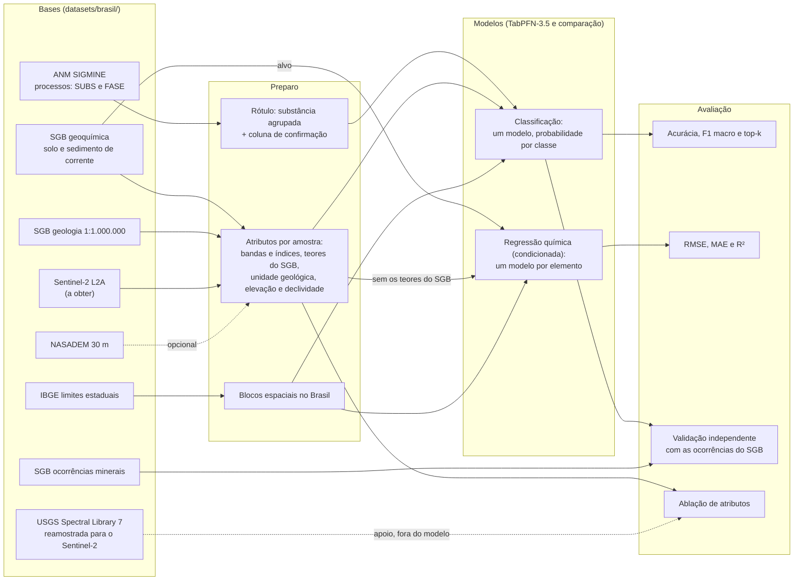

# Fluxo dos dados

Dono do papel de cada base no fluxo dos dados e dos exemplos de tabelas. Mostra como cada base baixada entra no trabalho, segundo as decisões de `docs/decisoes-projeto.md` (D01, D03, D07, D22 a D26). Os valores das tabelas de exemplo são inventados, só para ilustrar.

## Diagrama

- **Linha cheia:** entra no modelo ou na avaliação.
- **Linha tracejada:** uso opcional ou de apoio.
- **Regressão química:** os teores do SGB são o alvo e não entram como atributo, para que o alvo não vaze para a entrada.

## O que cada base faz

| Base | Papel | Observação |
| --- | --- | --- |
| ANM SIGMINE | Rótulo da classificação (`SUBS`) | `FASE` vira a coluna de confirmação (D26) |
| SGB ocorrências | Validação independente | Observações de campo, independentes dos processos |
| SGB geoquímica | Atributo de entrada e alvo da regressão condicionada | O teor de cada amostra vem do ponto mais próximo ou de interpolação; o método muda entre lotes (pendência 2 do registro) |
| SGB geologia 1:1.000.000 | Atributo (unidade geológica) | Escala uniforme no país (pendência 2 do registro) |
| Sentinel-2 L2A | Atributo principal (reflectância) | Ainda a obter (D04) |
| NASADEM | Atributo opcional da ablação (elevação e declividade) | Pode virar atalho de localização (D22) |
| IBGE limites | Recorte do Brasil e blocos espaciais | — |
| USGS Spectral Library 7 | Apoio, fora do modelo (D03) | Usos em `docs/dados/dataset-brasil.md` |

## Exemplo: classificação com mais de um minério

### Dados de treino

Cada linha é um local. O local C tem ferro e manganês e entra duas vezes, com os mesmos atributos e um rótulo diferente em cada linha.

| Local | B4 (vermelho) | B8 (infraverm. próximo) | B11 | B12 | Fe no solo (%) | Rótulo |
| --- | ---: | ---: | ---: | ---: | ---: | --- |
| A | 0,21 | 0,30 | 0,35 | 0,28 | 12,0 | ferro |
| B | 0,19 | 0,28 | 0,33 | 0,27 | 10,5 | ferro |
| C | 0,18 | 0,26 | 0,31 | 0,25 | 9,8 | ferro |
| C | 0,18 | 0,26 | 0,31 | 0,25 | 9,8 | manganês |
| D | 0,12 | 0,22 | 0,27 | 0,22 | 3,1 | ouro |
| E | 0,10 | 0,20 | 0,24 | 0,20 | 2,5 | cobre |

### Saída do modelo para locais novos

O TabPFN devolve uma probabilidade para cada classe.

| Local novo | Ferro | Manganês | Ouro | Cobre | 1ª mais provável | 2ª mais provável |
| --- | ---: | ---: | ---: | ---: | --- | --- |
| X | 0,48 | 0,37 | 0,10 | 0,05 | ferro | manganês |
| Y | 0,05 | 0,03 | 0,82 | 0,10 | ouro | cobre |
| Z | 0,20 | 0,05 | 0,40 | 0,35 | ouro | cobre |

- **X:** duas classes altas e próximas; o modelo indica ferro e manganês.
- **Y:** uma classe domina; provavelmente só ouro.
- **Z:** o modelo está indeciso entre ouro e cobre, o que indica incerteza alta.

### Avaliação

| Local de teste | Substâncias reais | 1ª prevista | Acertou a 1ª? | Reais entre as 2 primeiras? |
| --- | --- | --- | --- | --- |
| X | ferro, manganês | ferro | sim | 2 de 2 |
| Y | ouro | ouro | sim | 1 de 1 |
| Z | cobre | ouro | não | 1 de 1 (cobre é a 2ª) |

- **Acurácia (top-1):** 2 de 3.
- **Top-2:** todas as substâncias reais estão entre as 2 mais prováveis. Mede a capacidade de indicar mais de um minério.

### Classes com poucos exemplos

As classes raras ficam no mesmo modelo, que aproveita todos os dados. Se ainda faltar exemplo, elas são agrupadas (D24, D25). O mapeamento abaixo é hipotético; o agrupamento real está em `docs/proposta-sinonimos-subs.md` e ainda será revisto.

| Substância original | Classe no modelo |
| --- | --- |
| substância rara 1, substância rara 2 | grupo de raras |
| ferro | ferro |
| ouro | ouro |

## Exemplo: predição química

Cada amostra do SGB traz todos os elementos medidos juntos.

| Amostra | B4 | B8 | B11 | B12 | Fe (%) | Mn (ppm) | Cu (ppm) | Ce (ppm) |
| --- | ---: | ---: | ---: | ---: | ---: | ---: | ---: | ---: |
| S1 | 0,21 | 0,30 | 0,35 | 0,28 | 12,0 | 850 | 30 | 95 |
| S2 | 0,12 | 0,22 | 0,27 | 0,22 | 3,1 | 210 | 75 | 40 |

- Há um modelo para Fe, outro para Mn, outro para Cu, e assim por diante. Todos usam as mesmas amostras, então nenhum elemento tem menos dados que outro.
- O resultado é um teor previsto para cada elemento no local novo.
- A classificação diz quais substâncias são mais prováveis; a química diz quanto de cada elemento se espera.
