Xin Luo$^{a, b}$, Xinghua Ci$^{c}$, Jianmeng Sun$^{a, b}$, Chengyu Dan$^{d}$, Peng Chi$^{a, b}$, Ruikang Cui$^{a, b}$

## Highlights

- Core data augmentation primarily addresses core data scarcity issues.
- Core data augmentation combines retrieval-based and generative-based methods.
- Core data augmentation enhances complex reservoir parameter prediction.

## Abstract

Machine learning models that rely on core data as dataset labels have become a mainstream method for predicting reservoir parameters. However, the high costs and insufficient spatial sampling density associated with core data acquisition often result in weak nonlinear representation, poor generalization ability, and overfitting in these models. To address limited core data challenges, we propose a reliability analysis-driven workflow that optimally selects multiple core data augmentation (CDA) methods to enhance reservoir parameter prediction. This workflow achieves two primary advancements: Firstly, it mitigates data scarcity by treating core data as a minority class and applying diverse tabular data augmentation techniques to generate and rigorously evaluate reliable synthetic data. This effectively expands the useable core dataset. Secondly, leveraging this augmented data, the workflow integrates machine learning with pre-trained language models (PLMs) to develop and apply multiple combinations of augmentation-prediction models for both lithology classification and physical property parameter prediction. Field data applications demonstrate that the combination of Tabular Denoising Diffusion Probabilistic Model (TabDDPM) and Tabular Prior Data Fitting Network (TabPFN) in CDA achieves outstanding performance in evaluation metrics and case studies for lithology classification and petrophysical parameter prediction. This study provides a reproducible framework for enhancing small-sample reservoir parameter prediction in oil and gas exploration, proving that synthetic data augmentation can effectively mitigate data scarcity and open new pathways for geophysical data analysis.

## Keywords

Core data augmentation; Reservoir parameter prediction; Ensemble machine learning; Pre-trained language model

## Nomenclature

- **CDA** = Core data augmentation
- **EML** = Ensemble machine learning
- **PLM** = Pre-trained language model
- **RF** = Random forest
- **XGB** = Extreme Gradient Boosting
- **LGB** = Light Gradient Boosting
- **CTGAN** = Conditional Tabular generative adversarial network
- **TVAE** = Tubular Variational Autoencoder
- **DeltaTVAE** = Tubular Variational Auto Encoder via Delta
- **TabDDPM** = Tubular Denoising Diffusion Probabilistic Models
- **TabPFN** = Tabular Prior-data Fitted Network
- **TabPFGen** = Tabular Data Generation with TabPFN
- **SGLD** = Stochastic Gradient Langevin Dynamics
- **GReaT** = Generation of realistic tabular data
- **ACC** = Accuracy classification score
- **F1** = F1-score
- **AUC** = Area Under Curve
- **$R^{2}$** = Coefficient of determination
- **CVRMSE** = Coefficient of Variation of Root Mean Square Error
- **BA** = Balanced Accuracy
- **AP** = Average Precision score
- **SP** = Spontaneous Potential
- **AC** = Acoustic
- **CNL** = Compensated Neutron Log
- **CAL** = Caliper
- **GR** = Gamma Ray
- **SP** = Spontaneous Potential
- **PE** = Photoelectric factor
- **AT90** = 90-inch Array Induction
- **R25** = 25-inch Resistivity
- **RMG** = Microresistivity
- **RT** = True Formation Resistivity

## 1. Introduction

Reservoir parameters prediction is crucial for the exploration and development of oil and gas resources, as it directly impacts reservoir description, reserve estimation, and the optimization of development strategies ([Bao et al., 2023](https://www.sciencedirect.com/science/article/pii/S0264817225003228#bib4); [Li et al., 2022a](https://www.sciencedirect.com/science/article/pii/S0264817225003228#bib35); [Mishra et al., 2022](https://www.sciencedirect.com/science/article/pii/S0264817225003228#bib44); [Wang et al., 2022b](https://www.sciencedirect.com/science/article/pii/S0264817225003228#bib60)). Traditional approaches, which commonly depend on well logging interpretation models and rock physics experiments, are often constrained by the heterogeneity of geological formations and the complexity of downhole conditions. Consequently, these methods are limited in their ability to accurately predict complex reservoir parameters ([Prankada et al., 2021](https://www.sciencedirect.com/science/article/pii/S0264817225003228#bib50); [Song et al., 2022](https://www.sciencedirect.com/science/article/pii/S0264817225003228#bib54)). In recent years, machine learning techniques, support vector machines, and deep learning, have shown significant promise in lithology classification, porosity prediction, and permeability prediction ([Ali et al., 2023](https://www.sciencedirect.com/science/article/pii/S0264817225003228#bib3); [Yang et al., 2023](https://www.sciencedirect.com/science/article/pii/S0264817225003228#bib68)). Their strong nonlinear modeling capabilities have made them increasingly important for intelligent reservoir evaluation ([Mehrabi et al., 2024](https://www.sciencedirect.com/science/article/pii/S0264817225003228#bib42); [Wood, 2023](https://www.sciencedirect.com/science/article/pii/S0264817225003228#bib63)). Deep learning models, in particular, have been widely adopted by researchers for various reservoir evaluation tasks due to their superior nonlinear capabilities ([Xu et al., 2021](https://www.sciencedirect.com/science/article/pii/S0264817225003228#bib66)). For instance, convolutional neural networks can be used for automatic lithology stratification through feature extraction from logging curves ([Matinkia et al., 2022](https://www.sciencedirect.com/science/article/pii/S0264817225003228#bib41); [Mousavi and Hosseini-Nasab, 2024a](https://www.sciencedirect.com/science/article/pii/S0264817225003228#bib46)). Ensemble learning algorithms enhance the accuracy of porosity prediction by integrating multi-source data ([Pan et al., 2023](https://www.sciencedirect.com/science/article/pii/S0264817225003228#bib49)). Additionally, the application of Long Short-Term Memory (LSTM) networks in the analysis of time-series production data has further advanced dynamic reservoir evaluation ([Chen et al., 2020](https://www.sciencedirect.com/science/article/pii/S0264817225003228#bib13)).

As intelligent reservoir evaluation progresses, researchers have found that Ensemble Machine Learning (EML) outperforms deep learning models with more layers. This is especially true when tackling classic reservoir evaluation tasks, which mainly involve tabular data. EML models have lower training costs and perform better on such data. This is because their inductive bias aligns well with the characteristics of tabular data ([Kumari et al., 2023](https://www.sciencedirect.com/science/article/pii/S0264817225003228#bib32); [Shin et al., 2023](https://www.sciencedirect.com/science/article/pii/S0264817225003228#bib52)). Specifically, EML models excel at fitting irregular target functions through hierarchical feature splitting. In contrast, neural networks, which tend to learn smooth functions, often struggle with complex patterns. EML models also rely on feature importance ranking, which allows them to filter out noise and redundant features effectively ([Han et al., 2023](https://www.sciencedirect.com/science/article/pii/S0264817225003228#bib21)). Neural networks, however, require additional learning of feature directions due to rotation invariance and are more susceptible to interference in high-noise scenarios ([Liu et al., 2025](https://www.sciencedirect.com/science/article/pii/S0264817225003228#bib39)). Additionally, the feature directions of tabular data are crucial for prediction. EML models directly handle raw features, while the rotation invariance of neural networks can disrupt this natural basis information, leading to performance degradation. Moreover, the zero-shot learning capability of Pre-trained language models (PLMs) offers new opportunities for tabular data modeling ([Singh et al., 2024](https://www.sciencedirect.com/science/article/pii/S0264817225003228#bib53)).

Core data, which serves as a reliable benchmark for reservoir parameter calibration, is often scarce due to the high costs associated with coring operations and laboratory analyses. While EML models and PLMs have reduced the training data requirements, the limited availability of core data remains insufficient for optimal reservoir modeling. Concurrently, the scarcity of data can induce a phenomenon akin to local optimality within the model. Moreover, the greater the degree of stratal heterogeneity, the more pronounced this phenomenon becomes ([Adim et al., 2018](https://www.sciencedirect.com/science/article/pii/S0264817225003228#bib1)). Data augmentation techniques provide a potential solution to this challenge. Commonly used in image classification, segmentation, and object detection, data augmentation involves basic transformations such as rotation, flipping, and noise addition to expand the dataset ([Bosquet et al., 2023](https://www.sciencedirect.com/science/article/pii/S0264817225003228#bib8); [Li et al., 2022b](https://www.sciencedirect.com/science/article/pii/S0264817225003228#bib36)). However, core data is typically structured as tabular data, which complicates augmentation efforts. In well logging, studies have attempted to augment datasets by adding Gaussian noise ([Bayer et al., 2023](https://www.sciencedirect.com/science/article/pii/S0264817225003228#bib5)) and applying spatiotemporal interpolation ([Goceri, 2023](https://www.sciencedirect.com/science/article/pii/S0264817225003228#bib18); [Su et al., 2024](https://www.sciencedirect.com/science/article/pii/S0264817225003228#bib55)). Yet, these methods still face significant limitations when dealing with high-dimensional, nonlinearly correlated core data, particularly in preserving geological statistical characteristics and physical constraints.

Although the Synthetic Minority Over-sampling Technique (SMOTE) has been applied to increase the number of core data labels for predicting physical properties, current studies lack comparative analysis and reliability assessments of different tabular data augmentation algorithms on core data. In this work, we propose a core data augmentation (CDA) workflow for reservoir parameters prediction to enhance lithology classification and physical property prediction in complex sandstone reservoirs ([Fig. 1](assets/figura-1.jpg)). The workflow begins with data preprocessing, including outlier removal and core depth calibration, to ensure the initial quality of the dataset. The core part of the workflow is data augmentation, where we use tabular data augmentation methods to generate synthetic data and validate their rationality. Then, we employ different CDAs to enhance the accuracy of various reservoir parameter prediction tasks. The outline is as follows: In the Methods section, we describe the proposed workflow and briefly explain the principles of the models and methods used. In the case study section, we apply the workflow to logging and core experimental data obtained from the X Sag sandstone reservoir for lithology classification and physical property prediction.

[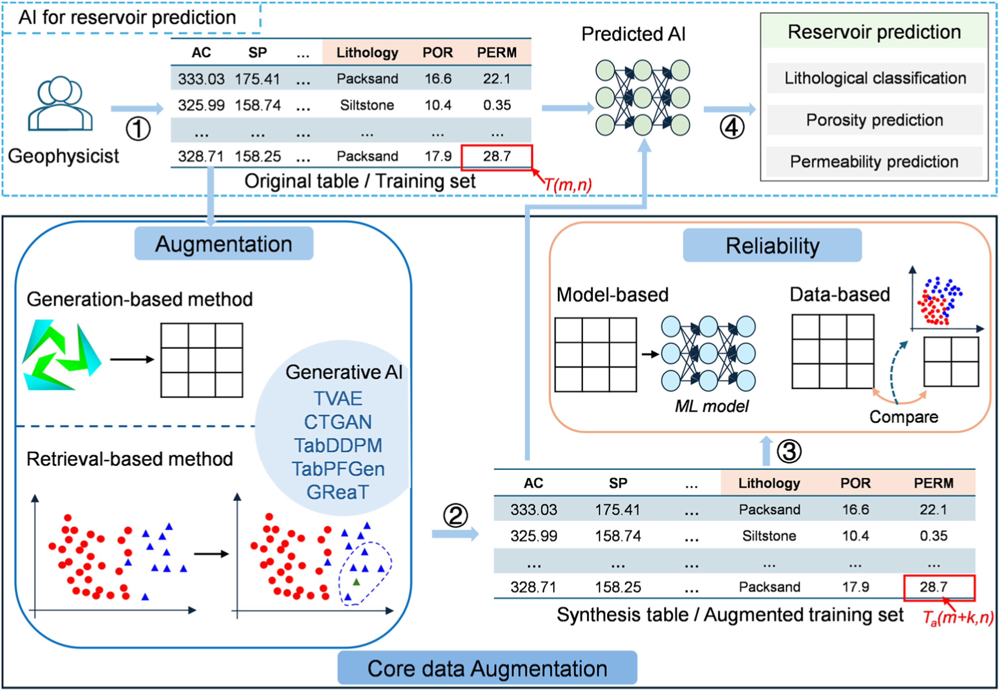](https://ars.els-cdn.com/content/image/1-s2.0-S0264817225003228-gr1_lrg.jpg)

Fig. 1. Workflow of enhancing reservoir parameter prediction employing CDA. Geophysicists match the preprocessed core tabular data with logging data based on depth, obtaining the original tabular data labeled with lithology, porosity, and permeability. The original tabular data are processed using retrieval-based and generative-based tabular data augmentation methods to generate synthetic tabular data. The synthetic tabular data are subjected to reliability analysis. The synthetic tabular data are merged with the original tabular data and used for predictive AI training, resulting in inference outcomes for three distinct tasks: lithology classification, porosity prediction, and permeability prediction.

Compared to studies that only use methods like SMOTE and CTGAN to enhance petrophysical experimental data ([Min et al., 2024](https://www.sciencedirect.com/science/article/pii/S0264817225003228#bib43); [Zheng et al., 2022](https://www.sciencedirect.com/science/article/pii/S0264817225003228#bib73)), our work provides a more comprehensive expansion of research in the CDA field. Additionally, this study is the first to propose a relatively complete reliability analysis approach for CDA, particularly focusing on the feature distribution of synthetic data at different scales. Building on this, our proposed workflow has also been effectively applied to complex sandstone reservoirs (e.g., lithology classification and petrophysical parameter prediction). This research can serve as a reference for future geophysicists facing limited petrophysical experimental data.

## 2. Methodology

### 2.1. Overview of the generation workflow

In this study, our objective is to integrate CDA with ML models and PLM to establish a workflow for reservoir parameter prediction, which consists of the following main steps ([Fig. 1](assets/figura-1.jpg)):

**Data Preprocessing.** Logging data and core experimental results (e.g., lithology, porosity, and permeability) collected from the study area are preprocessed to construct the original dataset.

**CDA.** Enriching core tabular data through diverse tabular data augmentation techniques. Tabular data augmentation methods can be categorized into retrieval-based and generative-based approaches.

**Reliability Analysis.** Two approaches were employed to validate the reliability of CDA: evaluation based on ML efficiency and analysis of feature distribution patterns across varying data scales.

**Reservoir Parameter Prediction Application.** The combined dataset of synthetic and original data is used for specific tasks, including lithology classification, porosity prediction, and permeability prediction. Traditional methods, MLs, and PLMs are applied to well logs data according to the specific requirements of each application.

### 2.2. Core data augmentation (CDA) method

In this study, core data refer to lithology, porosity, and permeability obtained from rock physics experiments. These data are presented in tabular form and include both text and numerical types. Conducting CDA research can be understood as the selection of data-driven tabular data augmentation methods. Tabular data augmentation methods can be categorized into two types: Retrieval-based methods and Generation-based methods. Historically, tabular data augmentation primarily relied on Retrieval-based methods, such as adding small amounts of Gaussian noise or employing feature perturbation. These methods are suitable for datasets with a larger number of samples.

#### 2.2.1. Retrieval-based methods

However, for core data, which are typically small sample types, adding noise or feature perturbation can alter the data feature distribution. To enhance the reliability of the generated tabular data, the SMOTE algorithm generates new synthetic samples by randomly selecting a neighbor from the k-nearest neighbors of the minority class samples and performing linear interpolation in the feature space between them ([Chawla et al., 2002](https://www.sciencedirect.com/science/article/pii/S0264817225003228#bib10); [Zhao et al., 2021](https://www.sciencedirect.com/science/article/pii/S0264817225003228#bib72)). The SMOTE algorithm fills data in the sparse areas of the minority class samples, helping the model learn more reasonable classification boundaries ([Zheng et al., 2022](https://www.sciencedirect.com/science/article/pii/S0264817225003228#bib73)). The adjustable K value provides flexibility to the SMOTE algorithm ([Wang et al., 2025](https://www.sciencedirect.com/science/article/pii/S0264817225003228#bib61)). SMOTE operates through the following steps: (1) For each sample *x* in the minority class, compute the Euclidean distances to all other minority class samples to identify its *k*-nearest neighbors. (2) Based on the class imbalance ratio, set a sampling proportion to determine the oversampling rate *N*; for each minority sample *x*, randomly select a subset of its *k*-nearest neighbors, denoted as *o*. (3) For each selected neighbor *o*, generate a new synthetic sample $o_{new}$ by interpolating between *x* and *o* using Equation [(1)](https://www.sciencedirect.com/science/article/pii/S0264817225003228#fd1), where *rand* (0, 1) is a random weight in the interval [0, 1]. This approach effectively augments the minority class by creating plausible synthetic instances along the feature space, mitigating class imbalance while preserving data distribution characteristics.

$$
{o}_{new}=o+rand(0,1)\ast |\tilde{o}-o|
\tag{1}
$$

*Rand* (0, 1) is a random weight in the interval [0, 1]. However, SMOTE can cause boundary blurring due to oversampling. Therefore, variants such as the SMOTETomek algorithm have been developed. This algorithm removes noisy samples from the majority class using Tomek Links while optimizing the boundaries between the two classes ([Mousavi and Hosseini-Nasab, 2024b](https://www.sciencedirect.com/science/article/pii/S0264817225003228#bib47)).

#### 2.2.2. Generation-based methods

**Conditional Tabular generative adversarial network (CTGAN).** In response to the complex generation requirements of tabular data, Generation-based methods have shown significant advantages. CTGAN uses the generative adversarial network framework to generate highly realistic and diverse synthetic samples through mode-specific normalization and conditional vector constraints ([Xu et al., 2019](https://www.sciencedirect.com/science/article/pii/S0264817225003228#bib65)). CTGAN leverages Generative Adversarial Networks (GANs) to synthesize tabular data by introducing two key modifications: mode-specific normalization for continuous features and conditional vectors for categorical features. Mode-specific normalization is designed to address the issue where non-Gaussian distributions of continuous features make it difficult for the generator to learn the true distribution ([Adiputra and Wanchai, 2024](https://www.sciencedirect.com/science/article/pii/S0264817225003228#bib2)). This enables subsequent generators to learn multimodal distribution structures and avoid information loss. To solve the problem that random noise inputs cannot control the generation distribution of discrete features, leading to the neglect of minority categories, CTGAN encodes categorical features into conditional vectors during training. It adopts a sampling strategy based on class frequency distribution to mitigate class imbalance. Additionally, CTGAN has improved the loss function by incorporating conditional cross-entropy into the generator's loss function, ensuring generated samples are controlled by conditional categories ([Habibi et al., 2023](https://www.sciencedirect.com/science/article/pii/S0264817225003228#bib20); [Zha et al., 2025](https://www.sciencedirect.com/science/article/pii/S0264817225003228#bib70)). Despite its ability to generate diverse samples, CTGAN suffers from training instability, particularly in high-dimensional settings ([Jiang et al., 2025b](https://www.sciencedirect.com/science/article/pii/S0264817225003228#bib28); [Min et al., 2024](https://www.sciencedirect.com/science/article/pii/S0264817225003228#bib43)).

**Tabular Variational Autoencoder (TVAE).** To further optimize the quality of generation, TVAE is based on the variational autoencoder architecture. It balances generation diversity and distribution fidelity through the reparameterization technique in the latent variable space. Traditional VAEs exhibit unstable latent spaces and tend to ignore categorical information when generating tabular data. To address latent space instability, TVAE introduces dual encoders to learn both stochastic and deterministic representations of the data, thereby improving output stability. Additionally, to prevent minority samples from being overlooked, TVAE incorporates a label constraint mechanism in the loss function, which forces data from different categories to be separated in the latent space ([Inan et al., 2023](https://www.sciencedirect.com/science/article/pii/S0264817225003228#bib25)). During training, TVAE takes input data *X* and uses the dual encoders to represent its fixed latent features. These features are then decoded, and the proximity between the generated data and the original data is calculated. This proximity is measured via the loss function, which in TVAE is enhanced with a unique label constraint compared to traditional VAE models. The loss function converges and updates the decoder's internal parameters, ultimately providing an optimized decoder that outputs $X_{gen}$. In TVAE, both the dual encoders and the decoder are implemented using Multilayer Perceptron (MLP) architectures ([Yadav et al., 2024](https://www.sciencedirect.com/science/article/pii/S0264817225003228#bib67)). However, the synthetic samples generated by TVAE are relatively conservative compared to CTGAN.

**Tabular Denoising Diffusion Probabilistic Models (TabDDPM).** In recent years, TabDDPM, an extension of diffusion models to tabular data, fits the data distribution through a step-by-step denoising process ([Kotelnikov et al., 2023](https://www.sciencedirect.com/science/article/pii/S0264817225003228#bib31)). Its progressive generation mechanism can capture fine-grained feature dependencies, significantly enhancing the authenticity of generated high-dimensional sparse tabular data ([Kinakh and Voloshynovskiy, 2024](https://www.sciencedirect.com/science/article/pii/S0264817225003228#bib30)). For the tabular generation task, TabDDPM introduces significant improvements over DDPM. Tabular data may contain both numerical (continuous) and categorical (discrete) features.

To address categorical features, TabDDPM proposes a multi-category diffusion approach. For continuous numerical features, TabDDPM employs the same Gaussian diffusion process as DDPM. For discrete features such as lithology categories, TabDDPM adopts multinomial diffusion, specifically implemented by repeatedly applying random flipping to transform the one-hot encoded discrete features into a uniform distribution. Notably, TabDDPM's two diffusion mechanisms operate simultaneously. Traditional generative models require separate preprocessing for continuous/discrete features, making it difficult to capture feature dependencies ([Villaizán-Vallelado et al., 2024](https://www.sciencedirect.com/science/article/pii/S0264817225003228#bib57)). TabDDPM's dual-path diffusion mechanism provides a unified approach for handling heterogeneous features, implicitly learning feature interactions through shared neural networks to generate data that better matches the true distribution. Additionally, for tabular data with relatively low information density, TabDDPM uses MLPs instead of Transformer architectures to reduce computational overhead ([Zhang et al., 2023](https://www.sciencedirect.com/science/article/pii/S0264817225003228#bib71)). In summary, through its dual-path diffusion mechanism and lightweight conditional generation architecture, TabDDPM successfully applies diffusion models to tabular data generation, solving the challenge of joint modeling of heterogeneous features.

**Generation of Realistic Tabular (GReaT).** In addition to these methods, several studies on PLMs within the Generation-based methods have demonstrated significant potential for tabular data generation ([Wu et al., 2025](https://www.sciencedirect.com/science/article/pii/S0264817225003228#bib64)). For example, GReaT converts structured tabular data into natural language sequences using a novel text encoding strategy, thereby overcoming the traditional reliance on numerical preprocessing ([Borisov et al., 2023](https://www.sciencedirect.com/science/article/pii/S0264817225003228#bib7)). Building on this approach, a random feature permutation mechanism is introduced to dynamically shuffle the order of features during training, thereby eliminating the interference of fixed list orders. Subsequently, fine-tuning is performed using pre-trained large language models (such as GPT-2), leveraging their context understanding capabilities learned from vast amounts of text to capture the complex logical relationships between tabular features ([Li et al., 2024a](https://www.sciencedirect.com/science/article/pii/S0264817225003228#bib34)).

Ultimately, flexible and controllable tabular data synthesis is achieved through an autoregressive generative model. As shown in [Fig. 2](assets/figura-2.jpg), GReaT can be roughly divided into two stages: fine-tuning and sample generation. In the fine-tuning phase, core data is first converted into sequential text. Then, as indicated in Step 2 of [Fig. 2](assets/figura-2.jpg), the sequential text undergoes shuffled permutation. The purpose of shuffling is to eliminate positional bias of features, enabling the model to learn conditional dependencies in arbitrary orders ([Kwok et al., 2025](https://www.sciencedirect.com/science/article/pii/S0264817225003228#bib33)). In Step 3 of [Fig. 2](assets/figura-2.jpg), the shuffled sequences are tokenized and fed into a pre-trained large language model (LLM) to achieve fine-tuning. The fine-tuning approach employs autoregressive prediction of the next token, where the loss function between predicted and actual tokens guides the entire fine-tuning process ([Gulati and Roysdon, 2023](https://www.sciencedirect.com/science/article/pii/S0264817225003228#bib19)). During sample generation, randomly fragmented text sequences are tokenized and input into the fine-tuned and parameter-frozen LLM (Step 4 in [Fig. 2](assets/figura-2.jpg)b). After processing by the de-tokenizer, complete synthetic text sequences are generated, which are then deserialized into new tabular synthetic core data ([Jia et al., 2024](https://www.sciencedirect.com/science/article/pii/S0264817225003228#bib26)).

[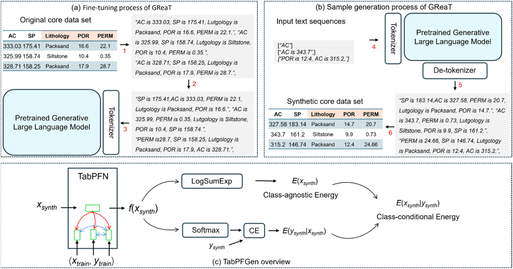](https://ars.els-cdn.com/content/image/1-s2.0-S0264817225003228-gr2_lrg.jpg)

Fig. 2. The workflow of the GReaT and TabPFGen. (LogSumExp is used to construct class-agnostic energy. Softmax converts the results into a probability distribution.)

**Tabular Prior-data Fitted Network Generation (TabPFGen).** TabPFGen contributes by transforming a discriminative model into a generative one ([Jiang et al., 2025a](https://www.sciencedirect.com/science/article/pii/S0264817225003228#bib27)). It achieves high-quality tabular data generation using energy functions and Stochastic Gradient Langevin Dynamics (SGLD) sampling ([Welling and Teh, 2011](https://www.sciencedirect.com/science/article/pii/S0264817225003228#bib62)), while retaining the efficiency and training-free advantages of TabPFN ([Ma et al., 2024](https://www.sciencedirect.com/science/article/pii/S0264817225003228#bib40)). The key steps of TabPFGen can be divided into three parts.

1) Energy calculation. First, the original core samples are divided into ($x_{train}$, $y_{train}$) according to the task type. Synthetic data is then generated from the unlabeled raw samples $x_{train}$ by adding Gaussian noise, as shown in the following formula:

   $$
   {x}_{synth}^{0}={x}_{train}+\mathcal{N}(0,0.01I)
   \tag{2}
   $$

   ϵ denotes Gaussian distributed noise. Next, the class-conditional energy function is defined as follows:

   $$
   E({x}_{synth}^{0}|{y}_{synth})=-f({x}_{synth}^{0}) [{y}_{synth}]
   \tag{3}
   $$

   In Equation [(3)](https://www.sciencedirect.com/science/article/pii/S0264817225003228#fd3), $f({x}_{synth}^{0})$ is the logits output of TabPFN, and [$y_{synth}$] denotes the index of $y_{synth}$ ([Liu and Ye, 2025](https://www.sciencedirect.com/science/article/pii/S0264817225003228#bib38)). During iterative updates, the generation process of ${x}_{synth}^{t}$ at the *t*-th step is as follows

   $$
   E({x}_{synth}^{t}|{y}_{synth})=-f({x}_{synth}^{t}) [{y}_{synth}]
   \tag{4}
   $$

   During the iterative process, lower energy values indicate that the synthetic data ${x}_{synth}^{t}$ better matches the distribution characteristics of the target label $y_{synth}$.

2) Gradient Computation. The class-conditional energy minimization is governed by a loss function. As illustrated in [Fig. 2](assets/figura-2.jpg)c, TabPFGen utilizes the cross-entropy (CE) function as its loss metric ([Ye et al., 2025](https://www.sciencedirect.com/science/article/pii/S0264817225003228#bib69)). The energy gradients are computed via backpropagation of the CE function, with the detailed implementation procedure described below:

   $$
   \nabla x=\frac{\partial E}{\partial {x}_{synth}^{t}}
   \tag{5}
   $$

3) SGLD Sampling. The synthetic data sample at the (t+1)-th iteration is obtained through SGLD sampling, with the sampling procedure described by the following equation:

   $$
   {x}_{synth}^{t+1}={x}_{synth}^{t}-\alpha \cdot \nabla x+\sigma \cdot \mathcal{N}(0,I)
   \tag{6}
   $$

   σ represents the noise coefficient. $\mathcal{N}$ (0, *I*) indicates Gaussian noise with zero mean and identity covariance matrix *I*. As the energy gradient decreases, the synthetic data is driven toward the target distribution ([Ma et al., 2024](https://www.sciencedirect.com/science/article/pii/S0264817225003228#bib40)). The iterative process terminates when *t* = *η*, at which point TabPFGen outputs the final synthetic data ${x}_{synth}^{\eta }$.

### 2.3. Reservoir parameter prediction model

#### 2.3.1. EML model

For modeling optimization of small-sample tabular datasets like core data, two key approaches can break through sample size limitations: model selection and ensemble strategies, both requiring preservation of original data attributes. For small-sample-adapted model selection, Support Vector Machines (SVM) are a preferred choice to enhance baseline accuracy. This is because SVM, based on VC dimension theory and structural risk minimization principles, effectively balances model complexity and empirical risk, significantly reducing overfitting risks in small-sample scenarios ([Hearst et al., 1998](https://www.sciencedirect.com/science/article/pii/S0264817225003228#bib22); [Moosavi et al., 2024](https://www.sciencedirect.com/science/article/pii/S0264817225003228#bib45)). However, to comprehensively improve core data modeling performance, widely used ensemble learning methods should also be considered.

The Ensemble Machine Learning (EML) framework integrates multiple weak learners through heterogeneous ensemble strategies, including bagging, boosting, and stacking, thereby achieving predictive performance that exceeds that of individual base models. As a classic example of bagging, the random forest (RF) integrates decorrelated Classification and Regression Trees (CART) as base learners ([Tabasi et al., 2022](https://www.sciencedirect.com/science/article/pii/S0264817225003228#bib56)). Its intrinsic randomness arises from a dual randomization mechanism: (1) perturbing the training data via bootstrap sampling; (2) perturbing attributes via random feature subspace selection. By training diverse base models on differentiated sample-feature subsets, RF aggregates prediction results through majority voting (for classification) or arithmetic averaging (for regression), thereby enhancing generalization by reducing variance.

Unlike bagging, which constructs learners independently, EML methods integrate diverse base predictors through a coordinated integration mechanism, including bootstrap aggregation, residual-driven sequential boosting, and meta-learner orchestration, thereby overcoming the performance limitations of individual models. Within this framework, RF implements bootstrap aggregation through a dual randomization process: introducing instance selection based on bootstrapping (to induce data variability) and random feature subspace sampling during tree growth ([Feng et al., 2021](https://www.sciencedirect.com/science/article/pii/S0264817225003228#bib16)). This dual randomization protocol ensures model diversity, ultimately generating predictions through consensus aggregation (for classification) or expectation approximation (for regression), effectively reducing overfitting risk by suppressing variance.

Unlike parallel ensemble construction, the gradient boosting framework adopts a cascaded predictor sequence architecture, with each subsequent learner focusing on correcting the residual errors from the previous stage ([Elith et al., 2008](https://www.sciencedirect.com/science/article/pii/S0264817225003228#bib14)). The evolution of gradient boosting trees has set computational benchmarks through architectural innovations such as Extreme Gradient Boosting (XGB) and Light Gradient Boosting (LGB). XGB employs a tree-splitting strategy based on the Hessian matrix, combined with regularization constraints and a distributed computing paradigm to prevent model degradation ([Bione et al., 2024](https://www.sciencedirect.com/science/article/pii/S0264817225003228#bib6); [Chen et al., 2024a](https://www.sciencedirect.com/science/article/pii/S0264817225003228#bib11)). LGB optimizes the growth process through leaf-wise expansion and feature bundling heuristic algorithms ([Esfandi et al., 2024](https://www.sciencedirect.com/science/article/pii/S0264817225003228#bib15)). The preeminent status of EML in tabular data analysis stems from its ability to model diverse nonlinear interactions and robust operation—both of which are crucial for geoscience applications with heterogeneous feature spaces ([Ganaie et al., 2022](https://www.sciencedirect.com/science/article/pii/S0264817225003228#bib17)).

#### 2.3.2. Pre-trained language model (PLM)

Prior research has shown that ML outperforms deep learning models with more layers in most tabular data tasks. However, PLMs based on prior knowledge have demonstrated potential in classification and regression tasks for tabular data. These PLMs rely solely on prior knowledge, with no involvement of the dataset in training or fine-tuning, limiting their performance to small-sample scenarios. After data augmentation, the number of columns in core tabular data can meet the data volume requirements of PLMs. Therefore, PLMs based on prior knowledge hold potential for exploration in classification and regression tasks for core tabular data.

In this study, we employ the TabPFN model to implement classification and regression tasks for core tabular data, corresponding to lithology classification and physical property prediction in reservoir evaluation applications ([Hollmann et al., 2025](https://www.sciencedirect.com/science/article/pii/S0264817225003228#bib23)). The working principle of TabPFN involves leveraging pre-trained prior knowledge and efficient inference mechanisms, addressing the challenges of training efficiency and generalization in small-sample scenarios for tabular data. TabPFN utilizes contextual learning to train a Transformer model on a large-scale tabular dataset, enabling the model to utilize pre-trained prior knowledge and combine it with a small amount of new task data (without additional training) to directly perform classification and regression ([Ruiz-Villafranca et al., 2025](https://www.sciencedirect.com/science/article/pii/S0264817225003228#bib51)).

## 3. Core data augmentation (CDA) experiment

### 3.1. Collection and design of core data sets

**Regional Overview.** The Bohai Bay Basin, a Cenozoic rift basin, has undergone multiple tectonic movements, leading to the formation of several depressions and uplifts ([Wang et al., 2024](https://www.sciencedirect.com/science/article/pii/S0264817225003228#bib58)). It is China's largest crude oil production base ([Fig. 3](assets/figura-3.jpg)a). The X Sag, situated in the western part of the Bohai Bay Basin, lies structurally between the Taihang Mountain Uplift and the Gaoyang Low Uplift ([Chen et al., 2024b](https://www.sciencedirect.com/science/article/pii/S0264817225003228#bib12)). Its northern and southern boundaries are delineated by two major transverse faults: the Wuji North Fault and the Heilongkou Fault. The depression spans an area of approximately 4000 $km^{2}$ ([Fig. 3](assets/figura-3.jpg)b).

[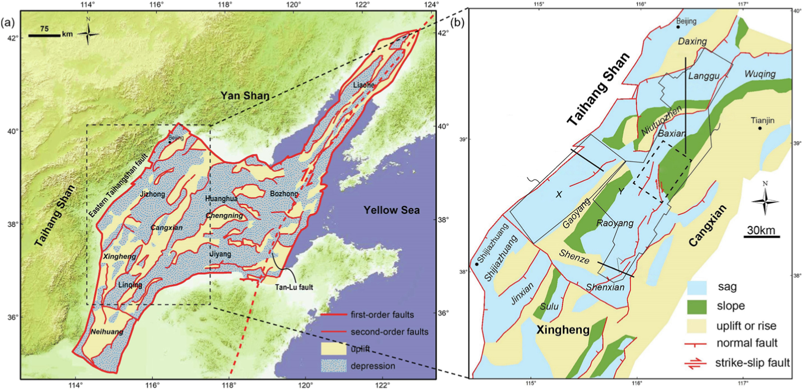](https://ars.els-cdn.com/content/image/1-s2.0-S0264817225003228-gr3_lrg.jpg)

Fig. 3. The location of the Bohai Bay Basin and the X Sag.

The Dongying Formation within the X Sag is characterized by relatively shallow hydrocarbon burial depths, averaging 1600 m ([Li et al., 2024b](https://www.sciencedirect.com/science/article/pii/S0264817225003228#bib37)). This formation can be stratigraphically divided from top to bottom into the Dongyi I, Dongyi II, and Dongyi III segments. The Dongyi I segment, the primary oil-bearing stratum in the study area, predominantly comprises mudstone, fine-grained sandstone, and siltstone ([Wang et al., 2022a](https://www.sciencedirect.com/science/article/pii/S0264817225003228#bib59)). The lithological profile features thick mudstone layers interbedded with thin sandstone layers, and in some areas, thin interlayers of sand and mudstone are present. These characteristics challenge traditional lithological classification methods. Moreover, low-resistance phenomena observed in some well logging curves introduce errors in traditional methods for calculating porosity and permeability. Some fine-grained sandstones and siltstones exhibit overlapping characteristics on well logs. These phenomena increase geological complexity and pose challenges for lithology classification and petrophysical parameter regression.

**Creation of the dataset.** In this study, core data were collected from wells B1, B2, A1, G1, and G2. The five wells are representative sample wells among the 12 wells deployed in the overall X Sag plan, located in the southeastern part. These five wells were selected as the dataset because they not only have abundant collectable data, but also belong to a relatively complex geological structure. The rapidly varying lithology patterns make lithology classification applications more challenging. The dataset consists of 143 samples, including depth, lithology, porosity, and permeability. Through depth correction processing, we constructed a dataset comprising 143 core samples characterized by 14 petrophysical features. The input variables include 11 well logging measurements: Acoustic (AC), Compensated Neutron Log (CNL), Density (DEN), Caliper (CAL), Gamma Ray (GR), Spontaneous Potential (SP), Photoelectric factor (PE), 90-inch Array Induction (AT90), as well as three resistivity measurements (namely 25-inch Resistivity (R25), Microresistivity (RMG), and True Formation Resistivity (RT)). The corresponding output labels represent lithology classification, porosity, and permeability parameters. The selection of logging features relies on correlation analysis between features and labels. The detailed analysis results are shown in [Appendix A](https://www.sciencedirect.com/science/article/pii/S0264817225003228#appsec3). Given the small size of the dataset, the precision of models for lithology classification, property prediction, and fluid identification is likely to be low. Moreover, the dataset includes only non-mudstone segments, which limits the model's applicability. Despite mudstone's low porosity and permeability, the study area exhibits frequent lithological changes and sand-mudstone interbedding, making well-wide classification and prediction challenging with non-mudstone data alone.

To address these limitations, we augmented the core dataset with typical mudstone data. The logging characteristics of mudstone data are derived from wells B1, B2, A1, G1, and G2, with lithology types determined based on cuttings profiles from these wells. Consequently, we collected a total of 16,794 columns of mudstone logging data. Since the mudstone logging data come from five different wells, it is necessary to perform random uniform sampling by well category, with each sampling round selecting one-tenth of the total data. After random uniform sampling, the mudstone data comprises approximately 1679 columns.

However, relying solely on cuttings logging as the basis may result in a small amount of sandstone logging characteristics being mixed into the mudstone data. To ensure high-quality mudstone logging characteristics, we preprocessed the mudstone logging data using the interquartile range (IQR) outlier detection method ([Appendix B](https://www.sciencedirect.com/science/article/pii/S0264817225003228#appsec4)). After this processing, the mudstone logging data contains only 1172 columns. Subsequently, we assigned very low porosity and permeability values to the mudstone segments. Finally, the logging data of mudstone and the 143-column core data are concatenated along the column direction to form a dataset with dimensions of [1315, 14].

In this study, the dataset includes two primary components. First, core data (as targets) derived from rock physics experiments are aligned with conventional well logging curves through depth matching and correction, yielding core samples with corresponding labels. Second, conventional well logging curves and labels for typical mudstone sections are included, determined by expert analysis of cuttings data and well logging curve morphology, with assigned values for very low porosity and permeability (as targets). The selection of dataset labels varies according to the specific reservoir evaluation task. [Table 1](https://www.sciencedirect.com/science/article/pii/S0264817225003228#tbl1) provides details on dataset partitioning and label selection. As indicated in [Table 1](https://www.sciencedirect.com/science/article/pii/S0264817225003228#tbl1), the number of mudstone samples substantially exceeds that of non-mudstone samples. This imbalance is intentional for two reasons: Certain data augmentation techniques, such as SMOTE and SMOTETomek, are specifically designed to address imbalanced datasets by generating synthetic data for the minority class (non-mudstone sections). Some PLMs require a minimum of thousands of samples to effectively leverage their performance, as insufficient samples can hinder both the utilization of PLMs and the fine-tuning process.

Table 1. Dataset partitioning scheme.

|  | Task Type | Label Type | Label Name | Label Category | Data Distribution |
| --- | --- | --- | --- | --- | --- |
| Lithology Classification | Classification | Discrete Text | Lithology | Fine-grained Sandstone, Siltstone, Mudstone | Non-mudstone samples: 143, Mudstone samples: 1172. |
| Petrophysical Parameter Prediction | Regression | Continuous Numerical | Porosity, Permeability | NA | Non-mudstone samples: 143, Mudstone samples: 1172. |

### 3.2. Preprocessing of core data sets and training of CDA

To perform CDA, the dataset requires further preprocessing. First, lithology types, being discrete text data, are numerically represented via one-hot encoding to enhance model recognition. Second, certain data augmentation models, such as SMOTE and SMOTETomek, necessitate categorical labels. Consequently, lithology categories remain essential as features in the dataset for regression tasks like reservoir parameter prediction. For different task types ([Table 1](https://www.sciencedirect.com/science/article/pii/S0264817225003228#tbl1)), varying degrees of label encoding are required for the class categories. In the petrophysical parameter prediction task (regression), we only need to set mudstone data as the majority class and non-mudstone data as the minority class. This is because the porosity and permeability labels of mudstone samples lack physical significance. This approach allows CDA to focus primarily on generating data for the minority class. For the lithology classification task, class labels require supervised encoding based on lithology types. Overall, mudstone data should still be designated as the majority class, enabling CDA to generate data proportionally according to the sample count distribution.

Category encoding is completed, and the dataset partitioning can now begin. We divide the dataset into training and test sets using a 6:4 ratio scheme. The partitioning is performed through random sampling while maintaining the category proportions. This sampling method helps prevent scenarios where either the training or test set lacks samples from certain minority classes. For this dataset, the 6:4 partitioning scheme ensures effective CDA training while relatively mitigating the issue of insufficient samples from minority classes in the test set. Subsequently, we randomly select a subset of samples from the training set, maintaining category proportions, to create the dataset for tabular data augmentation. This approach effectively ensures that minority class samples are included in the augmented dataset. The specific dataset partitioning details are presented in [Table 2](https://www.sciencedirect.com/science/article/pii/S0264817225003228#tbl2).

$$
\theta =\text{num}(\text{Target}[0]):\text{num}(\text{Target}[1])
\tag{7}
$$

Table 2. Dataset partitioning with CDA.

| Dataset$_{\theta}$ | Train Data$_{\theta}$ | Few Data | Test Data |
| --- | --- | --- | --- |
| [1315,14] | [703,14] | [80,14] | [469,14] |

We use the “Few data” from [Table 2](https://www.sciencedirect.com/science/article/pii/S0264817225003228#tbl2) as the dataset for tabular data augmentation methods and employ nine tabular data augmentation models—Noisy, SMOTE, SMOTETomek, CTGAN, GReaT, TabPFGen, TVAE, DeltaVAE, and TabDDPM—to generate a customized number of synthetic data samples. In this study, the CDA models were trained and inferred on an RTX3060 GPU. The runtime varies significantly across different CDAs, with TabDDPM and PLMs requiring notably longer durations. Detailed model runtimes and training specifics for selected models are provided in [Appendix C](https://www.sciencedirect.com/science/article/pii/S0264817225003228#appsec5).

### 3.3. Reliability analysis

To determine the optimal tabular data augmentation method for core data, we conducted reliability analysis on synthetic data generated by various tabular augmentation models, using an imbalanced binary classification dataset with sandstone as the few-shot class. This analysis encompassed three aspects: machine learning efficiency, the internal feature distribution of the synthetic data, and the feature distribution alignment between synthetic and real data.

#### 3.3.1. Machine learning efficiency

To conduct the performance assessment of machine learning, we required a benchmark model based on EML to provide quantitative results on the quality of synthetic data. We selected XGB as the benchmark model due to its capabilities for both classification and regression tasks; here, we utilized its classification function. The implementation details are as follows: First, we generated multiple training sets with varying amounts of synthetic data and trained XGB classification models on each, resulting in several pre-trained models. Second, we used the unlabeled features from the “Test data” as inputs for these pre-trained models to obtain multiple inference results. Subsequently, we calculated evaluation metrics by comparing these inference results with the labeled part of the “Test data” ([Fig. 4](assets/figura-4.jpg)). The evaluation metrics selected included Accuracy, Precision, F1 score (F1), Area under curve (AUC), and Average Precision (AP).

[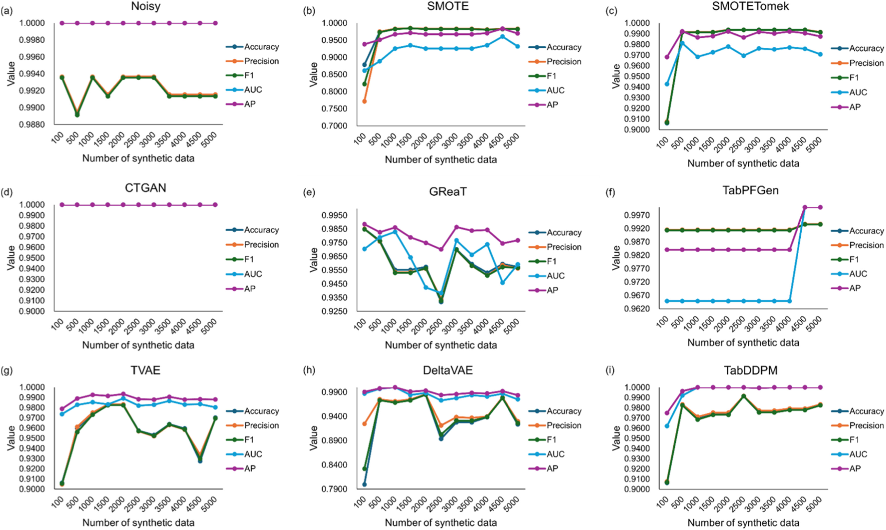](https://ars.els-cdn.com/content/image/1-s2.0-S0264817225003228-gr4_lrg.jpg)

Fig. 4. Comparison of synthetic data quality indicators with different quantities.

The XGB classification models, constructed using synthetic data generated by Noisy, SMOTE, SMOTETomek, CTGAN, GReaT, TabPFGen, TVAE, DeltaVAE, and TabDDPM, achieve high accuracy on the “Test Data” as illustrated ([Fig. 4](assets/figura-4.jpg)). Notably, even when the amount of synthetic data significantly exceeds that of the “Few Data”, these tabular data augmentation models maintain their superior performance. Further analysis of [Fig. 4](assets/figura-4.jpg) reveals that the data quality generated by SMOTE, SMOTETomek, TabPFGen, TVAE, DeltaVAE, and TabDDPM initially increases, then stabilizes after reaching a certain level. This pattern is reasonable. In classification models, small-sample datasets suffer from insufficient samples, which prevents the model from fully demonstrating its performance. As the dataset size increases, the information content becomes richer. However, the representational capacity of these data augmentation algorithms is also constrained by the dataset size. This means that beyond a certain point, generating more synthetic data will not continue to increase the information content—it will instead stabilize. In [Fig. 4](assets/figura-4.jpg), the CTGAN model's results remain close to the peak throughout. This is likely because the inherent feature differences between mudstone and sandstone are already quite significant. Due to its underlying mechanism, CTGAN generates synthetic data in an outward-expanding manner, which further amplifies the feature gap between mudstone and sandstone. Therefore, the reliability of the CDA model requires more intuitive analysis.

#### 3.3.2. Statistical similarity

To intuitively demonstrate the reliability of tabular data augmentation methods, we generated synthetic datasets with the same quantity as the “Few Data” using SMOTE, SMOTETomek, CTGAN, GReaT, TabPFGen, TVAE, DeltaVAE, and TabDDPM. We compared the data distribution patterns and statistical characteristics of different lithologies between the synthetic data and “Few Data” in terms of Spontaneous Potential (SP) and Acoustic (AC) features ([Fig. 5](assets/figura-5.jpg)). The results indicate that the AC characteristics of sandstone and mudstone in both “Few Data” and synthetic data largely overlap, while the SP values of sandstone are generally higher than those of mudstone, with only a small portion of data distribution overlapping. This finding aligns with the logging curve patterns observed in sandstone and mudstone intervals.

[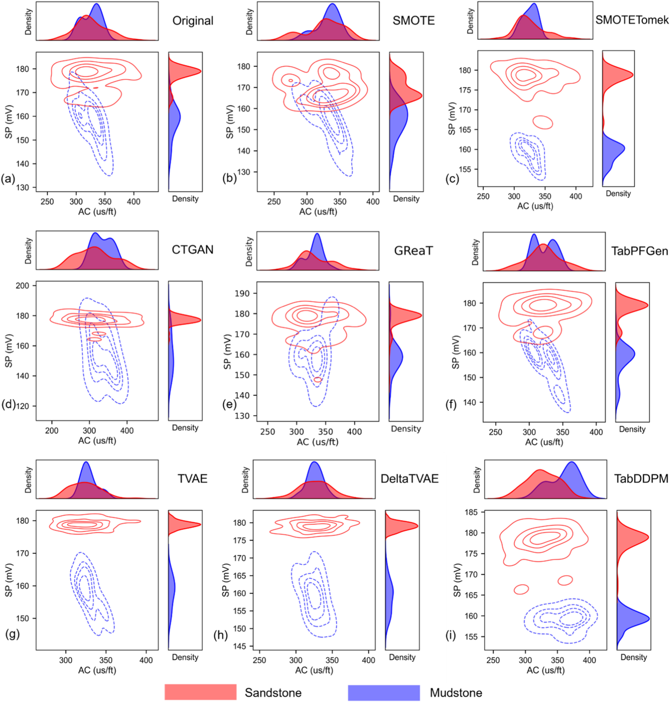](https://ars.els-cdn.com/content/image/1-s2.0-S0264817225003228-gr5_lrg.jpg)

Fig. 5. The lithological feature distribution and statistical patterns of small-scale synthetic data generated by different methods.

Among the methods tested, the SMOTE and SMOTETomek algorithms produced synthetic data that closely matched the original data ([Fig. 5](assets/figura-5.jpg)a–c), highlighting the continued effectiveness of traditional resampling-based algorithms in small-scale data augmentation. The synthetic data generated by TVAE, DeltaVAE, and TabDDPM exhibited completely independent distributions for different lithologies in the SP feature dimension, demonstrating their ability to produce high-quality synthetic data even with limited data. Similarly, TabPFGen, a PLM, achieved a high degree of consistency with the original data, indicating its excellent performance. However, the results from GReaT and CTGAN showed that the SP values of mudstone were higher than those of sandstone, suggesting that the quality of synthetic data generated by these models is not stable in small-scale data generation. Overall, generative methods outperformed traditional resampling-based algorithms and PLM-based data generation techniques in small-scale data augmentation.

The limited quantity of core data falls short of the requirements for few-shot learning. In addition to precision, the diversity of synthetic data must also be considered in CDA research. In our study, we generated synthetic datasets matching the original dataset's size using various tabular data augmentation models. We then visualized the data distribution and statistical patterns of the synthetic data in the acoustic (AC) and spontaneous potential (SP) feature dimensions ([Fig. 6](assets/figura-6.jpg)). Our results indicate that, in large-scale data generation, traditional resampling-based algorithms (Noisy, SMOTE, and SMOTETomek) and Gaussian noise addition methods are significantly less effective than generative data augmentation algorithms and probabilistic language models (PLMs). Specifically, models incorporating probabilistic distribution derivation (TVAE, DeltaVAE, and TabDDPM) exhibit superior data stability compared to GANs ([Fig. 6](assets/figura-6.jpg)d–g-i). While GReaT and TabPFGen demonstrate good performance in synthetic data generation, they remain less effective than purely generative models ([Fig. 6](assets/figura-6.jpg)e–f).

[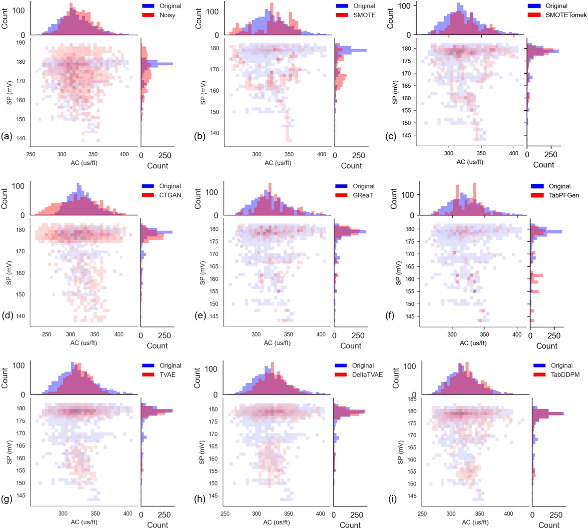](https://ars.els-cdn.com/content/image/1-s2.0-S0264817225003228-gr6_lrg.jpg)

Fig. 6. The data distribution and statistical patterns of large-scale synthetic data generated by different methods.

## 4. Application - reservoir parameter prediction

Following the reliability analysis of CDA methods, we selected TVAE, TabDDPM, GReaT, and TabPFGen as the most suitable methods for the X Sag block. The synthetic data generated by these optimized models, combined with the original core data, constituted the dataset for the application phase. We utilized the classification and regression capabilities of mainstream ML and PLM models to perform lithology classification and reservoir parameter prediction for the Sag block.

### 4.1. Lithology classification

In this study, the dataset is sourced from the X Sag block and comprises three lithologies: siltstone, fine-grained sandstone, and mudstone. Conducting lithology classification thus involves a three-class classification task. The initial analysis of CDA categorized lithologies into only mudstone and sandstone. To refine this approach for lithology classification, we retrained and retested the data augmentation models to distinguish among siltstone, fine-grained sandstone, and mudstone. Notably, mudstone constitutes a significant proportion of the dataset. To enhance model performance during training and testing, we focused on differentiating between siltstone and fine-grained sandstone and reduced the emphasis on mudstone. We redesigned the dataset partitioning scheme to balance the proportions of the three lithologies, thereby improving the robustness of our test results. Specifically, we reduced the number of mudstone samples to half the combined number of fine-grained sandstone and siltstone samples. In addition, siltstone and fine-grained sandstone samples may also suffer from class imbalance issues. We employed the Balanced Accuracy (BA) metric from the Sklearn library ([Brodersen et al., 2010](https://www.sciencedirect.com/science/article/pii/S0264817225003228#bib9)). This metric is specifically designed to evaluate classification model performance, particularly when dealing with imbalanced datasets. Compared to conventional accuracy, BA demonstrates greater robustness in such scenarios ([Kelleher et al., 2020](https://www.sciencedirect.com/science/article/pii/S0264817225003228#bib29)).

After processing the dataset, we generated a series of synthetic data of various scales using data augmentation methods. Classification models were then established using RF, XGB, LGB, and TabPFN on these synthetic datasets. The selected model metrics included BA, F1, and AUC, which are commonly used for evaluating classification performance. The training and testing results are presented in [Table 3](https://www.sciencedirect.com/science/article/pii/S0264817225003228#tbl3). The results demonstrate that pairwise combinations of multiple CDAs (SMOTE, SMOTETomek, CTGAN, GReaT, TabpfGen, TVAE, DeltaVAE and TabDDPM) with MLs (SVM, RF, XGB, LGB, and TabPFN) yield consistent improvements in BA, F1, and AUC compared to single ensemble models. Furthermore, the combination of TabDDPM and TabPFN achieves the best performance.

Table 3. Performance comparison experiment of lithology classification models. (Dataset scales are unified to 3000 columns. The experimental results are the means of five trials with different random seeds).

|  | Metric | Original | SMOTE | SMOTETomek | CTGAN | GReaT | TabPFGen | TVAE | DeltaVAE | TabDDPM |
| --- | --- | --- | --- | --- | --- | --- | --- | --- | --- | --- |
| SVM | BA | 0.761 | 0.812 | 0.825 | 0.837 | 0.842 | 0.845 | 0.862 | 0.851 | 0.866 |
| SVM | F1 | 0.775 | 0.832 | 0.839 | 0.842 | 0.858 | 0.852 | 0.871 | 0.864 | 0.879 |
| SVM | AUC | 0.782 | 0.829 | 0.834 | 0.833 | 0.85 | 0.862 | 0.872 | 0.855 | 0.877 |
| RF | BA | **0.843** | 0.850 | 0.850 | 0.866 | **0.886** | 0.897 | 0.902 | 0.901 | 0.910 |
| RF | F1 | **0.854** | 0.865 | 0.871 | 0.893 | **0.906** | 0.933 | 0.934 | 0.927 | 0.936 |
| RF | AUC | **0.865** | 0.879 | 0.887 | 0.906 | **0.924** | 0.942 | 0.945 | 0.939 | 0.942 |
| XGB | BA | 0.802 | 0.820 | 0.851 | 0.875 | 0.873 | 0.898 | 0.899 | 0.910 | 0.923 |
| XGB | F1 | 0.805 | 0.842 | 0.874 | 0.897 | 0.891 | 0.921 | 0.914 | 0.909 | 0.941 |
| XGB | AUC | 0.826 | 0.861 | 0.879 | 0.908 | 0.912 | 0.942 | 0.942 | 0.932 | 0.948 |
| LGB | BA | 0.816 | 0.833 | 0.846 | 0.877 | 0.884 | 0.910 | 0.912 | 0.915 | 0.923 |
| LGB | F1 | 0.822 | 0.847 | 0.871 | 0.897 | 0.901 | 0.927 | 0.928 | 0.928 | 0.939 |
| LGB | AUC | 0.837 | 0.864 | 0.887 | 0.908 | 0.913 | 0.946 | 0.943 | 0.943 | 0.942 |
| TabPFN | BA | 0.820 | **0.853** | **0.859** | **0.880** | 0.886 | **0.924** | **0.927** | **0.925** | **0.937** |
| TabPFN | F1 | 0.838 | **0.873** | **0.884** | **0.903** | 0.908 | **0.939** | **0.937** | **0.931** | **0.945** |
| TabPFN | AUC | 0.862 | **0.881** | **0.887** | **0.909** | 0.915 | **0.947** | **0.945** | **0.943** | **0.95** |

As shown in [Table 3](https://www.sciencedirect.com/science/article/pii/S0264817225003228#tbl3), RF, SMOTE-TabPFN, SMOTETomek-TabPFN, CTGAN-TabPFN, GReaT-RF, TabPFGen-TabPFN, TVAE-TabPFN, and TabDDPM-TabPFN each achieved their respective single-column optima. To better demonstrate the application effects, we used well A1's logging data from 1440m to 1680m depth as the test set, applied the aforementioned CDA-ML combinations for inference, and visualized the results ([Fig. 7](assets/figura-7.jpg)). By referencing the SP logging curve and the lithological profile, the TabDDPM-TabPFN model achieved the most accurate lithology identification compared to other models, as illustrated in [Fig. 7](assets/figura-7.jpg).

[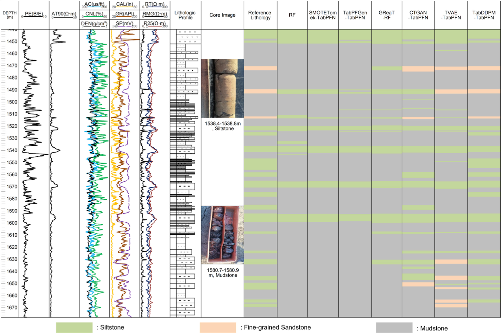](https://ars.els-cdn.com/content/image/1-s2.0-S0264817225003228-gr7_lrg.jpg)

Fig. 7. Lithology classification results of Well A1 under different model combinations. The lithological profile combined with SP curves is used as the reference standard.

### 4.2. Physical property parameter prediction

**Porosity Prediction.** In this application experiment, porosity serves as a representative example for predicting reservoir parameters. We generated synthetic data of various scales using multiple CDA techniques. These synthetic datasets, along with all collected original data, were used to form the dataset for porosity prediction. We employed mainstream ML algorithms and tabular PLM with regression capabilities to predict continuous porosity curves. It is noteworthy that the dataset with added mudstone samples shows significant differences, specifically manifested as large variance in porosity labels. In such cases, evaluation metrics suitable for imbalanced data regression tasks should be selected. For reservoir parameter prediction, we adopted the Coefficient of Variation of Root Mean Square Error (CVRMSE) metric. This metric eliminates the influence of data scale by dividing RMSE by the mean of observed values, thereby providing a relative error measure. Its core function is to address the comparability of model errors across datasets with different magnitudes ([Palaić et al., 2023](https://www.sciencedirect.com/science/article/pii/S0264817225003228#bib48)). In addition, the correlation coefficient, as a typical evaluation metric for regression tasks, was also adopted.

To evaluate the performance of these models, we conducted comparative experiments on $R^{2}$ and CVRMSE for RF, XGB, LGB, and TabPFN across different datasets composed of synthetic data ([Table 4](https://www.sciencedirect.com/science/article/pii/S0264817225003228#tbl4)). The results show that compared to porosity prediction without data augmentation, various combinations of CDA and ML models achieve different levels of accuracy improvement. Among them, the TabDDPM-TabPFN model yields the highest porosity prediction accuracy.

Table 4. Performance comparison experiment of porosity prediction models. 1) For statistical standards, the synthetic data volume is set to 2000 columns. 2) The results are derived from the averages of five trials with different random seeds. 3) The $R^{2}$ and CVRMSE both range from 0 to 1. A higher $R^{2}$ value (approaching 1) indicates better prediction accuracy, while a lower CVRMSE value (approaching 0) corresponds to smaller relative errors in the predictive model.

|  | Metric | Original | SMOTE | SMOTETomek | CTGAN | GReaT | TabPFGen | TVAE | DeltaVAE | TabDDPM |
| --- | --- | --- | --- | --- | --- | --- | --- | --- | --- | --- |
| SVM | $R^{2}$ | 0.827 | 0.83 | 0.832 | 0.839 | 0.852 | 0.895 | 0.867 | 0.872 | 0.903 |
| SVM | CVRMSE | 0.364 | 0.334 | 0.331 | 0.325 | 0.315 | 0.286 | 0.294 | 0.289 | 0.271 |
| RF | $R^{2}$ | 0.882 | 0.893 | 0.894 | 0.896 | 0.909 | 0.925 | 0.936 | 0.932 | 0.949 |
| RF | CVRMSE | 0.295 | 0.249 | 0.245 | 0.251 | 0.177 | 0.167 | 0.174 | 0.177 | 0.155 |
| XGB | $R^{2}$ | 0.872 | 0.903 | 0.894 | 0.895 | 0.902 | 0.927 | 0.937 | 0.935 | 0.943 |
| XGB | CVRMSE | 0.284 | 0.258 | 0.252 | 0.261 | 0.196 | 0.164 | 0.172 | 0.188 | 0.171 |
| LGB | $R^{2}$ | 0.877 | 0.897 | 0.901 | 0.892 | 0.901 | 0.941 | 0.938 | 0.932 | 0.942 |
| LGB | CVRMSE | 0.289 | 0.255 | 0.248 | 0.264 | 0.196 | 0.141 | 0.171 | 0.175 | 0.172 |
| TabPFN | $R^{2}$ | 0.874 | 0.905 | 0.902 | 0.899 | 0.905 | 0.95 | 0.951 | 0.944 | **0.957** |
| TabPFN | CVRMSE | 0.263 | 0.243 | 0.238 | 0.253 | 0.193 | 0.124 | 0.143 | 0.132 | **0.122** |

To evaluate the practical application of various data augmentation–reservoir parameter prediction model combinations, this study uses Well A1 as a case study and employs the porosity curve calculated by logging experts as a benchmark. The logging curves from Well A1, excluding outliers, were input into the trained models that included mudstone categories, and the inference results were obtained. These results were partially displayed in the form of a logging profile ([Fig. 8](assets/figura-8.jpg)). The findings demonstrate that, compared to models without data augmentation, the porosity curves predicted by RF, XGB, LGB, and TabPFN with data augmentation more accurately represent the non-coring sections. After processing the original dataset with data augmentation methods, the TabDDPM–TabPFN combination provided the most accurate porosity curve predictions.

[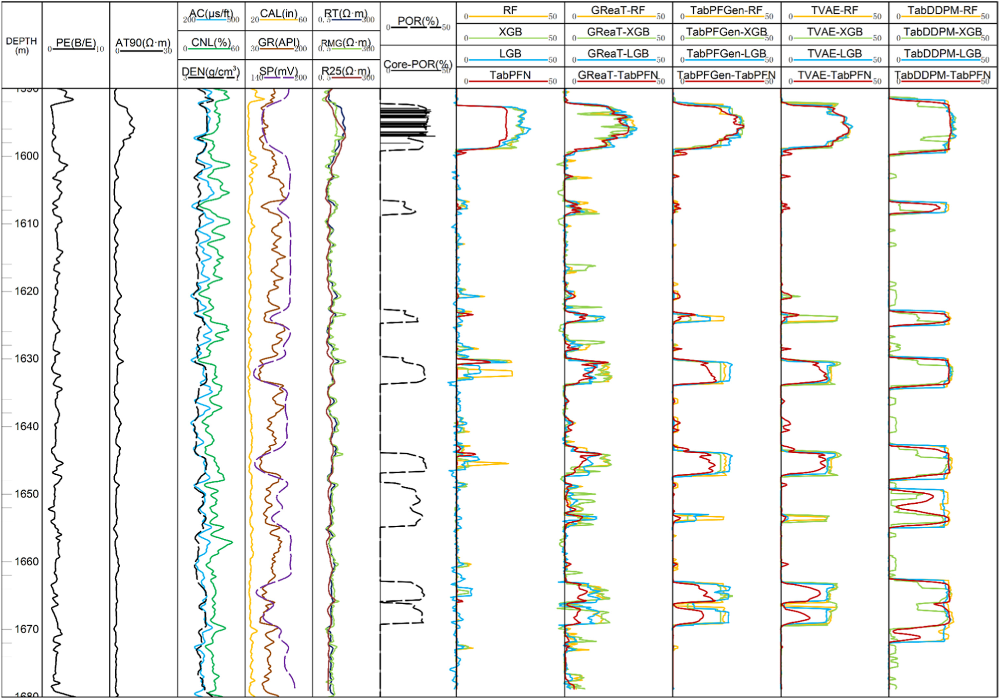](https://ars.els-cdn.com/content/image/1-s2.0-S0264817225003228-gr8_lrg.jpg)

Fig. 8. Porosity prediction results of Well A1 under different model combinations. The results processed by logging experts (Core-POR) are used as the reference standard.

**Permeability Prediction.** The method for permeability prediction is largely consistent with that for porosity prediction, with the primary difference being in label adjustment. Specifically, the permeability values measured from core samples are used as targets in the dataset. Given the substantial variation in the order of magnitude of permeability in non-mudstone core samples, the permeability labels are transformed into logarithmic form. It is important to note that porosity is excluded from this dataset. This exclusion is due to potential calculation errors in porosity values derived either from logging experts or predicted in Section [4.1](https://www.sciencedirect.com/science/article/pii/S0264817225003228#sec4.1), despite the known strong positive correlation between porosity and permeability. To quantitatively evaluate the accuracy of permeability prediction, we obtained $R^{2}$ and CVRMSE results for different CDA-ML combinations ([Table 5](https://www.sciencedirect.com/science/article/pii/S0264817225003228#tbl5)). The results demonstrate that the TabDDPM-TabPFN model achieves the best evaluation performance in permeability prediction.

Table 5. Performance comparison experiment of permeability prediction models. 1) For statistical standards, the synthetic data volume is set to 2000 columns. 2) The results are derived from the averages of five trials with different random seeds. 3) The $R^{2}$ and CVRMSE both range from 0 to 1. A higher $R^{2}$ value (approaching 1) indicates better prediction accuracy, while a lower CVRMSE value (approaching 0) corresponds to smaller relative errors in the predictive model.

|  | Metric | Original | SMOTE | SMOTETomek | CTGAN | GReaT | TabPFGen | TVAE | DeltaVAE | TabDDPM |
| --- | --- | --- | --- | --- | --- | --- | --- | --- | --- | --- |
| SVM | $R^{2}$ | 0.847 | 0.85 | 0.852 | 0.859 | 0.872 | 0.915 | 0.887 | 0.892 | 0.923 |
| SVM | CVRMSE | 0.364 | 0.334 | 0.331 | 0.325 | 0.315 | 0.286 | 0.294 | 0.289 | 0.271 |
| RF | $R^{2}$ | 0.902 | 0.913 | 0.914 | 0.916 | 0.929 | 0.945 | 0.956 | 0.952 | 0.969 |
| RF | CVRMSE | 0.195 | 0.249 | 0.245 | 0.221 | 0.177 | 0.167 | 0.174 | 0.177 | 0.155 |
| XGB | $R^{2}$ | 0.892 | 0.923 | 0.914 | 0.915 | 0.922 | 0.947 | 0.957 | 0.955 | 0.963 |
| XGB | CVRMSE | 0.194 | 0.268 | 0.252 | 0.241 | 0.196 | 0.164 | 0.172 | 0.188 | 0.171 |
| LGB | $R^{2}$ | 0.897 | 0.917 | 0.921 | 0.912 | 0.921 | 0.961 | 0.958 | 0.952 | 0.962 |
| LGB | CVRMSE | 0.199 | 0.255 | 0.248 | 0.244 | 0.196 | 0.141 | 0.171 | 0.175 | 0.172 |
| TabPFN | $R^{2}$ | 0.894 | 0.925 | 0.922 | 0.919 | 0.925 | 0.970 | 0.964 | 0.964 | **0.971** |
| TabPFN | CVRMSE | 0.213 | 0.243 | 0.238 | 0.223 | 0.193 | 0.124 | 0.143 | 0.132 | **0.120** |

Four data augmentation methods—TVAE, TabDDPM, GReaT, and TabPFGen—were selected and combined with RF, XGB, LGB, and TabPFN to form various data augmentation–reservoir parameter prediction model combinations. The application effects of these combinations are illustrated in [Fig. 9](assets/figura-9.jpg). Compared to the baseline prediction models, the models incorporating data augmentation demonstrate varying degrees of performance improvement. Notably, the TabDDPM and GReaT prediction models exhibit exceptional performance in the depth range of 1640–1670 m. As shown in [Fig. 9](assets/figura-9.jpg), the permeability prediction performance of the TabDDPM-TabPFN and GReaT-TabPFN combinations is superior to that of other models.

[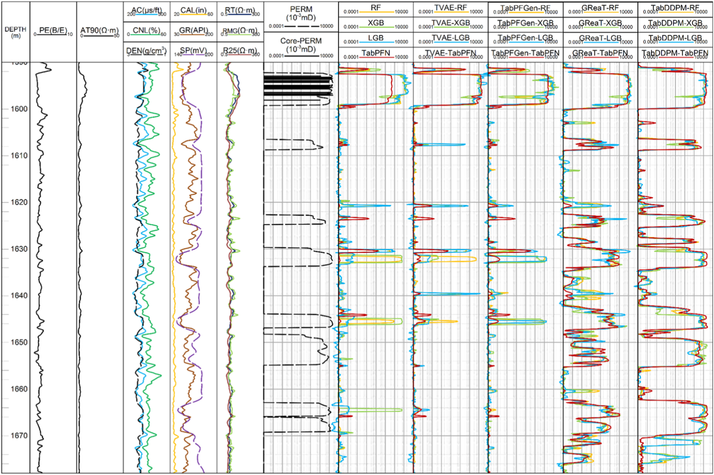](https://ars.els-cdn.com/content/image/1-s2.0-S0264817225003228-gr9_lrg.jpg)

Fig. 9. Permeability prediction results of Well A1 under different model combinations. The results processed by logging experts (Core-PERM) are used as the reference standard.

## 5. Discussion

The reliability of CDA methods has been demonstrated through their application to core data, with various techniques exhibiting different levels of accuracy enhancement in lithology classification, porosity prediction, and permeability prediction. However, the data-driven nature of these methods imposes certain limitations. Specifically, core data must achieve a sufficient scale to effectively employ certain data augmentation techniques, such as those based on probabilistic derivation models and PLMs. The scarcity of core data often necessitates their maximal utilization in typical studies. This study, however, did not investigate the performance of data augmentation methods across varying volumes of original core data, nor did it address the minimum data requirements for training these methods. Additionally, core data sampling is typically concentrated along the wellbore, resulting in a complex inverse relationship between reservoir heterogeneity and the effectiveness of data-driven CDA. Therefore, future work will consider integrating physics-based approaches to enhance the reliability of synthetic data.

This study primarily investigates CDA as a means to enhance the prediction of reservoir parameters. Data augmentation techniques are particularly valuable for maintaining data confidentiality. Acquiring core data is often costly, and synthetic data, by contrast, do not pose the risk of data leakage. This characteristic enables the utilization of advanced open-source large language models. Moreover, CDA can reduce dependence on original core data to some extent. Therefore, a balanced approach that integrates both core and synthetic data is essential for optimizing reservoir parameter prediction.

## 6. Conclusion

We present a workflow aimed at enhancing reservoir parameter prediction using CDA. This workflow includes data preprocessing, CDA implementation, reliability analysis, and reservoir parameter prediction. The reliability analysis results demonstrate that TVAE, DeltaVAE, and TabDDPM in CDA generate high-quality synthetic outputs for small-scale datasets. For large-scale data generation, pre-trained large language models (GReaT and TabPFGen) exhibit strong latent performance. In terms of application effectiveness, among various CDA-ML model combinations, TabDDPM-TabPFN performs the best. For lithology classification, TabDDPM-TabPFN achieves BA, F1, and AUC scores of 0.937, 0.945, and 0.95 respectively. For porosity prediction, TabDDPM-TabPFN yields $R^{2}$ and CVRMSE values of 0.957 and 0.122. For permeability prediction, TabDDPM-TabPFN shows $R^{2}$ and CVRMSE values of 0.971 and 0.12. In future research, we aim to explore the applicability of this workflow to more complex reservoirs and integrate CDA with physical models to further enhance the reliability of synthetic datasets.

## CRediT authorship contribution statement

**Xin Luo:** Writing – original draft, Visualization, Validation, Methodology, Data curation, Conceptualization. **Xinghua Ci:** Investigation. **Jianmeng Sun:** Investigation. **Chengyu Dan:** Supervision. **Peng Chi:** Writing – review & editing. **Ruikang Cui:** Visualization.

## Declaration of competing interest

The authors have no relevant financial or non-financial interests to disclose.

## Codes availability

The source codes are available for downloading at the link: [https://github.com/luoxinggyyy/CDA.git](https://github.com/luoxinggyyy/CDA.git).

## Funding

This work was funded by the National Natural Science Foundation of China (Grant No. 42474156), Innovation fund project for graduate student of China University of Petroleum (East China) and supported by “the Fundamental Research Funds for the Central Universities” (Grant No. 25CX04045A).

## Declaration of competing interest

The authors declare that they have no known competing financial interests or personal relationships that could have appeared to influence the work reported in this paper.

## Acknowledgements

We thank reviewers and the editor, Lin Ma, for their contributions in enhancing the manuscript.

## Appendix A. Supplementary data

The following is the Supplementary data to this article.

[Multimedia component 1.](assets/material-suplementar-1.xlsx)

## Appendix A. Well Log Correlation Analysis

To reasonably determine well logs as inputs for various models, sensitivity analysis was conducted on collected core petrophysical data and corresponding depth-based log measurements. The results show that AC, CNL, DEN, CAL, GR, SP, PE, RMG, RT, and AT90 exhibit good correlations with Label, POR and PREM ([Figure. A1](assets/figura-a1.jpg)). Therefore, these well logs are all selected as input features for CDA and ML.

[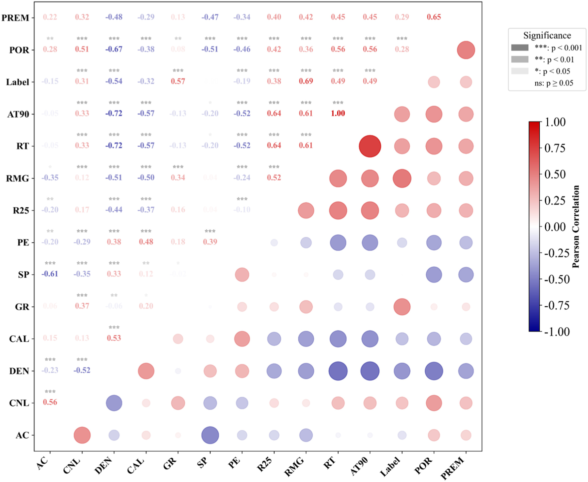](https://ars.els-cdn.com/content/image/1-s2.0-S0264817225003228-fx1_lrg.jpg)

Fig. A1. Pearson Correlation Coefficient Analysis of Well Log Features.

## Appendix B. Remove outliers using IQR

IQR (Interquartile Range) is a statistical method for outlier detection based on data distribution. The procedure includes: first calculating the first quartile (Q1) and third quartile (Q3), then computing IQR = Q3 - Q1. The upper and lower bounds for outliers are defined as: lower bound = Q1 - 1.5 × IQR, upper bound = Q3 + 1.5 × IQR. Finally, values exceeding these bounds are removed ([Hyndman and Fan, 1996](https://www.sciencedirect.com/science/article/pii/S0264817225003228#bib24)). In this study, we applied the IQR method to eliminate outliers from logging data corresponding to mudstone categories ([Figure. A2](assets/figura-a2.jpg)). The results after outlier removal are shown in [Figure. A3](assets/figura-a3.jpg).

[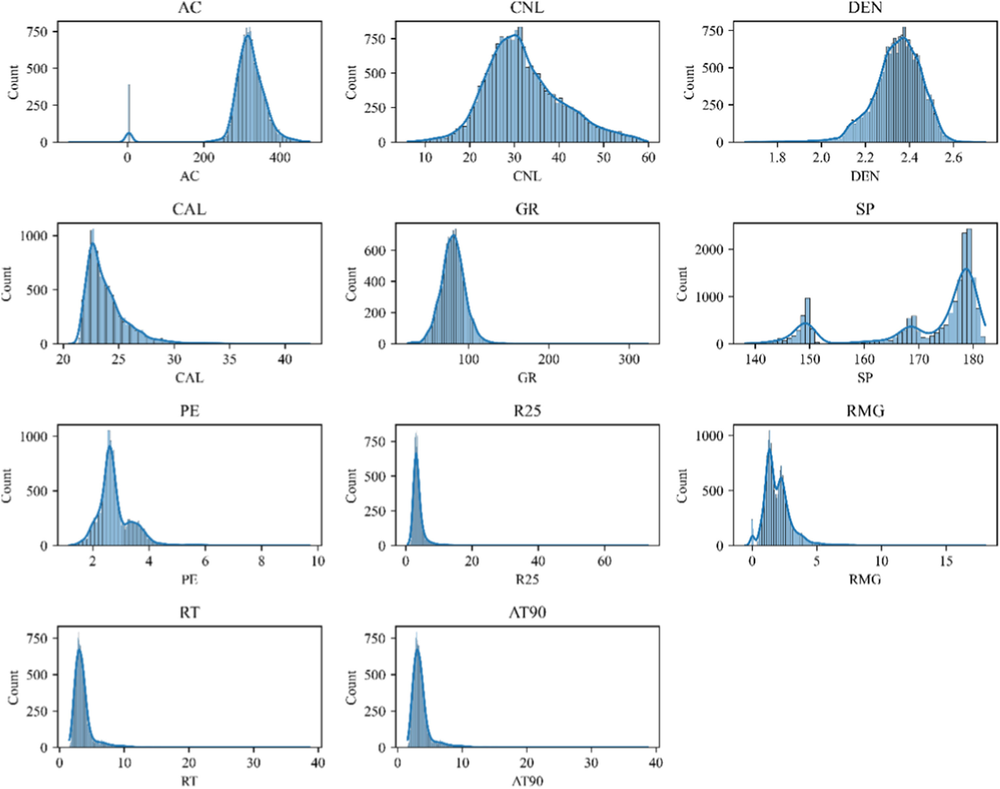](https://ars.els-cdn.com/content/image/1-s2.0-S0264817225003228-fx2_lrg.jpg)

Fig. A2. Logging Data of Mudstone Section Without Outlier Removal.

[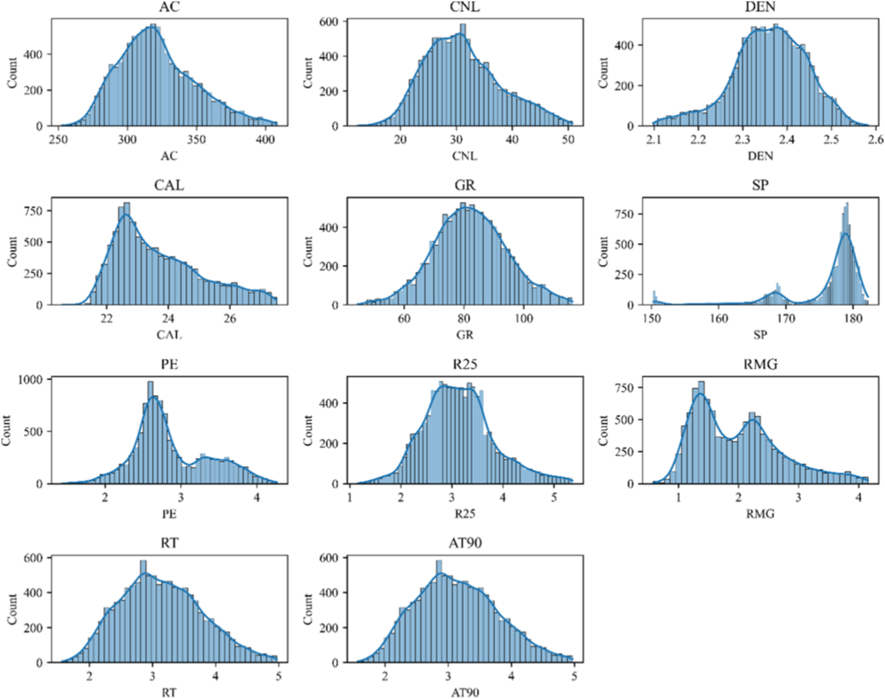](https://ars.els-cdn.com/content/image/1-s2.0-S0264817225003228-fx3_lrg.jpg)

Fig. A3. Logging Data of Mudstone Section After Outlier Removal.

## Appendix C. The running time and learning performance of different CDA

We employed CDA to generate varying amounts of synthetic data, with different CDA models exhibiting significant differences in runtime ([Figure. A4a](assets/figura-a4.jpg)). Among them, SMOTE and SMOTETomek had the shortest runtime due to their underlying principles. CTGAN also required relatively less time in this study because it only involves random generation by an internal data generator followed by discriminator evaluation. Compared to VAE-based methods, it does not involve extensive mathematical derivations, resulting in shorter runtime. In TabDDPM, there is a key timestep parameter (T) that controls generation quality but also increases computational cost ([Figure. A4c](assets/figura-a4.jpg)). For this study, we set T = 10,000. For PLMs, TabPFGen, which is based on TabPFN and SGLD, does not require fine-tuning of the TabPFN model. Therefore, the generation quality and runtime of TabPFGen are only influenced by the SGLD iteration parameter, which has a similar effect to the T parameter in TabDDPM. Additionally, GReaT required the longest runtime because it involves model fine-tuning ([Figure. A4b](assets/figura-a4.jpg)).

[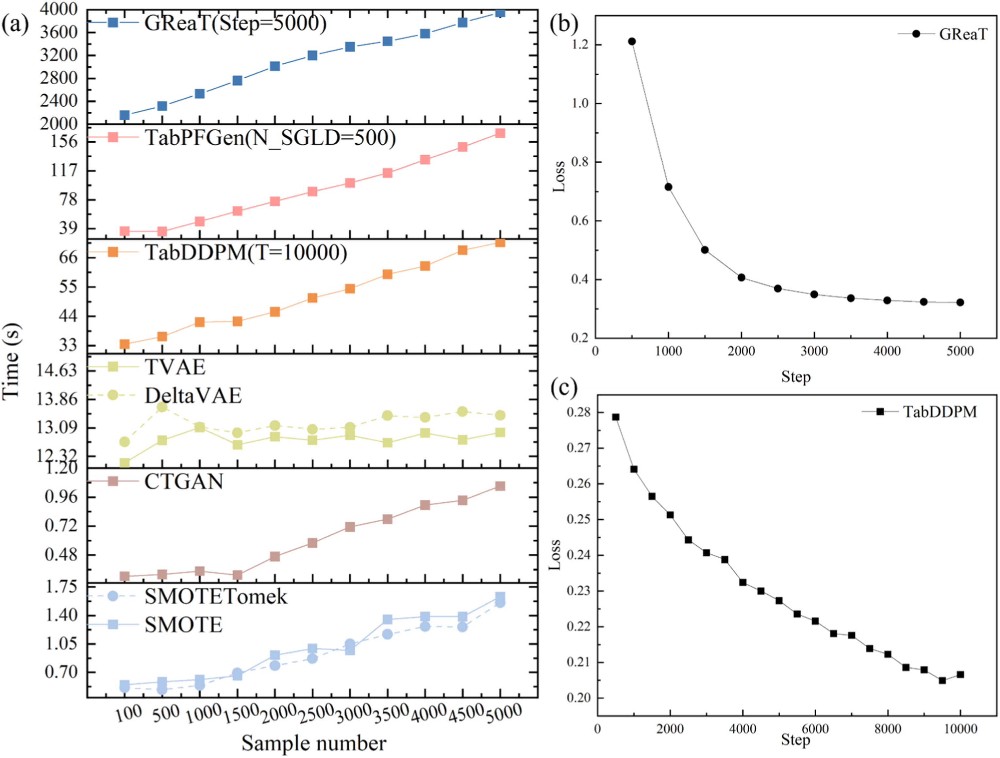](https://ars.els-cdn.com/content/image/1-s2.0-S0264817225003228-fx4_lrg.jpg)

Fig. A4. The running time of CDA and the learning performance of TabDDPM and GReaT.

## Data availability

Data will be made available on request.

## References

- [Adim et al., 2018](https://www.sciencedirect.com/science/article/pii/S0264817225003228#bbib1) A. Adim, M. Riahi, M. Bagheri Estimation of pore pressure by eaton and bowers methods using seismic and well survey data J. Appl. Global Res., 4 (2018), pp. 267-275
- [Adiputra and Wanchai, 2024](https://www.sciencedirect.com/science/article/pii/S0264817225003228#bbib2) I.N.M. Adiputra, P. Wanchai CTGAN-ENN: a tabular GAN-based hybrid sampling method for imbalanced and overlapped data in customer churn prediction J. Big Data, 11 (2024), p. 121
- [Ali et al., 2023](https://www.sciencedirect.com/science/article/pii/S0264817225003228#bbib3) N. Ali, J. Chen, X. Fu, W. Hussain, M. Ali, S.M. Iqbal, A. Anees, M. Hussain, M. Rashid, H.V. Thanh Classification of reservoir quality using unsupervised machine learning and cluster analysis: example from kadanwari gas field SE pakistan. Geosyst. Geoenviron., 2 (2023), Article 100123, [10.1016/j.geogeo.2022.100123](https://doi.org/10.1016/j.geogeo.2022.100123) [View PDF](https://www.sciencedirect.com/science/article/pii/S277288382200098X/pdfft?md5=8430a08028283ae11b0990fa9259b3ba&pid=1-s2.0-S277288382200098X-main.pdf) [View article](https://www.sciencedirect.com/science/article/pii/S277288382200098X)
- [Bao et al., 2023](https://www.sciencedirect.com/science/article/pii/S0264817225003228#bbib4) L.-L. Bao, J.-S. Zhang, C.-X. Zhang, R. Guo, X.-L. Wei, Z.-L. Jiang A reliable bayesian neural network for the prediction of reservoir thickness with quantified uncertainty Comput. Geosci., 178 (2023), Article 105409, [10.1016/j.cageo.2023.105409](https://doi.org/10.1016/j.cageo.2023.105409) [View PDF](https://www.sciencedirect.com/science/article/pii/S0098300423001139/pdfft?md5=ad9442a3eaa1400140364746666bb812&pid=1-s2.0-S0098300423001139-main.pdf) [View article](https://www.sciencedirect.com/science/article/pii/S0098300423001139)
- [Bayer et al., 2023](https://www.sciencedirect.com/science/article/pii/S0264817225003228#bbib5) M. Bayer, M.-A. Kaufhold, C. Reuter A survey on data augmentation for text classification ACM Comput. Surv., 55 (2023), pp. 1-39, [10.1145/3544558](https://doi.org/10.1145/3544558)
- [Bione et al., 2024](https://www.sciencedirect.com/science/article/pii/S0264817225003228#bbib6) F.R.A. Bione, I.M. Venancio, T.P. Santos, A.L. Belem, B.R. Rangel, I.V.A.F. Souza, A.L.D. Spigolon, A.L.S. Albuquerque Estimating total organic carbon of potential source rocks in the espírito santo basin, SE Brazil, using XGBoost Mar. Petrol. Geol., 162 (2024), Article 106765, [10.1016/j.marpetgeo.2024.106765](https://doi.org/10.1016/j.marpetgeo.2024.106765) [View PDF](https://www.sciencedirect.com/science/article/pii/S0264817224000771/pdfft?md5=a2b82846853202bfa4d97c1d0a7bc7bb&pid=1-s2.0-S0264817224000771-main.pdf) [View article](https://www.sciencedirect.com/science/article/pii/S0264817224000771)
- [Borisov et al., 2023](https://www.sciencedirect.com/science/article/pii/S0264817225003228#bbib7) V. Borisov, K. Seßler, T. Leemann, M. Pawelczyk, G. Kasneci Language models are realistic tabular data generators [https://doi.org/10.48550/arXiv.2210.06280](https://doi.org/10.48550/arXiv.2210.06280) (2023)
- [Bosquet et al., 2023](https://www.sciencedirect.com/science/article/pii/S0264817225003228#bbib8) B. Bosquet, D. Cores, L. Seidenari, V.M. Brea, M. Mucientes, A.D. Bimbo A full data augmentation pipeline for small object detection based on generative adversarial networks Pattern Recogn., 133 (2023), Article 108998, [10.1016/j.patcog.2022.108998](https://doi.org/10.1016/j.patcog.2022.108998) [View PDF](https://www.sciencedirect.com/science/article/pii/S0031320322004782/pdfft?md5=efcc0740804992ab40088713654c5db7&pid=1-s2.0-S0031320322004782-main.pdf) [View article](https://www.sciencedirect.com/science/article/pii/S0031320322004782)
- [Brodersen et al., 2010](https://www.sciencedirect.com/science/article/pii/S0264817225003228#bbib9) K.H. Brodersen, C.S. Ong, K.E. Stephan, J.M. Buhmann The balanced accuracy and its posterior distribution IEEE (2010), pp. 3121-3124
- [Chawla et al., 2002](https://www.sciencedirect.com/science/article/pii/S0264817225003228#bbib10) N.V. Chawla, K.W. Bowyer, L.O. Hall, W.P. Kegelmeyer SMOTE: synthetic minority over-sampling technique jair, 16 (2002), pp. 321-357, [10.1613/jair.953](https://doi.org/10.1613/jair.953)
- [Chen et al., 2024a](https://www.sciencedirect.com/science/article/pii/S0264817225003228#bbib11) B. Chen, Q. Li, Y. Tan, Y. Zhang, T. Yu, J. Ma, Y. Zhong, X. Li Caprock sealing integrity and key indicators of CO2 geological storage considering the effect of hydraulic-mechanical coupling: X field in the bohai bay basin, China Eng. Geol., 342 (2024), Article 107741, [10.1016/j.enggeo.2024.107741](https://doi.org/10.1016/j.enggeo.2024.107741) [View PDF](https://www.sciencedirect.com/science/article/pii/S0013795224003417/pdfft?md5=fdb2b5aeca6498329ee200af65cb0b3c&pid=1-s2.0-S0013795224003417-main.pdf) [View article](https://www.sciencedirect.com/science/article/pii/S0013795224003417)
- [Chen et al., 2024b](https://www.sciencedirect.com/science/article/pii/S0264817225003228#bbib12) J. Chen, J. You, J. Wei, Z. Dai, G. Zhang Interpreting XGBoost predictions for shear-wave velocity using SHAP: insights into gas hydrate morphology and saturation Fuel, 364 (2024), Article 131145, [10.1016/j.fuel.2024.131145](https://doi.org/10.1016/j.fuel.2024.131145) [View PDF](https://www.sciencedirect.com/science/article/pii/S0016236124002916/pdfft?md5=20351dd42faec40b11e4df5cb22dc7bb&pid=1-s2.0-S0016236124002916-main.pdf) [View article](https://www.sciencedirect.com/science/article/pii/S0016236124002916)
- [Chen et al., 2020](https://www.sciencedirect.com/science/article/pii/S0264817225003228#bbib13) W. Chen, L. Yang, B. Zha, M. Zhang, Y. Chen Deep learning reservoir porosity prediction based on multilayer long short-term memory network Geophysics, 85 (2020), pp. WA213-WA225, [10.1190/geo2019-0261.1](https://doi.org/10.1190/geo2019-0261.1)
- [Elith et al., 2008](https://www.sciencedirect.com/science/article/pii/S0264817225003228#bbib14) J. Elith, J.R. Leathwick, T. Hastie A working guide to boosted regression trees J. Anim. Ecol., 77 (2008), pp. 802-813, [10.1111/j.1365-2656.2008.01390.x](https://doi.org/10.1111/j.1365-2656.2008.01390.x)
- [Esfandi et al., 2024](https://www.sciencedirect.com/science/article/pii/S0264817225003228#bbib15) T. Esfandi, S. Sadeghnejad, A. Jafari Effect of reservoir heterogeneity on well placement prediction in CO2-EOR projects using machine learning surrogate models: benchmarking of boosting-based algorithms Geoenergy Sci. Eng., 233 (2024), Article 212564, [10.1016/j.geoen.2023.212564](https://doi.org/10.1016/j.geoen.2023.212564) [View PDF](https://www.sciencedirect.com/science/article/pii/S294989102301151X/pdfft?md5=2d43ec5dac5a6bbcdd2ae80346325247&pid=1-s2.0-S294989102301151X-main.pdf) [View article](https://www.sciencedirect.com/science/article/pii/S294989102301151X)
- [Feng et al., 2021](https://www.sciencedirect.com/science/article/pii/S0264817225003228#bbib16) R. Feng, D. Grana, N. Balling Imputation of missing well log data by random forest and its uncertainty analysis Comput. Geosci., 152 (2021), Article 104763, [10.1016/j.cageo.2021.104763](https://doi.org/10.1016/j.cageo.2021.104763) [View PDF](https://www.sciencedirect.com/science/article/pii/S0098300421000704/pdfft?md5=f86a38ff7901e7f93a6d2613f9261f13&pid=1-s2.0-S0098300421000704-main.pdf) [View article](https://www.sciencedirect.com/science/article/pii/S0098300421000704)
- [Ganaie et al., 2022](https://www.sciencedirect.com/science/article/pii/S0264817225003228#bbib17) M.A. Ganaie, M. Hu, A.K. Malik, M. Tanveer, P.N. Suganthan Ensemble deep learning: a review Eng. Appl. Artif. Intell., 115 (2022), Article 105151, [10.1016/j.engappai.2022.105151](https://doi.org/10.1016/j.engappai.2022.105151) [View PDF](https://www.sciencedirect.com/science/article/pii/S095219762200269X/pdfft?md5=a02e5511646ae68f6a6525aac31e9a47&pid=1-s2.0-S095219762200269X-main.pdf) [View article](https://www.sciencedirect.com/science/article/pii/S095219762200269X)
- [Goceri, 2023](https://www.sciencedirect.com/science/article/pii/S0264817225003228#bbib18) E. Goceri Medical image data augmentation: techniques, comparisons and interpretations Artif. Intell. Rev., 56 (2023), pp. 12561-12605, [10.1007/s10462-023-10453-z](https://doi.org/10.1007/s10462-023-10453-z)
- [Gulati and Roysdon, 2023](https://www.sciencedirect.com/science/article/pii/S0264817225003228#bbib19) M. Gulati, P. Roysdon TabMT: generating tabular data with masked transformers Adv. Neural Inf. Process. Syst., 36 (2023), pp. 46245-46254 [Crossref](https://doi.org/10.52202/075280-2005)
- [Habibi et al., 2023](https://www.sciencedirect.com/science/article/pii/S0264817225003228#bbib20) O. Habibi, M. Chemmakha, M. Lazaar Imbalanced tabular data modelization using CTGAN and machine learning to improve IoT botnet attacks detection Eng. Appl. Artif. Intell., 118 (2023), Article 105669 [View PDF](https://www.sciencedirect.com/science/article/pii/S0952197622006595/pdfft?md5=efd50de1a9400499fbfb139eaba19ce8&pid=1-s2.0-S0952197622006595-main.pdf) [View article](https://www.sciencedirect.com/science/article/pii/S0952197622006595)
- [Han et al., 2023](https://www.sciencedirect.com/science/article/pii/S0264817225003228#bbib21) R. Han, Z. Wang, Y. Guo, X. Wang, G. Zhong Multi-label prediction method for lithology, lithofacies and fluid classes based on data augmentation by cascade forest Adv. Geo-Energy Res., 9 (2023), pp. 25-37 [Crossref](https://doi.org/10.46690/ager.2023.07.04)
- [Hearst et al., 1998](https://www.sciencedirect.com/science/article/pii/S0264817225003228#bbib22) M.A. Hearst, S.T. Dumais, E. Osuna, J. Platt, B. Scholkopf Support vector machines IEEE Intell. Syst. Their Appl., 13 (1998), pp. 18-28, [10.1109/5254.708428](https://doi.org/10.1109/5254.708428)
- [Hollmann et al., 2025](https://www.sciencedirect.com/science/article/pii/S0264817225003228#bbib23) N. Hollmann, S. Müller, L. Purucker, A. Krishnakumar, M. Körfer, S.B. Hoo, R.T. Schirrmeister, F. Hutter Accurate predictions on small data with a tabular foundation model Nature, 637 (2025), pp. 319-326, [10.1038/s41586-024-08328-6](https://doi.org/10.1038/s41586-024-08328-6)
- [Hyndman and Fan, 1996](https://www.sciencedirect.com/science/article/pii/S0264817225003228#bbib24) R.J. Hyndman, Y. Fan Sample quantiles in statistical packages Am. Statistician, 50 (1996), pp. 361-365
- [Inan et al., 2023](https://www.sciencedirect.com/science/article/pii/S0264817225003228#bbib25) M.S.K. Inan, S. Hossain, M.N. Uddin Data augmentation guided breast cancer diagnosis and prognosis using an integrated deep-generative framework based on breast tumor's morphological information Inform. Med. Unlocked, 37 (2023), Article 101171 [View PDF](https://www.sciencedirect.com/science/article/pii/S2352914823000138/pdfft?md5=9e4464ff3a9d338b4ea450365acabb05&pid=1-s2.0-S2352914823000138-main.pdf) [View article](https://www.sciencedirect.com/science/article/pii/S2352914823000138)
- [Jia et al., 2024](https://www.sciencedirect.com/science/article/pii/S0264817225003228#bbib26) Fengwei Jia, H. Zhu, Fengyuan Jia, X. Ren, S. Chen, H. Tan, W.K.V. Chan A tabular data generation framework guided by downstream tasks optimization Sci. Rep., 14 (2024), Article 15267
- [Jiang et al., 2025a](https://www.sciencedirect.com/science/article/pii/S0264817225003228#bbib27) J.-P. Jiang, S.-Y. Liu, H.-R. Cai, Q. Zhou, H.-J. Ye Representation learning for tabular data: a comprehensive survey [https://doi.org/10.48550/arXiv.2504.16109](https://doi.org/10.48550/arXiv.2504.16109) (2025)
- [Jiang et al., 2025b](https://www.sciencedirect.com/science/article/pii/S0264817225003228#bbib28) Y. Jiang, W. Wang, L. Zou, Y. Cao, W.-C. Xie Investigating landslide data balancing for susceptibility mapping using generative and machine learning models Landslides, 22 (2025), pp. 189-204, [10.1007/s10346-024-02352-3](https://doi.org/10.1007/s10346-024-02352-3)
- [Kelleher et al., 2020](https://www.sciencedirect.com/science/article/pii/S0264817225003228#bbib29) J.D. Kelleher, B. Mac Namee, A. D’arcy Fundamentals of machine learning for predictive data analytics Algorithms, Worked Examples, and Case Studies, MIT press (2020)
- [Kinakh and Voloshynovskiy, 2024](https://www.sciencedirect.com/science/article/pii/S0264817225003228#bbib30) V. Kinakh, S. Voloshynovskiy Tabular data generation using binary diffusion [https://doi.org/10.48550/arXiv.2409.13882](https://doi.org/10.48550/arXiv.2409.13882) (2024)
- [Kotelnikov et al., 2023](https://www.sciencedirect.com/science/article/pii/S0264817225003228#bbib31) A. Kotelnikov, D. Baranchuk, I. Rubachev, A. Babenko Tabddpm: Modelling Tabular Data with Diffusion Models PMLR (2023), pp. 17564-17579
- [Kumari et al., 2023](https://www.sciencedirect.com/science/article/pii/S0264817225003228#bbib32) J. Kumari, E. Kumar, D. Kumar A structured analysis to study the role of machine learning and deep learning in the healthcare sector with big data analytics Arch. Comput. Methods Eng., 30 (2023), pp. 3673-3701, [10.1007/s11831-023-09915-y](https://doi.org/10.1007/s11831-023-09915-y)
- [Kwok et al., 2025](https://www.sciencedirect.com/science/article/pii/S0264817225003228#bbib33) T.S.T. Kwok, C.-H. Wang, G. Cheng Greater: generate realistic tabular data after data enhancement and reduction Arxiv Preprint Arxiv:2503.15564 (2025)
- [Li et al., 2024a](https://www.sciencedirect.com/science/article/pii/S0264817225003228#bbib34) J. Li, R. Qian, Y. Tan, Z. Li, L. Chen, S. Liu, J. Wu, H. Chai Tabsal: synthesizing tabular data with small agent assisted language models Knowl. Base Syst., 304 (2024), Article 112438 [View PDF](https://www.sciencedirect.com/science/article/pii/S0950705124010724/pdfft?md5=4298caffa2a8c3cebe9f3532672fd4a7&pid=1-s2.0-S0950705124010724-main.pdf) [View article](https://www.sciencedirect.com/science/article/pii/S0950705124010724)
- [Li et al., 2022a](https://www.sciencedirect.com/science/article/pii/S0264817225003228#bbib35) Weirong Li, L. Wang, Z. Dong, R. Wang, B. Qu Reservoir production prediction with optimized artificial neural network and time series approaches J. Petrol. Sci. Eng., 215 (2022), Article 110586, [10.1016/j.petrol.2022.110586](https://doi.org/10.1016/j.petrol.2022.110586) [View PDF](https://www.sciencedirect.com/science/article/pii/S0920410522004624/pdfft?md5=3f2833f35aa4b4f1b6051236eab7a43c&pid=1-s2.0-S0920410522004624-main.pdf) [View article](https://www.sciencedirect.com/science/article/pii/S0920410522004624)
- [Li et al., 2022b](https://www.sciencedirect.com/science/article/pii/S0264817225003228#bbib36) Wei Li, X. Zhong, H. Shao, B. Cai, X. Yang Multi-mode data augmentation and fault diagnosis of rotating machinery using modified ACGAN designed with new framework Adv. Eng. Inform., 52 (2022), Article 101552, [10.1016/j.aei.2022.101552](https://doi.org/10.1016/j.aei.2022.101552) [View PDF](https://www.sciencedirect.com/science/article/pii/S1474034622000271/pdfft?md5=29230e7cd16e31f9ac7e0a1dc438958f&pid=1-s2.0-S1474034622000271-main.pdf) [View article](https://www.sciencedirect.com/science/article/pii/S1474034622000271)
- [Li et al., 2024b](https://www.sciencedirect.com/science/article/pii/S0264817225003228#bbib37) Z. Li, B. Liu, Y. Liu, J. Yuan, Q. Zhou, S. Li, Q. Guan, G. Wang Mesozoic to cenozoic tectonic evolution in the central bohai bay basin, east China Geol. Soc. Am. Bull., 136 (2024), pp. 4965-4984, [10.1130/B37427.1](https://doi.org/10.1130/B37427.1)
- [Liu and Ye, 2025](https://www.sciencedirect.com/science/article/pii/S0264817225003228#bbib38) S.-Y. Liu, H.-J. Ye Tabpfn unleashed: a scalable and effective solution to tabular classification problems Arxiv Preprint Arxiv:2502.02527 (2025)
- [Liu et al., 2025](https://www.sciencedirect.com/science/article/pii/S0264817225003228#bbib39) Y. Liu, C. Xu, Z. Wen, Y. Dong Trust EEG epileptic seizure detection via evidential multi-view learning Inf. Sci., 694 (2025), Article 121699, [10.1016/j.ins.2024.121699](https://doi.org/10.1016/j.ins.2024.121699) [View PDF](https://www.sciencedirect.com/science/article/pii/S002002552401613X/pdfft?md5=496683733161be8b31fa2dfb55a8203b&pid=1-s2.0-S002002552401613X-main.pdf) [View article](https://www.sciencedirect.com/science/article/pii/S002002552401613X)
- [Ma et al., 2024](https://www.sciencedirect.com/science/article/pii/S0264817225003228#bbib40) J. Ma, V. Thomas, G. Yu, A. Caterini In-context data distillation with TabPFN [https://doi.org/10.48550/arXiv.2402.06971](https://doi.org/10.48550/arXiv.2402.06971) (2024)
- [Matinkia et al., 2022](https://www.sciencedirect.com/science/article/pii/S0264817225003228#bbib41) M. Matinkia, A. Amraeiniya, M.M. Behboud, M. Mehrad, M. Bajolvand, M.H. Gandomgoun, M. Gandomgoun A novel approach to pore pressure modeling based on conventional well logs using convolutional neural network J. Petrol. Sci. Eng., 211 (2022), Article 110156, [10.1016/j.petrol.2022.110156](https://doi.org/10.1016/j.petrol.2022.110156) [View PDF](https://www.sciencedirect.com/science/article/pii/S0920410522000493/pdfft?md5=ad1bbd63e0c30aa74088fab27fc33a2f&pid=1-s2.0-S0920410522000493-main.pdf) [View article](https://www.sciencedirect.com/science/article/pii/S0920410522000493)
- [Mehrabi et al., 2024](https://www.sciencedirect.com/science/article/pii/S0264817225003228#bbib42) A. Mehrabi, M. Bagheri, M.N. Bidhendi, E.B. Delijani, M. Behnoud Improved porosity estimation in complex carbonate reservoirs using hybrid CRNN deep learning model Earth Sci Inform, 17 (2024), pp. 4773-4790, [10.1007/s12145-024-01419-y](https://doi.org/10.1007/s12145-024-01419-y)
- [Min et al., 2024](https://www.sciencedirect.com/science/article/pii/S0264817225003228#bbib43) D.-H. Min, Y. Kim, S. Kim, H.-K. Yoon Strategy of oversampling geotechnical parameters through geostatistical, SMOTE, and CTGAN methods for assessing susceptibility of landslide Landslides, 21 (2024), pp. 291-307, [10.1007/s10346-023-02166-9](https://doi.org/10.1007/s10346-023-02166-9)
- [Mishra et al., 2022](https://www.sciencedirect.com/science/article/pii/S0264817225003228#bbib44) A. Mishra, A. Sharma, A.K. Patidar Evaluation and development of a predictive model for geophysical well log data analysis and reservoir characterization: machine learning applications to lithology prediction Nat Resour Res, 31 (2022), pp. 3195-3222, [10.1007/s11053-022-10121-z](https://doi.org/10.1007/s11053-022-10121-z)
- [Moosavi et al., 2024](https://www.sciencedirect.com/science/article/pii/S0264817225003228#bbib45) N. Moosavi, M. Bagheri, M. Nabi-Bidhendi Hydrocarbon reservoir parameter estimation using a fuzzy Gaussian based SVR method Bull. geophys. oceanogr. (BGO), 65 (2024), p. 70
- [Mousavi and Hosseini-Nasab, 2024a](https://www.sciencedirect.com/science/article/pii/S0264817225003228#bbib46) S.H.R. Mousavi, S.M. Hosseini-Nasab Residual convolutional neural network for lithology classification: a case study of an iranian gas field Int. J. Energy Res. (2024), [10.1155/2024/5576859](https://doi.org/10.1155/2024/5576859) 2024
- [Mousavi and Hosseini-Nasab, 2024b](https://www.sciencedirect.com/science/article/pii/S0264817225003228#bbib47) S.H.R. Mousavi, S.M. Hosseini-Nasab A novel approach to classify lithology of reservoir formations using GrowNet and deep‐insight with physic‐based feature augmentation Energy Sci. Eng., 12 (2024), pp. 4453-4477, [10.1002/ese3.1895](https://doi.org/10.1002/ese3.1895)
- [Palaić et al., 2023](https://www.sciencedirect.com/science/article/pii/S0264817225003228#bbib48) D. Palaić, I. Štajduhar, S. Ljubic, I. Wolf Development, calibration, and validation of a simulation model for indoor temperature prediction and HVAC system fault detection Buildings, 13 (2023), p. 1388 [Crossref](https://doi.org/10.3390/buildings13061388)
- [Pan et al., 2023](https://www.sciencedirect.com/science/article/pii/S0264817225003228#bbib49) W. Pan, C. Torres-Verdín, I.J. Duncan, M.J. Pyrcz Improving multiwell petrophysical interpretation from well logs via machine learning and statistical models Geophysics, 88 (2023), pp. D159-D175, [10.1190/geo2022-0151.1](https://doi.org/10.1190/geo2022-0151.1)
- [Prankada et al., 2021](https://www.sciencedirect.com/science/article/pii/S0264817225003228#bbib50) M. Prankada, K. Yadav, A. Sircar Analysis of wellbore stability by pore pressure prediction using seismic velocity Energy Geosci., 2 (2021), pp. 219-228, [10.1016/j.engeos.2021.06.005](https://doi.org/10.1016/j.engeos.2021.06.005) [View PDF](https://www.sciencedirect.com/science/article/pii/S2666759221000305/pdfft?md5=2e9810b228414e3fce1e0562555241ce&pid=1-s2.0-S2666759221000305-main.pdf) [View article](https://www.sciencedirect.com/science/article/pii/S2666759221000305)
- [Ruiz-Villafranca et al., 2025](https://www.sciencedirect.com/science/article/pii/S0264817225003228#bbib51) S. Ruiz-Villafranca, J. Roldán-Gómez, J. Carrillo-Mondéjar, J.L. Martinez, C.H. Gañán WFE-tab: overcoming limitations of TabPFN in IIoT-MEC environments with a weighted fusion ensemble-TabPFN model for improved IDS performance Future Gener. Comput. Syst., 166 (2025), Article 107707, [10.1016/j.future.2025.107707](https://doi.org/10.1016/j.future.2025.107707) [View PDF](https://www.sciencedirect.com/science/article/pii/S0167739X25000020/pdfft?md5=c9a2b74dec65987175f66e92cdfccf1d&pid=1-s2.0-S0167739X25000020-main.pdf) [View article](https://www.sciencedirect.com/science/article/pii/S0167739X25000020)
- [Shin et al., 2023](https://www.sciencedirect.com/science/article/pii/S0264817225003228#bbib52) S. Shin, D. Shin, N. Kang Topology optimization via machine learning and deep learning: a review Journal of Computational Design and Engineering, 10 (2023), pp. 1736-1766, [10.1093/jcde/qwad072](https://doi.org/10.1093/jcde/qwad072)
- [Singh et al., 2024](https://www.sciencedirect.com/science/article/pii/S0264817225003228#bbib53) J. Singh, N.N. Khanna, R.K. Rout, N. Singh, J.R. Laird, I.M. Singh, M.K. Kalra, L.E. Mantella, A.M. Johri, E.R. Isenovic, M.M. Fouda, L. Saba, M. Fatemi, J.S. Suri GeneAI 3.0: powerful, novel, generalized hybrid and ensemble deep learning frameworks for miRNA species classification of stationary patterns from nucleotides Sci. Rep., 14 (2024), p. 7154, [10.1038/s41598-024-56786-9](https://doi.org/10.1038/s41598-024-56786-9)
- [Song et al., 2022](https://www.sciencedirect.com/science/article/pii/S0264817225003228#bbib54) L. Song, Y. Gu, L. Zhang, X. Wang A novel permeability prediction model for deep coal via NMR and fractal theory Mathematics, 11 (2022), p. 118, [10.3390/math11010118](https://doi.org/10.3390/math11010118)
- [Su et al., 2024](https://www.sciencedirect.com/science/article/pii/S0264817225003228#bbib55) J. Su, X. Yu, X. Wang, Z. Wang, G. Chao Enhanced transfer learning with data augmentation Eng. Appl. Artif. Intell., 129 (2024), Article 107602, [10.1016/j.engappai.2023.107602](https://doi.org/10.1016/j.engappai.2023.107602) [View PDF](https://www.sciencedirect.com/science/article/pii/S0952197623017864/pdfft?md5=f2ac844bbf19d82dc6002f32dacba654&pid=1-s2.0-S0952197623017864-main.pdf) [View article](https://www.sciencedirect.com/science/article/pii/S0952197623017864)
- [Tabasi et al., 2022](https://www.sciencedirect.com/science/article/pii/S0264817225003228#bbib56) S. Tabasi, P. Soltani Tehrani, M. Rajabi, D.A. Wood, S. Davoodi, H. Ghorbani, N. Mohamadian, M. Ahmadi Alvar Optimized machine learning models for natural fractures prediction using conventional well logs Fuel, 326 (2022), Article 124952, [10.1016/j.fuel.2022.124952](https://doi.org/10.1016/j.fuel.2022.124952) [View PDF](https://www.sciencedirect.com/science/article/pii/S001623612201794X/pdfft?md5=2b6e842c05fa03c64375fbea572bac1b&pid=1-s2.0-S001623612201794X-main.pdf) [View article](https://www.sciencedirect.com/science/article/pii/S001623612201794X)
- [Villaizán-Vallelado et al., 2024](https://www.sciencedirect.com/science/article/pii/S0264817225003228#bbib57) M. Villaizán-Vallelado, M. Salvatori, C. Segura, I. Arapakis Diffusion models for tabular data imputation and synthetic data generation Arxiv Preprint Arxiv:2407.02549 (2024)
- [Wang et al., 2024](https://www.sciencedirect.com/science/article/pii/S0264817225003228#bbib58) L. Wang, Y. Han, D. Lou, Z. He, X. Guo, M. Steele-MacInnis Hydrothermal petroleum related to intracontinental magmatism in the bohai bay basin, eastern China Mar. Petrol. Geol., 167 (2024), Article 106982, [10.1016/j.marpetgeo.2024.106982](https://doi.org/10.1016/j.marpetgeo.2024.106982) [View PDF](https://www.sciencedirect.com/science/article/pii/S0264817224002940/pdfft?md5=fb206380740981a493bb0d422171d133&pid=1-s2.0-S0264817224002940-main.pdf) [View article](https://www.sciencedirect.com/science/article/pii/S0264817224002940)
- [Wang et al., 2022a](https://www.sciencedirect.com/science/article/pii/S0264817225003228#bbib59) Q. Wang, Y. Sun, W. Zhang, Y. Wang, L. Cao, X. Li Structural characteristics and mechanism of the hengshui accommodation zone in the southern jizhong subbasin, bohai bay basin, China Mar. Petrol. Geol., 138 (2022), Article 105558, [10.1016/j.marpetgeo.2022.105558](https://doi.org/10.1016/j.marpetgeo.2022.105558) [View PDF](https://www.sciencedirect.com/science/article/pii/S0264817222000368/pdfft?md5=511819861467f5bd4ba1f6d8c24b7812&pid=1-s2.0-S0264817222000368-main.pdf) [View article](https://www.sciencedirect.com/science/article/pii/S0264817222000368)
- [Wang et al., 2022b](https://www.sciencedirect.com/science/article/pii/S0264817225003228#bbib60) Y. Wang, H. Tang, J. Huang, T. Wen, J. Ma, J. Zhang A comparative study of different machine learning methods for reservoir landslide displacement prediction Eng. Geol., 298 (2022), Article 106544, [10.1016/j.enggeo.2022.106544](https://doi.org/10.1016/j.enggeo.2022.106544) [View PDF](https://www.sciencedirect.com/science/article/pii/S0013795222000291/pdfft?md5=b654bd191056e9689cb067311869ec24&pid=1-s2.0-S0013795222000291-main.pdf) [View article](https://www.sciencedirect.com/science/article/pii/S0013795222000291)
- [Wang et al., 2025](https://www.sciencedirect.com/science/article/pii/S0264817225003228#bbib61) Y. Wang, X. Wang, L. Shan Asphalt oil source determination model based on machine learning Fuel, 396 (2025), Article 135318, [10.1016/j.fuel.2025.135318](https://doi.org/10.1016/j.fuel.2025.135318) [View PDF](https://www.sciencedirect.com/science/article/pii/S0016236125010439/pdfft?md5=4b4cd0eb7ecc410234d3ff401739af30&pid=1-s2.0-S0016236125010439-main.pdf) [View article](https://www.sciencedirect.com/science/article/pii/S0016236125010439)
- [Welling and Teh, 2011](https://www.sciencedirect.com/science/article/pii/S0264817225003228#bbib62) M. Welling, Y.W. Teh Bayesian learning via stochastic gradient Langevin dynamics Citeseer (2011), pp. 681-688
- [Wood, 2023](https://www.sciencedirect.com/science/article/pii/S0264817225003228#bbib63) D.A. Wood Well-log attributes assist in the determination of reservoir formation tops in wells with sparse well-log data Adv. Geo-Energy Res., 8 (2023), pp. 45-60 [Crossref](https://doi.org/10.46690/ager.2023.04.05)
- [Wu et al., 2025](https://www.sciencedirect.com/science/article/pii/S0264817225003228#bbib64) J. Wu, R. Luo, L. Luo, C. Lei, X. Chen Advanced machine learning for low-data porosity and permeability prediction in tight sandstones Geophysics, 90 (2025), pp. M31-M44, [10.1190/geo2024-0340.1](https://doi.org/10.1190/geo2024-0340.1)
- [Xu et al., 2019](https://www.sciencedirect.com/science/article/pii/S0264817225003228#bbib65) L. Xu, M. Skoularidou, A. Cuesta-Infante, K. Veeramachaneni Modeling tabular data using conditional gan Adv. Neural Inf. Process. Syst., 32 (2019)
- [Xu et al., 2021](https://www.sciencedirect.com/science/article/pii/S0264817225003228#bbib66) Z. Xu, W. Ma, P. Lin, H. Shi, D. Pan, T. Liu Deep learning of rock images for intelligent lithology identification Comput. Geosci., 154 (2021), Article 104799, [10.1016/j.cageo.2021.104799](https://doi.org/10.1016/j.cageo.2021.104799) [View PDF](https://www.sciencedirect.com/science/article/pii/S009830042100100X/pdfft?md5=829f17437bc4e6eb315b4346b5ba53b3&pid=1-s2.0-S009830042100100X-main.pdf) [View article](https://www.sciencedirect.com/science/article/pii/S009830042100100X)
- [Yadav et al., 2024](https://www.sciencedirect.com/science/article/pii/S0264817225003228#bbib67) P. Yadav, M. Gaur, R.K. Madhukar, G. Verma, P. Kumar Rigorous experimental analysis of tabular data generated using TVAE and CTGAN Int. J. Adv. Comput. Sci. Appl., 15 (2024)
- [Yang et al., 2023](https://www.sciencedirect.com/science/article/pii/S0264817225003228#bbib68) L. Yang, S. Fomel, S. Wang, X. Chen, W. Chen, O.M. Saad, Y. Chen Porosity and permeability prediction using a transformer and periodic long short-term network Geophysics, 88 (2023), pp. WA293-WA308, [10.1190/geo2022-0150.1](https://doi.org/10.1190/geo2022-0150.1)
- [Ye et al., 2025](https://www.sciencedirect.com/science/article/pii/S0264817225003228#bbib69) H.-J. Ye, S.-Y. Liu, W.-L. Chao A closer look at tabpfn v2: strength, limitation, and extension Arxiv Preprint Arxiv:2502.17361 (2025)
- [Zha et al., 2025](https://www.sciencedirect.com/science/article/pii/S0264817225003228#bbib70) C. Zha, Z. Wang, Y. Fan, B. Bai, Y. Zhang, S. Shi, R. Zhang A-NIDS: adaptive network intrusion detection system based on clustering and stacked CTGAN IEEE Trans. Inf. Forensics Secur. (2025)
- [Zhang et al., 2023](https://www.sciencedirect.com/science/article/pii/S0264817225003228#bbib71) H. Zhang, J. Zhang, B. Srinivasan, Z. Shen, X. Qin, C. Faloutsos, H. Rangwala, G. Karypis Mixed-type tabular data synthesis with score-based diffusion in latent space Arxiv Preprint Arxiv:2310.09656 (2023)
- [Zhao et al., 2021](https://www.sciencedirect.com/science/article/pii/S0264817225003228#bbib72) L. Zhao, C. Zou, Y. Chen, W. Shen, Y. Wang, H. Chen, J. Geng Fluid and lithofacies prediction based on integration of well-log data and seismic inversion: a machine-learning approach Geophysics, 86 (2021), pp. M151-M165, [10.1190/geo2020-0521.1](https://doi.org/10.1190/geo2020-0521.1)
- [Zheng et al., 2022](https://www.sciencedirect.com/science/article/pii/S0264817225003228#bbib73) D. Zheng, M. Hou, A. Chen, H. Zhong, Z. Qi, Q. Ren, J. You, H. Wang, C. Ma Application of machine learning in the identification of fluvial-lacustrine lithofacies from well logs: a case study from sichuan basin, China J. Petrol. Sci. Eng., 215 (2022), Article 110610, [10.1016/j.petrol.2022.110610](https://doi.org/10.1016/j.petrol.2022.110610) [View PDF](https://www.sciencedirect.com/science/article/pii/S0920410522004855/pdfft?md5=f18bee0d97ab1bf34790593bc734bb0e&pid=1-s2.0-S0920410522004855-main.pdf) [View article](https://www.sciencedirect.com/science/article/pii/S0920410522004855)
