## Abstract

The state of Bahia in Brazil possesses significant, yet underexploited, iron ore reserves. To support the initial stages of mineral exploration in this vast region, cost-effective and rapid large-scale mapping methods are essential. This paper presents a workflow based on publicly available remote sensing data for a state mineral prospectivity mapping (MPM) for iron. The methodology employs a Random Forest (RF) classification model on Sentinel-2 multispectral images, trained with a randomly selected dataset in the image at varying distances defined from the location of known iron mines in the state. The Spectral Angle Mapper (SAM) algorithm was used to categorize the samples according to spectral similarity features with laboratory-confirmed ore signatures from samples collected in the mine pit area. The resulting MPM successfully delineated known iron districts and highlighted new, unexplored areas with potential. A quantitative evaluation of the model yielded an overall accuracy of 69.8%, a macro-average F1-score of 0.697, and a Cohen’s Kappa coefficient of 0.623, indicating a reasonable agreement beyond random chance. This work demonstrates a validated, low-cost, and simple approach for regional-scale MPM, offering a valuable reconnaissance tool for preliminary exploration, particularly in extensive and data-scarce regions.

**Keywords:** mineral prospectivity mapping; iron ore; artificial intelligence

## 1. Introduction

Iron is one of the most globally demanded metals, being the main component for steel manufacturing. This essential alloy forms the backbone of modern global infrastructure, from skyscrapers and pipelines to household appliances. Brazil stands out as the world’s second-largest producer of iron ore, with the states of Minas Gerais and Pará accounting for 98% of national production [[1](https://www.mdpi.com/2075-163X/15/11/1119#B1-minerals-15-01119)]. In 2024, Minas Gerais produced 238.92 million tons and Pará produced 167.98 million tons, representing 64.35% and 34.5% of the national total, respectively [[2](https://www.mdpi.com/2075-163X/15/11/1119#B2-minerals-15-01119)].

The state of Bahia is the third-largest mineral producer in Brazil, with a strong emphasis on chromium, gold, copper, and nickel [[2](https://www.mdpi.com/2075-163X/15/11/1119#B2-minerals-15-01119)]. However, despite possessing estimated reserves of at least 12.5 billion tons of iron ore, the state contributes only a small fraction to the country’s iron output. In 2024, Bahia’s production was approximately 1.2 million tons, or 0.016% of the national total [[3](https://www.mdpi.com/2075-163X/15/11/1119#B3-minerals-15-01119)]. The primary constraint on growth is the lack of an effective logistical infrastructure to facilitate exports.

While the state works to overcome its past export limitations by developing key infrastructure such as the FIOL railway, which will provide a link between Bahia’s largest iron mine, Pedra de Ferro Mine, and the deep-water port in the southeast of the state, Porto Sul, numerous other potential iron reserves within the state, which have been documented in geological surveys for over 80 years, remain unsubstantiated due to the insufficiency of comprehensive studies to delineate and quantify reserves. This discourages mining companies and, consequently, the government from investing in these regions.

In this context, remote sensing emerges as an essential tool for MPM as satellite platforms such as Landsat, ASTER, and Sentinel-2 offers consistent, large-scale, and accessible source for applying strategic insights from geologic knowledge and data to the identification of surface indicators of mineralization, such as lithological units, structural features, and hydrothermal alteration zones [[4](https://www.mdpi.com/2075-163X/15/11/1119#B4-minerals-15-01119)].

Combining these geoscience datasets with Artificial Intelligence (AI) methods, such as Machine Learning (ML) algorithms, allows a data-driven approach that can assist in the identification of complex, non-linear relationships between geological evidence and mineralization. It also systematically reduces the exploration search space and increases the effectiveness of discovering new profitable mineral deposits while lowering costs by redirecting prospecting field work.

Comparative studies [[5](https://www.mdpi.com/2075-163X/15/11/1119#B5-minerals-15-01119),[6](https://www.mdpi.com/2075-163X/15/11/1119#B6-minerals-15-01119),[7](https://www.mdpi.com/2075-163X/15/11/1119#B7-minerals-15-01119)] suggest that RF, one of the ML methods that can be used in MBM, is particularly well-suited for geological applications because of its overall performance, feature importance, and robustness against noise and outliers, and it is less prone to overfitting compared to other ML algorithms like Support Vector Machines (SVM). However, it offers poor performance with limited and often imbalanced training datasets typical of mineral exploration. A hybrid approach may be used to overcome this.

Geological mapping has long employed the Spectral Angle Mapper (SAM) to identify mineralized zones of interest by comparing training data with a spectral reference library to determine which samples most closely resemble the target mineral’s spectrum [[8](https://www.mdpi.com/2075-163X/15/11/1119#B8-minerals-15-01119),[9](https://www.mdpi.com/2075-163X/15/11/1119#B9-minerals-15-01119),[10](https://www.mdpi.com/2075-163X/15/11/1119#B10-minerals-15-01119),[11](https://www.mdpi.com/2075-163X/15/11/1119#B11-minerals-15-01119)]. This strategy can help determine the iron-rich positive samples training set and work as a class weight to mitigate the RF’s bias towards the majority class in imbalanced datasets, also reducing the likelihood of committing a “false negative” error by labeling a prospective area as non-mineralized.

This study aims to assess a simple and accessible workflow based on remote sensing data for large-scale, low-cost, and rapid regional MPM. By design, this approach is intended to be a first-pass, reconnaissance-level tool that is adequate for quickly evaluating large-scale areas with a minimum of data available, as many high-performing models rely on the integration of multiple, often expensive and heterogeneous, datasets, including geophysical, geochemical, and drilling data. This can be a significant barrier in the early stages of exploration or in regions where such data is not readily available.

## 2. Iron Districts in Bahia

The geological context of Bahia’s iron formations predominantly follows the global pattern, with depositions between the Mesoarchean and Paleoproterozoic (~3.2–1.6 Ga). Most known iron occurrences in Bahia are of the Algoma type, associated with greenstone belt environments. However, the largest reserves are related to metavolcano–sedimentary sequences of the Superior Lake type [[12](https://www.mdpi.com/2075-163X/15/11/1119#B12-minerals-15-01119),[13](https://www.mdpi.com/2075-163X/15/11/1119#B13-minerals-15-01119)]. These environments are characterized by the presence of Banded Iron Formations (BIFs), which are sedimentary rocks with intercalated layers of iron oxide and silica. The BIFs in the state are classified as:

- Siliceous Itabirites: Rocks with iron-rich bands intercalated with quartzose bands, with average Fe contents between 30% and 45%.
- Dolomitic Itabirites: Dolomitic bands intercalated with iron oxide bands, with average Fe contents between 30% and 35%.
- Amphibolitic Itabirites: Intercalation of iron-rich bands with metabasic rocks, with average Fe contents varying from 25% to 32%.
- Magnetitites and Hematitites: Rocks associated with hydrothermal activity and low silica content, presenting the highest grades, varying from 50% to 67% Fe.

Supergene Ore: Lateritic iron formations formed by leaching, resulting in supergene enrichment with average Fe contents from 30% to 50%.

A report paper by the Bahia Mineral Research Company (CBPM) [[14](https://www.mdpi.com/2075-163X/15/11/1119#B14-minerals-15-01119)] identified five main iron districts in the state, based on historical data from past survey campaigns and data provided by mining companies. The districts are as follows ([Figure 1](assets/figura-1.png)):

[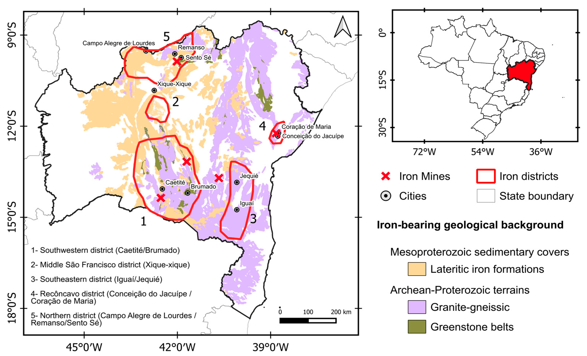](https://mdpi-res.com/minerals/minerals-15-01119/article_deploy/html/images/minerals-15-01119-g001.png)

**Figure 1.** Simplified geological map of the study area, with iron-rich districts in the state of Bahia according to Ribeiro (2017) [[14](https://www.mdpi.com/2075-163X/15/11/1119#B14-minerals-15-01119)].

- **Southwest Bahia District (Caetité-Brumado):** Estimated reserves of 5.21 billion tons, with grades between 32% and 62%.
- **Middle São Francisco District (Xique-Xique):** Estimated reserves of 430 million tons, with an average grade of 24.8%.
- **Southeast Bahia District (Iguaí-Jequié):** Estimated reserves of 513 million tons, with grades between 29% and 39%.
- **Recôncavo District (Coração de Maria-Conceição do Jacuípe):** Estimated reserves of 1.13 billion tons, with an average grade of 27.7%.
- **North Bahia District (Campo Alegre de Lourdes/Remanso/Sento Sé):** Estimated reserves of 5.0 billion tons, with grades between 26% and 66%.

## 3. Materials and Methods

The methodological framework of this study was designed to be, at most, an end-to-end workflow, from satellite data acquisition to the generation and validation of the final MPM. The software used includes Google Earth Engine (GEE; Google LLC, Mountain View, CA, USA) for image acquisition, sample collection, model generation by Random Forest (RF), and validation; ENVI 5.3 (L3Harris Geospatial, Broomfield, CO, USA) for Spectral Angle Mapper (SAM) analysis and preparation of the training dataset; and QGIS 3.4 (QGIS Development Team, Hannover, Germany) for map production, validation, and additional spatial analysis. The workflow is visually summarized in a flow diagram in the following image ([Figure 2](assets/figura-2.png)).

[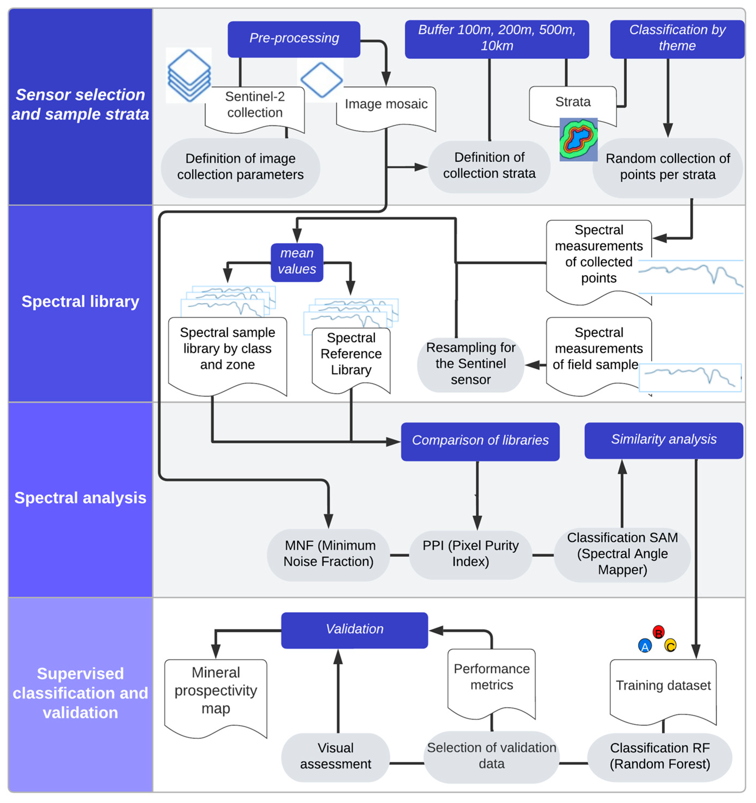](https://mdpi-res.com/minerals/minerals-15-01119/article_deploy/html/images/minerals-15-01119-g002.png)

**Figure 2.** Methodology workflow illustrating the main stages of the study, from data acquisition to validation and mineral prospectivity mapping. For details on the satellite data used and sensor characteristics, refer to Section 3.1 (Sensor Selection and Data Acquisition).

### 3.1. Sensor Selection and Data Acquisition

The sole data product used was images from the Sentinel-2 multispectral sensor. The choice of this sensor was strategic for several reasons. Technically, the Sentinel-2 mission offers a distinct advantage for mapping iron-rich minerals. It includes several narrow bands in the visible and near-infrared (VNIR) (specifically bands 5, 6, 7, 8, and 8A), with the wavelength range of 0.7 to 0.9 µm, a crucial spectral region where ferrous minerals such as goethite, jarosite, and hematite exhibit diagnostic absorption features [[15](https://www.mdpi.com/2075-163X/15/11/1119#B15-minerals-15-01119),[16](https://www.mdpi.com/2075-163X/15/11/1119#B16-minerals-15-01119),[17](https://www.mdpi.com/2075-163X/15/11/1119#B17-minerals-15-01119)]. In contrast, other multispectral sensors, such as Landsat, offer only one or two bands in this region, limiting spectral detail [[18](https://www.mdpi.com/2075-163X/15/11/1119#B18-minerals-15-01119),[19](https://www.mdpi.com/2075-163X/15/11/1119#B19-minerals-15-01119),[20](https://www.mdpi.com/2075-163X/15/11/1119#B20-minerals-15-01119)]. From a practical standpoint, Sentinel-2 data is freely accessible, has a wide coverage, and a high revisit rate (approximately 10 days). These features give it a practical edge over other sensors, like ASTER, which, despite being well suited for geological mapping, does not have a high revisit rate, making it impractical for large-scale regions such as the state of Bahia.

The specific data product used was the Harmonized Sentinel-2 Level-2A Surface Reflectance (SR) collection, accessed via the GEE data catalog. These products include atmospheric correction with the Sen2Cor method [[21](https://www.mdpi.com/2075-163X/15/11/1119#B21-minerals-15-01119)] and bi-directional reflectance distribution function (BRDF) normalization within the GEE cloud environment.

For the image selection, we focused on selecting images that maximize cloud-free coverage. There are three distinct biomes in the state of Bahia, each with its own rainfall dynamics. Therefore, it was necessary to expand the time window for selecting images.

The image collection was filtered to cover the entire study area and a time interval from 1 January 2020 to 31 December 2022. This multi-year window helped reduce areas that were obscured by cloud presence. A cloud-masking function was applied to the collection. This function utilized the Sentinel-2 QA60 quality assessment band to identify and remove pixels contaminated by opaque clouds or cirrus clouds, which would otherwise introduce significant noise into the spectral data.

The filtered and masked image collection was subjected to a median reducer to produce a single, cloud-free mosaic image. This statistical method determines the median value for each pixel across all available images in the time series. This effectively helped to mitigate the effects of seasonal variations in vegetation and soil moisture.

### 3.2. Sampling Design

The sampling strategy involved selecting two reference areas with proven mineralization, evidenced by the presence of active mining operations. The Pedra de Ferro Mine, located near the city of Caetité, in southwestern Bahia, and the Mocó Mine, located further towards the central part of the state, were chosen as reference areas ([Figure 3](assets/figura-3.png)), representing high-grade and low-grade iron ore deposits, respectively. The samples were selected from within the area of the mine pit and from its surroundings, selected inside a buffer zone around the perimeter of each mine with 100 m, 200 m, 500 m and 10 km radius.

[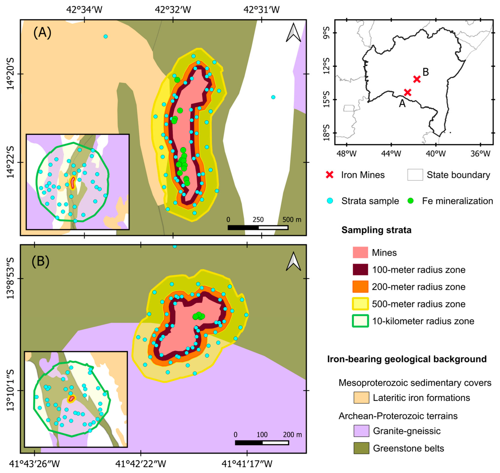](https://mdpi-res.com/minerals/minerals-15-01119/article_deploy/html/images/minerals-15-01119-g003.png)

**Figure 3.** Location map of the sampling strata at the (**A**) Pedra de Ferro Mine and (**B**) Mocó Mine, and the simplified geology.

#### 3.2.1. Ore Sampling Strata

The “ore” dataset represents the target class of iron mineralization. It corresponds to the coordinates where the ore samples, later used to build the reference library, were collected in the field in both mines.

#### 3.2.2. Ancillary Classes Sampling Strata

These samples were selected to characterize the spectral background and the potential “halo” effect of mineralization on the surrounding environment. These included “soil” for non-vegetated areas, “vegetation” for vegetated areas and “mixed soil-vegetation” for shrubby and sparsely vegetated areas. A set of randomly selected points was created within each “Strata”, regions between the defined buffer limits. The number of points for each class in the respective strata were deliberately balanced to include validation data. The complete sampling scheme is detailed in Table 1.

**Table 1.** Table of sampling strata used for input data.

| Class | Description/Selection Criteria | Strata | Number of Points $^{1}$ |
| --- | --- | --- | --- |
| ore | Iron ore/field coordinates | mines | 20 |
| soil | Non-vegetated areas/random selection within strata | 100 m | 20 |
| soil | Non-vegetated areas/random selection within strata | 100 m–200 m | 20 |
| soil | Non-vegetated areas/random selection within strata | 200 m–500 m | 20 |
| soil | Non-vegetated areas/random selection within strata | 500 m–10 km | 40 |
| vegetation | Areas with dense vegetation or forests/random selection within strata | 100 m | 20 |
| vegetation | Areas with dense vegetation or forests/random selection within strata | 100 m–200 m | 20 |
| vegetation | Areas with dense vegetation or forests/random selection within strata | 200 m–500 m | 20 |
| vegetation | Areas with dense vegetation or forests/random selection within strata | 500 m–10 km | 40 |
| mixed soil–vegetation | Areas with shrubby or sparse vegetation/random selection within strata | 100 m | 20 |
| mixed soil–vegetation | Areas with shrubby or sparse vegetation/random selection within strata | 100 m–200 m | 20 |
| mixed soil–vegetation | Areas with shrubby or sparse vegetation/random selection within strata | 200 m–500 m | 20 |
| mixed soil–vegetation | Areas with shrubby or sparse vegetation/random selection within strata | 500 m–10 km | 40 |

$^{1}$ Corresponds to the number of points per mine.

### 3.3. Spectral Libraries and Analysis

To establish the reference signatures for iron ore, samples collected in the field were measured in the laboratory using a FieldSpec® 4 Hi-Res spectroradiometer (Malvern Panalytical Ltd., Boulder, CO, USA). The measurement results were then converted to reflectance units compatible with those of the Sentinel-2 image to build the reference library. Meanwhile, the input data included the set of selected points exported to ENVI, where they were defined as regions of interest (ROIs), and two scenes from the Sentinel-2 image, cropped from the mosaic, containing the buffer zones of the two mines, defined as test areas.

For this study, ENVI Spectral Hourglass Workflow [[22](https://www.mdpi.com/2075-163X/15/11/1119#B22-minerals-15-01119)] was used, which includes Minimum Noise Fraction Dimensionality Reduction (MNF) to reduce noise by defining which bands best contribute to the analysis and the Pixel Purity Index (PPI), which automatically selects the spectrally purest pixels (endmembers) corresponding to the classes defined in the initial collection.

Class-specific SAM angle thresholds were adopted to balance false positives in spectrally similar materials and false negatives under spectral mixing. Lower thresholds were applied to enforce stricter spectral conformity to the laboratory reference, whereas higher thresholds were used to accommodate greater intra-class variability. Accordingly, thresholds of 0.10 radians for hematite, 0.12 radians for itabirite, and 0.15 radians for soil and vegetation were established to minimize spurious matches with iron oxides under lateritic coatings, to reflect the mixed quartz–iron spectral character of itabirite, and to tolerate illumination/BRDF effects and VNIR–SWIR mixing in partially vegetated or thin-soil surfaces, respectively. These values are supported by typical operational SAM thresholds ranging between 0.08 and 0.15 radians, as reported in recent mineral mapping studies [[23](https://www.mdpi.com/2075-163X/15/11/1119#B23-minerals-15-01119),[24](https://www.mdpi.com/2075-163X/15/11/1119#B24-minerals-15-01119),[25](https://www.mdpi.com/2075-163X/15/11/1119#B25-minerals-15-01119)]. The thresholds were empirically tuned using held-out strata samples. Angles were scanned in 0.02-rad increments, and the triplet that maximized macro-F1 while limiting ore-class false positives in lateritic and urban areas was selected (see Section 3.5). By applying this class-specific scheme, misclassification of non-mineralized backgrounds was reduced while sensitivity to iron-bearing targets was preserved.

The training dataset was created by reclassifying the samples into seven new classes based on the mean similarity score values to related minerals and the level of iron content present (Table 2). Classes with Fe content were further restricted to geological units consistent with Fe-hosting environments identified from state-level geological maps as being promising for iron mineralization. These units primarily included the Archean–Proterozoic greenstone belts and lateritic covers, as the Fe grade in these formations have higher percentages. The negative Fe content class consisted of samples from any previous class or strata that had a score lower than 70%, according to the SAM analysis.

**Table 2.** Table of the training dataset reclassifications.

| Training Class | Former Class | Similarity Threshold |
| --- | --- | --- |
| Hematite high Fe content | ore, soil (100 m, 500 m, 10 km) | ≥90% |
| Itabirite high Fe content | ore, soil (100 m, 200 m, 500 m) | ≥90% |
| Hematite moderate Fe content | soil (200 m), mixed soil–vegetation (100 m, 200 m, 500 m, 10 km) | ≥80% and <90% |
| Itabirite moderate Fe content | soil (10 km), mixed soil–vegetation (100 m, 200 m, 500 m, 10 km) | ≥80% and <90% |
| Hematite low Fe content | vegetation (100 m, 200 m) | ≥70% and <80% |
| Itabirite low Fe content | vegetation (100 m, 200 m) | ≥70% and <80% |
| Negative Fe content | soil, mixed soil–vegetation, vegetation (all strata) | <70% |

### 3.4. Machine Learning Classification

For the classification of the entire state, the RF supervised machine learning algorithm was used [[26](https://www.mdpi.com/2075-163X/15/11/1119#B26-minerals-15-01119),[27](https://www.mdpi.com/2075-163X/15/11/1119#B27-minerals-15-01119),[28](https://www.mdpi.com/2075-163X/15/11/1119#B28-minerals-15-01119)]. RF is an ensemble method that builds multiple decision trees during training to improve accuracy and control overfitting. The main hyperparameters of the model include number of trees, splitting criterion and number of features per split (Table 3).

**Table 3.** Random Forest hyperparameter optimization.

| Hyperparameter | Description | Value Selected |
| --- | --- | --- |
| n_estimators | Number of trees in the forest. | 50 |
| max_features | Number of features to consider at each split. | sqrt’ |
| min_samples_split | Minimum samples required to split a node. | 30 |
| min_samples_leaf | Minimum samples required at a leaf node. | 3 |

The number of trees hyperparameter (n_estimators) defines the number of decision trees in the forest. A larger number generally leads to a more stable and robust model, with a value chosen where the classification error stabilizes.

Splitting criterion (criterion) is the function for measuring the quality of a split. The Gini index was used, which measures the impurity of a node and seeks to maximize the purity of the child nodes in each split.

The number of features per split (max_features) is the number of features (spectral bands) to be considered when searching for the best split. This parameter introduces randomness, which helps reduce the correlation between trees and improves the model’s generalization ability.

The model was trained with the collected samples and then used to classify each pixel in the state of Bahia. The results were reclassified into potentiality levels (high, medium, low) based on their spectral similarity to the reference ore in the spectral library.

### 3.5. Validation

The resulting MPM was assessed both qualitatively and quantitatively. Qualitative validation involved a visual comparison with mining concession and research request data from the National Mining Agency (ANM), and with known geology occurrences from the Geological Survey of Brazil (CPRM-SGB).

For the model’s performance, an accuracy test comprising 30% (175 points) of the strata samples was used to generate a confusion matrix. The metrics employed included the overall accuracy, F1-score per-class basis, and Cohen’s Kappa Coefficient (κ).

Robustness was verified by varying the SAM thresholds by ±0.02 radians. Performance trends remained stable, and the selected values provided the best precision–recall balance for the ore class.

## 4. Results

The initial spectral analysis focused on evaluating how the spectral signatures of the sampled classes vary in each stratum. The spectral curves ([Figure 4](assets/figura-4.png)) revealed that pixels sampled of soil, vegetation, and soil/vegetation exhibit distinct absorption features in the wavelength intervals between 0.6 and 0.9 μm. This indicates the presence of iron oxides in these targets, even when covered by soil or vegetation.

[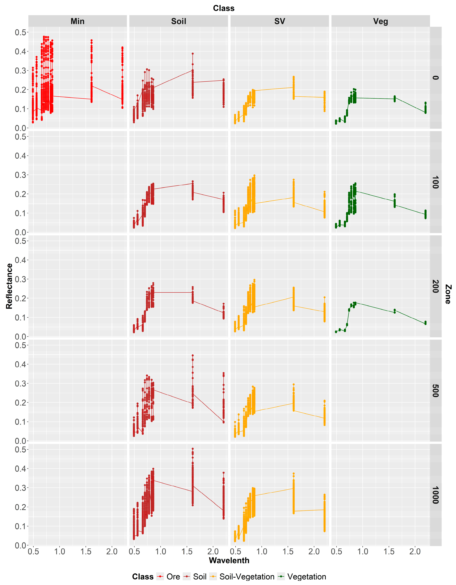](https://mdpi-res.com/minerals/minerals-15-01119/article_deploy/html/images/minerals-15-01119-g004.png)

**Figure 4.** Scatter plots of pixel points representing ore, soil, mixed soil–vegetation, and vegetation extracted from the image in the strata: (0) mine area zone, (100) 100 m buffer from mine areas, (200) 200 m buffer from mine areas, (500) 500 m buffer from mine areas, and (1000) 10 km buffer, representing distances greater than 500 m from mine areas. The plots illustrate the spectral response variation with distance from the mines, particularly in the NIR (Near-Infrared) and SWIR (Short-Wave Infrared) regions, where iron-related absorption and reflectance changes are most pronounced.

The lines show the similarity between the spectral curve of soil samples in the mine stratum and the ore signature. As distance increases, a change in the reflection pattern in the SWIR band is observed, with increasing reflectance values in the strata furthest from the mine areas.

The signatures of soil and soil/vegetation collected near the mines displayed similar spectral behaviors to the ore spectrum, indicating a “halo” effect where iron-rich material is present in the surrounding surface cover. As the distance from the mines increased, the spectral similarity to the ore signature decreased, and the influence of vegetation, characterized by high reflectance in the NIR, and mineralogically distinct soils became more dominant.

Further spectral analysis was conducted to assess the sample classes spectral signatures to understand their separability. [Figure 5](assets/figura-5.png) displays the mean spectral reflectance signatures of the pixels sampled of ore, soil, vegetation, and mixed soil–vegetation. The soil signatures are characterized by a generally increasing reflectance from the visible to the SWIR region, a typical feature of mineral soils. The curves exhibit a significant absorption feature around 2.20 µm, which is commonly associated with the presence of hydroxyl groups in clay minerals. Additionally, it features a peak reflectance in the NIR region (~0.85 µm), which is highly diagnostic for the presence of iron oxides.

[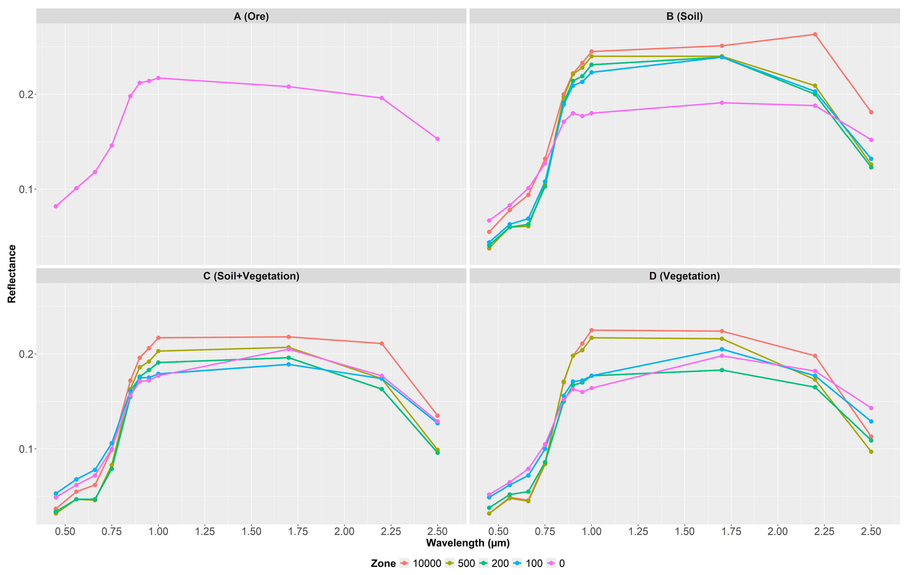](https://mdpi-res.com/minerals/minerals-15-01119/article_deploy/html/images/minerals-15-01119-g005.png)

**Figure 5.** Median spectral signatures of pixels representing (**A**) ore, (**B**) soil, (**C**) mixed soil–vegetation, and (**D**) vegetation extracted from Sentinel-2 imagery within the defined strata: (0) mine area zone, (100) 100 m buffer, (200) 200 m buffer, (500) 500 m buffer, and (1000) 10 km buffer. The spectral curves highlight diagnostic absorption features in the SWIR (Short-Wave Infrared) region (~2.20 µm) and reflectance peaks in the NIR (Near-Infrared) region (~0.85 µm), both indicative of iron oxides and hydroxyl-bearing minerals.

The vegetation signatures that are closest to the mines exhibit a sharp increase in reflectance between 0.70 µm and 0.80 µm in the Red Edge region, indicating presence of iron oxides. The signatures of mixed soil–vegetation display a less pronounced curve in the Red Edge region and a lower reflectance value in the NIR region compared to the pure vegetation class, while also showing higher reflectance in the visible spectrum than pure vegetation. This demonstrates the linear or non-linear mixing of spectral signals from multiple components within a given area.

Boxplot graphs were also generated to assess the dispersion behavior of the data collected in each band of the Sentinel-2 image ([Figure 6](assets/figura-6.png)).

[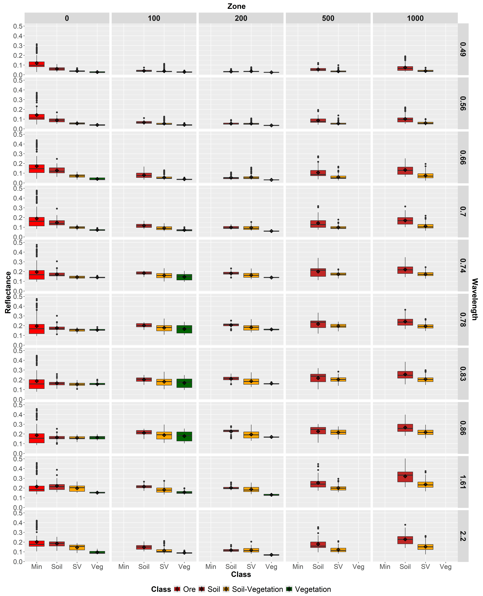](https://mdpi-res.com/minerals/minerals-15-01119/article_deploy/html/images/minerals-15-01119-g006.png)

**Figure 6.** Boxplot graphs of representative pixel values for ore, soil, mixed soil–vegetation, and vegetation extracted from Sentinel-2 imagery across different strata: (0) mine area zone, (100) 100 m buffer, (200) 200 m buffer, (500) 500 m buffer, and (1000) 10 km buffer. The boxplots show the dispersion and variability of reflectance values across spectral bands, emphasizing differences in the Red, NIR (Near-Infrared), and SWIR (Short-Wave Infrared) regions that correspond to variations in mineralogical and vegetation cover.

The graph shows the behavior of the data in each region. In strata closest to the mines, the data referring to ore shows a great variability in the Red to NIR regions. The soil data shows greater variability in the Red and SWIR regions. The mixed soil–vegetation class shows greater variability in the SWIR region, and the vegetation data in the Red-edge and NIR region.

The routine for reducing data noise using the MNF function calculated the eigenvalues of the Sentinel-2 image, ordering its information and noise content. The result of this operation is expressed in the form of a table, where the calculated eigenvalues are classified in descending order, with the values closest to zero representing noise. By applying the components corresponding to the information content generated in the image, it is possible to obtain a color composition where the tonal variations of the different types of elements can be identified according to the themes of the samples. The SAM technique allowed the mapping of the similarity between the spectrum of an image pixel and the reference spectrum from the spectral libraries. This resulted in indices (endmembers) corresponding to the reference materials that spectrally predominate in the pixel showing the order of similarity with the sample type from the reference library for each stratum class. [Figure 7](assets/figura-7.png) summarizes the results according to class, percentage of similarity, and collection stratum.

[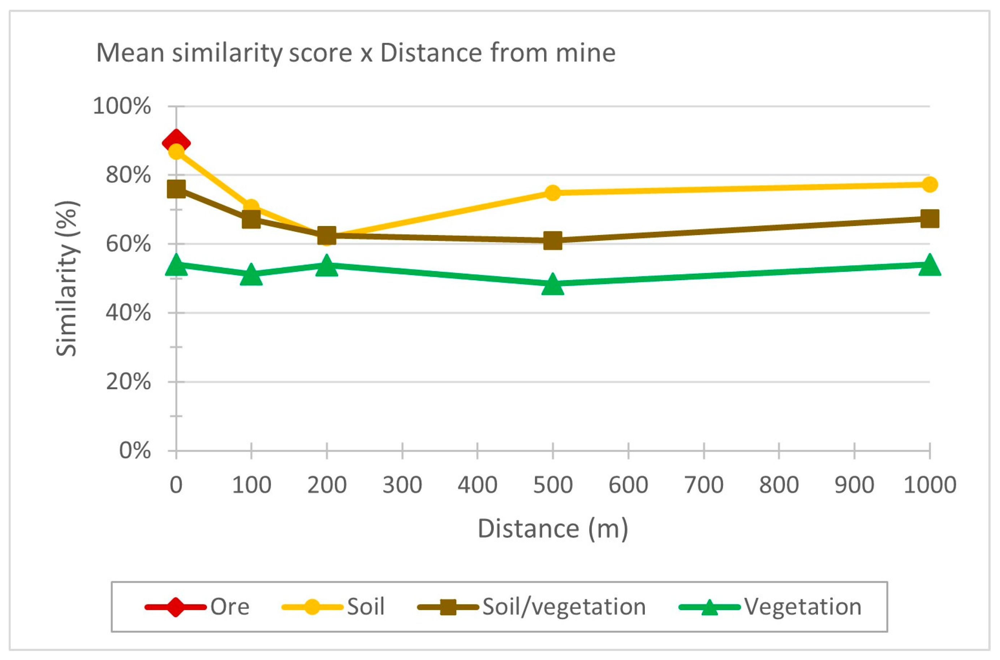](https://mdpi-res.com/minerals/minerals-15-01119/article_deploy/html/images/minerals-15-01119-g007.png)

**Figure 7.** Graphs showing the similarity of the mean values of the classes with the spectral library X distance zone (sampling strata).

The results of processing using RF model show the mapping of areas with potential for iron deposits well distributed throughout the state ([Figure 8](assets/figura-8.png)).

[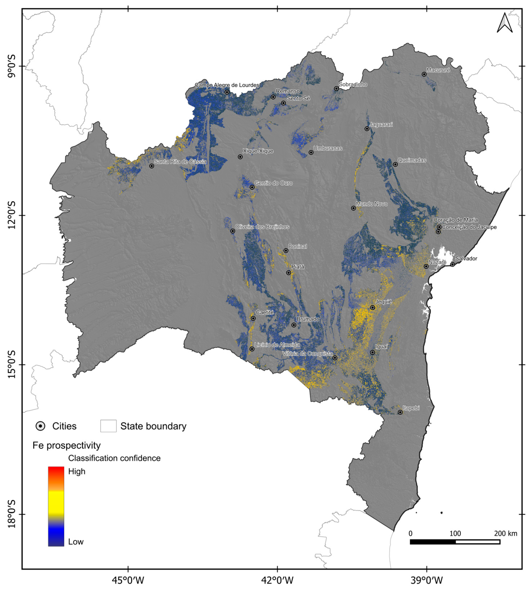](https://mdpi-res.com/minerals/minerals-15-01119/article_deploy/html/images/minerals-15-01119-g008.png)

**Figure 8.** Fe mineral prospectivity map of the state of Bahia, Brazil.

The analysis located areas of medium potential between the cities of Caetité and Licínio de Almeida, belonging to the Southwest District of Bahia. These bodies are aligned in a north–northeast to south–southwest trend, approximately 150 km long. Also in this region, it is possible to note two branches of potentially low areas, heading north–northwest. South of Brumado, clusters of areas can be observed, with a predominance of low potential, which, as they extend north–northwest, passing through Piatã and ending in Boninal, increase their iron potential.

In the Southeast District of Bahia, a north–south strip with average potentiality is observed. It extends from north of Jequié and diverges near Iguaí, northeast–southwest towards Vitoria da Conquista and north–northwest to south–southeast to Itapebi. It is possible to note, in this region, the occurrence of two more trends parallel to that of Jequié-Iguaí.

Between the cities of Nazaré, Coração de Maria, and Mundo Novo, lenticular-shaped areas extend from north–northwest to south–southeast. These zones, belonging to the Recôncavo District, were mapped with levels ranging from low to medium potential and branch out towards the cities of Queimadas and Jaguarari, further north in the state.

In the north of the state, the analysis mapped the strip corresponding to the Northern Iron District, located near the cities of Remanso and Sento Sé. This area extends northeast–southwest to the region near Santa Rita de Cássia, with a gradual increase in the level of mineral potential.

In [Figure 9](assets/figura-9.png), the MPM was overlaid with the district boundaries suggested by Ribeiro [[14](https://www.mdpi.com/2075-163X/15/11/1119#B14-minerals-15-01119)], ANM mining concession areas, as well as points referring to mineral occurrence locations. In general, the processing was able to map areas within and beyond the known districts, as observed on the map between the cities of Caetité and Jequié, an intermediate portion between the Southwest and Southeast districts. Other regions outside the districts include a discontinuous zone north of the Recôncavo District, near Macururé, and a strip extending from Sobradinho to Umburanas.

[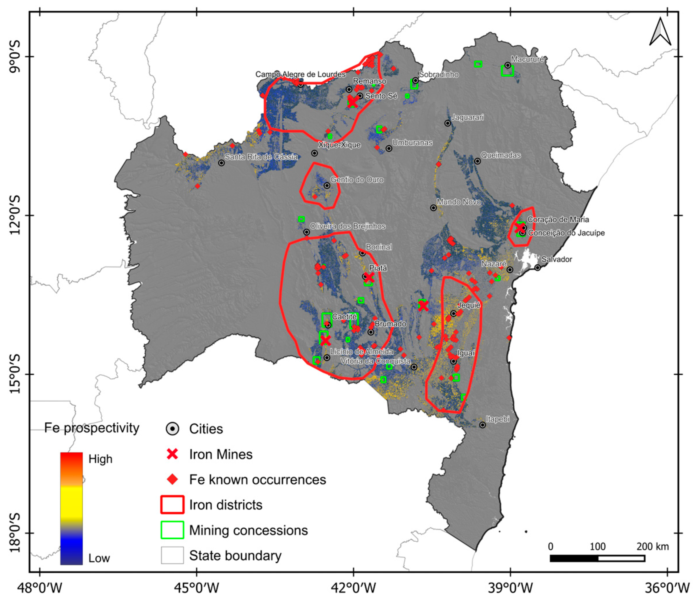](https://mdpi-res.com/minerals/minerals-15-01119/article_deploy/html/images/minerals-15-01119-g009.png)

**Figure 9.** Fe mineral prospectivity map with known occurrences, iron districts, and ANM mining concessions.

Visually, the MPM showed high consistency with ground reality. Operating iron mine areas, including non-sampled mines, like Jacuípe mine (Coração de Maria), and Tombador mine (Sento sé) were correctly classified with the highest potential, as their respective mineral deposits are associated with iron formations.

In addition, traces of iron were found around mines that produced other types of ore, such as the Caraíba mine (copper), Ipueira mine (chromium), and Vanádio de Maracás mine (vanadium) ([Figure 10](assets/figura-10.png)). These are probably host rocks that are mostly rich in iron. Although they are not considered iron deposits, they are commonly produced as a secondary substance in these mines.

[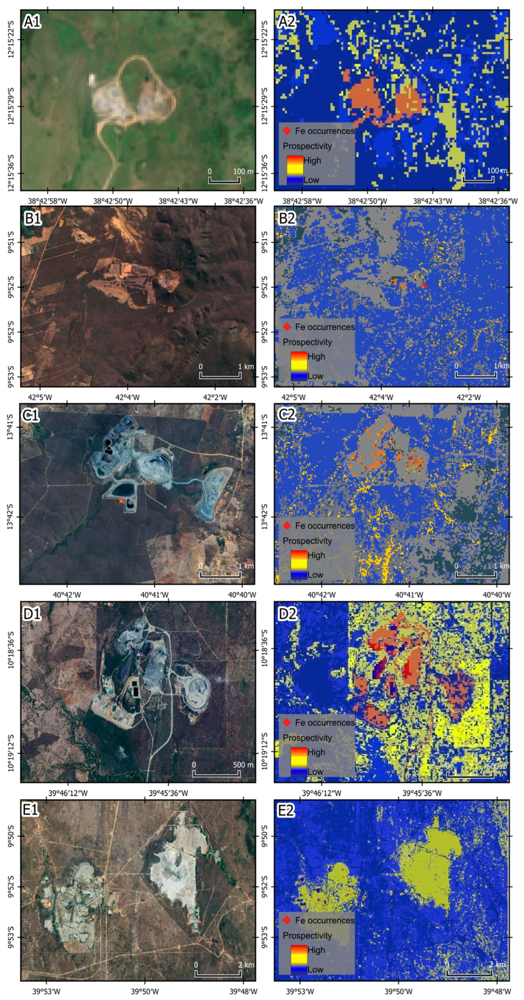](https://mdpi-res.com/minerals/minerals-15-01119/article_deploy/html/images/minerals-15-01119-g010.png)

**Figure 10.** Classification and high-resolution images (Google). (**A1,A2**) Jacuípe iron mine, (**B1,B2**) Tombador iron Mine, (**C1,C2**) Maracás Vanadium mine, (**D1,D2**) Ipueira chromium mine, and (**E1,E2**) Caraíba copper mine.

[Figure 11](assets/figura-11.png) shows, in detail, the location of iron occurrences in relation to the prospectivity results. Although certain portions of the mining concessions areas do not yet have an open pit, these are sites where trenches and trails have already been opened as a result of extensive prospecting. On the map, the locations of known Fe occurrences are shown by medium–high potential values in the north district and the iron-bearing district in southwest Bahia. Although no Fe mineralization has been found in these locations as of yet, potential areas of interest have also been discovered.

[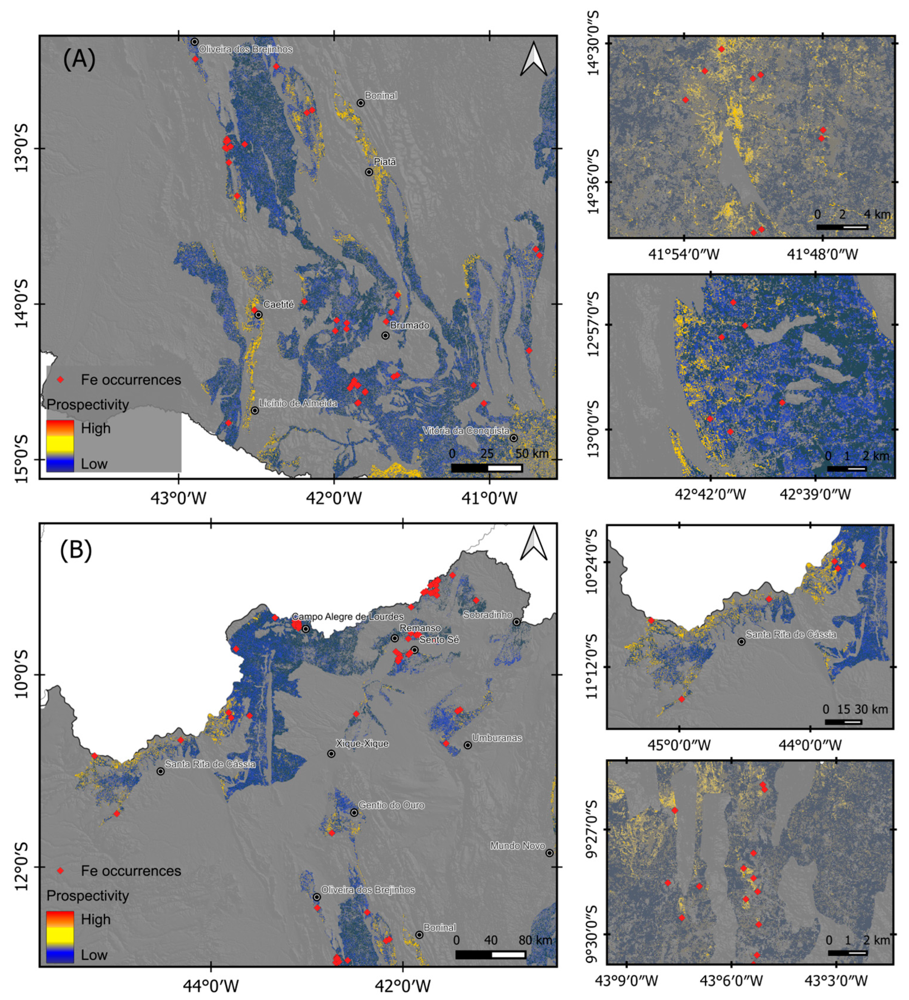](https://mdpi-res.com/minerals/minerals-15-01119/article_deploy/html/images/minerals-15-01119-g011.png)

**Figure 11.** Fe mineral prospectivity map in the iron districts of Bahia. (**A**) Southwestern district (**B**) Northern district.

A heat map was created to represent the trend in demand for research requested areas ([Figure 12](assets/figura-12.png)). From 1992 to 2025, 3491 areas were requested for iron research with the ANM. Of these, 1853 (53.07%) are located in regions with moderate to high prospectivity potential for iron ore. It is evident that there is a pattern related to the access to information over the years, since most research requests are made by small prospectors or local mining companies. In the first period (1992–2009), applications were more scattered throughout the state, while from 2010 onwards, there has been an increase in applications near areas where large mining corporations operate. It is also noteworthy that from 2020 to 2025, there is a trend toward applications in the central and southeastern parts of the state.

[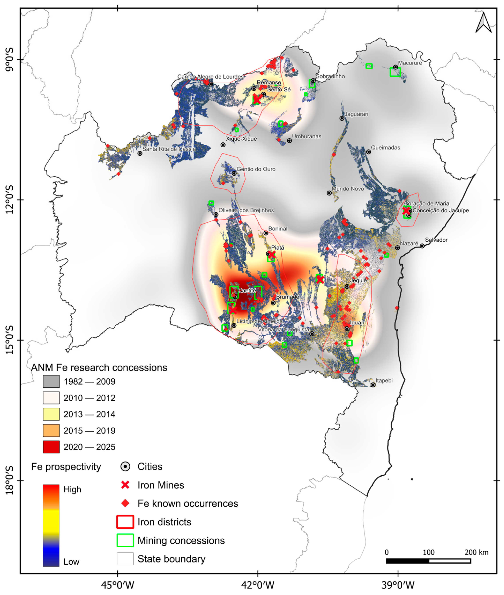](https://mdpi-res.com/minerals/minerals-15-01119/article_deploy/html/images/minerals-15-01119-g012.png)

**Figure 12.** Fe mineral prospectivity map and mineral exploration requirements.

The accuracy assessment of performance metrics was calculated and is summarized in Table 4, and [Figure 13](assets/figura-13.png) displayed the confusion matrix. The model achieved an overall accuracy of 69.8%. Cohen’s Kappa coefficient was calculated to be 0.623, indicating a fair level of agreement between the model’s predictions and the ground truth. The macro-averaged F1-score, which provides a balanced measure of precision and recall across all classes, was 0.697. An analysis of the per-class metrics shows that the model performed best at identifying the “Soil” class (F1-score = 0.750) and struggled most with the mixed soil–vegetation class (F1-score = 0.638), likely due to the high degree of spectral mixing in this category. The F1-score for the “Ore” class was 0.686.

**Table 4.** Summary of classification accuracy assessment metrics.

| Metric | Class | Score |
| --- | --- | --- |
| Overall Accuracy |  | 69.8% |
| Kappa Coefficient (κ) |  | 0.623 |
| Macro-Averaged F1-Score |  | 0.697 |
| Per-Class F1-Scores | Ore | 0.686 |
| Per-Class F1-Scores | Soil | 0.750 |
| Per-Class F1-Scores | Vegetation | 0.714 |
| Per-Class F1-Scores | Mixed soil–vegetation | 0.638 |

[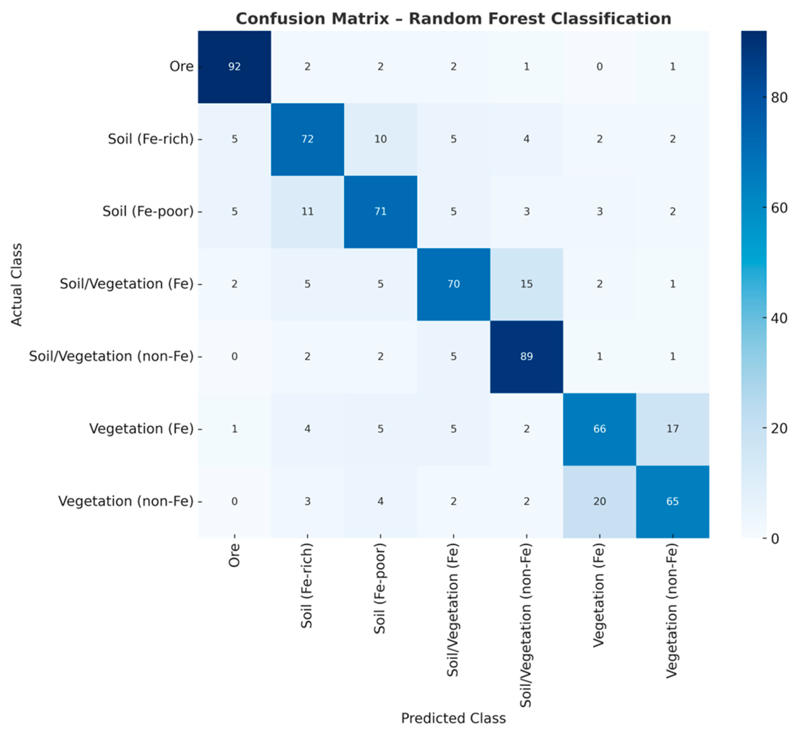](https://mdpi-res.com/minerals/minerals-15-01119/article_deploy/html/images/minerals-15-01119-g013.png)

**Figure 13.** Confusion matrix of sampled classes.

## 5. Discussion

The integrated SAM–RF framework has shown consistency between the modeled potentiality patterns and the geological architecture of Bahia. The high- and medium-potential zones identified by the model align spatially with units known for hosting iron ore, particularly within the metavolcano–sedimentary sequences of the Licínio de Almeida Complex and the greenstone belts of the Santaluz and Rio Itapicuru complexes. These findings suggest that the model effectively captures the lithological and alteration patterns inherent to Banded Iron Formations (BIFs) and related structures. Additionally, the model has demonstrated the ability to differentiate varying levels of iron enrichment, from exposed ore to subtle anomalies beneath vegetation or lateritic covers, thereby confirming its capacity to detect both direct and indirect spectral indicators of iron mineralization.

The validation metrics, including an overall accuracy of 69.8%, a macro-averaged F1-score of 0.697, and Cohen’s Kappa of 0.623, offer quantitative evidence of the model’s reliability. These results are comparable to, or slightly exceed, those found in similar studies utilizing RF model for MPM in data-scarce environments, such as the findings of Lachaud et al. [[5](https://www.mdpi.com/2075-163X/15/11/1119#B5-minerals-15-01119)] (accuracy 61%–70%) and Kong [[28](https://www.mdpi.com/2075-163X/15/11/1119#B28-minerals-15-01119)] (accuracy 66%). This underscores that the combination of SAM with RF produces competitive outcomes relative to global benchmarks, even when faced with limited training data. The similarity weights derived from SAM effectively reduced class imbalances and addressed the RF’s tendency to favor the dominant non-mineralized background, a common issue in mineral exploration. As a result, the model achieved a more favorable balance between sensitivity and specificity compared to the single classifiers typically employed in similar studies, such as those by Saremi et al. [[29](https://www.mdpi.com/2075-163X/15/11/1119#B29-minerals-15-01119)], Gong et al. [[30](https://www.mdpi.com/2075-163X/15/11/1119#B30-minerals-15-01119)], Hronsky and Groves [[31](https://www.mdpi.com/2075-163X/15/11/1119#B31-minerals-15-01119)], and Rajesh [[32](https://www.mdpi.com/2075-163X/15/11/1119#B32-minerals-15-01119)].

A critical aspect of the model’s performance relates to false positives, which were primarily observed in regions dominated by lateritic soils, ferruginous crusts, and certain urbanized areas. These features exhibit strong reflectance in the 0.7–0.9 µm range—similar to the diagnostic absorption region of hematite and goethite—resulting in confusion between iron-bearing lithologies and surficial iron oxides. Although these occurrences slightly reduced the model’s precision, they highlight the spectral complexity of tropical regolith environments, where chemical weathering and surface coatings alter the reflectance properties of rocks. This limitation does not invalidate the model’s predictive capacity but rather identifies zones of spectral ambiguity that warrant further geophysical or geochemical validation. Similar challenges have been reported in iron MPM studies in Australia and Africa, where regolith and lateritic cover severely complicate spectral interpretation [[14](https://www.mdpi.com/2075-163X/15/11/1119#B14-minerals-15-01119),[16](https://www.mdpi.com/2075-163X/15/11/1119#B16-minerals-15-01119),[22](https://www.mdpi.com/2075-163X/15/11/1119#B22-minerals-15-01119),[23](https://www.mdpi.com/2075-163X/15/11/1119#B23-minerals-15-01119),[24](https://www.mdpi.com/2075-163X/15/11/1119#B24-minerals-15-01119)].

To address this issue, the proposed SAM–RF integration introduces a semi-physically constrained data weighting scheme, which improves class separability compared to conventional data-driven RF or SVM models. The SAM component enhances the physical interpretability of spectral relationships by identifying endmember minerals that typify iron oxide alteration zones [[8](https://www.mdpi.com/2075-163X/15/11/1119#B8-minerals-15-01119),[9](https://www.mdpi.com/2075-163X/15/11/1119#B9-minerals-15-01119),[10](https://www.mdpi.com/2075-163X/15/11/1119#B10-minerals-15-01119),[11](https://www.mdpi.com/2075-163X/15/11/1119#B11-minerals-15-01119)]. At the same time, RF provides nonlinear decision boundaries that effectively generalize to unseen spatial contexts. This dual mechanism represents an incremental methodological advance in MPM because it merges spectral physics-based classification with statistical learning, reducing overfitting while improving robustness in spectrally complex terrains. The superior performance compared to SVM-based approaches—commonly reported to exhibit instability under small or imbalanced datasets [[5](https://www.mdpi.com/2075-163X/15/11/1119#B5-minerals-15-01119),[19](https://www.mdpi.com/2075-163X/15/11/1119#B19-minerals-15-01119),[27](https://www.mdpi.com/2075-163X/15/11/1119#B27-minerals-15-01119)]—supports findings from Yu and Li [[18](https://www.mdpi.com/2075-163X/15/11/1119#B18-minerals-15-01119)] and Riquelme [[26](https://www.mdpi.com/2075-163X/15/11/1119#B26-minerals-15-01119)], who emphasized the enhanced stability and interpretability of ensemble models for geological applications.

From a comparative perspective, the results achieved in Bahia are consistent with those reported in well-studied provinces such as the Yilgarn Craton (Western Australia), where Duuring et al. [[33](https://www.mdpi.com/2075-163X/15/11/1119#B33-minerals-15-01119)] used ASTER data to map BIFs with approximately 70% accuracy. However, unlike those semi-arid regions, Bahia presents a dense vegetation cover and extensive weathering crust, both of which degrade the spectral signal. Achieving comparable accuracy under such conditions underscores the robustness of the proposed approach for tropical environments. Similarly, research in Algeria, Mauritania, and Morocco [[14](https://www.mdpi.com/2075-163X/15/11/1119#B14-minerals-15-01119),[16](https://www.mdpi.com/2075-163X/15/11/1119#B16-minerals-15-01119)] demonstrated the potential of multispectral data for regional-scale iron exploration but also highlighted the difficulty in distinguishing ore from lateritic soils. The present model mitigated this issue through the SAM weighting strategy, which prioritized spectral endmembers closely aligned with laboratory-calibrated ore signatures. Comparable to Iranian studies [[17](https://www.mdpi.com/2075-163X/15/11/1119#B17-minerals-15-01119),[19](https://www.mdpi.com/2075-163X/15/11/1119#B19-minerals-15-01119),[34](https://www.mdpi.com/2075-163X/15/11/1119#B34-minerals-15-01119)], this work reinforces the need for future integration of geophysical datasets (magnetometry and gravimetry) to reduce misclassifications and confirm subsurface mineral continuity.

In general terms, three main challenges emerged: (i) managing spectral confusion in areas of strong lateritization, (ii) ensuring representativeness of training samples under data scarcity, and (iii) validating results in the absence of dense ground-truth datasets. The use of Sentinel-2’s narrow VNIR bands (0.7–0.9 µm) and multi-strata sampling strategy—covering ore, soil, soil–vegetation mixtures, and vegetation—proved critical to minimize these effects. The MNF transformation further enhanced feature selection by reducing noise and emphasizing spectral components relevant to iron mineralization. Future model refinements should focus on fusing multisource datasets, such as magnetometric and gravimetric layers, to improve the discrimination between lithological and pedological iron signatures. Additionally, exploring Explainable AI (XAI) tools can elucidate the model’s decision process and link it more explicitly to geological reasoning.

This study contributes to the ongoing evolution of MPM. The field is shifting from conventional statistical models to hybrid and deep learning architectures capable of capturing nonlinear, multiscale relationships between geology and mineralization [[27](https://www.mdpi.com/2075-163X/15/11/1119#B27-minerals-15-01119),[28](https://www.mdpi.com/2075-163X/15/11/1119#B28-minerals-15-01119),[29](https://www.mdpi.com/2075-163X/15/11/1119#B29-minerals-15-01119),[30](https://www.mdpi.com/2075-163X/15/11/1119#B30-minerals-15-01119),[35](https://www.mdpi.com/2075-163X/15/11/1119#B35-minerals-15-01119),[36](https://www.mdpi.com/2075-163X/15/11/1119#B36-minerals-15-01119)]. However, geological processes are inherently non-stationary, and the relationships among ore-controlling factors vary significantly across regions [[36](https://www.mdpi.com/2075-163X/15/11/1119#B36-minerals-15-01119)]. In this sense, the SAM–RF hybrid approach offers a pragmatic and scalable framework for regional-scale reconnaissance, capable of providing meaningful predictions even when data are sparse or heterogeneous. Such adaptability positions the method as a potential foundation for developing next-generation geospatial models that integrate physical spectral knowledge with data-driven generalization.

The SAM–RF integrated workflow provided a validated, cost-effective, and interpretable approach for large-scale iron MPM in Bahia. Its accuracy metrics are on par with or surpass those of comparable studies, while its methodological structure introduces an innovative fusion of physics-based and statistical learning techniques. The main limitations relate to the spectral confusion caused by lateritic covers and the absence of geophysical validation layers; however, these also define clear directions for future research. Expanding the approach through data fusion, transfer learning, and deep neural models could further enhance predictive precision and contribute to a more comprehensive understanding of mineralization processes in tropical metallogenic provinces.

## 6. Conclusions

The work demonstrated the potential of using remote sensing and machine learning techniques, processed in the cloud, to generate large-scale mineral potentiality maps. The combination of SAM and RF classifiers was effective in characterizing different targets based on their spectral signatures, resulting in a map that proved to be consistent with known deposits and that points out new promising areas for exploration.

The Bahia mineral exploration study is a real-world illustration of an international scientific undertaking. The growing availability of multi-source geodata and the strength of artificial intelligence are driving the rapid evolution of the MPM field. A global drive to develop more precise, reliable, and interpretable prediction tools is reflected in the achievements and difficulties observed in Bahia.

The future of MPM depends on tackling its core issues comprehensively rather than merely implementing increasingly sophisticated algorithms. This includes using intelligent sampling and augmentation to manage sparse and unbalanced data, using explainable AI to allow the model’s reasoning to be compared with established geological knowledge and developing models that take into account the spatial heterogeneity of geological systems.

As future prospects and next steps, the integration of geophysical data, specifically magnetometry and gravimetry, can enhance the model by offering essential physical constraints. This approach distinguishes targets that are only spectrally similar, such as laterite cover, from those that exhibit both spectral and magnetic anomalies, indicating potential iron ore. Therefore, it provides insights into subsurface structures that optical sensors do not capture. Similarly, the use of hyperspectral data, when available, would allow for more detailed mineralogical discrimination. It would also be useful to explore deep learning algorithms, such as Convolutional Neural Networks (CNNs), which utilize stacked kernels, such as 3 × 3 convolutions, for hierarchical feature extraction, enabling them to model the spatially dependent, multiscale lithology-structure associations inherent to mineral systems that pixel-based classifiers, such as RF, are unable to capture. It may enhance spatial pattern recognition and could further refine the results.

It is recommended that the products generated by this work serve as guidelines to direct future mineral research campaigns, which should include detailed geological field studies, such as drilling and rock sampling, to confirm the new areas suggested by the model. The evaluation method presented here, being relatively fast and low-cost, is a critical tool for mineral modeling and exploration in a state with the vast geological potential of Bahia.

## Author Contributions

Conceptualization, R.F.-R., C.M.S.J., R.N.V. and W.J.S.F.-R.; methodology, R.F.-R., C.M.S.J., R.N.V., P.W.M.S.-F., T.d.A. and W.J.S.F.-R.; software execution, R.F.-R., C.M.S.J., R.N.V. and W.J.S.F.-R., writing—original draft preparation, R.F.-R., C.M.S.J. and R.N.V.; writing—review and editing, R.F.-R., R.N.V., C.M.S.J., P.W.M.S.-F., T.d.A. and W.J.S.F.-R.; supervision, C.M.S.J. and W.J.S.F.-R.; funding acquisition, C.M.S.J. and W.J.S.F.-R. All authors have read and agreed to the published version of the manuscript.

## Funding

This work is funded by the Prospecta 4.0—CNPq research grant under Process No. 407907/2022-0 and Foundation of the State of Bahia-FAPESB under the program Bioresources, Water Resources, and Environmental Sustainability in Bahia, through the Postgraduate Program in Modeling in Earth and Environmental Sciences, Call for Proposals 38/2022. W.J.S.F.R. was supported by a CNPQ research fellowship under Process #314954/2021-0. Additional funding was provided by the National Council for Scientific and Technological Development (CNPq), and the Ministry of Science, Technology, and Innovation (MCTI) under the grant CNPq/MCTI No. 441271/2023-5 “Present, past and future of Semi-Arid Biodiversity: inventories, monitoring, impact of climate change and implications for the use and conservation of flora, fauna and fungi”. We thank the National Institute of Science and Technology (INCT) in Inter and Transdisciplinary Studies in Ecology and Evolution (IN-TREE), funded by CNPq (408930/2024-1), CAPES (88887.195651/2025-00), and FAPESP.

## Data Availability Statement

The original contributions presented in this study are included in the article. Further inquiries can be directed to the corresponding authors.

## Acknowledgments

We appreciate comments and suggestions from the reviewers that helped improve the quality and presentation of the manuscript.

## Conflicts of Interest

Author Rafael Franca-Rocha was employed by the company Geodatin Inteligência em dados e Geoinformação, Ltda. The remaining authors declare that the research was conducted in the absence of any commercial or financial relationships that could be construed as a potential conflict of interest.

## Abbreviations

The following abbreviations are used in this manuscript:

- **AI**: Artificial Intelligence
- **ANM**: Agência Nacional de Mineração (National Mining Agency, Brazil)
- **ASTER**: Advanced Spaceborne Thermal Emission and Reflection Radiometer
- **BIF**: Banded Iron Formation
- **CBPM**: Companhia Baiana de Pesquisa Mineral (Bahia Mineral Research Company)
- **CPRM-SBG**: Companhia de Pesquisa de Recursos Minerais (Geological Survey of Brazil)
- **GEE**: Google Earth Engine
- **ML**: Machine Learning
- **MPM**: Mineral Prospectivity Mapping
- **MSI**: Multispectral Instrument
- **NIR**: Near-infrared
- **RF**: Random Forest
- **SAM**: Spectral Angle Mapper
- **SVM**: Support Vector Machine
- **SWIR**: Short-wave infrared
- **VNIR**: Visible and near-infrared

## References

1. Brazil. *Mineral Sector Bulletin*, 3rd ed.; Secretariat of Geology, Mining and Mineral Transformation (DTTM), Ministry of Mines and Energy (MME): Brasília, Brazil, 2022; p. 32.
2. Brazil. *Brazilian Mineral Yearbook*, 1st ed.; National Mining Agency (ANM): Brasília, Brazil, 2025; p. 26.
3. Leonardos, H. *Iron in the State of Bahia. Mining and Metallurgy*, 2nd ed.; Sociedade Brasileira de Geologia (SBG): Rio de Janeiro, Brazil, 1937; pp. 51–57.
4. Silva, A. *Geo-Referenced Information Systems: Concepts and Fundamentals*, 1st ed.; Unicamp: Campinas, Brazil, 2003; p. 236.
5. Lachaud, A.; Adam, M.; Mišković, I. Comparative Study of Random Forest and Support Vector Machine Algorithms in Mineral Prospectivity Mapping with Limited Training Data. *Minerals* **2023**, *13*, 1073. [[CrossRef](https://doi.org/10.3390/min13081073)]
6. Sun, K.; Chen, Y.; Geng, G.; Lu, Z.; Zhang, W.; Song, Z.; Guan, J.; Zhao, Y.; Zhang, Z. A Review of Mineral Prospectivity Mapping Using Deep Learning. *Minerals* **2024**, *14*, 1021. [[CrossRef](https://doi.org/10.3390/min14101021)]
7. Peng, Q.; Wang, Z.; Wang, G.; Zhang, W.; Chen, Z.; Liu, X. 3D Mineral Prospectivity Mapping from 3D Geological Models Using Return–Risk Analysis and Machine Learning on Imbalance Data. *Minerals* **2023**, *13*, 1384. [[CrossRef](https://doi.org/10.3390/min13111384)]
8. Van Der Meer, F.; Vazquez-Torres, M.; Van Dijk, P.M. Spectral characterization of ophiolite lithologies in the Troodos Ophiolite complex of Cyprus and its potential in prospecting for massive sulphide deposits. *Int. J. Remote Sens.* **1997**, *18*, 1245–1257. [[CrossRef](https://doi.org/10.1080/014311697218395)]
9. Yuhas, R.H.; Goertz, A.F.H.; Boardman, J.W. Discrimination among semi-arid landscape endmembers using the Spectral Angle Mapper (SAM) algorithm. In Proceedings of the 24th Lunar and Planetary Science Conference. Part 2: G-M, Houston, TX, USA, 15–19 March 1993.
10. De Carvalho, O.A.; Meneses, P.R. Spectral Correlation Mapper (SCM); An Improvement on the Spectral Angle Mapper (SAM). In Proceedings of the 9th JPL Airborne Earth Science Workshop 2000, Pasadena, CA, USA, 1–5 June 2000; p. 9.
11. Crosta, A.P.; Sabine, C.; Taranik, J.V. Hydrothermal Alteration Mapping at Bodie, California, using AVIRIS Hyperspectral Data. *Remote Sens. Environ.* **1998**, *65*, 309–319. [[CrossRef](https://doi.org/10.1016/S0034-4257(98)00040-6)]
12. Biondi, J. *Metallogenic Processes and Brazilian Mineral Deposits*, 1st ed.; Oficina de Textos: São Paulo, Brazil, 2003; p. 528.
13. Santana, A. *Project for Registering Mineral Occurrences in the State of Bahia*, 2nd ed.; SME: Juazeiro, Brazil, 1974; p. 324.
14. Ribeiro, A. *Potential of Iron Ore in the State of Bahia*, 1st ed.; Companhia Baiana de Pesquisa Mineral: Salvador, Brazil, 2017; pp. 9–61.
15. Van der Meer, F.D.; Van der Werff, H.M.A. Sentinel-2 for Mapping Iron Absorption Feature Parameters. *Remote Sens. Environ.* **2015**, *7*, 12635–12653. [[CrossRef](https://doi.org/10.3390/rs71012635)]
16. Van der Werff, H.; Hewson, R. Using Sentinel-2 MSI for mapping iron oxide minerals on a continental and global scale. *Authorea*, 2020; *in press*. [[CrossRef](https://doi.org/10.1002/essoar.10501783.1)]
17. Feizi, F.; Mansouri, E. Introducing the Iron Potential Zones Using Remote Sensing Studies in South of Qom Province, Iran. *Open J. Geol.* **2013**, *3*, 278–286. [[CrossRef](https://doi.org/10.4236/ojg.2013.34032)]
18. Ciampalini, A.; Garfagnoli, F.; Antonielli, B.; Moretti, S.; Righini, G. Remote sensing techniques using Landsat ETM+ applied to the detection of iron ore deposits in Western Africa. *Arab. J. Geosci.* **2013**, *6*, 4529–4546. [[CrossRef](https://doi.org/10.1007/s12517-012-0725-0)]
19. Shirazi, A.; Hezarkhani, A.; Shirazy, A. Remote Sensing Studies for Mapping of Iron Oxide Regions, South of Kerman, IRAN. *Int. J. Sci. Eng. Appl.* **2018**, *7*, 045–051. [[CrossRef](https://doi.org/10.7753/IJSEA0704.1002)]
20. Ourhzif, Z.; Ahmed, A.; Ab, A.; Fatiha, H. Lithological mapping using landsat 8 oli and aster multispectral data in imini-ounilla district south high atlas of Marrakech. *ISPRS J. Photogramm. Remote Sens.* **2019**, *XLII-2/W13*, 1255–1262. [[CrossRef](https://doi.org/10.5194/isprs-archives-XLII-2-W13-1255-2019)]
21. STEP ESA Platform. Available online: [https://step.esa.int/main/snap-supported-plugins/sen2cor/](https://step.esa.int/main/snap-supported-plugins/sen2cor/) (accessed on 2 October 2025).
22. ENVI Spectral Hourglass Workflow. Available online: [https://www.nv5geospatialsoftware.com/docs/SpectralHourglassWorkflow.html](https://www.nv5geospatialsoftware.com/docs/SpectralHourglassWorkflow.html) (accessed on 2 October 2025).
23. Ng-Cutipa, W.L.; Lobato, A.; González, F.J.; Georgalas, G.P.; Zananiri, I.; Carvalho, M.; Cardoso-Fernandes, J.; Somoza, L.; Piña, R.; Lunar, R.; et al. Spectral Angle Mapper Application Using Sentinel-2 in Coastal Placer Deposits in Vigo Estuary, Northwest Spain. *Remote Sens.* **2025**, *17*, 1824. [[CrossRef](https://doi.org/10.3390/rs17111824)]
24. Sinaice, B.B.; Owada, N.; Ikeda, H.; Toriya, H.; Bagai, Z.; Shemang, E.; Adachi, T.; Kawamura, Y. Spectral Angle Mapping and AI Methods Applied in Automatic Identification of Placer Deposit Magnetite Using Multispectral Camera Mounted on UAV. *Minerals* **2022**, *12*, 268. [[CrossRef](https://doi.org/10.3390/min12020268)]
25. Wang, M.; Huang, Z.; Zhang, X.; Zhang, Y.; Chen, M. Altered mineral mapping based on ground-airborne hyperspectral data and wavelet spectral angle mapper tri-training model: Case studies from Dehua-Youxi-Yongtai Ore District, Central Fujian, China. *Int. J. Appl. Earth Obs. Geoinf.* **2021**, *101*, 102357. [[CrossRef](https://doi.org/10.1016/j.jag.2021.102409)]
26. Kruse, F.A.; Lefkoff, A.B.; Boardman, J.W.; Heidebrecht, K.B.; Shapiro, A.T.; Barloon, P.J.; Goetz, A.F.H. The spectral image processing system (SIPS)—Interactive visualization and analysis of imaging spectrometer data. *Remote Sens. Environ.* **1993**, *44*, 145–163. [[CrossRef](https://doi.org/10.1016/0034-4257(93)90013-N)]
27. Yu, Z.; Li, B. Mineral Prospectivity Mapping Susceptibility Evaluation Based on Interpretable Ensemble Learning. *Ore Geol. Rev.* **2024**, *173*, 106248. [[CrossRef](https://doi.org/10.1016/j.oregeorev.2024.106248)]
28. Kong, W. Machine Learning-Based Uranium Prospectivity Mapping Using Random Forest and Explainability Study. *Minerals* **2024**, *14*, 128. [[CrossRef](https://doi.org/10.3390/min14020128)]
29. Saremi, M.; Hezarkhani, A.; Mirzabozorg, S.A.A.S.; DehghanNiri, R.; Shirazy, A.; Shirazi, A. Unsupervised Anomaly Detection for Mineral Prospectivity Mapping Using Isolation Forest and Extended Isolation Forest Algorithms. *Minerals* **2025**, *15*, 411. [[CrossRef](https://doi.org/10.3390/min15040411)]
30. Gong, J.; Li, Y.; Xie, M.; Kong, Y.; Tang, R.; Li, C.; Wu, Y.; Wu, Z. Mineral Prospectivity Mapping in Xiahe-Hezuo Area Based on Wasserstein Generative Adversarial Network with Gradient Penalty. *Minerals* **2025**, *15*, 184. [[CrossRef](https://doi.org/10.3390/min15020184)]
31. Hronsky, J.; Groves, D. Science of targeting: Definition, strategies, targeting and performance measurement. *Aust. J. Earth Sci.* **2008**, *55*, 3–12. [[CrossRef](https://doi.org/10.1080/08120090701581356)]
32. Rajesh, H. Application of remote sensing and GIS in mineral resource mapping: An overview. *J. Mineral. Petrol. Sci.* **2004**, *99*, 83–103. [[CrossRef](https://doi.org/10.2465/jmps.99.83)]
33. Duuring, P.; Hagemann, S.; Novikova, Y.; Cudahy, T.; Laukamp, C. Targeting Iron Ore in Banded Iron Formations Using ASTER Data: Weld Range Greenstone Belt, Yilgarn Craton, Western Australia. *Econ. Geol.* **2012**, *107*, 585–597. [[CrossRef](https://doi.org/10.2113/econgeo.107.4.585)]
34. Majid, G.; Narges, Y.; Konari, B.M. *Porphyry Copper Deposits of Iran*; Tarbiat Modares University: Tehran, Iran, 2018; ISBN 978.600.7589.69.4.
35. Riquelme, Á.I. Dual Random Fields and Their Application to Mineral Potential Mapping. *Math. Geosci.* **2025**, *57*, 845–881. [[CrossRef](https://doi.org/10.1007/s11004-025-10195-4)]
36. Daruna, A.; Zadorozhnyy, V.; Lukoczki, G.; Chiu, H.-P. GFM4MPM: Towards Geospatial Foundation Models for Mineral Prospectivity Mapping. *arXiv* **2024**, arXiv:2406.12756. [[CrossRef](https://doi.org/10.48550/arXiv.2406.12756)]
