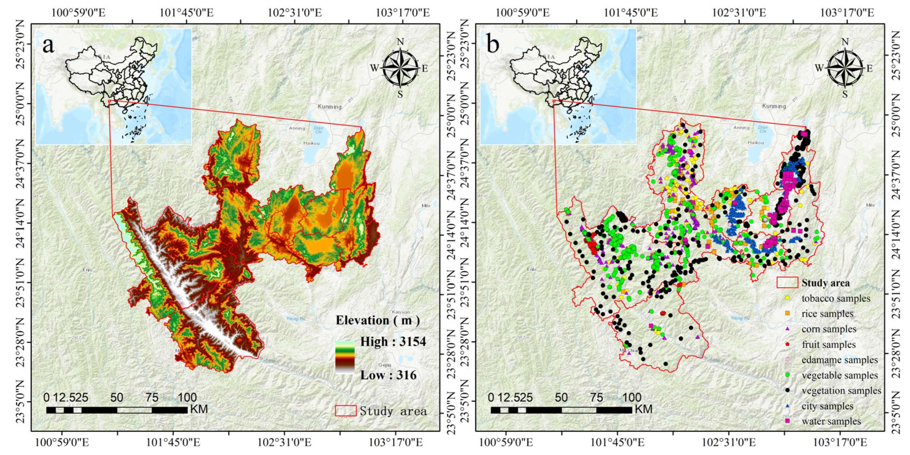
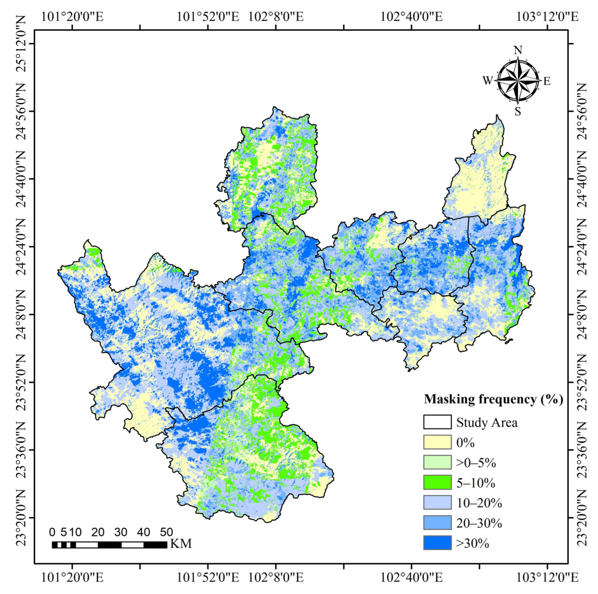
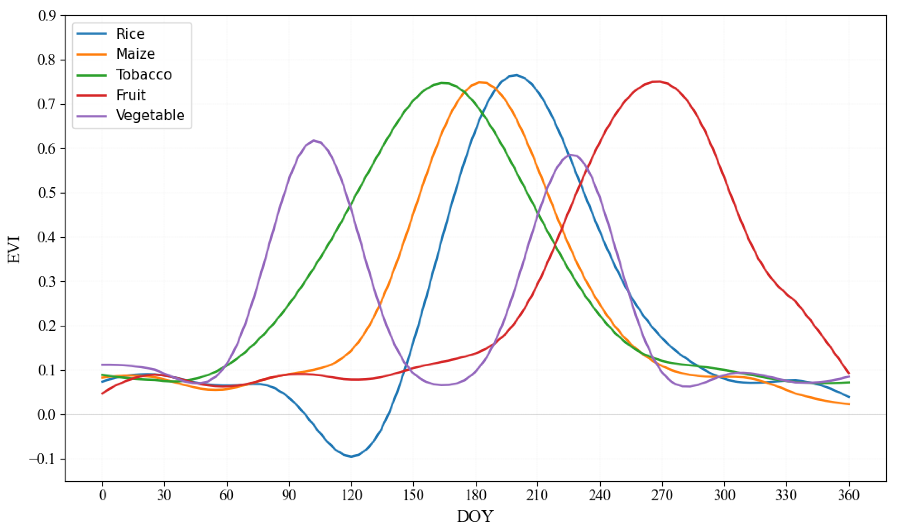
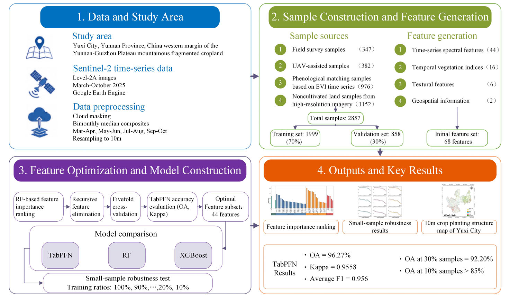
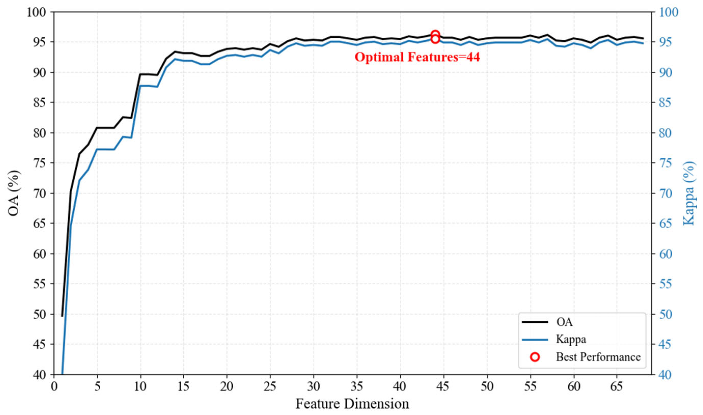
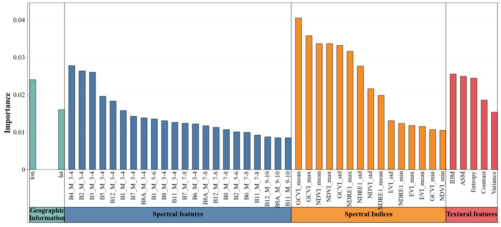
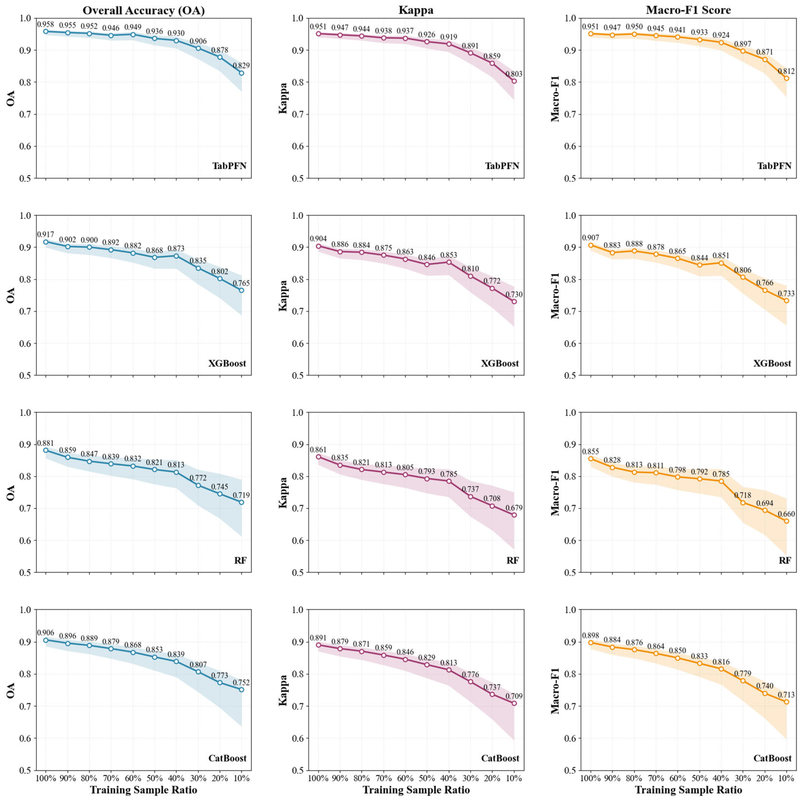
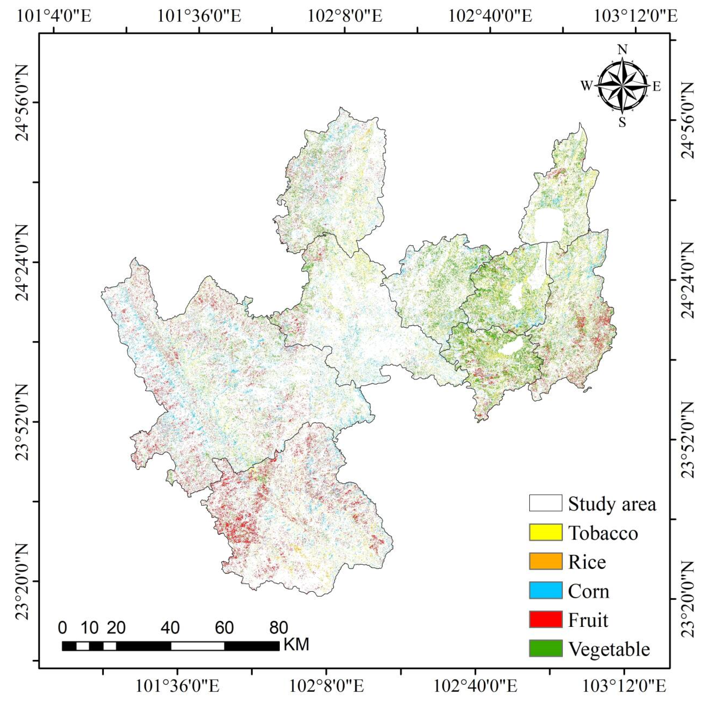

Ke Yang$^{1}$, Yanyan Huang$^{1,2,*}$ and Xin Lu$^{3}$

- $^{1}$ School of Software Engineering, Chengdu University of Information Technology, Chengdu 610225, China
- $^{2}$ Sichuan Key Laboratory of Software Automatic Generation and Intelligent Service, Chengdu University of Information Technology, Chengdu 610225, China
- $^{3}$ Sichuan Research Institute of Water Conservancy, Chengdu 610072, China
- $^{*}$ Author to whom correspondence should be addressed.

_Remote Sens._ **2026**, _18_(11), 1857; [https://doi.org/10.3390/rs18111857](https://doi.org/10.3390/rs18111857)

Received: 27 April 2026 / Revised: 31 May 2026 / Accepted: 3 June 2026 / Published: 5 June 2026

## Highlights

**What are the main findings?**

- The RFE-TabPFN framework achieved an OA of 96.27%, a kappa coefficient of 0.9558, and a macro-F1 score of 0.956 in the main validation.
- In repeated small-sample experiments, TabPFN maintained a mean OA of 90.60% at a 30% training-sample ratio and 82.89% at a 10% ratio.

**What are the implications of the main findings?**

- The proposed framework provides a feasible approach for crop classification in data-scarce mountainous regions where field sampling is costly and constrained.
- RF-guided feature ranking and coordinate-removal ablation suggest that phenological, spectral, and textural features were important sources of discrimination, while geographic coordinates mainly provided supplementary spatial context.

## Abstract

Accurate mapping of crop planting structures is critical for precision agriculture, yet it remains challenging in rugged terrain with fragmented fields, frequent cloud contamination, and limited high-quality training samples. This study evaluates an integrated framework combining recursive feature elimination (RFE) and the pretrained Tabular Prior-Data Fitted Network (TabPFN) for small-sample crop classification using Sentinel-2 time-series data in Yuxi City, located on the western margin of the Yunnan–Guizhou Plateau. A multidimensional feature set integrating spectral and temporal vegetation indices and textural and geospatial information was constructed and optimized via RFE. The TabPFN model achieved an overall accuracy (OA) of 96.27%, a kappa coefficient of 0.9558, and a macro-F1 score of 0.956 in the main validation. In repeated small-sample experiments, TabPFN maintained a mean OA of 90.60% at a 30% training-sample ratio and 82.89% at a 10% ratio. RF-guided feature ranking and ablation analyses suggested that temporal vegetation indices were important predictors, followed by early-season spectral characteristics, textural features, and supplementary geospatial information. Overall, these findings indicate that RFE-TabPFN is a feasible option for 10 m crop mapping in Yuxi under limited training samples, while its broader applicability still requires further testing across additional years, regions, and cropping systems.

## Keywords

TabPFN; crop planting structure; Sentinel-2; few-shot learning; feature selection; remote sensing classification

## 1. Introduction

The accurate and timely acquisition of spatial distribution information at the regional scale is important for the precise management of agricultural production, the optimal allocation of water and land resources, and the optimization and adjustment of cropping systems. It also serves as critical data for ensuring national food security, addressing climate change, and achieving sustainable agricultural development [[1](https://www.mdpi.com/2072-4292/18/11/1857#B1-remotesensing-18-01857),[2](https://www.mdpi.com/2072-4292/18/11/1857#B2-remotesensing-18-01857),[3](https://www.mdpi.com/2072-4292/18/11/1857#B3-remotesensing-18-01857)]. Compared with traditional manual statistical methods and field sampling-based survey methods, remote sensing technology has become a mainstream approach for large-scale crop identification and crop planting structure mapping because of its technical advantages as a macroscopic, rapid, dynamic, and noncontact approach [[4](https://www.mdpi.com/2072-4292/18/11/1857#B4-remotesensing-18-01857)]. In particular, the Sentinel-2 satellite constellation of the European Space Agency provides multispectral data with a 10 m spatial resolution and a 5-day revisit period. It offers the advantage of both high spatial and high temporal resolution. Four red-edge spectral bands are highly sensitive to changes in the physiological and biochemical characteristics of the vegetation canopy, providing unprecedented data support for fine-scale dynamic monitoring of crop planting structures in areas with complex terrain [[5](https://www.mdpi.com/2072-4292/18/11/1857#B5-remotesensing-18-01857),[6](https://www.mdpi.com/2072-4292/18/11/1857#B6-remotesensing-18-01857),[7](https://www.mdpi.com/2072-4292/18/11/1857#B7-remotesensing-18-01857)].

In recent years, researchers worldwide have conducted extensive research on crop classification and mapping using multisource time-series remote sensing images and have established a mature technical system of “building time-series phenological metrics–machine learning (ML) model training–large-scale classification and mapping”, achieving a series of breakthroughs. In the national context, Qiu et al. [[8](https://www.mdpi.com/2072-4292/18/11/1857#B8-remotesensing-18-01857)] developed a complex cropping pattern mapping (CCPM) framework and constructed the first national cropping structure map of China with a 10 m resolution, covering 10 crop types and crop rotation sequences using Sentinel-1/2 time-series images; the overall accuracy of this method was 91.47%, thus demonstrating the importance of time-series red-edge and shortwave infrared bands in crop type identification. At the field level, Tang et al. [[9](https://www.mdpi.com/2072-4292/18/11/1857#B9-remotesensing-18-01857)] proposed a crop planting structure mapping method based on the semantic edge-aware multitask neural network (SEANet), which can suppress classification noise by accurately delineating the boundaries of farmland parcels. This method ultimately achieved an overall classification accuracy of 94.86% with a random forest (RF) model. In addition, multisource data fusion has become an important approach for improving crop classification accuracy. Blickensdörfer et al. [[10](https://www.mdpi.com/2072-4292/18/11/1857#B10-remotesensing-18-01857)] combined multisource time-series data to map crop types and crop rotation sequences across Germany. Faqe Ibrahim et al. [[11](https://www.mdpi.com/2072-4292/18/11/1857#B11-remotesensing-18-01857)] reported that the combined use of Sentinel-1 synthetic aperture radar (SAR) and Sentinel-2 optical data can significantly reduce the effects of clouds and rain on classification results.

Although important breakthroughs have been reported in existing research, the application of currently available technical systems in mountainous agricultural areas with rugged terrain, such as the Yunnan–Guizhou Plateau, still faces two unavoidable core challenges. First, classification uncertainty resulting from complex terrain and climatic conditions is greatly increased. The western margin of the Yunnan–Guizhou Plateau is dominated by mountains, river valleys, and intermountain basins, with highly rugged terrain and significant local climatic differences. Crop cultivation in this region is characterized by “three-dimensional (3D) distributions, fragmented patches, and diverse types” [[12](https://www.mdpi.com/2072-4292/18/11/1857#B12-remotesensing-18-01857),[13](https://www.mdpi.com/2072-4292/18/11/1857#B13-remotesensing-18-01857)]. A subtropical monsoon climate, with frequent cloudy and rainy weather, occurs during the critical crop growth period. During this period, the effective observation data provided by optical images are insufficient. The phenomenon of “different spectra for the same crop, and the same spectrum for different crops” is therefore much more severe than it is in plain areas. Consequently, relying solely on single-phase spectral information makes it difficult to effectively distinguish among various crop types [[14](https://www.mdpi.com/2072-4292/18/11/1857#B14-remotesensing-18-01857),[15](https://www.mdpi.com/2072-4292/18/11/1857#B15-remotesensing-18-01857),[16](https://www.mdpi.com/2072-4292/18/11/1857#B16-remotesensing-18-01857)]. Existing studies have confirmed that the key to addressing this problem is the construction of phenological time-series features covering the complete growth period of target crops [[17](https://www.mdpi.com/2072-4292/18/11/1857#B17-remotesensing-18-01857)]. However, as the dimensionality of temporal features increases, the subsequent model’s requirement for training samples also increases.

The second concern is the few-shot learning (FSL) bottleneck caused by the difficulty of obtaining high-quality training samples. In rugged, mountainous plateau regions, where access to field roads is poor, the cost of on-site sampling is 3 to 5 times higher than that in the plains, making it difficult to obtain large-scale, spatially uniform, high-quality training samples [[18](https://www.mdpi.com/2072-4292/18/11/1857#B18-remotesensing-18-01857)]. Moreover, the spatial heterogeneity of crop types is strong, the sample sizes for niche crops are highly insufficient, and the category imbalance problem is prominent [[19](https://www.mdpi.com/2072-4292/18/11/1857#B19-remotesensing-18-01857),[20](https://www.mdpi.com/2072-4292/18/11/1857#B20-remotesensing-18-01857),[21](https://www.mdpi.com/2072-4292/18/11/1857#B21-remotesensing-18-01857)]. The “large region–low density” situation resulting from small sample sizes has become a core bottleneck that restricts the performance of the traditional models. The traditional tree ensemble models [RF and extreme gradient boosting (XGBoost)] are prone to issues such as insufficient training, poor generalizability, and high risks of overfitting when sample sizes are small [[22](https://www.mdpi.com/2072-4292/18/11/1857#B22-remotesensing-18-01857)], whereas deep learning models rely on a large number of labeled samples, which limits their applicability in this scenario [[23](https://www.mdpi.com/2072-4292/18/11/1857#B23-remotesensing-18-01857)].

To address the FSL bottleneck encountered in remote sensing classification scenarios, three major technical approaches have been developed. First, data augmentation-based methods that generate virtual samples through the synthetic minority oversampling technique (SMOTE) and generative adversarial networks (GANs) have been developed to expand the training set [[24](https://www.mdpi.com/2072-4292/18/11/1857#B24-remotesensing-18-01857)]. However, such methods are prone to generating invalid samples that do not conform to actual phenological patterns in a high-dimensional time-series feature space; thus, the resulting improvement is limited. Second, model optimization-based methods that transfer knowledge from the source domain to a target task with limited training samples through transfer learning and meta-learning have been proposed [[25](https://www.mdpi.com/2072-4292/18/11/1857#B25-remotesensing-18-01857)]. However, these methods require consistency in data distribution between the source and target domains and involve complex parameter optimization, limiting their applicability in mountainous agricultural areas with strong topographic heterogeneity [[26](https://www.mdpi.com/2072-4292/18/11/1857#B26-remotesensing-18-01857),[27](https://www.mdpi.com/2072-4292/18/11/1857#B27-remotesensing-18-01857)]. Third, in feature selection-based optimization methods, core discriminative features are selected through techniques such as recursive feature elimination (RFE) and redundant noise feature removal, thereby reducing model complexity and alleviating the risk of overfitting under high-dimensional conditions [[28](https://www.mdpi.com/2072-4292/18/11/1857#B28-remotesensing-18-01857),[29](https://www.mdpi.com/2072-4292/18/11/1857#B29-remotesensing-18-01857)]. However, the screening effect of these methods is highly dependent on the fitting performance of the benchmark model. When sample sizes are severely limited, problems such as the erroneous deletion of key weakly correlated features and insufficient generalizability of the screening results are prone to occur. Therefore, it remains difficult to fundamentally overcome the performance bottleneck associated with small sample sizes.

In recent years, Hollmann et al. [[30](https://www.mdpi.com/2072-4292/18/11/1857#B30-remotesensing-18-01857)] proposed the Tabular Prior-Data Fitted Network (TabPFN) model, a new approach for performing forecasting tasks on tabular data with small sample sizes. As a pretrained tabular foundation model, TabPFN was pretrained on a dataset consisting of 100 million synthetic tables. This pretraining captures universal distribution patterns in tabular data and enables the model to mine complex nonlinear relations. By leveraging the characteristics of in-context learning (ICL), the TabPFN model can produce high-precision predictions with a single forward pass while using only a small number of labeled samples, eliminating the need for iterative training and complex hyperparameter tuning. To date, the TabPFN model has demonstrated strong performance in small-sample prediction tasks across various fields, including remote sensing-based aerosol inversion [[31](https://www.mdpi.com/2072-4292/18/11/1857#B31-remotesensing-18-01857)], organic soil carbon mapping [[32](https://www.mdpi.com/2072-4292/18/11/1857#B32-remotesensing-18-01857)], and permafrost hazard research [[33](https://www.mdpi.com/2072-4292/18/11/1857#B33-remotesensing-18-01857)]. However, its applicability to temporal remote sensing-based crop classification remains unexplored, and its applicability, classification performance, and robustness under limited samples in the rugged terrain of the Yunnan–Guizhou Plateau have not yet been systematically validated.

In this context, Yuxi City in Yunnan Province, a typical agricultural area located on the western margin of the Yunnan–Guizhou Plateau, was selected as the study area. This study evaluated the applicability of TabPFN for mapping crop planting structures in mountainous agricultural regions under limited training samples and established an integrated workflow consisting of multidimensional temporal feature construction, RFE-based feature optimization, TabPFN classification, and multimodel comparison. Specifically, this study addressed the following objectives: (1) Given the crop planting characteristics of the Yunnan–Guizhou Plateau with rugged terrain, a multidimensional classification feature set integrating time-series spectral data, vegetation indices, textural features, and geospatial information was developed. (2) Using an RFE-based feature optimization strategy, the optimal subset of crop classification features was identified, and the contributions of different feature groups to the classification results were analyzed. (3) The performance of the TabPFN model in crop classification tasks conducted in rugged terrain was evaluated, its robustness under varying training sample sizes was tested, and its performance was compared with RF, XGBoost, and CatBoost. (4) The crop planting structure in Yuxi City was mapped at a resolution of 10 m to characterize the spatial distribution pattern of major crops in the study area and to provide a reference for crop classification under limited training samples in complex mountainous agricultural regions.

## 2. Materials and Methods

### 2.1. Study Area

The study area was Yuxi City, Yunnan Province, China. Its geographical range is between 23°19′–24°53′N and 101°16′–103°09′E. The total administrative region covers approximately 15,000 km$^{2}$. Yuxi City is a core area of characteristic agriculture in the Central Yunnan Plateau ([Figure 1](assets/figura-1.png)a). The region is dominated by mountainous landforms, with mountainous areas accounting for more than 90% of the total area, whereas mountainous basins and river valleys account for less than 10%. The terrain is highly rugged, with an altitude difference of 316–3154 m, resulting in a typical “3D agriculture” planting pattern [[34](https://www.mdpi.com/2072-4292/18/11/1857#B34-remotesensing-18-01857)]. The study area has a low-latitude plateau monsoon climate, with a multiyear average temperature of 16.4 °C and an annual average precipitation level of 974.2 mm. Its dry and wet seasons are distinct, and its rainy and hot seasons are synchronized, providing favorable hydrothermal conditions for the growth of specialty crops, such as flue-cured tobacco, vegetables, and fruit orchards [[35](https://www.mdpi.com/2072-4292/18/11/1857#B35-remotesensing-18-01857)]. Yuxi City is a well-known flue-cured tobacco and vegetable production base in China, with flue-cured tobacco being its local agricultural pillar industry [[36](https://www.mdpi.com/2072-4292/18/11/1857#B36-remotesensing-18-01857)]. The main crops include corn, rice, flue-cured tobacco, vegetables, and fruit orchards. The crop planting distribution exhibits significant spatial variations and is characterized by “fragmentation, heterogeneity, and diversity.” These characteristics make Yuxi a suitable case for evaluating crop classification models under fragmented mountainous conditions and limited field samples.

**[Figure 1](assets/figura-1.png).** Overview of the study area. (**a**) Geographic location of Yuxi City. (**b**) Distribution of the sample points.

To further quantify the topographic complexity shown in [Figure 1](assets/figura-1.png)a, DEM-derived elevation and slope metrics were calculated in GEE using SRTM DEM data. Terrain statistics were summarized for both the entire study area and the georeferenced sample candidates, as shown in [Table 1](https://www.mdpi.com/2072-4292/18/11/1857#remotesensing-18-01857-t001).

**Table 1.** DEM-derived terrain characteristics of the study area and sample candidates.

| Object | Elevation Range (m) | Mean Elevation (m) | Slope Range (°) | Mean Slope (°) | Median Slope (°) | Slope > 15° (%) | Slope > 25° (%) |
| --- | --- | --- | --- | --- | --- | --- | --- |
| Study area | 316–3154 | 1666.96 | 0–79.19 | 19.75 | 19.74 | 65.66 | 31.09 |
| Sample candidates | 385–2679 | 1652.22 | 0–53.42 | 10.18 | 7.62 | 26.63 | 7.53 |

These terrain statistics confirm the rugged mountainous characteristics of Yuxi City and show that the sample candidates covered a broad elevation and slope gradient. Such terrain conditions may increase topographic shadow, fragmented field boundaries, terrace-like agricultural landscapes, and mixed-pixel effects in Sentinel-2 imagery, thereby increasing the difficulty of crop classification.

### 2.2. Sentinel-2 Data

In this study, based on the Google Earth Engine (GEE) cloud platform, all Sentinel-2 Level-2A surface reflectance datasets covering the study area from 1 March 2025 to 31 October 2025 were acquired and processed. These datasets have undergone systematic geometric correction and atmospheric correction using the sen2cor algorithm, and the data quality satisfies the requirements for time-series remote sensing analysis. The Sentinel-2 satellite constellation consists of two polar-orbiting satellites, i.e., Sentinel-2A and Sentinel-2B, with a revisit period of 3–5 days. The onboard multispectral imager includes 12 spectral bands. The band parameters used in this study are given in [Table 2](https://www.mdpi.com/2072-4292/18/11/1857#remotesensing-18-01857-t002).

**Table 2.** Sentinel-2 image data parameters.

| Band Name | Center Wavelength (nm) — S2A | Center Wavelength (nm) — S2B | Resolution (m) |
| --- | --- | --- | --- |
| B1—Aerosol band | 443.9 | 442.3 | 60 |
| B2—Blue band | 496.6 | 492.1 | 10 |
| B3—Green band | 560 | 559 | 10 |
| B4—Red band | 664.5 | 665 | 10 |
| B5—Red edge band 1 | 703.9 | 703.8 | 20 |
| B6—Red edge band 2 | 740.2 | 739.1 | 20 |
| B7—Red edge band 3 | 782.5 | 779.7 | 20 |
| B8—Near-infrared band | 835.1 | 833 | 10 |
| B8A—Red edge band 4 | 864.8 | 864 | 20 |
| B9—Water vapor band | 945 | 943.2 | 60 |
| B11—Shortwave infrared 1 | 1613.7 | 1610.4 | 20 |
| B12—Shortwave infrared 2 | 2202.4 | 2185.7 | 20 |

The data preprocessing procedure was as follows. (1) Cloud mask processing: The Sentinel-2 cloud probability dataset was used for pixel-level cloud masking. Low-quality images with cloud cover rates exceeding 20% were eliminated, and cloud shadows and snow-covered pixels were removed through synchronous masking. (2) Time-series image synthesis: Targeting the complete growth period (March to October) of the crops in the study area, time-series images were constructed using the bimonthly median synthesis method. Median images were generated for four periods (March–April, May–June, July–August, and September–October) to minimize interference from residual cloud cover, atmospheric disturbances, and soil moisture variations in the spectral signals [[37](https://www.mdpi.com/2072-4292/18/11/1857#B37-remotesensing-18-01857)]. (3) Unified resolution: All 20 m and 60 m resolution bands were resampled to a 10 m spatial resolution using bilinear interpolation to ensure a consistent spatial resolution across all features.

To quantify the influence of cloud and cloud-shadow contamination, the masked-pixel proportion was calculated for each retained Sentinel-2 granule after applying the cloud probability and SCL-based masks. The statistics were summarized for each bimonthly compositing period, as shown in [Table 3](https://www.mdpi.com/2072-4292/18/11/1857#remotesensing-18-01857-t003).

**Table 3.** Cloud and cloud-shadow masking statistics for Sentinel-2 images during the crop growing season.

| Period | Available Sentinel-2 Granules | Mean Masked Pixels (%) | Median Masked Pixels (%) | Min (%) | Max (%) |
| --- | --- | --- | --- | --- | --- |
| March–April | 78 | 2.12 | 0.91 | 0.00 | 12.36 |
| May–June | 8 | 5.02 | 4.06 | 0.20 | 12.94 |
| July–August | 7 | 4.37 | 6.94 | 0.09 | 7.69 |
| September–October | 4 | 2.28 | 1.46 | 0.19 | 6.00 |

As shown in [Table 3](https://www.mdpi.com/2072-4292/18/11/1857#remotesensing-18-01857-t003), the mean masked-pixel proportion of the retained Sentinel-2 granules ranged from 2.12% to 5.02% across the four compositing periods. The highest mean masked proportion occurred in May–June, reflecting increased cloud contamination during the rainy season. The use of cloud/shadow masking and bimonthly median compositing helped reduce the influence of residual cloud contamination on time-series feature construction.

In addition to the period-based masking statistics, a cumulative cloud and cloud-shadow masking frequency map was generated to evaluate the spatial distribution of invalid observations during the crop growing season ([Figure 2](assets/figura-2.png)). The masking frequency represents the proportion of retained Sentinel-2 observations that were masked as cloud, cloud shadow, snow, or invalid pixels from March to October 2025. The results showed that 72.71% of the study area had masking frequencies below or equal to 20%, whereas 14.86% of the area had masking frequencies greater than 30%. This indicates that cloud and cloud-shadow contamination was spatially heterogeneous, and localized high-frequency masking areas may still introduce uncertainty in time-series feature extraction and crop mapping.

**[Figure 2](assets/figura-2.png).** Spatial distribution of cumulative cloud and cloud-shadow masking frequency during the crop growing season.

### 2.3. Sample Data

To ensure the spatial representativeness, type balance, and field authenticity of the sample data, a collaborative sampling strategy of “primarily field investigation, supplemented by multisource verification” was adopted in this study to construct a complete sample dataset covering cropland and noncultivated land ([Figure 1](assets/figura-1.png)b). This method balances the proportions of different land cover types and prevents noncultivated land pixels from interfering with crop classification results. The specific sampling methods are as follows.

(1) Ground field survey data: In August 2025, concentrated field sampling was performed in the main agricultural areas of Yuxi City. The sampling routes covered concentrated planting areas of major crops, such as flue-cured tobacco, corn, rice, vegetables, and fruit orchards, as well as different terrain types, such as basins, mountains, and river valleys, to ensure spatial heterogeneity in the sample data. During the sampling process, OvitalMap was used to locate the sample points (positioning accuracy: ≤5 m), and information such as the latitude and longitude coordinates of the sampling points and the crop types planted in the field was recorded. Farmers and agricultural technicians were interviewed to verify crop types for the complete 2025 planting season and to avoid sample misclassification caused by phenological differences. A total of 347 valid samples were obtained from this field survey.

(2) Unmanned aerial vehicle (UAV)-assisted remote sensing samples: Low-altitude UAV remote sensing operations were carried out simultaneously during the field survey. A DJI Mavic 3 multispectral UAV was used to acquire 1 m resolution orthophoto images to clearly identify spatial morphological features, such as canopy textures and row orientations, for different crops. Combined with the crop texture characteristics recorded during the field survey, pure crop patches were delineated via visual interpretation. Uniformly distributed sample points were then randomly generated within these patches, resulting in 382 valid samples.

(3) Time-series phenological characteristic matching samples: Based on the pure field samples, the time series of the enhanced vegetation index (EVI) for each crop over the complete growing season in 2025 was extracted. The mean EVI time series for each crop type was calculated, and Savitzky–Golay filtering was applied to smooth and denoise the time-series curves. Standard EVI phenological characteristic curves were then constructed for five crop types: flue-cured tobacco, corn, rice, vegetables, and fruit orchards ([Figure 3](assets/figura-3.png)). On this basis, the EVI time-series curves of the test points were generated on the GEE platform. Crop types were identified based on their degree of fit with the standard curves, and 976 valid samples were added.

**[Figure 3](assets/figura-3.png).** Growth cycles of different crops and time series curves of their enhanced vegetation indices (EVIs). “DOY” denotes the day of the year.

(4) Collection of samples using high-resolution images of noncultivated land: High-resolution Google Earth imagery with a spatial resolution of 1 m was obtained for the study area in 2025. Three types of noncultivated land samples, namely, natural vegetation (forests and grasslands), developed land, and water bodies, were extracted through visual interpretation. A total of 1152 valid samples were obtained.

The final sample set consisted of four sources: field survey samples, UAV-assisted interpretation samples, EVI phenological matching samples, and high-resolution Google image interpretation samples. To clarify the provenance of the sample data, the sample composition by source and class is summarized in [Table 4](https://www.mdpi.com/2072-4292/18/11/1857#remotesensing-18-01857-t004).

**Table 4.** Composition of samples by source and class.

| Class | Field | UAV | EVI Matching | Google HR Image | Total |
| --- | --- | --- | --- | --- | --- |
| Tobacco | 71 | 96 | 299 | 0 | 466 |
| Rice | 31 | 33 | 60 | 0 | 124 |
| Corn | 81 | 104 | 325 | 0 | 510 |
| Fruit orchards | 52 | 52 | 52 | 0 | 156 |
| Vegetable | 112 | 97 | 240 | 0 | 449 |
| Natural vegetation | 0 | 0 | 0 | 494 | 494 |
| Developed land | 0 | 0 | 0 | 538 | 538 |
| Water body | 0 | 0 | 0 | 120 | 120 |
| Total | 347 | 382 | 976 | 1152 | 2857 |

As shown in [Table 4](https://www.mdpi.com/2072-4292/18/11/1857#remotesensing-18-01857-t004), the multisource collaborative sampling strategy produced 2857 valid samples, including 1705 crop samples and 1152 non-cropland samples. Among the crop samples, 347 were collected through field surveys, 382 were obtained through UAV-assisted interpretation, and 976 were generated through EVI phenological matching. The non-cropland samples, including natural vegetation, developed land, and water bodies, were interpreted from high-resolution Google imagery.

All samples were selected using a spatially stratified random sampling method and divided into a training set (1999 samples) and a validation set (858 samples) at an approximately 7:3 ratio. The partitioning was performed using stratified random sampling to maintain class proportions as closely as possible and to reduce sampling-induced class imbalance. Because samples from different sources were integrated before partitioning, the source-wise proportions in the training and validation sets were not forced to be exactly 7:3 but remained close to the overall split ratio. To reduce potential spatial autocorrelation effects, where possible, samples interpreted from the same visually identified parcel or homogeneous patch were preferentially assigned to the same subset, and spatial proximity between training and validation samples was considered during partitioning. This strategy was further assessed using the spatial buffer-based validation described in [Section 2.11](https://www.mdpi.com/2072-4292/18/11/1857#sec2dot11-remotesensing-18-01857).

To further clarify how samples from different sources were allocated for model development and accuracy assessment, the training and validation counts by sample source are reported in [Table 5](https://www.mdpi.com/2072-4292/18/11/1857#remotesensing-18-01857-t005).

**Table 5.** Training and validation sample counts by source.

| Source | Total | Training | Validation |
| --- | --- | --- | --- |
| Field | 347 | 239 | 108 |
| UAV | 382 | 257 | 125 |
| EVI matching | 976 | 697 | 279 |
| Google HR image | 1152 | 806 | 346 |
| Total | 2857 | 1999 | 858 |

The complete source-by-class training and validation distribution is provided in [Supplementary Table S1](https://www.mdpi.com/2072-4292/18/11/1857#app1-remotesensing-18-01857).

### 2.4. Methodology Overview

The process of the crop planting structure mapping technology established in this study is shown in [Figure 4](assets/figura-4.png). The basic process consists of four steps: (1) construction of a multidimensional classification feature set based on Sentinel-2 time-series images; (2) RFE-based feature space optimization and optimal feature subset screening; (3) construction of TabPFN classification models and model comparison; and (4) classification accuracy verification and result analysis.

**[Figure 4](assets/figura-4.png).** Workflow of the crop mapping method based on the TabPFN model.

### 2.5. Construction of the Multidimensional Classification Feature Set

Considering the spectral similarity, phenological variation, and field fragmentation in the study area, we constructed a feature set from four dimensions: time-series spectral features, time-series vegetation index features, textural features, and geospatial information. This feature set was designed to represent crop spectral responses, phenological dynamics, canopy structure, and spatial vegetation patterns. The initial feature set contained 68 variables. Specifically, the geospatial information consisted of the longitude and latitude of the sample points, which were used to characterize the constraining effects of the topographic and climatic gradients in the study area on the observed crop planting patterns.

#### 2.5.1. Time-Series Spectral Features

Significant differences were observed in the physiological and biochemical characteristics of crops at different growth stages, such as leaf structure, chlorophyll content, and water content, which exhibit regular spectral reflectance changes. These differences provide a theoretical basis for conducting crop classification based on remote sensing time series [[38](https://www.mdpi.com/2072-4292/18/11/1857#B38-remotesensing-18-01857),[39](https://www.mdpi.com/2072-4292/18/11/1857#B39-remotesensing-18-01857)]. On this basis, median synthesized images of four time-series nodes (March–April, May–June, July–August, and September–October) were selected, and 11 spectral bands (B2–B8, B8A, B11, and B12) that are sensitive to vegetation and soil characteristics were used. A 44-dimensional time-series spectral feature set was constructed by combining “4 time series × 11 spectral bands” to capture the spectral evolution pattern of each crop during the complete growth period, including sowing, jointing, ripening, and harvesting.

#### 2.5.2. Temporal Vegetation Index Features

Four classic vegetation indices that are highly sensitive to the physiological characteristics of crops in agricultural remote sensing were selected ([Table 6](https://www.mdpi.com/2072-4292/18/11/1857#remotesensing-18-01857-t006)). Based on the Sentinel-2 time-series images obtained during the complete crop growth period, the daily time series of each index was calculated on a pixel-by-pixel basis, and four statistical features (maximum, minimum, mean, and standard deviation) were extracted. A 16-dimensional vegetation index feature set was constructed using “4 indices × 4 statistics” to represent crop growth intensity, phenological rhythm, and growth stability.

**Table 6.** Vegetation index expressions.

| Vegetation Index | Formula | Interpretation |
| --- | --- | --- |
| Normalized Difference Vegetation Index | $\frac{\mathrm{NIR} - \mathrm{Red}}{\mathrm{NIR}+\mathrm{Red}}$ | Reflects vegetation growth and biomass |
| Enhanced Vegetation Index | $2.5 \ast \frac{\mathrm{NIR} - \mathrm{Red}}{\mathrm{NIR}+6 \ast \mathrm{Red} - 7.5 \ast \mathrm{Blue}+1}$ | Reflects vegetation cover, growth and activity |
| Green Chlorophyll Vegetation Index | $\frac{\mathrm{NIR}}{\mathrm{Green} - 1}$ | Reflects crop chlorophyll content |
| Normalized Difference Red Edge Index 1 | $\frac{\mathrm{NIR} - \mathrm{RE}1}{\mathrm{NIR}+\mathrm{RE}1}$ | Used to monitor crop growth and assess crop health |

#### 2.5.3. Textural Features

A single image acquired in late July, when differences in crop canopy structure were most pronounced and cloud cover was minimal, was selected. A gray-level co-occurrence matrix (GLCM) was used to extract the associated textural features. To avoid redundancy in single-band texture extraction, a grayscale base image was constructed using a visible-near-infrared-band weighted fusion method. The formula for this process is as follows:

$$Gray = 0.3 \times NIR + 0.59 \times Red + 0.11 \times Green \tag{1}$$

where gray represents the grayscale image obtained after fusion, and NIR, red, and green represent the surface reflectance of the B8, B4, and B3 bands, respectively.

Based on the fused grayscale image, a 3 × 3 sliding window was used to calculate six classic textural features: contrast, correlation, angular second moment, variance, inverse different moment, and entropy ([Table 7](https://www.mdpi.com/2072-4292/18/11/1857#remotesensing-18-01857-t007)). A 6-dimensional texture feature set was constructed to characterize the spatial structural heterogeneity of the crop canopy and mitigate classification errors caused by the phenomenon of “same crop with different spectra and the same spectrum for different crops”.

**Table 7.** Expressions of the textural features.

| Feature | Formula | Interpretation |
| --- | --- | --- |
| Contrast | $\sum_{i=0}^{L - 1}\sum_{j=0}^{L - 1}{p(i,\ j)}^{2} \ast\ {(i - j)}^{2}$ | Describes gray-level differences within the window; greater local variation yields higher contrast. |
| Correlation | $\sum_{i=0}^{L - 1}\sum_{j=0}^{L - 1}\frac{(i - Mean)(j - Mean) \ast\ {p(i,j)}^{2}}{Variance}$ | Describes the correlation of gray values within the window; stronger correlation yields higher values. |
| Angular Second Moment | $\sum_{i=0}^{L - 1}\sum_{j=0}^{L - 1}{p(i,\ j)}^{2}$ | Describes pixel homogeneity. |
| Variance | $\sum_{i=0}^{L - 1}\sum_{j=0}^{L - 1}{p(i,\ Mean)}^{2} \ast\ p(i,\ j)$ | Describes variation within the window; larger variation yields higher values. |
| Inverse Different Moment | $\sum_{i=0}^{L - 1}\sum_{j=0}^{L - 1}\frac{p(i,j)}{1+{(i - j)}^{2}}$ | Measures local texture uniformity; more homogeneous textures yield higher values. |
| Entropy | $- \sum_{i=0}^{L - 1}\sum_{j=0}^{L - 1}p(i,j) \ast Inp(i - \mathrm{j})$ | Describes the degree of disorder within the window. |

### 2.6. Feature Space Optimization Based on RFE

The initial multidimensional feature set contained 68 features, including time-series spectral features, vegetation-index features, textural features, and geospatial variables. Although these features provide complementary information for crop classification, redundant and weakly informative variables may increase model complexity and overfitting risk, especially under limited training samples. RFE is a classic supervised feature selection method that iteratively removes low-importance features and retains the subset with the best predictive performance [[40](https://www.mdpi.com/2072-4292/18/11/1857#B40-remotesensing-18-01857)]. Therefore, RFE was used to optimize the feature space before model classification.

To avoid information leakage, the training–validation split was fixed before feature selection. The held-out validation set was never used for feature ranking, feature elimination, or optimal feature-subset determination. The validation set was used only for the final accuracy assessment after the optimal feature subset had been determined.

The RFE procedure consisted of three steps. First, within the fivefold stratified cross-validation conducted on the training set, the RFE process was performed separately in each fold. For each fold, an RF model was trained only on the training portion of that fold, and the Gini importance of each feature was calculated as the feature elimination criterion. The 68 input features were ranked according to their RF-based importance values within that fold. Second, starting from the full feature set, the least important feature was removed iteratively according to the fold-specific ranking. At each feature dimension, TabPFN was trained on the training portion of the fold and evaluated only on the corresponding validation portion of that fold. Stratified folds were used to preserve class proportions during feature-subset evaluation. The overall accuracy (OA) and kappa coefficient were recorded at each iteration to evaluate the effect of feature reduction on classification performance. Third, the feature dimension that achieved the best cross-validation performance was selected as the optimal feature-subset size. In this study, the highest cross-validation performance was obtained when 44 features were retained.

It should be noted that the RF-based importance ranking was used only to guide the recursive elimination process, whereas the final subset size was determined according to the cross-validation performance of TabPFN. After cross-validation, the same RFE procedure was applied to the full training set to determine the final 44-dimensional feature subset. This final subset was then applied unchanged to the held-out validation set and the subsequent mapping procedure. All random processes, including data partitioning and cross-validation, were controlled using a fixed random seed to improve reproducibility.

### 2.7. Crop Classification Model Construction

#### 2.7.1. TabPFN Architecture

The TabPFN model is pretrained on tabular data and is based on the transformer architecture. Its core innovation is the use of pretraining on large-scale synthetic data to achieve ICL, thereby replacing the traditional “iterative training–parameter optimization–inference prediction” paradigm of ML models. This approach is advantageous for tabular data forecasting tasks with small sample sizes [[30](https://www.mdpi.com/2072-4292/18/11/1857#B30-remotesensing-18-01857)].

The core workflow of the TabPFN model is divided into 3 stages:

Pretraining data synthesis: Approximately 100 million synthetic table datasets with varying data distributions, feature dimensions, sample sizes, and noise levels were generated using a structural causal model (SCM), and an a priori knowledge space that covers a wide range of data patterns was constructed.

Pretraining of the transformer model: The causal transformer model was trained on the synthetic dataset to infer the intrinsic pattern of the target variable from the given context samples (labeled training data) and to enable general-purpose prediction for tabular data, rather than tailoring the parameter fitting process to specific tasks.

Downstream task reasoning: For the crop classification task in this study, fine-tuning of the pretrained model was not required. The training samples were input as context into the model; classification and prediction of the test samples were completed through a single forward propagation stage, and the probability distribution of each class was output.

In this study, model construction and inference were performed using the open-source official Python toolkit for the TabPFN model, and the default hyperparameter configuration was used to ensure the reproducibility of the results.

#### 2.7.2. Benchmark Model Configuration

To systematically evaluate the classification performance of the TabPFN model and its applicability under limited training samples, three benchmark models were selected for comparison: RF, XGBoost, and CatBoost. All models were trained and evaluated using the same training–validation split and the same 44-dimensional RFE-selected feature subset to ensure a consistent comparison. The random seed was fixed for all models to improve reproducibility.

RF model [[41](https://www.mdpi.com/2072-4292/18/11/1857#B41-remotesensing-18-01857)]: RF is one of the most widely used ensemble learning models in remote sensing classification. It constructs multiple decision trees and combines their voting results for final classification, providing relatively strong resistance to overfitting and stable generalization performance.

XGBoost model [[42](https://www.mdpi.com/2072-4292/18/11/1857#B42-remotesensing-18-01857)]: XGBoost is an efficient gradient boosting algorithm in which decision trees are iteratively constructed to optimize the objective function. It has been widely used for structured tabular data and remote sensing classification tasks.

CatBoost model [[43](https://www.mdpi.com/2072-4292/18/11/1857#B43-remotesensing-18-01857)]: CatBoost is a gradient boosting algorithm designed for structured tabular data. In this study, it was included as an additional tabular-learning baseline to strengthen the benchmark comparison beyond RF and XGBoost.

For RF and XGBoost, the number of trees was tuned using fivefold cross-validation, with candidate values selected from {100, 200, 300, 400, 500, 700, 1000}. The optimal number of trees was set to 400 for both models. For CatBoost, the number of boosting iterations was selected from the same candidate range, and the best performance was obtained with 500 iterations. Other hyperparameters were kept at their default settings unless otherwise specified. In contrast, the TabPFN model was applied using its default inference setting without task-specific hyperparameter tuning. This experimental setting was used to examine whether TabPFN could achieve competitive performance under limited training samples while requiring minimal model-specific tuning.

To further evaluate the contribution of the RFE-based feature selection strategy, an ablation experiment was conducted by comparing model performance using the original 68-dimensional feature set and the 44-dimensional RFE-selected feature subset. The training–validation split, random seed, model settings, and evaluation metrics were kept consistent with the main model comparison experiment.

### 2.8. Accuracy Assessment Metrics

Based on the confusion matrix of the validation set, three core indicators were selected to comprehensively evaluate the classification performance of the tested models:

(1) OA: This is the proportion of correctly classified samples out of the total number of validation samples. It reflects the overall classification performance of the tested model, and its formula is as follows:

$$OA = \frac{\sum_{i=1}^{n} x_{ii}}{N} \tag{2}$$

where $x_{ii}$ is the number of samples correctly classified as belonging to class _i_ in the confusion matrix, _N_ is the total number of samples in the validation set, and _n_ is the total number of classes.

(2) Kappa coefficient: This coefficient is used to estimate the consistency between the model predictions and actual labels while excluding the influence of random classification. The kappa coefficient ranges from 0 to 1. The closer the kappa coefficient is to 1, the better the classification performance of the tested model. Its formula is as follows:

$$Kappa = \frac{OA - P_{e}}{1 - P_{e}} \tag{3}$$

where $P_{e}$ is the expected accuracy of random classification.

(3) Macro-F1 score: This indicator is the arithmetic mean of the F1-scores across all classes and is suitable for evaluating model performance in scenarios with class imbalance.

$$F1\ score = 2 \ast \frac{Precision \ast Recall}{Precision + Recall} \tag{4}$$

In addition, small-sample robustness verification tests were designed by gradually reducing the size of the training dataset; that is, the training sample ratio was reduced from 100% to 90%, 80%, 70%, 60%, 50%, 40%, 30%, 20%, and 10%. The TabPFN, XGBoost, CatBoost, and RF models were trained using these different training dataset sizes. The corresponding classification accuracy indicators were calculated, and the performance attenuation and robustness of the models under small-sample-size conditions were comparatively analyzed.

For the repeated small-sample robustness experiment, one-sided paired Wilcoxon signed-rank tests were used to assess whether TabPFN significantly outperformed each benchmark model at the 30%, 20%, and 10% training-sample ratios.

### 2.9. EVI-Excluded Independent Validation

To further examine whether the reported accuracy was influenced by EVI-matched samples, an additional EVI-excluded validation was conducted. In this validation scheme, all EVI phenological matching samples were removed from the original validation set, and only samples derived from field surveys, UAV-assisted interpretation, and high-resolution image interpretation were retained. The resulting validation subset contained 579 samples, including 108 field survey samples, 125 UAV-assisted interpretation samples, and 346 high-resolution image interpretation samples. No EVI-matched samples were included in this subset. The trained RFE-TabPFN model was then evaluated on this EVI-excluded validation subset using the OA, kappa coefficient, macro-F1, and weighted-F1. Per-class precision, recall, and F1-score were also calculated to assess whether performance remained stable across crop and non-cropland classes.

### 2.10. Coordinate-Removal Ablation Experiment

To assess whether the model performance was overly dependent on geographic coordinates, a coordinate-removal ablation experiment was conducted. In this experiment, longitude and latitude were removed from the selected 44-dimensional feature subset, and the RFE-TabPFN model was re-evaluated using the same training and validation samples as in the main experiment. The remaining spectral, vegetation-index, and textural features were kept unchanged. The OA, kappa coefficient, macro-F1, and weighted-F1 were calculated and compared with those of the original RFE-TabPFN model. This experiment was designed to evaluate whether geographic coordinates served as supplementary spatial context or caused coordinate-related shortcut learning.

### 2.11. Spatial Buffer-Based Validation

To further examine the influence of spatial proximity between training and validation samples, a nearest-neighbor distance analysis was conducted using the geographic coordinates of the samples. For each validation sample, the distance to the nearest training sample was calculated using the Haversine formula. In addition, buffer-based validation was performed by excluding validation samples located within 50 m, 100 m, and 300 m of any training sample. The trained RFE-TabPFN model was then evaluated on the remaining validation samples to assess whether classification accuracy was sensitive to spatial proximity between training and validation data.

## 3. Results

### 3.1. Feature Optimization Results

Based on the RFE strategy, the relationship between feature dimensionality and the classification performance of the TabPFN model was evaluated, as shown in [Figure 5](assets/figura-5.png). As features were progressively removed, OA and kappa first fluctuated, reached their highest values at 44 retained features, and then declined as more features were excluded. In the initial stage (68 dimensions), the OA was close to 95%. The highest validation performance was obtained when 44 features were retained (OA = 96.27%, kappa = 0.9558). When the dimensionality was reduced to 14, the accuracy decreased slightly but remained relatively high (OA > 90%). When the feature dimensionality was further reduced below 14, many core discriminative features were eliminated, and model accuracy decreased significantly. These results indicate that redundant features were present in the initial 68-dimensional feature set, and their removal improved classification accuracy; however, excessive removal led to the loss of key discriminative information. Finally, the 44-dimensional feature subset was selected as the optimal feature set, corresponding to the highest validation performance after removing 35.3% of the features.

**[Figure 5](assets/figura-5.png).** Relationship between the overall accuracy (OA) and feature dimensionality.

### 3.2. RF-Guided Feature Ranking for RFE

The importance rankings of the 44 features in the optimal feature subset, as calculated by the RF model, are shown in [Figure 6](assets/figura-6.png). In the RF-guided RFE ranking, temporal vegetation-index features were generally ranked higher than spectral, textural, and geospatial variables. Vegetation-index features occupied the top six positions in the RF-guided ranking. Specifically, the mean growing-season green chlorophyll vegetation index (GCVI_mean) had an importance weight of 0.0405, ranking first globally. Other indices, including GCVI_max, NDVI_mean, NDVI_max, and GCVI_std, were also retained among the highly ranked variables. Original spectral features from the early growing season (March–April), such as the red (B4), blue (B2), and green (B3) bands, ranked 7th, 9th, and 10th, suggesting that early-season visible bands helped capture canopy and soil-background differences before peak biomass. In contrast, the contributions of the original time-series spectral bands from other periods were relatively low; this finding is consistent with those of existing studies [[44](https://www.mdpi.com/2072-4292/18/11/1857#B44-remotesensing-18-01857),[45](https://www.mdpi.com/2072-4292/18/11/1857#B45-remotesensing-18-01857)]. Among the textural features, the inverse difference moment (IDM), angular second moment (ASM), and entropy ranked 11th to 13th, indicating that local texture information was useful for representing canopy structural heterogeneity. It is worth noting that geospatial information (longitude and latitude) ranked moderately at 14th (0.0240) and 20th (0.0160), respectively. The moderate ranking of longitude and latitude suggests that geographic coordinates were not the dominant predictors. When considered together with the coordinate-removal ablation, this result indicates that vegetation-index, early-season spectral, and textural features provided the main discriminatory information, whereas geographic coordinates mainly served as supplementary spatial context.

**[Figure 6](assets/figura-6.png).** RF-guided feature ranking for the 44-dimensional RFE-selected feature subset. B4_M_3-4 refers to the red band of the Sentinel-2 image synthesized using the median value from March to April, NDVI_mean refers to the average value of the normalized difference vegetation index over the growing season, and the other naming conventions follow similar rules. Note: The feature importance values shown here were derived from the RF-based RFE procedure and should be interpreted as feature-selection relevance rather than a direct explanation of the internal decision mechanism of TabPFN.

### 3.3. Crop Classification Accuracy Results

The classification confusion matrix and single-class accuracy achieved by the TabPFN model based on the 44-dimensional optimal feature subset are shown in [Table 8](https://www.mdpi.com/2072-4292/18/11/1857#remotesensing-18-01857-t008). The TabPFN model achieved high overall classification performance, with an OA of 96.27%, a kappa coefficient of 0.9558, and a macro-F1 score of 0.956. In terms of single-class accuracy, noncultivated land classes showed higher overall accuracy than cultivated land classes, and the F1 scores of developed land, water, and natural vegetation reached 99.08%, 98.59%, and 96.58%, respectively. The classification accuracy was highest for corn, with an F1 score of 96.73%. The F1 scores for flue-cured tobacco, fruit orchards, and vegetables were all greater than 94%. The classification accuracy for rice was the lowest, with an F1 score of 88.24%. This finding was primarily due to the small sample size of rice, as well as slight spectral overlap between rice in some river valley areas and neighboring vegetable and tobacco fields, which caused a small number of samples to be misclassified.

**Table 8.** Confusion matrix of the crop identification results.

| Validation Data | Classification Results — Tobacco | Classification Results — Rice | Classification Results — Corn | Classification Results — Fruit Orchards | Classification Results — Vegetable | Classification Results — Natural Vegetation | Classification Results — Developed Land | Classification Results — Water | Accuracy (%) — PA | Accuracy (%) — UA | Accuracy (%) — F1 |
| --- | --- | --- | --- | --- | --- | --- | --- | --- | --- | --- | --- |
| Tobacco | 134 | 0 | 2 | 0 | 4 | 0 | 0 | 0 | 95.71 | 93.71 | 94.7 |
| Rice | 2 | 30 | 2 | 0 | 1 | 0 | 2 | 0 | 81.08 | 96.77 | 88.24 |
| Corn | 2 | 1 | 148 | 1 | 1 | 0 | 0 | 0 | 96.73 | 96.73 | 96.73 |
| Fruit orchards | 0 | 0 | 0 | 45 | 1 | 1 | 0 | 0 | 95.74 | 95.74 | 95.74 |
| Vegetable | 2 | 0 | 0 | 0 | 132 | 1 | 0 | 0 | 97.78 | 92.96 | 95.31 |
| Natural vegetation | 3 | 0 | 1 | 1 | 2 | 141 | 0 | 0 | 95.27 | 97.92 | 96.58 |
| Developed land | 0 | 0 | 0 | 0 | 1 | 0 | 161 | 0 | 99.38 | 98.77 | 99.08 |
| Water | 0 | 0 | 0 | 0 | 0 | 1 | 0 | 35 | 97.22 | 100 | 98.59 |

OA = 96.27%; Kappa coefficient = 0.9558.

### 3.4. EVI-Excluded Validation Results

To evaluate whether the original accuracy was influenced by EVI-matched validation samples, an additional EVI-excluded validation was performed. All EVI-matched samples were removed from the original validation set, leaving 579 samples derived from field survey, UAV-assisted interpretation, and high-resolution image interpretation. The comparison between the original validation and the EVI-excluded validation is shown in [Table 9](https://www.mdpi.com/2072-4292/18/11/1857#remotesensing-18-01857-t009).

**Table 9.** Comparison of original and EVI-excluded validation results.

| Validation Scheme | Samples | EVI Samples | OA | Kappa | Macro-F1 |
| --- | --- | --- | --- | --- | --- |
| Original validation | 858 | 279 | 0.9627 | 0.9558 | 0.9562 |
| EVI-excluded validation | 579 | 0 | 0.9603 | 0.9514 | 0.9491 |

After excluding EVI-matched samples, the model achieved an OA of 96.03%, a kappa coefficient of 0.9514, and a macro-F1 score of 0.9491. These values were close to those obtained from the original validation set (OA = 96.27%, kappa = 0.9558, macro-F1 = 0.9562), indicating that the model performance was not primarily driven by EVI-matched validation samples.

Because the EVI-excluded subset contained a higher proportion of non-cropland samples, per-class metrics were further examined to avoid relying solely on overall accuracy. The per-class precision, recall, and F1-scores of the EVI-excluded validation are reported in [Table 10](https://www.mdpi.com/2072-4292/18/11/1857#remotesensing-18-01857-t010).

**Table 10.** Per-class accuracy of the EVI-excluded validation.

| Class | Precision | Recall | F1-Score | Support |
| --- | --- | --- | --- | --- |
| Tobacco | 0.8548 | 0.9464 | 0.8983 | 56 |
| Rice | 1.0000 | 0.8571 | 0.9231 | 21 |
| Corn | 0.9474 | 0.9310 | 0.9391 | 58 |
| Fruit orchards | 0.9412 | 0.9697 | 0.9552 | 33 |
| Vegetable | 0.8986 | 0.9538 | 0.9254 | 65 |
| Natural vegetation | 0.9860 | 0.9527 | 0.9691 | 148 |
| Developed land | 1.0000 | 0.9938 | 0.9969 | 162 |
| Water body | 1.0000 | 0.9722 | 0.9859 | 36 |

In the EVI-excluded validation, the F1-scores of the crop classes ranged from 0.8983 for tobacco to 0.9552 for fruit orchards, while the non-cropland classes showed F1-scores between 0.9691 and 0.9969.

### 3.5. Spatial Buffer Validation Assessment

The nearest-neighbor distance analysis showed that the median distance from validation samples to their nearest training sample was 387.88 m, and the mean distance was 715.44 m. Only 7.93% and 14.69% of validation samples were located within 50 m and 100 m of a training sample, respectively.

After removing validation samples located within different buffer distances from the training samples, the RFE-TabPFN model maintained stable classification performance ([Table 11](https://www.mdpi.com/2072-4292/18/11/1857#remotesensing-18-01857-t011)). The OA values were 0.9608, 0.9577, and 0.9621 for the >50 m, >100 m, and >300 m validation subsets, respectively. These results indicate that the high validation accuracy was not primarily caused by validation samples being spatially adjacent to training samples. The decrease in macro-F1 under the >300 m buffer condition should be interpreted with caution because several minority crop classes retained relatively few validation samples; for example, only 17 rice samples and 11 fruit orchard samples remained in this subset.

**Table 11.** Spatial buffer-based validation results.

| Validation Setting | Samples | OA | Kappa | Macro-F1 |
| --- | --- | --- | --- | --- |
| Original validation | 858 | 0.9627 | 0.9558 | 0.9562 |
| >50 m from training samples | 790 | 0.9608 | 0.9535 | 0.9511 |
| >100 m from training samples | 732 | 0.9577 | 0.9497 | 0.9467 |
| >300 m from training samples | 501 | 0.9621 | 0.9545 | 0.9443 |

### 3.6. Effect of Coordinate Features on Model Performance

To examine whether geographic coordinates caused coordinate-related shortcut learning, longitude and latitude were removed from the selected feature subset, and the RFE-TabPFN model was re-evaluated using the same training and validation samples. The coordinate-removal ablation results are shown in [Table 12](https://www.mdpi.com/2072-4292/18/11/1857#remotesensing-18-01857-t012).

**Table 12.** Coordinate-removal ablation results.

| Feature Setting | OA | Kappa | Mean PA | Mean UA | Macro-F1 |
| --- | --- | --- | --- | --- | --- |
| With longitude/latitude | 0.9627 | 0.9558 | 0.9487 | 0.9658 | 0.9562 |
| Without longitude/latitude | 0.9382 | 0.9268 | 0.9210 | 0.9449 | 0.9313 |
| Difference | −0.0245 | −0.0290 | −0.0277 | −0.0209 | −0.0249 |

After removing longitude and latitude from the selected feature subset, the OA decreased from 0.9627 to 0.9382, the kappa coefficient decreased from 0.9558 to 0.9268, and the macro-F1 decreased from 0.9562 to 0.9313. This decrease indicates that geographic coordinates provided useful supplementary spatial context. However, the model still retained an OA of 93.82% and a macro-F1 score of 0.9313 without longitude and latitude, suggesting that the classification performance was not solely dependent on coordinate-related information.

### 3.7. RFE Ablation and Model Comparison

To evaluate the contribution of RFE-based feature selection, the performance of each model using all 68 features and the 44 RFE-selected features was compared ([Table 13](https://www.mdpi.com/2072-4292/18/11/1857#remotesensing-18-01857-t013)). For all tested models, the RFE-selected feature subset produced higher classification accuracy than the original feature set. For TabPFN, OA increased from 0.9592 to 0.9627, kappa increased from 0.9517 to 0.9558, and macro-F1 increased from 0.9539 to 0.9562 after feature selection. Similar improvements were observed for XGBoost, CatBoost, and RF, with OA increases of 0.0058, 0.0175, and 0.0152, respectively. These results indicate that RFE helped remove redundant or weakly informative variables and improved model performance under limited training samples.

**Table 13.** Ablation comparison of model performance using all features and RFE-selected features.

| Model | Feature Setting | Feature Number | OA | Kappa | Macro-F1 |
| --- | --- | --- | --- | --- | --- |
| TabPFN | All features | 68 | 0.9592 | 0.9517 | 0.9539 |
| TabPFN | RFE-selected features | 44 | 0.9627 | 0.9558 | 0.9562 |
| XGBoost | All features | 68 | 0.9184 | 0.9033 | 0.9051 |
| XGBoost | RFE-selected features | 44 | 0.9242 | 0.9103 | 0.9109 |
| CatBoost | All features | 68 | 0.8986 | 0.8797 | 0.8821 |
| CatBoost | RFE-selected features | 44 | 0.9161 | 0.9005 | 0.9079 |
| RF | All features | 68 | 0.8776 | 0.8544 | 0.8491 |
| RF | RFE-selected features | 44 | 0.8928 | 0.8726 | 0.8675 |

Using the same optimal feature subset, training set, and validation set, the classification performance of the four models was compared ([Table 14](https://www.mdpi.com/2072-4292/18/11/1857#remotesensing-18-01857-t014)). The results show that TabPFN achieved the highest values for the evaluated metrics among all tested models, with an OA of 0.9627, a kappa coefficient of 0.9558, and a macro-F1 score of 0.9562. XGBoost achieved the second-best performance, followed by CatBoost and RF. Compared with XGBoost, TabPFN improved OA by 0.0385, kappa by 0.0455, and macro-F1 by 0.0453. Compared with CatBoost, TabPFN improved OA by 0.0466, kappa by 0.0553, and macro-F1 by 0.0483. The inclusion of CatBoost as an additional tabular-learning baseline further indicates that the performance advantage of TabPFN was not limited to comparisons with RF and XGBoost.

**Table 14.** Comparison of the classification performances of the TabPFN, XGBoost, CatBoost, and RF models.

| Evaluation Metric | TabPFN | XGBoost | CatBoost | RF |
| --- | --- | --- | --- | --- |
| OA | 0.9627 | 0.9242 | 0.9161 | 0.8928 |
| Kappa | 0.9558 | 0.9103 | 0.9005 | 0.8726 |
| Macro-F1 | 0.9562 | 0.9109 | 0.9079 | 0.8675 |

### 3.8. Robustness of the Validation Results Under Small-Sample-Size Conditions

The robustness of the four models under progressively reduced training sample ratios is presented in [Figure 7](assets/figura-7.png). To reduce the dependence of the small-sample robustness analysis on a single random subsampling result, each training sample ratio was repeated 20 times using stratified subsampling. Each point in [Figure 7](assets/figura-7.png) represents the mean value of the repeated runs, and the shaded band indicates the range between the minimum and maximum values.

**[Figure 7](assets/figura-7.png).** Small-sample robustness of TabPFN, XGBoost, CatBoost, and RF under progressively reduced training sample ratios. Each point represents the mean value from 20 repeated stratified subsampling runs, and the shaded band indicates the range between the minimum and maximum values.

As the training sample size decreased, all models exhibited declining performance, but the rate of decline differed among models. Across all training sample ratios, TabPFN achieved the highest mean OA, kappa coefficient, and macro-F1 score. When the training sample ratio decreased from 100% to 10%, the OA of TabPFN decreased from 0.9580 to 0.8289, corresponding to a relative decrease of 13.47%. In comparison, the OA of XGBoost, CatBoost, and RF decreased by 16.58%, 17.06%, and 18.39%, respectively. Similar trends were observed for kappa and macro-F1, indicating that TabPFN was less sensitive to reductions in training sample size than the benchmark models.

This relatively stable performance can be attributed to the pretrained in-context learning mechanism of TabPFN, which captures complex interactions among spectral, temporal, textural, and geospatial features without task-specific iterative parameter optimization. In combination with RFE-based feature selection, the framework preserves core discriminative features and mitigates the influence of redundant or noisy features. Nevertheless, the widened min–max ranges at lower training sample ratios indicate increased uncertainty under extremely limited samples, particularly when only 10–20% of the training data were used.

Paired Wilcoxon signed-rank tests further confirmed the statistical significance of the performance differences under low training-sample ratios ([Table 15](https://www.mdpi.com/2072-4292/18/11/1857#remotesensing-18-01857-t015)). At the 30%, 20%, and 10% training-sample ratios, TabPFN achieved statistically higher OA than XGBoost, CatBoost, and RF (_p_ < 0.001 for all comparisons). These results indicate that the observed small-sample advantage of TabPFN was consistent across repeated stratified subsampling runs rather than being caused by a single favorable random split.

**Table 15.** Wilcoxon signed-rank test results for OA under low training-sample ratios.

| Training Ratio | Comparison | TabPFN Mean OA | Baseline Mean OA | Mean Difference | _p_-Value |
| --- | --- | --- | --- | --- | --- |
| 30% | TabPFN vs. XGBoost | 0.9060 | 0.8350 | 0.0710 | <0.001 |
| 30% | TabPFN vs. CatBoost | 0.9060 | 0.8070 | 0.0990 | <0.001 |
| 30% | TabPFN vs. RF | 0.9060 | 0.7720 | 0.1340 | <0.001 |
| 20% | TabPFN vs. XGBoost | 0.8780 | 0.8020 | 0.0760 | <0.001 |
| 20% | TabPFN vs. CatBoost | 0.8780 | 0.7730 | 0.1050 | <0.001 |
| 20% | TabPFN vs. RF | 0.8780 | 0.7450 | 0.1330 | <0.001 |
| 10% | TabPFN vs. XGBoost | 0.8289 | 0.7650 | 0.0639 | <0.001 |
| 10% | TabPFN vs. CatBoost | 0.8289 | 0.7516 | 0.0774 | <0.001 |
| 10% | TabPFN vs. RF | 0.8289 | 0.7190 | 0.1099 | <0.001 |

### 3.9. Spatial Distribution Pattern of the Crop Planting Structure

A 10 m resolution map of the crop planting structure of Yuxi City for 2025 was generated based on the classification results obtained using the TabPFN model ([Figure 8](assets/figura-8.png)), and the planting areas and proportions of various crops were statistically analyzed. The results reveal that vegetables were the most extensively planted crop type in the study area, with a planting area of 103,000 hm$^{2}$, accounting for 36.10% of the total crop area, and were distributed mainly in the mountainous basin areas of Tonghai, Jiangchuan, and Huaning counties. Fruit orchards were the second-most common type, covering an area of 76,100 hm$^{2}$ and accounting for 26.66% of the total crop area. They were highly concentrated in the low-lying, warm river valleys of Yuanjiang County and Xinping County. The corn planting area was 54,400 hm$^{2}$, accounting for 19.07% of the total, and was widely distributed in semimountainous areas. The flue-cured tobacco planting area was 41,200 hm$^{2}$, accounting for 14.44% of the total, and was distributed in patches across traditional flue-cured tobacco-growing regions. The rice planting area was the smallest, at only 10,600 hm$^{2}$, accounting for 3.72% of the total, and was distributed in a strip-like pattern primarily along the waterways surrounding Fuxian Lake and Xingyun Lake. Overall, the mapped crop planting structure in Yuxi exhibited a typical spatial pattern of “cash crops concentrated in basin and valley areas, food crops widely distributed in mountainous areas, and fruit orchards concentrated in river valleys”. This pattern was broadly consistent with the topography, climate, water-resource distribution, and known agricultural characteristics of the study area. However, because independent crop-area statistics with matching crop categories and spatial scale were not fully available, the mapped areas should be interpreted as remote-sensing-derived estimates rather than official statistical values.

**[Figure 8](assets/figura-8.png).** Crop planting structure map of Yuxi City for 2025.

## 4. Discussion

### 4.1. TabPFN for Crop Classification Under Small Sample Sizes: Performance and Mechanisms

In this study, the TabPFN model showed strong performance for crop classification in the rugged terrain of the Yunnan–Guizhou Plateau. In the main validation, it achieved an OA of 96.27%. In the repeated small-sample experiment, TabPFN maintained a mean OA of 90.60% at the 30% training-sample ratio and 82.89% at the 10% ratio. Compared with XGBoost, CatBoost, and RF, TabPFN achieved higher mean performance and smaller performance degradation as the training sample size decreased. These results suggest that TabPFN was relatively less sensitive to sample-size reduction in this study, although further validation across years and regions is still needed to assess its broader transferability.

Traditional ensemble learning models, such as RF and XGBoost, follow a “task-specific fitting” strategy, in which model parameters are optimized based on annotated samples of the target task. When training samples are insufficient, learning the complex nonlinear relationships between high-dimensional features and each crop type becomes difficult, and overfitting may occur [[22](https://www.mdpi.com/2072-4292/18/11/1857#B22-remotesensing-18-01857),[46](https://www.mdpi.com/2072-4292/18/11/1857#B46-remotesensing-18-01857)]. The TabPFN model was pretrained on a dataset consisting of 100 million synthetic tables, enabling general-purpose prediction for tabular data. For the crop classification task in this study, the TabPFN model obtained high-precision predictions through a single forward pass using only a small number of training samples as contextual inputs, without the need for iterative model parameter optimization [[30](https://www.mdpi.com/2072-4292/18/11/1857#B30-remotesensing-18-01857)]. This paradigm of “pretrained general knowledge + small-sample context adaptation” fundamentally reduces the dependence of the model on the number of labeled samples and is well suited to real-world challenges such as high field sampling costs and difficulties in sample acquisition in plateau mountainous areas. The built-in attention mechanism of TabPFN likely contributes to capturing interactions among features, potentially alleviating the challenges posed by high-dimensional temporal inputs in small-sample scenarios. This mechanism may help explain the model’s relatively stable performance even when the training sample size is significantly reduced.

### 4.2. Feature Selection and Multidimensional Feature Contributions

The ablation comparison between the original 68-dimensional feature set and the 44-dimensional RFE-selected feature subset further confirmed the contribution of feature selection. After RFE, the OA of TabPFN increased from 0.9592 to 0.9627, and its macro-F1 increased from 0.9539 to 0.9562. Although TabPFN was relatively robust to redundant features, RFE still produced a modest improvement in classification performance. The larger improvements observed for CatBoost and RF indicate that removing redundant or weakly informative variables was particularly beneficial for conventional tree-based models under limited training samples.

It should be noted that the feature importance values reported in this study were derived from the RF-based RFE procedure. Therefore, these values should be interpreted as feature-selection relevance rather than as a direct explanation of the internal decision mechanism of TabPFN. To avoid relying solely on RF-derived importance, the contribution of feature selection was further examined through the RFE ablation experiment, and the influence of geographic coordinates was independently evaluated through the coordinate-removal ablation. These additional analyses provide complementary evidence for interpreting the roles of different feature groups in the RFE-TabPFN framework.

The RF-guided feature ranking used in the RFE procedure, together with the ablation analyses, identified time-series vegetation-index features as the most relevant feature group for crop discrimination in the study area. Among these variables, the mean growing-season GCVI ranked first, owing to its sensitivity to canopy chlorophyll content and its ability to capture differences in growth-stage rhythms and physiological characteristics among crop types [[47](https://www.mdpi.com/2072-4292/18/11/1857#B47-remotesensing-18-01857)]. Phenological differences were therefore a key basis for distinguishing crops in the mountainous agricultural landscape.

Geographic coordinates ranked moderately in the RF-guided ranking and were further evaluated through the coordinate-removal ablation. In the rugged terrain of the Yunnan–Guizhou Plateau, longitude and latitude served as supplementary proxies for unquantified macroclimatic and topographic gradients, such as elevation, heat, and precipitation differences, which are closely related to suitable planting areas [[48](https://www.mdpi.com/2072-4292/18/11/1857#B48-remotesensing-18-01857)]. The coordinate-removal ablation showed that removing longitude and latitude reduced classification performance but did not undermine the overall accuracy of the model. Coordinates therefore provided useful spatial context rather than dominant shortcut information. Nevertheless, they should be interpreted as auxiliary spatial descriptors rather than transferable physical predictors.

Early-season spectral features, particularly the red, blue, and green bands from March–April, also ranked high. This period corresponds to the sowing and seedling emergence stages of several crops in Yuxi, during which differences in bare soil exposure and early vegetation cover helped separate crops with different planting calendars. In contrast, the original spectral bands from later periods were generally ranked lower, indicating that single-phase spectral characteristics alone are insufficient for high-accuracy crop classification and that time-series phenological features remain necessary [[49](https://www.mdpi.com/2072-4292/18/11/1857#B49-remotesensing-18-01857)].

Textural features, including IDM, ASM, and entropy, also helped characterize local canopy structure and field heterogeneity beyond spectral and vegetation-index features.

### 4.3. Validation Independence and the Influence of EVI-Matched Samples

The EVI-excluded validation provides a more conservative assessment of model performance because it removes samples generated by phenological curve matching, which may share information with vegetation-index features used by the classifier. The small decrease in macro-F1 from 0.9562 to 0.9491 suggests that EVI-matched samples did not substantially inflate the reported accuracy. However, the EVI-excluded subset contained fewer crop samples, particularly for rice and fruit orchards, and a higher proportion of non-cropland samples. Therefore, the result should be interpreted together with the per-class metrics, and future studies should further expand field-verified validation samples.

### 4.4. Influence of Geographic Coordinates and Spatial Shortcut Risk

The coordinate-removal ablation showed that longitude and latitude contributed to the classification performance but were not the sole basis for prediction. After removing the coordinate variables, the OA decreased from 0.9627 to 0.9382, and the macro-F1 decreased from 0.9562 to 0.9313. This moderate decrease is expected in mountainous agricultural regions, where crop planting patterns are closely associated with spatial environmental gradients, such as elevation, valley systems, irrigation accessibility, and local climatic conditions. Therefore, longitude and latitude may provide useful supplementary spatial context for distinguishing crop distribution patterns.

However, the model retained an OA above 93% and a macro-F1 score above 0.93 without longitude and latitude, indicating that the classification was not solely dependent on coordinate-related information. Spectral, phenological, and textural features remained important sources of discrimination. Nevertheless, because geographic coordinates may reduce transferability when applying the model to other regions or years, future applications should further test coordinate-free or physically interpretable terrain-variable alternatives, such as elevation, slope, aspect, and agroclimatic indicators.

### 4.5. Innovations and Future Prospects

The contributions of this study are reflected in three aspects. At the method level, this study evaluated the applicability of the pretrained TabPFN model for Sentinel-2 time-series crop classification under limited training samples, providing an empirical case for applying tabular foundation models to mountainous agricultural remote sensing. At the strategy level, the RFE-based feature selection strategy reduced feature dimensionality and helped mitigate the risk of overfitting under small-sample conditions. At the application level, a 10 m resolution crop planting structure map of Yuxi City was produced, providing useful reference information for understanding the spatial distribution of major crops in the study area.

In similar studies, the accuracies achieved by mainstream crop classification methods in areas with complex terrain are mostly between 91% and 95% [[8](https://www.mdpi.com/2072-4292/18/11/1857#B8-remotesensing-18-01857),[9](https://www.mdpi.com/2072-4292/18/11/1857#B9-remotesensing-18-01857)]. In this study, the OA reached 96.27% in the rugged terrain of the Yunnan–Guizhou Plateau, suggesting that the TabPFN model combined with multidimensional time-series features has promising applicability in the study area. Notably, the classification accuracy was lowest for rice (F1 score = 88.24%) owing to insufficient sample size, class imbalance, and spectral confusion for niche crops, which remain challenges that need to be addressed in future studies.

This study has several limitations. First, the experimental design, which involved a single year and a single study area, could not fully validate the spatiotemporal transferability of the model. Further multiregional and multiyear comparative experiments are needed in areas with different degrees of rugged terrain across the Yunnan–Guizhou Plateau to explore the generalization boundaries of the model under different climatic regions and cropping systems. Second, although cloud and cloud-shadow masking and bimonthly median compositing were used to reduce atmospheric contamination, residual cloud effects and uneven temporal observation availability may still affect feature extraction for some crop fields, especially during the rainy-season growth stages. Future studies should incorporate Sentinel-1 SAR data to construct an optical–radar fusion feature set, thereby improving classification stability under cloudy and rainy conditions. Third, the DEM-derived terrain statistics showed that 65.66% of the study area had slopes greater than 15° and 31.09% had slopes greater than 25°, confirming the strong topographic complexity of Yuxi City. Terrace-like agricultural landscapes occur in parts of the study area, especially in mountainous and river-valley regions. In this study, terrace boundaries were not explicitly extracted, and no terrace-specific topographic correction was applied because reliable terrace parcel data were not available. Instead, the potential influence of terrace agriculture was considered indirectly through DEM-derived terrain statistics, textural features, spatial buffer-based validation, and uncertainty discussion. Nevertheless, terrace-related effects, including narrow and fragmented field patches, mixed pixels, slope-related illumination differences, and field-boundary uncertainty, may still affect classification accuracy and crop-area estimation in localized mountainous areas. Future studies should incorporate explicit terrain variables, such as elevation, slope, aspect, and topographic illumination factors, and evaluate classification uncertainty across different terrain gradients or terrace-dominated landscapes. In addition, because official 2025 crop-area statistics for Yuxi City with the same crop-category definitions were not available, the mapped crop areas should not be interpreted as official statistical estimates. Fourth, only five major crop types were classified, whereas detailed classification at the crop variety level and crop rotation pattern mapping were not conducted. In the future, hyperspectral data acquired by drones could be integrated to explore the potential of the TabPFN model for more detailed crop identification, thereby providing more fine-grained data support for precision agricultural management.

## 5. Conclusions

To address the small-sample problem in crop classification in the rugged terrain of the Yunnan–Guizhou Plateau, this study evaluated an integrated framework of “multidimensional time-series feature construction–RFE feature selection–TabPFN model classification” using Yuxi City, Yunnan Province, as the study area. Crop planting structures were mapped at a 10 m resolution, and the classification performance, validation independence, coordinate sensitivity, and small-sample robustness of the model were assessed. The main conclusions are as follows:

(1) The RFE feature selection strategy reduced the initial 68-dimensional feature set to a 44-dimensional optimal feature subset, reducing feature dimensionality by 35.3%. Feature analysis indicated that time-series vegetation indices were the main discriminating factors for crop classification in the study area, while early-season spectral characteristics, textural features, and geospatial information provided supplementary constraints. The coordinate-removal ablation showed that the model retained an OA of 93.82% without longitude and latitude, suggesting that the classification performance was not solely dependent on geographic coordinates.

(2) Based on the optimal feature subset, TabPFN achieved an OA of 96.27%, a kappa coefficient of 0.9558, and a macro-F1 score of 0.956 in the main validation. In the EVI-excluded validation, the model maintained an OA of 96.03%, a kappa coefficient of 0.9514, and a macro-F1 score of 0.9491, indicating that the reported performance was not primarily driven by EVI-matched validation samples. The spatial buffer-based validation also showed stable OA values of 96.08%, 95.77%, and 96.21% after excluding validation samples within 50 m, 100 m, and 300 m of training samples, respectively, suggesting that the validation accuracy was not mainly caused by spatial adjacency between training and validation samples. Compared with XGBoost, CatBoost, and RF, TabPFN achieved the highest values for the evaluated metrics under the same training–validation split and feature subset.

(3) The repeated small-sample robustness experiment showed that TabPFN was less sensitive to reductions in training sample size than the benchmark models. When the training sample ratio decreased from 100% to 10%, the OA of TabPFN decreased by 13.47%, whereas XGBoost, CatBoost, and RF decreased by 16.58%, 17.06%, and 18.39%, respectively. TabPFN maintained a mean OA of 90.60% at a 30% training-sample ratio and 82.89% at a 10% ratio, suggesting its potential for crop classification under limited training samples.

(4) The crop planting structure of Yuxi City in 2025 showed a spatial pattern in which “cash crops were concentrated in basin areas, food crops were widely distributed in mountainous areas, and fruit orchards were concentrated in river valleys.” The vegetable planting area accounted for 36.10% of the total crop area, the fruit orchard area accounted for 26.66%, the corn planting area accounted for 19.07%, the flue-cured tobacco planting area accounted for 14.44%, and the rice planting area accounted for 3.72%. These spatial patterns were broadly consistent with the known topographic, climatic, and agricultural characteristics of the study area.

Overall, the RFE-TabPFN framework showed promising performance for 10 m crop planting structure mapping in Yuxi City under limited training samples. The results provide a useful reference for crop classification in mountainous agricultural regions where field samples are difficult to obtain, while further multiyear and multiregional validation is still needed to assess transferability.

## Supplementary Materials

The following supporting information can be downloaded at: [https://www.mdpi.com/article/10.3390/rs18111857/s1](https://www.mdpi.com/article/10.3390/rs18111857/s1), Table S1: Training and validation sample counts by source and class.

## Author Contributions

Conceptualization, K.Y. and Y.H.; methodology, K.Y.; software, K.Y. and X.L.; validation, K.Y. and X.L.; formal analysis, K.Y.; investigation, K.Y. and X.L.; resources, Y.H.; data curation, K.Y. and X.L.; writing—original draft preparation, K.Y.; writing—review and editing, Y.H.; visualization, K.Y. and X.L.; supervision, Y.H.; project administration, Y.H.; funding acquisition, Y.H. All authors have read and agreed to the published version of the manuscript.

## Funding

This research was supported by the “Jiebang Guashuai” Project of Sichuan Provincial Science and Technology Empowerment for Disaster Prevention, Mitigation and Relief (Grant No. 2025YFNH0006).

## Data Availability Statement

The data presented in this study are available upon request from the corresponding author.

## Conflicts of Interest

The authors declare no conflicts of interest.

## References

1. Wang, Y.; Guo, K.; Kong, X.; Zhao, J.; Chang, B.; Zhao, C.; Jin, F. Acquisition of crop spatial patterns based on remote sensing data from Sentinel-2 satellite. _Agriculture_ **2025**, _15_, 633. [[Google Scholar](https://scholar.google.com/scholar_lookup?title=Acquisition+of+crop+spatial+patterns+based+on+remote+sensing+data+from+Sentinel-2+satellite&author=Wang,+Y.&author=Guo,+K.&author=Kong,+X.&author=Zhao,+J.&author=Chang,+B.&author=Zhao,+C.&author=Jin,+F.&publication_year=2025&journal=Agriculture&volume=15&pages=633&doi=10.3390/agriculture15060633)] [[CrossRef](https://doi.org/10.3390/agriculture15060633)] [[Scilit](https://www.scilit.com/publications/7eaa144aa928af729234912efea41ba5)]
2. Huang, L.; Miao, B.; She, B.; Zhang, A.; Zhao, J.; Ruan, C. Rapid mapping of soybean planting areas under complex crop structures: A modified GWCCI approach. _Comput. Electron. Agric._ **2025**, _235_, 110326. [[Google Scholar](https://scholar.google.com/scholar_lookup?title=Rapid+mapping+of+soybean+planting+areas+under+complex+crop+structures:+A+modified+GWCCI+approach&author=Huang,+L.&author=Miao,+B.&author=She,+B.&author=Zhang,+A.&author=Zhao,+J.&author=Ruan,+C.&publication_year=2025&journal=Comput.+Electron.+Agric.&volume=235&pages=110326&doi=10.1016/j.compag.2025.110326)] [[CrossRef](https://doi.org/10.1016/j.compag.2025.110326)] [[Scilit](https://www.scilit.com/publications/ec67bfe940da69041821440f3fea743f)]
3. You, N.; Dong, J.; Huang, J.; Du, G.; Zhang, G.; He, Y.; Yang, T.; Di, Y.; Xiao, X. The 10-m crop type maps in northeast China during 2017–2019. _Sci. Data_ **2021**, _8_, 41. [[Google Scholar](https://scholar.google.com/scholar_lookup?title=The+10-m+crop+type+maps+in+northeast+China+during+2017%E2%80%932019&author=You,+N.&author=Dong,+J.&author=Huang,+J.&author=Du,+G.&author=Zhang,+G.&author=He,+Y.&author=Yang,+T.&author=Di,+Y.&author=Xiao,+X.&publication_year=2021&journal=Sci.+Data&volume=8&pages=41&doi=10.1038/s41597-021-00827-9)] [[CrossRef](https://doi.org/10.1038/s41597-021-00827-9)] [[Scilit](https://www.scilit.com/publications/f138fe32a33c381e69cc13b1a2977b14)]
4. Donmez, E.; Heckelei, T.; Storm, H. Satellite remote sensing-based crop cover classification over Europe: Accuracy of different methodological approaches. _Int. J. Remote Sens._ **2025**, _46_, 8251–8294. [[Google Scholar](https://scholar.google.com/scholar_lookup?title=Satellite+remote+sensing-based+crop+cover+classification+over+Europe:+Accuracy+of+different+methodological+approaches&author=Donmez,+E.&author=Heckelei,+T.&author=Storm,+H.&publication_year=2025&journal=Int.+J.+Remote+Sens.&volume=46&pages=8251%E2%80%938294&doi=10.1080/01431161.2025.2565837)] [[CrossRef](https://doi.org/10.1080/01431161.2025.2565837)] [[Scilit](https://www.scilit.com/publications/4ae13ed6361b57233f942866aaf5af1d)]
5. Drusch, M.; Del Bello, U.; Carlier, S.; Colin, O.; Fernandez, V.; Gascon, F.; Hoersch, B.; Isola, C.; Laberinti, P.; Martimort, P.; et al. Sentinel-2: ESA’s optical high-resolution mission for GMES operational services. _Remote Sens. Environ._ **2012**, _120_, 25–36. [[Google Scholar](https://scholar.google.com/scholar_lookup?title=Sentinel-2:+ESA%E2%80%99s+optical+high-resolution+mission+for+GMES+operational+services&author=Drusch,+M.&author=Del+Bello,+U.&author=Carlier,+S.&author=Colin,+O.&author=Fernandez,+V.&author=Gascon,+F.&author=Hoersch,+B.&author=Isola,+C.&author=Laberinti,+P.&author=Martimort,+P.&author=et+al.&publication_year=2012&journal=Remote+Sens.+Environ.&volume=120&pages=25%E2%80%9336&doi=10.1016/j.rse.2011.11.026)] [[CrossRef](https://doi.org/10.1016/j.rse.2011.11.026)] [[Scilit](https://www.scilit.com/publications/15b445410ef92568a93d8f6971abb899)]
6. Vuolo, F.; Neuwirth, M.; Immitzer, M.; Atzberger, C.; Ng, W.-T. How much does multi-temporal Sentinel-2 data improve crop type classification? _Int. J. Appl. Earth Obs. Geoinf._ **2018**, _72_, 122–130. [[Google Scholar](https://scholar.google.com/scholar_lookup?title=How+much+does+multi-temporal+Sentinel-2+data+improve+crop+type+classification?&author=Vuolo,+F.&author=Neuwirth,+M.&author=Immitzer,+M.&author=Atzberger,+C.&author=Ng,+W.-T.&publication_year=2018&journal=Int.+J.+Appl.+Earth+Obs.+Geoinf.&volume=72&pages=122%E2%80%93130&doi=10.1016/j.jag.2018.06.007)] [[CrossRef](https://doi.org/10.1016/j.jag.2018.06.007)] [[Scilit](https://www.scilit.com/publications/371c35e7559a673efd57ba6626c44634)]
7. Tufail, R.; Tassinari, P.; Torreggiani, D. Deep learning applications for crop mapping using multi-temporal Sentinel-2 data and red-edge vegetation indices: Integrating convolutional and recurrent neural networks. _Remote Sens._ **2025**, _17_, 3207. [[Google Scholar](https://scholar.google.com/scholar_lookup?title=Deep+learning+applications+for+crop+mapping+using+multi-temporal+Sentinel-2+data+and+red-edge+vegetation+indices:+Integrating+convolutional+and+recurrent+neural+networks&author=Tufail,+R.&author=Tassinari,+P.&author=Torreggiani,+D.&publication_year=2025&journal=Remote+Sens.&volume=17&pages=3207&doi=10.3390/rs17183207)] [[CrossRef](https://doi.org/10.3390/rs17183207)] [[Scilit](https://www.scilit.com/publications/24b3e5f4dbe82e8cf6a58883169b64c5)]
8. Qiu, B.; Wu, F.; Hu, X.; Yang, P.; Wu, W.; Chen, J.; Chen, X.; He, L.; Joe, B.; Tubiello, F.N.; et al. A robust framework for mapping complex cropping patterns: The first national-scale 10 m map with 10 crops in China using Sentinel 1/2 images. _ISPRS J. Photogramm. Remote Sens._ **2025**, _224_, 361–381. [[Google Scholar](https://scholar.google.com/scholar_lookup?title=A+robust+framework+for+mapping+complex+cropping+patterns:+The+first+national-scale+10+m+map+with+10+crops+in+China+using+Sentinel+1/2+images&author=Qiu,+B.&author=Wu,+F.&author=Hu,+X.&author=Yang,+P.&author=Wu,+W.&author=Chen,+J.&author=Chen,+X.&author=He,+L.&author=Joe,+B.&author=Tubiello,+F.N.&author=et+al.&publication_year=2025&journal=ISPRS+J.+Photogramm.+Remote+Sens.&volume=224&pages=361%E2%80%93381&doi=10.1016/j.isprsjprs.2025.04.012)] [[CrossRef](https://doi.org/10.1016/j.isprsjprs.2025.04.012)] [[Scilit](https://www.scilit.com/publications/1f57c1ddf2fccc93c65a74a890c54b85)]
9. Tang, Z.; Wang, X.; Jiang, Q.; Pan, H.; Deng, G.; Chen, H.; You, Y.; Li, S.; Hou, H. Parcel-scale crop planting structure extraction combining time-series of Sentinel-1 and Sentinel-2 data based on a semantic edge-aware multi-task neural network. _Int. J. Digit. Earth_ **2025**, _18_, 2497487. [[Google Scholar](https://scholar.google.com/scholar_lookup?title=Parcel-scale+crop+planting+structure+extraction+combining+time-series+of+Sentinel-1+and+Sentinel-2+data+based+on+a+semantic+edge-aware+multi-task+neural+network&author=Tang,+Z.&author=Wang,+X.&author=Jiang,+Q.&author=Pan,+H.&author=Deng,+G.&author=Chen,+H.&author=You,+Y.&author=Li,+S.&author=Hou,+H.&publication_year=2025&journal=Int.+J.+Digit.+Earth&volume=18&pages=2497487&doi=10.1080/17538947.2025.2497487)] [[CrossRef](https://doi.org/10.1080/17538947.2025.2497487)] [[Scilit](https://www.scilit.com/publications/0678d4d78b86dd2680aa07b0e36f6dab)]
10. Blickensdörfer, L.; Schwieder, M.; Pflugmacher, D.; Nendel, C.; Erasmi, S.; Hostert, P. Mapping of crop types and crop sequences with combined time series of Sentinel-1, Sentinel-2 and Landsat 8 data for Germany. _Remote Sens. Environ._ **2022**, _269_, 112831. [[Google Scholar](https://scholar.google.com/scholar_lookup?title=Mapping+of+crop+types+and+crop+sequences+with+combined+time+series+of+Sentinel-1,+Sentinel-2+and+Landsat+8+data+for+Germany&author=Blickensd%C3%B6rfer,+L.&author=Schwieder,+M.&author=Pflugmacher,+D.&author=Nendel,+C.&author=Erasmi,+S.&author=Hostert,+P.&publication_year=2022&journal=Remote+Sens.+Environ.&volume=269&pages=112831&doi=10.1016/j.rse.2021.112831)] [[CrossRef](https://doi.org/10.1016/j.rse.2021.112831)] [[Scilit](https://www.scilit.com/publications/d0fb917a9d3992cc72021bea77154ae4)]
11. Faqe Ibrahim, G.R.; Rasul, A.; Abdullah, H. Improving crop classification accuracy with integrated Sentinel-1 and Sentinel-2 data: A case study of barley and wheat. _J. Geovis. Spat. Anal._ **2023**, _7_, 22. [[Google Scholar](https://scholar.google.com/scholar_lookup?title=Improving+crop+classification+accuracy+with+integrated+Sentinel-1+and+Sentinel-2+data:+A+case+study+of+barley+and+wheat&author=Faqe+Ibrahim,+G.R.&author=Rasul,+A.&author=Abdullah,+H.&publication_year=2023&journal=J.+Geovis.+Spat.+Anal.&volume=7&pages=22&doi=10.1007/s41651-023-00152-2)] [[CrossRef](https://doi.org/10.1007/s41651-023-00152-2)] [[Scilit](https://www.scilit.com/publications/7b8be5e69d28f81c3ef4d6f44c356bb0)]
12. Ruan, X.; Mo, B.; Ma, P.; Ding, L.; Zhang, W.; Chen, W.; Lei, X.; Sun, F.; Wang, Z. The review of current distribution of vegetation resources in Yunnan-Guizhou Plateau and the mechanism research of its effects on rocky desertification process. _Sustain. Dev._ **2017**, _7_, 217–225. [[Google Scholar](https://scholar.google.com/scholar_lookup?title=The+review+of+current+distribution+of+vegetation+resources+in+Yunnan-Guizhou+Plateau+and+the+mechanism+research+of+its+effects+on+rocky+desertification+process&author=Ruan,+X.&author=Mo,+B.&author=Ma,+P.&author=Ding,+L.&author=Zhang,+W.&author=Chen,+W.&author=Lei,+X.&author=Sun,+F.&author=Wang,+Z.&publication_year=2017&journal=Sustain.+Dev.&volume=7&pages=217%E2%80%93225&doi=10.12677/SD.2017.74027)] [[CrossRef](https://doi.org/10.12677/SD.2017.74027)]
13. Yu, L.; Li, Y.; Yu, M.; Chen, M.; Yang, L. Dynamic changes in agroecosystem landscape patterns and their driving mechanisms in karst mountainous areas of southwest China: The case of central Guizhou. _Sustainability_ **2023**, _15_, 9160. [[Google Scholar](https://scholar.google.com/scholar_lookup?title=Dynamic+changes+in+agroecosystem+landscape+patterns+and+their+driving+mechanisms+in+karst+mountainous+areas+of+southwest+China:+The+case+of+central+Guizhou&author=Yu,+L.&author=Li,+Y.&author=Yu,+M.&author=Chen,+M.&author=Yang,+L.&publication_year=2023&journal=Sustainability&volume=15&pages=9160&doi=10.3390/su15129160)] [[CrossRef](https://doi.org/10.3390/su15129160)] [[Scilit](https://www.scilit.com/publications/96ac0a211a1b28473f787132246dfd3b)]
14. Sun, Y.; Li, Z.-L.; Luo, J.; Wu, T.; Liu, N. Farmland parcel-based crop classification in cloudy/rainy mountains using Sentinel-1 and Sentinel-2 based deep learning. _Int. J. Remote Sens._ **2022**, _43_, 757–778. [[Google Scholar](https://scholar.google.com/scholar_lookup?title=Farmland+parcel-based+crop+classification+in+cloudy/rainy+mountains+using+Sentinel-1+and+Sentinel-2+based+deep+learning&author=Sun,+Y.&author=Li,+Z.-L.&author=Luo,+J.&author=Wu,+T.&author=Liu,+N.&publication_year=2022&journal=Int.+J.+Remote+Sens.&volume=43&pages=757%E2%80%93778&doi=10.1080/01431161.2022.2032458)] [[CrossRef](https://doi.org/10.1080/01431161.2022.2032458)] [[Scilit](https://www.scilit.com/publications/87d225c3df38d923a9bdbb4682a26d71)]
15. Chen, J.; Li, H.; Liu, Y.; Chang, Z.; Han, W.; Liu, S. Crops identification based on Sentinel-2 with multi-feature optimization. _Remote Sens. Nat. Resour._ **2023**, _35_, 292–300. [[Google Scholar](https://scholar.google.com/scholar_lookup?title=Crops+identification+based+on+Sentinel-2+with+multi-feature+optimization&author=Chen,+J.&author=Li,+H.&author=Liu,+Y.&author=Chang,+Z.&author=Han,+W.&author=Liu,+S.&publication_year=2023&journal=Remote+Sens.+Nat.+Resour.&volume=35&pages=292%E2%80%93300&doi=10.6046/zrzyyg.2022272)] [[CrossRef](https://doi.org/10.6046/zrzyyg.2022272)]
16. Li, J.; Wu, S.; Liu, B.; Zhang, M.; Zhang, X.; Luo, Y.; Zhang, Q.; Wang, J. A two-step method for monitoring annual paddy rice planted area in tropical region by integrating rice identification and cropping intensity estimation. _IEEE Trans. Geosci. Remote Sens._ **2025**, _63_, 4405915. [[Google Scholar](https://scholar.google.com/scholar_lookup?title=A+two-step+method+for+monitoring+annual+paddy+rice+planted+area+in+tropical+region+by+integrating+rice+identification+and+cropping+intensity+estimation&author=Li,+J.&author=Wu,+S.&author=Liu,+B.&author=Zhang,+M.&author=Zhang,+X.&author=Luo,+Y.&author=Zhang,+Q.&author=Wang,+J.&publication_year=2025&journal=IEEE+Trans.+Geosci.+Remote+Sens.&volume=63&pages=4405915&doi=10.1109/TGRS.2025.3549296)] [[CrossRef](https://doi.org/10.1109/TGRS.2025.3549296)] [[Scilit](https://www.scilit.com/publications/11ffe8f713269bb7f96d4f6c90b9c33e)]
17. Hu, Q.; Sulla-Menashe, D.; Xu, B.; Yin, H.; Tang, H.; Yang, P.; Wu, W. A phenology-based spectral and temporal feature selection method for crop mapping from satellite time series. _Int. J. Appl. Earth Obs. Geoinf._ **2019**, _80_, 218–229. [[Google Scholar](https://scholar.google.com/scholar_lookup?title=A+phenology-based+spectral+and+temporal+feature+selection+method+for+crop+mapping+from+satellite+time+series&author=Hu,+Q.&author=Sulla-Menashe,+D.&author=Xu,+B.&author=Yin,+H.&author=Tang,+H.&author=Yang,+P.&author=Wu,+W.&publication_year=2019&journal=Int.+J.+Appl.+Earth+Obs.+Geoinf.&volume=80&pages=218%E2%80%93229&doi=10.1016/j.jag.2019.04.014)] [[CrossRef](https://doi.org/10.1016/j.jag.2019.04.014)] [[Scilit](https://www.scilit.com/publications/aacf4c67c44c2c84b0f8b2c1d4b7ab52)]
18. Xia, X.; Lv, S.; Liu, M.; Yan, M.; Chen, Q.; Pan, Y. Spatial distribution dataset of 30-m resolution cropland in agricultural regions, Qinghai-Tibet Plateau. _Sci. Data_ **2025**, _12_, 1472. [[Google Scholar](https://scholar.google.com/scholar_lookup?title=Spatial+distribution+dataset+of+30-m+resolution+cropland+in+agricultural+regions,+Qinghai-Tibet+Plateau&author=Xia,+X.&author=Lv,+S.&author=Liu,+M.&author=Yan,+M.&author=Chen,+Q.&author=Pan,+Y.&publication_year=2025&journal=Sci.+Data&volume=12&pages=1472&doi=10.1038/s41597-025-05841-9)] [[CrossRef](https://doi.org/10.1038/s41597-025-05841-9)] [[Scilit](https://www.scilit.com/publications/83732d12950f1a92069c96054193ce89)]
19. Li, W.; Zhu, J.; Li, T.; Ma, Z.; Warner, T.A.; Zheng, H.; Jiang, C.; Cheng, T.; Tian, Y.; Zhu, Y.; et al. ASROT: A novel resampling algorithm to balance training datasets for classification of minor crops in high-elevation regions. _Remote Sens._ **2025**, _17_, 3814. [[Google Scholar](https://scholar.google.com/scholar_lookup?title=ASROT:+A+novel+resampling+algorithm+to+balance+training+datasets+for+classification+of+minor+crops+in+high-elevation+regions&author=Li,+W.&author=Zhu,+J.&author=Li,+T.&author=Ma,+Z.&author=Warner,+T.A.&author=Zheng,+H.&author=Jiang,+C.&author=Cheng,+T.&author=Tian,+Y.&author=Zhu,+Y.&author=et+al.&publication_year=2025&journal=Remote+Sens.&volume=17&pages=3814&doi=10.3390/rs17233814)] [[CrossRef](https://doi.org/10.3390/rs17233814)] [[Scilit](https://www.scilit.com/publications/901ab989ebf5bf6e11e43a8e0f453a99)]
20. Lei, L.; Wang, X.; Zhong, Y.; Zhang, L. FineCrop: Mapping fine-grained crops using class-aware feature decoupling and parcel-aware class rebalancing with Sentinel-2 time series. _ISPRS J. Photogramm. Remote Sens._ **2025**, _228_, 785–803. [[Google Scholar](https://scholar.google.com/scholar_lookup?title=FineCrop:+Mapping+fine-grained+crops+using+class-aware+feature+decoupling+and+parcel-aware+class+rebalancing+with+Sentinel-2+time+series&author=Lei,+L.&author=Wang,+X.&author=Zhong,+Y.&author=Zhang,+L.&publication_year=2025&journal=ISPRS+J.+Photogramm.+Remote+Sens.&volume=228&pages=785%E2%80%93803&doi=10.1016/j.isprsjprs.2025.07.041)] [[CrossRef](https://doi.org/10.1016/j.isprsjprs.2025.07.041)] [[Scilit](https://www.scilit.com/publications/70906ae6aeaa7695cf6af77bd330dd7a)]
21. Gorbunov, I.; Gevaert, C.M.; Belgiu, M. Optimizing crop type mapping for fairness. _Int. J. Appl. Earth Obs. Geoinf._ **2025**, _142_, 104672. [[Google Scholar](https://scholar.google.com/scholar_lookup?title=Optimizing+crop+type+mapping+for+fairness&author=Gorbunov,+I.&author=Gevaert,+C.M.&author=Belgiu,+M.&publication_year=2025&journal=Int.+J.+Appl.+Earth+Obs.+Geoinf.&volume=142&pages=104672&doi=10.1016/j.jag.2025.104672)] [[CrossRef](https://doi.org/10.1016/j.jag.2025.104672)] [[Scilit](https://www.scilit.com/publications/6e5b3f85148f2477d6246c02b11abe43)]
22. Kupidura, P.; Kępa, A.; Krawczyk, P. Comparative analysis of the performance of selected machine learning algorithms depending on the size of the training sample. _Rep. Geod. Geoinf._ **2024**, _118_, 53–69. [[Google Scholar](https://scholar.google.com/scholar_lookup?title=Comparative+analysis+of+the+performance+of+selected+machine+learning+algorithms+depending+on+the+size+of+the+training+sample&author=Kupidura,+P.&author=K%C4%99pa,+A.&author=Krawczyk,+P.&publication_year=2024&journal=Rep.+Geod.+Geoinf.&volume=118&pages=53%E2%80%9369&doi=10.2478/rgg-2024-0015)] [[CrossRef](https://doi.org/10.2478/rgg-2024-0015)] [[Scilit](https://www.scilit.com/publications/d71c94c0c04eceb08f89024196fbf029)]
23. Safonova, A.; Ghazaryan, G.; Stiller, S.; Main-Knorn, M.; Nendel, C.; Ryo, M. Ten deep learning techniques to address small data problems with remote sensing. _Int. J. Appl. Earth Obs. Geoinf._ **2023**, _125_, 103569. [[Google Scholar](https://scholar.google.com/scholar_lookup?title=Ten+deep+learning+techniques+to+address+small+data+problems+with+remote+sensing&author=Safonova,+A.&author=Ghazaryan,+G.&author=Stiller,+S.&author=Main-Knorn,+M.&author=Nendel,+C.&author=Ryo,+M.&publication_year=2023&journal=Int.+J.+Appl.+Earth+Obs.+Geoinf.&volume=125&pages=103569&doi=10.1016/j.jag.2023.103569)] [[CrossRef](https://doi.org/10.1016/j.jag.2023.103569)] [[Scilit](https://www.scilit.com/publications/318c7b3e80e8b3ca42984338089ddb29)]
24. Miftahushudur, T.; Grieve, B.; Yin, H. Permuted KPCA and SMOTE to guide GAN-based oversampling for imbalanced HSI classification. _IEEE J. Sel. Top. Appl. Earth Obs. Remote Sens._ **2024**, _17_, 489–505. [[Google Scholar](https://scholar.google.com/scholar_lookup?title=Permuted+KPCA+and+SMOTE+to+guide+GAN-based+oversampling+for+imbalanced+HSI+classification&author=Miftahushudur,+T.&author=Grieve,+B.&author=Yin,+H.&publication_year=2024&journal=IEEE+J.+Sel.+Top.+Appl.+Earth+Obs.+Remote+Sens.&volume=17&pages=489%E2%80%93505&doi=10.1109/JSTARS.2023.3326963)] [[CrossRef](https://doi.org/10.1109/JSTARS.2023.3326963)] [[Scilit](https://www.scilit.com/publications/2b62d9764d63d44167b97131fbe84a84)]
25. Reuss, J.; Macdonald, J.; Becker, S.; Gikalo, E.; Schultka, K.; Richter, L.; Körner, M. Benchmarking for practice: Few-shot time-series crop-type classification on the EuroCropsML dataset (Version 2). _arXiv_ **2025**. [[Google Scholar](https://scholar.google.com/scholar_lookup?title=Benchmarking+for+practice:+Few-shot+time-series+crop-type+classification+on+the+EuroCropsML+dataset+(Version+2)&author=Reuss,+J.&author=Macdonald,+J.&author=Becker,+S.&author=Gikalo,+E.&author=Schultka,+K.&author=Richter,+L.&author=K%C3%B6rner,+M.&publication_year=2025&journal=arXiv&doi=10.1016/j.ophoto.2026.100117)] [[CrossRef](https://doi.org/10.1016/j.ophoto.2026.100117)] [[Scilit](https://www.scilit.com/publications/13d60d1822d6a00b8d469a2728861e1b)]
26. Capliez, E.; Ienco, D.; Gaetano, R.; Baghdadi, N.; Hadj Salah, A.; Le Goff, M.; Chouteau, F. Multisensor temporal unsupervised domain adaptation for land cover mapping with spatial pseudo-labeling and adversarial learning. _IEEE Trans. Geosci. Remote Sens._ **2023**, _61_, 5405716. [[Google Scholar](https://scholar.google.com/scholar_lookup?title=Multisensor+temporal+unsupervised+domain+adaptation+for+land+cover+mapping+with+spatial+pseudo-labeling+and+adversarial+learning&author=Capliez,+E.&author=Ienco,+D.&author=Gaetano,+R.&author=Baghdadi,+N.&author=Hadj+Salah,+A.&author=Le+Goff,+M.&author=Chouteau,+F.&publication_year=2023&journal=IEEE+Trans.+Geosci.+Remote+Sens.&volume=61&pages=5405716&doi=10.1109/TGRS.2023.3297077)] [[CrossRef](https://doi.org/10.1109/TGRS.2023.3297077)] [[Scilit](https://www.scilit.com/publications/de5d40226fefc5ddcf928d3cf09d7dc4)]
27. Wang, C.; Shang, R.; Li, Y.; Feng, J.; Xu, S. Cross-scene hyperspectral image classification based on cross-domain feature extraction and category decision collaborative optimization. _Expert Syst. Appl._ **2026**, _296_, 128842. [[Google Scholar](https://scholar.google.com/scholar_lookup?title=Cross-scene+hyperspectral+image+classification+based+on+cross-domain+feature+extraction+and+category+decision+collaborative+optimization&author=Wang,+C.&author=Shang,+R.&author=Li,+Y.&author=Feng,+J.&author=Xu,+S.&publication_year=2026&journal=Expert+Syst.+Appl.&volume=296&pages=128842&doi=10.1016/j.eswa.2025.128842)] [[CrossRef](https://doi.org/10.1016/j.eswa.2025.128842)] [[Scilit](https://www.scilit.com/publications/b7eaa1d93398f2d2fa84a5ee6ff2aca3)]
28. Li, G.; Han, W.; Huang, S.; Ma, W.; Zhao, W.; Kan, X. Multi-year crop type mapping using Sentinel-2 imagery and deep semantic segmentation algorithm in the Hetao irrigation district in China. _Remote Sens._ **2023**, _15_, 875. [[Google Scholar](https://scholar.google.com/scholar_lookup?title=Multi-year+crop+type+mapping+using+Sentinel-2+imagery+and+deep+semantic+segmentation+algorithm+in+the+Hetao+irrigation+district+in+China&author=Li,+G.&author=Han,+W.&author=Huang,+S.&author=Ma,+W.&author=Zhao,+W.&author=Kan,+X.&publication_year=2023&journal=Remote+Sens.&volume=15&pages=875&doi=10.3390/rs15040875)] [[CrossRef](https://doi.org/10.3390/rs15040875)] [[Scilit](https://www.scilit.com/publications/39605255763c234270f18af10af7d45d)]
29. Yang, L.; Mansaray, L.R.; Huang, J.; Wang, L. Optimal segmentation scale parameter, feature subset and classification algorithm for geographic object-based crop recognition using multisource satellite imagery. _Remote Sens._ **2019**, _11_, 514. [[Google Scholar](https://scholar.google.com/scholar_lookup?title=Optimal+segmentation+scale+parameter,+feature+subset+and+classification+algorithm+for+geographic+object-based+crop+recognition+using+multisource+satellite+imagery&author=Yang,+L.&author=Mansaray,+L.R.&author=Huang,+J.&author=Wang,+L.&publication_year=2019&journal=Remote+Sens.&volume=11&pages=514&doi=10.3390/rs11050514)] [[CrossRef](https://doi.org/10.3390/rs11050514)] [[Scilit](https://www.scilit.com/publications/bb6da38fc82b6f9e28bac019a1b12ae1)]
30. Hollmann, N.; Müller, S.; Purucker, L.; Krishnakumar, A.; Körfer, M.; Hoo, S.B.; Schirrmeister, R.T.; Hutter, F. Accurate predictions on small data with a tabular foundation model. _Nature_ **2025**, _637_, 319–326. [[Google Scholar](https://scholar.google.com/scholar_lookup?title=Accurate+predictions+on+small+data+with+a+tabular+foundation+model&author=Hollmann,+N.&author=M%C3%BCller,+S.&author=Purucker,+L.&author=Krishnakumar,+A.&author=K%C3%B6rfer,+M.&author=Hoo,+S.B.&author=Schirrmeister,+R.T.&author=Hutter,+F.&publication_year=2025&journal=Nature&volume=637&pages=319%E2%80%93326&doi=10.1038/s41586-024-08328-6&pmid=39780007)] [[CrossRef](https://doi.org/10.1038/s41586-024-08328-6)] [[Scilit](https://www.scilit.com/publications/21d7ced709be00868ed99616491fc460)] [[PubMed](https://www.ncbi.nlm.nih.gov/pubmed/39780007)]
31. Sun, X.; Xue, Y.; Kanniah, K.D.; Cui, Z. Multi-parameter aerosol retrieval from Landsat data under small dataset constraints. _IEEE Trans. Geosci. Remote Sens._ **2026**, _64_, 4300311. [[Google Scholar](https://scholar.google.com/scholar_lookup?title=Multi-parameter+aerosol+retrieval+from+Landsat+data+under+small+dataset+constraints&author=Sun,+X.&author=Xue,+Y.&author=Kanniah,+K.D.&author=Cui,+Z.&publication_year=2026&journal=IEEE+Trans.+Geosci.+Remote+Sens.&volume=64&pages=4300311&doi=10.1109/TGRS.2025.3646650)] [[CrossRef](https://doi.org/10.1109/TGRS.2025.3646650)] [[Scilit](https://www.scilit.com/publications/2e739a8c76020eb6c8cc09dae0e7f1ab)]
32. Chen, N.; Wei, Z.; Jin, X.; Lin, N.; Zhao, L.; Yang, F.; Wu, S. Integrating transformer-based learning and Sentinel-2 bare soil composites for soil organic carbon mapping in the black soil region of Northeast China. _Sci. Rep._ **2026**, _16_, 3784. [[Google Scholar](https://scholar.google.com/scholar_lookup?title=Integrating+transformer-based+learning+and+Sentinel-2+bare+soil+composites+for+soil+organic+carbon+mapping+in+the+black+soil+region+of+Northeast+China&author=Chen,+N.&author=Wei,+Z.&author=Jin,+X.&author=Lin,+N.&author=Zhao,+L.&author=Yang,+F.&author=Wu,+S.&publication_year=2026&journal=Sci.+Rep.&volume=16&pages=3784&doi=10.1038/s41598-025-33682-4&pmid=41490943)] [[CrossRef](https://doi.org/10.1038/s41598-025-33682-4)] [[Scilit](https://www.scilit.com/publications/9d15335e5c72c45dbb1976fe03201495)] [[PubMed](https://www.ncbi.nlm.nih.gov/pubmed/41490943)]
33. Zhu, H.; Zhang, X.; Wei, G.; Wang, Q.; Liu, X.; Yan, L.; Wang, G. A method for better mapping of susceptibility to thaw hazards in data-scarce cold regions. _Remote Sens. Environ._ **2026**, _337_, 115338. [[Google Scholar](https://scholar.google.com/scholar_lookup?title=A+method+for+better+mapping+of+susceptibility+to+thaw+hazards+in+data-scarce+cold+regions&author=Zhu,+H.&author=Zhang,+X.&author=Wei,+G.&author=Wang,+Q.&author=Liu,+X.&author=Yan,+L.&author=Wang,+G.&publication_year=2026&journal=Remote+Sens.+Environ.&volume=337&pages=115338&doi=10.1016/j.rse.2026.115338)] [[CrossRef](https://doi.org/10.1016/j.rse.2026.115338)] [[Scilit](https://www.scilit.com/publications/3e656b66569cd186c80f3fbd02fecda5)]
34. Han, H.; Cui, M.; Min, Q. Ecological anthropological research on the vertical agriculture of Lisu people: A case study of Tongle Village in Weixi County of Yunnan Province. _Asian Agric. Res._ **2013**, _5_, 22–26. [[Google Scholar](https://scholar.google.com/scholar_lookup?title=Ecological+anthropological+research+on+the+vertical+agriculture+of+Lisu+people:+A+case+study+of+Tongle+Village+in+Weixi+County+of+Yunnan+Province&author=Han,+H.&author=Cui,+M.&author=Min,+Q.&publication_year=2013&journal=Asian+Agric.+Res.&volume=5&pages=22%E2%80%9326&doi=10.22004/ag.econ.154048)] [[CrossRef](https://doi.org/10.22004/ag.econ.154048)]
35. Ding, Z.; Li, L.; Wei, R.; Dong, W.; Guo, P.; Yang, S.; Liu, J.; Zhang, Q. Association of cold temperature and mortality and effect modification in the subtropical plateau monsoon climate of Yuxi, China. _Environ. Res._ **2016**, _150_, 431–437. [[Google Scholar](https://scholar.google.com/scholar_lookup?title=Association+of+cold+temperature+and+mortality+and+effect+modification+in+the+subtropical+plateau+monsoon+climate+of+Yuxi,+China&author=Ding,+Z.&author=Li,+L.&author=Wei,+R.&author=Dong,+W.&author=Guo,+P.&author=Yang,+S.&author=Liu,+J.&author=Zhang,+Q.&publication_year=2016&journal=Environ.+Res.&volume=150&pages=431%E2%80%93437&doi=10.1016/j.envres.2016.06.029)] [[CrossRef](https://doi.org/10.1016/j.envres.2016.06.029)] [[Scilit](https://www.scilit.com/publications/0edb6f78d6e680f765433851e62ec483)]
36. Pu, Y.; Dai, K.; Gu, X.; Liu, M.; Li, J.; Wang, Y.; Yin, S.; Zhao, C.; Zhang, L.; Lin, S. Optimized nitrogen application rate significantly increases total economic value and quality of flue-cured tobacco due to the improvement of superior tobacco yield. _Contrib. Tob. Nicotine Res._ **2024**, _33_, 136–147. [[Google Scholar](https://scholar.google.com/scholar_lookup?title=Optimized+nitrogen+application+rate+significantly+increases+total+economic+value+and+quality+of+flue-cured+tobacco+due+to+the+improvement+of+superior+tobacco+yield&author=Pu,+Y.&author=Dai,+K.&author=Gu,+X.&author=Liu,+M.&author=Li,+J.&author=Wang,+Y.&author=Yin,+S.&author=Zhao,+C.&author=Zhang,+L.&author=Lin,+S.&publication_year=2024&journal=Contrib.+Tob.+Nicotine+Res.&volume=33&pages=136%E2%80%93147&doi=10.2478/cttr-2024-0003)] [[CrossRef](https://doi.org/10.2478/cttr-2024-0003)] [[Scilit](https://www.scilit.com/publications/c06c2df5fecc37054b8226b7f37d6fbd)]
37. Xu, F.; Li, Z.; Zhang, S.; Huang, N.; Quan, Z.; Zhang, W.; Liu, X.; Jiang, X.; Pan, J.; Prishchepov, A.V. Mapping winter wheat with combinations of temporally aggregated Sentinel-2 and Landsat-8 data in Shandong Province, China. _Remote Sens._ **2020**, _12_, 2065. [[Google Scholar](https://scholar.google.com/scholar_lookup?title=Mapping+winter+wheat+with+combinations+of+temporally+aggregated+Sentinel-2+and+Landsat-8+data+in+Shandong+Province,+China&author=Xu,+F.&author=Li,+Z.&author=Zhang,+S.&author=Huang,+N.&author=Quan,+Z.&author=Zhang,+W.&author=Liu,+X.&author=Jiang,+X.&author=Pan,+J.&author=Prishchepov,+A.V.&publication_year=2020&journal=Remote+Sens.&volume=12&pages=2065&doi=10.3390/rs12122065)] [[CrossRef](https://doi.org/10.3390/rs12122065)] [[Scilit](https://www.scilit.com/publications/ae07128610f533aac3767c63b4c52fc8)]
38. Gao, D.; Qiao, L.; An, L.; Zhao, R.; Sun, H.; Li, M.; Tang, W.; Wang, N. Estimation of spectral responses and chlorophyll based on growth stage effects explored by machine learning methods. _Crop J._ **2022**, _10_, 1292–1302. [[Google Scholar](https://scholar.google.com/scholar_lookup?title=Estimation+of+spectral+responses+and+chlorophyll+based+on+growth+stage+effects+explored+by+machine+learning+methods&author=Gao,+D.&author=Qiao,+L.&author=An,+L.&author=Zhao,+R.&author=Sun,+H.&author=Li,+M.&author=Tang,+W.&author=Wang,+N.&publication_year=2022&journal=Crop+J.&volume=10&pages=1292%E2%80%931302&doi=10.1016/j.cj.2022.07.011)] [[CrossRef](https://doi.org/10.1016/j.cj.2022.07.011)] [[Scilit](https://www.scilit.com/publications/9d1d862a6ed707f560f525509a804592)]
39. Yang, H.; Ming, B.; Nie, C.; Xue, B.; Xin, J.; Lu, X.; Xue, J.; Hou, P.; Xie, R.; Wang, K.; et al. Maize canopy and leaf chlorophyll content assessment from leaf spectral reflectance: Estimation and uncertainty analysis across growth stages and vertical distribution. _Remote Sens._ **2022**, _14_, 2115. [[Google Scholar](https://scholar.google.com/scholar_lookup?title=Maize+canopy+and+leaf+chlorophyll+content+assessment+from+leaf+spectral+reflectance:+Estimation+and+uncertainty+analysis+across+growth+stages+and+vertical+distribution&author=Yang,+H.&author=Ming,+B.&author=Nie,+C.&author=Xue,+B.&author=Xin,+J.&author=Lu,+X.&author=Xue,+J.&author=Hou,+P.&author=Xie,+R.&author=Wang,+K.&author=et+al.&publication_year=2022&journal=Remote+Sens.&volume=14&pages=2115&doi=10.3390/rs14092115)] [[CrossRef](https://doi.org/10.3390/rs14092115)] [[Scilit](https://www.scilit.com/publications/a10586b62a2fdb80f49d57caeb0d4ab2)]
40. Fabiyi, S.D.; Murray, P.; Zabalza, J.; Ren, J. Folded LDA: Extending the linear discriminant analysis algorithm for feature extraction and data reduction in hyperspectral remote sensing. _IEEE J. Sel. Top. Appl. Earth Obs. Remote Sens._ **2021**, _14_, 12312–12331. [[Google Scholar](https://scholar.google.com/scholar_lookup?title=Folded+LDA:+Extending+the+linear+discriminant+analysis+algorithm+for+feature+extraction+and+data+reduction+in+hyperspectral+remote+sensing&author=Fabiyi,+S.D.&author=Murray,+P.&author=Zabalza,+J.&author=Ren,+J.&publication_year=2021&journal=IEEE+J.+Sel.+Top.+Appl.+Earth+Obs.+Remote+Sens.&volume=14&pages=12312%E2%80%9312331&doi=10.1109/JSTARS.2021.3129818)] [[CrossRef](https://doi.org/10.1109/JSTARS.2021.3129818)] [[Scilit](https://www.scilit.com/publications/c8b21512243bf87f71d248b8b1ef34ef)]
41. Breiman, L. Random forests. _Mach. Learn._ **2001**, _45_, 5–32. [[Google Scholar](https://scholar.google.com/scholar_lookup?title=Random+forests&author=Breiman,+L.&publication_year=2001&journal=Mach.+Learn.&volume=45&pages=5%E2%80%9332&doi=10.1023/A:1010933404324)] [[CrossRef](https://doi.org/10.1023/A:1010933404324)] [[Scilit](https://www.scilit.com/publications/48baff775c7309df93424de521d90f25)]
42. Chen, T.; Guestrin, C. XGBoost: A scalable tree boosting system. In Proceedings of the 22nd ACM SIGKDD International Conference on Knowledge Discovery and Data Mining, San Francisco, CA, USA, 13–17 August 2016; pp. 785–794. [[Google Scholar](https://scholar.google.com/scholar_lookup?title=XGBoost:+A+scalable+tree+boosting+system&conference=Proceedings+of+the+22nd+ACM+SIGKDD+International+Conference+on+Knowledge+Discovery+and+Data+Mining&author=Chen,+T.&author=Guestrin,+C.&publication_year=2016&pages=785%E2%80%93794&doi=10.1145/2939672.2939785)] [[CrossRef](https://doi.org/10.1145/2939672.2939785)] [[Scilit](https://www.scilit.com/publications/03d86cbdcdb285c3155fbc14d3829068)]
43. Prokhorenkova, L.; Gusev, G.; Vorobev, A.; Dorogush, A.V.; Gulin, A. CatBoost: Unbiased boosting with categorical features. _Adv. Neural Inf. Process. Syst._ **2018**, _31_, 6638–6648. [[Google Scholar](https://scholar.google.com/scholar_lookup?title=CatBoost:+Unbiased+boosting+with+categorical+features&author=Prokhorenkova,+L.&author=Gusev,+G.&author=Vorobev,+A.&author=Dorogush,+A.V.&author=Gulin,+A.&publication_year=2018&journal=Adv.+Neural+Inf.+Process.+Syst.&volume=31&pages=6638%E2%80%936648)]
44. Yi, Z.; Jia, L.; Chen, Q. Crop classification using multi-temporal Sentinel-2 data in the Shiyang River Basin of China. _Remote Sens._ **2020**, _12_, 4052. [[Google Scholar](https://scholar.google.com/scholar_lookup?title=Crop+classification+using+multi-temporal+Sentinel-2+data+in+the+Shiyang+River+Basin+of+China&author=Yi,+Z.&author=Jia,+L.&author=Chen,+Q.&publication_year=2020&journal=Remote+Sens.&volume=12&pages=4052&doi=10.3390/rs12244052)] [[CrossRef](https://doi.org/10.3390/rs12244052)] [[Scilit](https://www.scilit.com/publications/dd02322a6e39c79b0e41c0d727561ee5)]
45. Immitzer, M.; Vuolo, F.; Atzberger, C. First experience with Sentinel-2 data for crop and tree species classifications in central Europe. _Remote Sens._ **2016**, _8_, 166. [[Google Scholar](https://scholar.google.com/scholar_lookup?title=First+experience+with+Sentinel-2+data+for+crop+and+tree+species+classifications+in+central+Europe&author=Immitzer,+M.&author=Vuolo,+F.&author=Atzberger,+C.&publication_year=2016&journal=Remote+Sens.&volume=8&pages=166&doi=10.3390/rs8030166)] [[CrossRef](https://doi.org/10.3390/rs8030166)] [[Scilit](https://www.scilit.com/publications/f19c788654e635059efc7ff4c4787af5)]
46. Belgiu, M.; Drăguţ, L. Random forest in remote sensing: A review of applications and future directions. _ISPRS J. Photogramm. Remote Sens._ **2016**, _114_, 24–31. [[Google Scholar](https://scholar.google.com/scholar_lookup?title=Random+forest+in+remote+sensing:+A+review+of+applications+and+future+directions&author=Belgiu,+M.&author=Dr%C4%83gu%C5%A3,+L.&publication_year=2016&journal=ISPRS+J.+Photogramm.+Remote+Sens.&volume=114&pages=24%E2%80%9331&doi=10.1016/j.isprsjprs.2016.01.011)] [[CrossRef](https://doi.org/10.1016/j.isprsjprs.2016.01.011)] [[Scilit](https://www.scilit.com/publications/762a18f54df7cf0e0a356609bc704fe4)]
47. Huang, X.; Vrieling, A.; Dou, Y.; Belgiu, M.; Nelson, A. A robust method for mapping soybean by phenological aligning of Sentinel-2 time series. _ISPRS J. Photogramm. Remote Sens._ **2024**, _218_, 1–18. [[Google Scholar](https://scholar.google.com/scholar_lookup?title=A+robust+method+for+mapping+soybean+by+phenological+aligning+of+Sentinel-2+time+series&author=Huang,+X.&author=Vrieling,+A.&author=Dou,+Y.&author=Belgiu,+M.&author=Nelson,+A.&publication_year=2024&journal=ISPRS+J.+Photogramm.+Remote+Sens.&volume=218&pages=1%E2%80%9318&doi=10.1016/j.isprsjprs.2024.10.015)] [[CrossRef](https://doi.org/10.1016/j.isprsjprs.2024.10.015)] [[Scilit](https://www.scilit.com/publications/49b4866a834aa438ab20200009dece1a)]
48. Dornik, A.; Cheţan, M.E.; Crişan, T.E.; Heciko, R.; Gora, A.; Drăguţ, L.; Panagos, P. Geospatial evaluation of the agricultural suitability and land use compatibility in Europe’s temperate continental climate region. _Int. Soil Water Conserv. Res._ **2024**, _12_, 908–919. [[Google Scholar](https://scholar.google.com/scholar_lookup?title=Geospatial+evaluation+of+the+agricultural+suitability+and+land+use+compatibility+in+Europe%E2%80%99s+temperate+continental+climate+region&author=Dornik,+A.&author=Che%C5%A3an,+M.E.&author=Cri%C5%9Fan,+T.E.&author=Heciko,+R.&author=Gora,+A.&author=Dr%C4%83gu%C5%A3,+L.&author=Panagos,+P.&publication_year=2024&journal=Int.+Soil+Water+Conserv.+Res.&volume=12&pages=908%E2%80%93919&doi=10.1016/j.iswcr.2024.01.002)] [[CrossRef](https://doi.org/10.1016/j.iswcr.2024.01.002)] [[Scilit](https://www.scilit.com/publications/0490daea3952033aea3da6ea969f92b2)]
49. Jamil, M.D.; Abbas, M.Z.; Saeed, M.F.; Jamal, A.; Mubeen, M.; Zakir, A.; Ahmad, I.; Jameel, R.; Pentoś, K.; Dewir, Y.H.; et al. Improved early-stage crop classification using a novel fusion-based machine learning approach with Sentinel-2A and Landsat 8–9 data. _Environ. Monit. Assess._ **2025**, _197_, 982. [[Google Scholar](https://scholar.google.com/scholar_lookup?title=Improved+early-stage+crop+classification+using+a+novel+fusion-based+machine+learning+approach+with+Sentinel-2A+and+Landsat+8%E2%80%939+data&author=Jamil,+M.D.&author=Abbas,+M.Z.&author=Saeed,+M.F.&author=Jamal,+A.&author=Mubeen,+M.&author=Zakir,+A.&author=Ahmad,+I.&author=Jameel,+R.&author=Pento%C5%9B,+K.&author=Dewir,+Y.H.&author=et+al.&publication_year=2025&journal=Environ.+Monit.+Assess.&volume=197&pages=982&doi=10.1007/s10661-025-14420-9&pmid=40767980)] [[CrossRef](https://doi.org/10.1007/s10661-025-14420-9)] [[Scilit](https://www.scilit.com/publications/b324b50bc95e19cb5e66e6dcd737efc9)] [[PubMed](https://www.ncbi.nlm.nih.gov/pubmed/40767980)]

**Disclaimer/Publisher’s Note:** The statements, opinions and data contained in all publications are solely those of the individual author(s) and contributor(s) and not of MDPI and/or the editor(s). MDPI and/or the editor(s) disclaim responsibility for any injury to people or property resulting from any ideas, methods, instructions or products referred to in the content.

© 2026 by the authors. Licensee MDPI, Basel, Switzerland. This article is an open access article distributed under the terms and conditions of the [Creative Commons Attribution (CC BY) license](https://creativecommons.org/licenses/by/4.0/).
