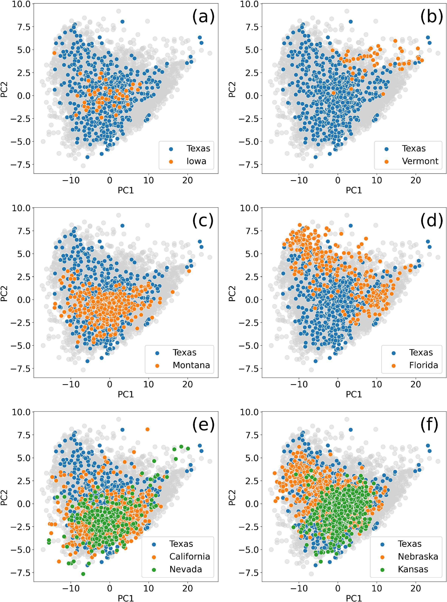
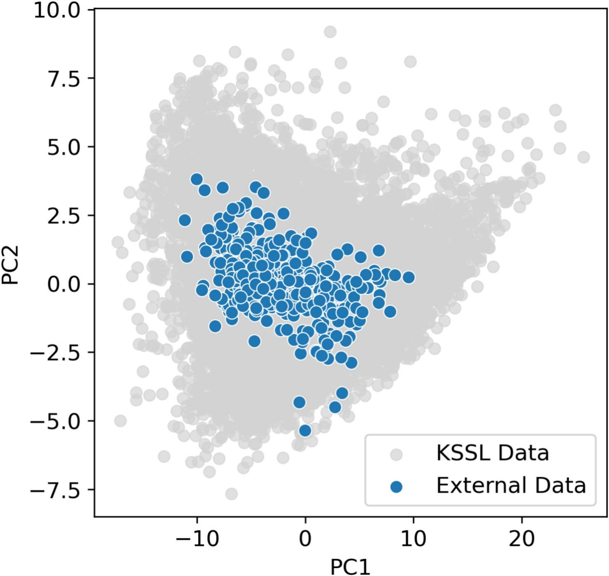
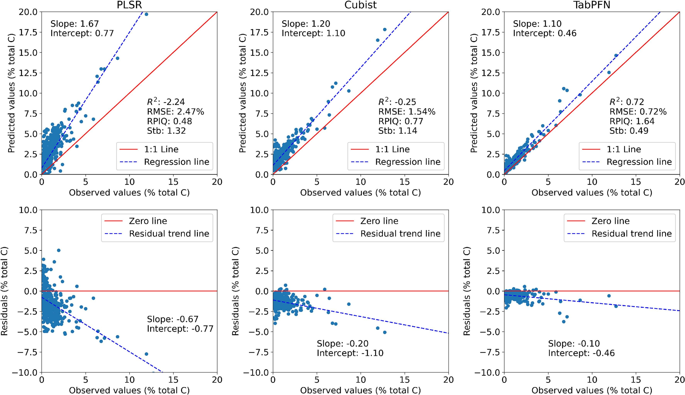
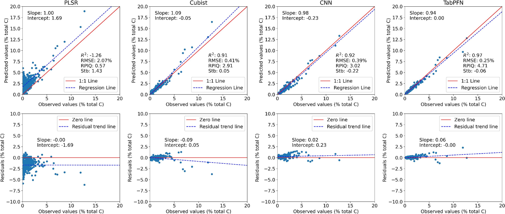
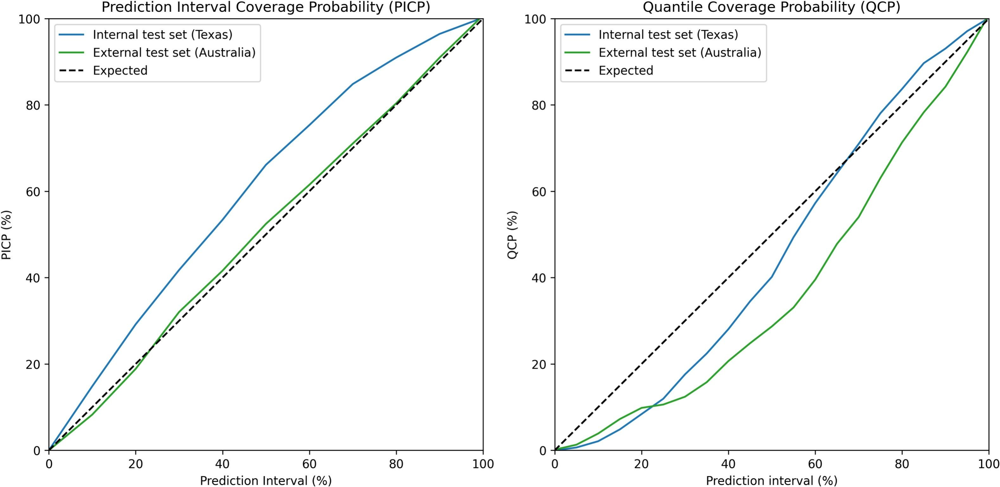
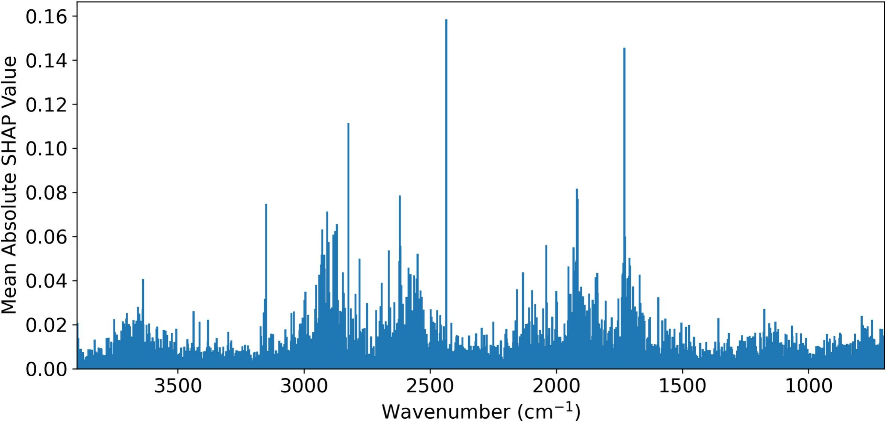

Yin-Chung Huang, José Padarian, Wartini Ng, Budiman Minasny, Alex B. McBratney

## Highlights

- TabPFN was evaluated against PLSR, Cubist, and CNN using mid-infrared soil spectra.
- TabPFN predicted total carbon, pH, and Olsen-P with high accuracy.
- TabPFN reduced total carbon RMSE by 74% vs PLSR and 39% vs Cubist.
- TabPFN generalised well across spectrally distinct training and test datasets.
- Uncertainty estimates and SHAP supported reliable and interpretable predictions.

## Abstract

The Tabular Prior-Data Fitted Network (TabPFN) is a foundation model, a pretrained, transformer-based neural network, designed for prediction tasks on tabular data. Although TabPFN has demonstrated strong performance relative to state-of-the-art baselines, its generalisability to soil spectral datasets of varying sizes remains unclear. This study evaluates the performance of TabPFN and compares it with partial least squares regression (PLSR), Cubist, and convolutional neural network (CNN) for soil spectral analysis using mid-infrared (MIR) spectroscopy. Soil samples from the Kellogg Soil Survey Laboratory were used to predict three soil properties: total carbon (TC), pH, and Olsen method extractable phosphorus (Olsen-P), representing high, medium and low predictability. An internal dataset from Texas (N = 620) and an external dataset from eastern Australia (N = 387) were used for testing. Models were trained using datasets of varying sizes and spectral similarity to the test sets. TabPFN achieved higher accuracy than all the baseline models in most results, with an average RMSE reduction of 74% relative to PLSR and 39% relative to Cubist when predicting TC. Performance gains were particularly pronounced when trained on medium-sized datasets, and TabPFN also exhibited superior generalisability across spectrally distinct training and test data. Soil property predictability influenced model performance across all models, with higher accuracy for TC than for pH and Olsen-P. For uncertainty quantification, TabPFN produced prediction intervals that closely matched the expected coverage in the external test set, indicating reasonable uncertainty generalisation, although quantile calibration was less reliable. Shapley additive explanations (SHAP) revealed that the wavenumbers contributed to the prediction corresponded to known spectral signatures of soil organic and inorganic carbon, supporting the interpretability of TabPFN. Overall, TabPFN demonstrated high predictive accuracy, improved generalisability compared to conventional methods, and useful uncertainty estimates, highlighting its potential for application to soil spectral libraries, for both large and small sizes.

## Keywords

Convolutional neural network (CNN); Machine learning; Mid-infrared spectroscopy; Partial least squares regression; Soil spectroscopy; Uncertainty quantification; AI; Foundation models

## 1. Introduction

Machine learning has been widely used in soil science for a range of tasks, including soil spectroscopy and digital soil mapping ([Padarian et al., 2020](https://www.sciencedirect.com/science/article/pii/S0016706126002089#b0135), [Gallios et al., 2025](https://www.sciencedirect.com/science/article/pii/S0016706126002089#b0040), [Wadoux, 2025](https://www.sciencedirect.com/science/article/pii/S0016706126002089#b0215)). Datasets used in soil modelling are usually represented in tabular form, in which information is organised in a structured row-column format with targets (soil properties) and features (e.g. soil spectra or environmental covariates). Predictions are commonly based on regression or machine learning models fitted to the training data. This modelling process may include, but is not limited to, spectra or covariate preprocessing, target variable scaling, hyperparameter tuning, model fitting, and model validation. In soil spectral modelling, different algorithms have been applied to capture relationships between soil properties and spectral features ([Dai et al., 2025](https://www.sciencedirect.com/science/article/pii/S0016706126002089#b0030)). For such tasks, traditional tree-based methods, such as XGBoost and Random Forests, are widely used due to their strong performance on tabular data ([Grinsztajn et al., 2022](https://www.sciencedirect.com/science/article/pii/S0016706126002089#b0050), [Wang et al., 2024](https://www.sciencedirect.com/science/article/pii/S0016706126002089#b0220)). Hybrid models, such as Cubist, which combine decision trees with linear regression, have also been extensively applied in soil spectral analysis ([Dangal et al., 2019](https://www.sciencedirect.com/science/article/pii/S0016706126002089#b0035), [Ng et al., 2022](https://www.sciencedirect.com/science/article/pii/S0016706126002089#b0110)). In recent years, more complex models, including artificial neural networks (ANNs) and convolutional neural networks (CNNs), have been explored to capture nonlinear relationships between soil properties and predictors, and these models can be coupled with additional methods for uncertainty quantification ([Rau et al., 2024](https://www.sciencedirect.com/science/article/pii/S0016706126002089#b0150), [Huang et al., 2025](https://www.sciencedirect.com/science/article/pii/S0016706126002089#b0070)).

Deep learning, a subset of machine learning that employs multi-layer neural networks, has also demonstrated potential in soil science applications ([Ng et al., 2019](https://www.sciencedirect.com/science/article/pii/S0016706126002089#b0120), [Padarian et al., 2019](https://www.sciencedirect.com/science/article/pii/S0016706126002089#b0130), [Tsakiridis et al., 2020](https://www.sciencedirect.com/science/article/pii/S0016706126002089#b0205)). For example, deep learning models can predict soil properties from unprocessed spectral data, and multi-task architectures enable simultaneous predictions of multiple soil properties ([Padarian et al., 2019](https://www.sciencedirect.com/science/article/pii/S0016706126002089#b0130), [Tsakiridis et al., 2020](https://www.sciencedirect.com/science/article/pii/S0016706126002089#b0205)). However, deep learning models typically require training over many epochs to optimise a large number of learnable parameters (weights and biases), making them computationally demanding and time-consuming. Moreover, due to the characteristics of tabular data, tree-based methods often perform similarly or even outperform deep learning models with much less computational cost ([Grinsztajn et al., 2022](https://www.sciencedirect.com/science/article/pii/S0016706126002089#b0050)). Deep learning models are also data-hungry and require large training datasets. For instance, [Ng et al. (2020)](https://www.sciencedirect.com/science/article/pii/S0016706126002089#b0115) found that partial least squares regression (PLSR) and Cubist performed better than CNNs when the sample size was fewer than 2000. Deep learning models trained on small datasets are also more susceptible to overfitting, and measures must be taken to prevent it ([Bejani and Ghatee, 2021](https://www.sciencedirect.com/science/article/pii/S0016706126002089#b0020)). Therefore, while larger datasets are generally beneficial, there is a strong need for algorithms that can deliver accurate predictions from relatively small datasets.

In-context learning (ICL) is a mechanism observed in large language models (LLMs) such as GPT ([Brown et al., 2020](https://www.sciencedirect.com/science/article/pii/S0016706126002089#b0025)). LLMs pre-trained on large text corpora have demonstrated the ability to perform new tasks by being prompted with input–output pairs, without updating their model parameters, a behaviour referred to as ICL ([Xie et al., 2021](https://www.sciencedirect.com/science/article/pii/S0016706126002089#b0225)). Unlike conventional model training, ICL does not involve modifying model weights. Instead, the model infers the task from examples provided at inference time. [Brown et al. (2020)](https://www.sciencedirect.com/science/article/pii/S0016706126002089#b0025) showed that GPT-3, when provided with a few input–output examples, achieved performance competitive with smaller models that had been fine-tuned for the same tasks. In other words, a model can adapt to diverse tasks using only a few input–output examples, without any parameter updates. Building on this principle, the Tabular Prior-data Fitted Network (TabPFN) was developed by pre-training a neural network on millions of synthetic tabular datasets. TabPFN outperformed strong baseline models such as XGBoost, Random Forests, multilayer perceptrons, and support vector machines, even after hours of tuning ([Hollmann et al., 2022](https://www.sciencedirect.com/science/article/pii/S0016706126002089#b0055), [Grinsztajn et al., 2025](https://www.sciencedirect.com/science/article/pii/S0016706126002089#b0045), [Hollmann et al., 2025](https://www.sciencedirect.com/science/article/pii/S0016706126002089#b0060)). TabPFN has an architecture that better accommodates tabular datasets and provides uncertainty quantification without additional computational cost.

When applied to real-world datasets, TabPFN still requires training data to guide the predictions, but this data is used only as contextual information rather than for updating model weights. During inference, TabPFN processes both the training data and the test features in a single forward pass, using the provided input–output examples to generate predictions for unseen samples. As a result, TabPFN is computationally efficient and requires no data-specific hyperparameter tuning. Given that soil spectral modelling is typically tabular data, we ask the question whether TabPFN can serve as a generic prediction tool applicable to spectral libraries of varying sizes.

Current studies of TabPFN have primarily focused on low-dimensional datasets, characterised by a low feature-to-sample ratio and relatively small sample sizes. [Barkov et al. (2026)](https://www.sciencedirect.com/science/article/pii/S0016706126002089#b0015) demonstrated that TabPFN can be applied to soil visible and near infrared (Vis-NIR) and mid-infrared (MIR) data after dimensionality reduction, and TabPFN achieved superior performance than classical machine learning baselines. The authors suggested that TabPFN could serve as a new baseline model for pedometrics and digital soil mapping. Additionally, [Schmidinger et al. (2026)](https://www.sciencedirect.com/science/article/pii/S0016706126002089#b0165) combined kriging and TabPFN for soil mapping and achieved a 30% improvement in $R^{2}$ compared to conventional methods. These studies demonstrated the robustness of TabPFN for predicting small-sized soil data.

In this study, we conducted a comprehensive evaluation of TabPFN for soil inference using spectral data generated from MIR spectroscopy. Comparing TabPFN with established machine learning methods commonly used in soil spectroscopy can validate its applicability to real-world datasets. Furthermore, it is essential to examine how well TabPFN can generalise from training data to unseen samples, relative to both simple and complex algorithms. Finally, the model’s uncertainty quantification and interpretability should be evaluated for the applied use of machine learning in soil spectral analysis.

Accordingly, the objectives of this study are to (1) evaluate if TabPFN can accurately predict soil properties from MIR spectra, (2) compare TabPFN with existing methods in prediction accuracy and generalisation capability, (3) assess the uncertainty quantification provided by TabPFN, and (4) investigate the interpretability of TabPFN on soil spectral analysis.

## 2. Materials and methods

### 2.1. Dataset

Soil MIR spectra and physicochemical properties were extracted from the Kellogg Soil Survey Laboratory (KSSL) dataset. To test the performance of TabPFN, three soil properties were selected based on their varying predictability using MIR spectroscopy ([Ng et al., 2022](https://www.sciencedirect.com/science/article/pii/S0016706126002089#b0110)). The selected soil properties were (1) total carbon (TC), which represents high predictability, (2) pH in a 1:1 soil–water suspension, which represents moderate predictability, and (3) Olsen method extractable phosphorus (Olsen-P), which represents low predictability. In [Ng et al. (2022)](https://www.sciencedirect.com/science/article/pii/S0016706126002089#b0110), TC was predicted with a high $R^{2}$ = 0.95, a low root mean square error (RMSE) = 0.38%, and a high ratio of performance to the interquartile range (RPIQ) = 5.64 with MIR spectra and Cubist. In comparison, the prediction of pH ($R^{2}$ = 0.85; RMSE = 0.44; RPIQ = 4.55) and Olsen-P ($R^{2}$ = 0.37; RMSE = 9.12 mg/kg; RPIQ = 1.43) were poorer compared to TC.

A total of 11,564 samples from the United States (US) were selected with TC, pH, and Olsen-P measurements. The laboratory procedure for the measurement of soil properties and spectra can be found in the work of [Soil Survey Staff (2014)](https://www.sciencedirect.com/science/article/pii/S0016706126002089#b0185). Soil MIR spectra were trimmed to 3900–700 $\mathrm{cm}^{-1}$ with 2 $\mathrm{cm}^{-1}$ resolution, and no further preprocessing was done. As demonstrated in previous studies ([Ng et al., 2019](https://www.sciencedirect.com/science/article/pii/S0016706126002089#b0120), [Padarian et al., 2019](https://www.sciencedirect.com/science/article/pii/S0016706126002089#b0130), [Huang et al., 2025](https://www.sciencedirect.com/science/article/pii/S0016706126002089#b0070)), complex algorithms can handle raw spectra without preprocessing. Hence, these raw spectra were directly used as inputs to the evaluated models.

To observe spectral similarities, principal component analysis (PCA) was used to reduce the dimensionality of spectra ([Fig. 1](assets/figura-1.jpg)). Soil samples from Texas (N = 620) were first separated to form the internal independent test set in this study for its proper size and distribution in the PCA graph ([Fig. 1](assets/figura-1.jpg)).

Fig. 1. Distribution of samples after dimensionality reduction by principal component analysis. Texas is used as the test set and evaluated with models trained on (a) Iowa (small dataset, N = 46) with similar spectral features to Texas; (b) Vermont (small dataset, N = 50) with different spectral features from Texas; (c) Montana (medium dataset, N = 337) with similar spectral features to Texas; (d) Florida (medium dataset, N = 275) with different spectral features from Texas; (e) California and Nevada (large dataset, N = 1119); (f) Nebraska and Kansas (large dataset, N = 1253).

TabPFN and baseline models were trained on datasets of different sizes and spectral similarity to the test set ([Fig. 1](assets/figura-1.jpg)). The specific selection criteria for different training sets are as follows:

1. Small and spectrally similar training set: Iowa (N = 46).
2. Small and spectrally different training set: Vermont (N = 50).
3. Medium and spectrally similar training set: Montana (N = 337).
4. Medium and spectrally different training set: Florida (N = 275).
5. Large training set 1: California + Nevada (N = 1119).
6. Large training set 2: Nebraska + Kansas (N = 1253).
7. Extra-large training set: all states in the US except Texas (N = 10,944).

These training sets represent different sizes and levels of difficulty in generalising the models ([Fig. S1](assets/figura-s1.png); [Fig. S2](assets/figura-s2.png); [Fig. S3](assets/figura-s3.png); [Fig. S4](assets/figura-s4.png)). For example, the Iowa and Montana datasets fall within the Texas dataset and should be easier for the models to predict on ([Fig. 1](assets/figura-1.jpg)a, c), whereas the Vermont and Florida datasets are spectrally less similar to the Texas dataset and require greater generalisability ([Fig. 1](assets/figura-1.jpg)b, d).

To test TabPFN and baseline models on completely unseen data, a soil spectral library from Australia was used as an external test set ([Fig. S5](assets/figura-s5.png); [Fig. S6](assets/figura-s6.png)). The external dataset consists of 387 samples collected from southern New South Wales and northern Victoria in Australia. The detailed descriptions of the sampling areas and soil properties can be found in [Tang et al. (2020)](https://www.sciencedirect.com/science/article/pii/S0016706126002089#b0190) and [Huang et al. (2025a)](https://www.sciencedirect.com/science/article/pii/S0016706126002089#b0065). MIR spectra were resampled to the same resolution and range. TC data from the external dataset were used to assess how well TabPFN generalises from the training data.

### 2.2. TabPFN

TabPFN was implemented using the *tabpfn* package coded in Python, and available on GitHub ([https://github.com/PriorLabs/TabPFN](https://github.com/PriorLabs/TabPFN)) ([Hollmann et al., 2025](https://www.sciencedirect.com/science/article/pii/S0016706126002089#b0060)). It was pre-trained on 100 million synthetic tasks. The architecture of TabPFN employed a two-way attention mechanism, enabling efficient processing of features in tabular data.

The attention mechanism was first introduced in recurrent neural networks to enhance translation performance ([Bahdanau et al., 2016](https://www.sciencedirect.com/science/article/pii/S0016706126002089#b0010)). This was achieved by enabling the model to search the entire source sentence for words relevant to the target word being generated. In transformer architecture, the attention mechanism was adapted to enable the model to search for related components across the entire input sequence, providing contextual understanding of the input features. When applied to tabular data, the two-way attention mechanism of TabPFN allowed each input cell to attend to both rows (samples) and columns (features). This architecture facilitated training efficiency and ensured invariance of the model’s predictions with respect to the ordering of samples and features ([Hollmann et al., 2025](https://www.sciencedirect.com/science/article/pii/S0016706126002089#b0060)). Two-way attention was particularly useful for tabular data, where both samples and features were treated as unordered. The synthetic dataset used to train TabPFN was generated using structural causal models. We referred to the original publication of [Hollmann et al. (2025)](https://www.sciencedirect.com/science/article/pii/S0016706126002089#b0060) for detailed information about the generation of these synthetic datasets.

During inference, TabPFN takes a training set with targets and features (input–output examples) and makes prediction on test sets. Both training and test sets were used in a single forward pass through the network, requiring the computations to be repeated each time predictions were made for a test set. It was recommended for processing small datasets with up to 10,000 samples and 500 features. The inherent nature of TabPFN allowed it to approximate Bayesian predictions ([Müller et al., 2024](https://www.sciencedirect.com/science/article/pii/S0016706126002089#b0105)), and prediction intervals are directly available. This enabled uncertainty quantification at no additional computational cost.

TabPFN can be accessed via a cloud-based application programming interface (API) or through local deployment for inference. A Hugging Face account is required to access the model. In this study, we implemented the TabPFN (v6.0.6) in a local environment. The *TabPFNRegressor* class provides a scikit-learn-style interface with *.fit()* and *.predict()* methods and can be easily applied to predict continuous targets. In practice, TabPFNRegressor*.fit()* and *.predict()* methods do not train new model parameters; instead, they utilise a frozen pre-trained foundation model and adapt to the given dataset through ICL (Box 1).

Box 1. How TabPFNRegressor works

- Uses a frozen, pre-trained transformer trained on a large collection of synthetic tabular regression problems.
- Performs in-context learning: no model parameters are updated; training samples are provided as context and test samples are treated as queries.
- Produces a full predictive distribution over the target variable, enabling uncertainty estimation rather than only point predictions.
- Improves robustness and calibration through an ensemble of prompt variations (*n_estimators*).

The pre-trained transformer has a fixed input capacity of 500 features. To handle datasets with more features, TabPFN constructs an ensemble of estimators, each of which randomly subsamples up to 500 features. Predictions from all estimators are then aggregated to produce the final output (Box 2), improving robustness and stability through ensemble averaging. TabPFN predicts a probability distribution over discretised target bins ([Torgo and Gama, 1997](https://www.sciencedirect.com/science/article/pii/S0016706126002089#b0200)); the neural network outputs logits for each bin, these are converted into probabilities, averaged across ensemble members, and then integrated to obtain means, medians, or quantiles in the original target scale.

Instance objects of the *TabPFNRegressor* class were instantiated with the default hyperparameters, and predictions were obtained via the *.predict()* method. Uncertainty quantification was performed by specifying *output_type=“quantiles”* to predict specific quantiles (Box S1). All analyses in this study were conducted in Python v3.9.23 ([Python Software Foundation, 2025](https://www.sciencedirect.com/science/article/pii/S0016706126002089#b0145)).

Box 2

Pseudocode for TabPFNRegressor.

**Input: Training data (Xtrain, Ytrain) and Test data (Xtest)**

1. Initialise the model and set up hyperparameters, including number of ensemble members n_estimators.
2. Validate inputs and encode categorical features.
3. Construct an ensemble of n_estimators estimators; each estimator randomly selects up to 500 features.
4. Standardise the target Y by subtracting its mean and dividing by its standard deviation.
5. Load the pre-trained TabPFN transformer and prepare the inference engine.

For each **estimator**

6. Concatenate training and test samples and run a forward pass through the transformer, using training targets as context.
7. Obtain a predictive distribution over target.
8. Aggregate predictive distributions across all estimators.
9. Transform predictions back to the original target scale.

**Output: Predicted values (mean, median, mode, or quantile)**

### 2.3. Baselines and model evaluation

TabPFN was compared with three methods for spectral analysis, namely partial least squares regression (PLSR), Cubist regression tree, and convolutional neural network (CNN). These methods were used as baselines in this study because of their wide applicability in soil spectral analysis ([Minasny and McBratney, 2008](https://www.sciencedirect.com/science/article/pii/S0016706126002089#b0100), [Sanderman et al., 2025](https://www.sciencedirect.com/science/article/pii/S0016706126002089#b0160)). PLSR represents a widely used linear model, and Cubist can handle nonlinear relationships. CNN is a deep learning method involving convolutional layers to process complex spectral signals ([Ng et al., 2019](https://www.sciencedirect.com/science/article/pii/S0016706126002089#b0120)). Both PLSR and Cubist were fine-tuned using grid search to optimise the number of PLS components and the Cubist hyperparameters.

For CNN, a one-dimensional network with six trainable layers was constructed with the architecture described in [Table 1](https://www.sciencedirect.com/science/article/pii/S0016706126002089#t0005). The architecture and hyperparameters were optimised for the extra-large training set (N = 10,944) predicting TC, and 20% of the training samples would be randomly selected as a validation set. The network was trained with a batch size of 128, a maximum number of epochs of 500, and early stopping on the validation set (patience = 35). The initial learning rate was 0.001, with a learning rate reduction patience of 45 and a reduction factor of 0.1. Monte Carlo dropout layer was implemented in the model ([Table 1](https://www.sciencedirect.com/science/article/pii/S0016706126002089#t0005)), and the results were averaged through 100 forward passes of the trained network ([Padarian et al., 2022](https://www.sciencedirect.com/science/article/pii/S0016706126002089#b0140), [Huang et al., 2025](https://www.sciencedirect.com/science/article/pii/S0016706126002089#b0070)). All the analyses were performed in the same Python environment (v3.9.23) using Tensorflow v2.15.1 ([Abadi et al., 2015](https://www.sciencedirect.com/science/article/pii/S0016706126002089#b0005)).

Table 1. Architecture of the convolutional neural network. ReLU stands for rectified linear unit.

| Layer type | Filter size | Filters | Activation |
| --- | --- | --- | --- |
| Convolutional | 5 | 32 | ReLU |
| Max Pooling | 2 |  |  |
| MC Dropout (0.2) |  |  |  |
| Convolutional | 5 | 64 | ReLU |
| Max Pooling | 2 |  |  |
| MC Dropout (0.2) |  |  |  |
| Convolutional | 5 | 128 | ReLU |
| Max Pooling | 2 |  |  |
| MC Dropout (0.2) |  |  |  |
| Convolutional | 5 | 256 | ReLU |
| Max Pooling | 2 |  |  |
| MC Dropout (0.2) |  |  |  |
| Convolutional | 5 | 512 | ReLU |
| Max Pooling | 2 |  |  |
| MC Dropout (0.2) |  |  |  |
| Convolutional | 5 | 1024 | ReLU |
| Max Pooling | 2 |  |  |
| MC Dropout (0.2) |  |  |  |
| Flatten |  |  | Linear |
| Fully-connected |  |  |  |

PLSR, Cubist, and TabPFN were trained or fitted on seven training sets of varying sizes and tested on internal and external datasets. Due to its data-hungry nature, CNN did not outperform PLSR and Cubist when the training sample size was less than 2000 ([Ng et al., 2020](https://www.sciencedirect.com/science/article/pii/S0016706126002089#b0115)). As a result, only the extra-large training set was used for CNN training and evaluation. Coefficients of determination ($R^{2}$, Eq. [(1)](https://www.sciencedirect.com/science/article/pii/S0016706126002089#e0005), root mean squared error (RMSE, Eq. [(2)](https://www.sciencedirect.com/science/article/pii/S0016706126002089#e0010), ratio of performance to the interquartile range (RPIQ, Eq. [(3)](https://www.sciencedirect.com/science/article/pii/S0016706126002089#e0015), and standardised bias (Stb, Eq. [(4)](https://www.sciencedirect.com/science/article/pii/S0016706126002089#e0020)) and Eq. [(5)](https://www.sciencedirect.com/science/article/pii/S0016706126002089#e0025)) were used to evaluate model performance ([Ng et al., 2022](https://www.sciencedirect.com/science/article/pii/S0016706126002089#b0110)). IQR stands for the interquartile range of the observed values.

$$
{R}^{2}=1-\frac{{\sum }_{i=1}^{n}{({y}_{i}-{\hat{y}}_{i})}^{2}}{{\sum }_{i=1}^{n}{({y}_{i}-{\bar{y}}_{i})}^{2}}
\tag{1}
$$

$$
\mathit{RMSE}=\sqrt{\frac{\sum _{i=1}^{n}{({y}_{i}-{\hat{y}}_{i})}^{2}}{n}}
\tag{2}
$$

$$
\mathit{RPIQ}=\frac{\mathit{IQR}}{\mathit{RMSE}}
\tag{3}
$$

$$
\mathit{bias}=\frac{1}{n}{\sum }_{i}^{n}({\hat{y}}_{i}{-y}_{i})
\tag{4}
$$

$$
\mathit{Stb}=\frac{\mathit{bias}}{\mathit{IQR}}
\tag{5}
$$

### 2.4. Uncertainty quantification

The prediction interval at $p$% was calculated by subtracting the $\frac{(100-p)}{2}$-th quantile from the $(p+\frac{(100-p)}{2})$-th quantile. For example, the 90% prediction interval is the difference between the 95th and 5th quantiles.

Mean prediction interval width (MPIW, Eq. [(6)](https://www.sciencedirect.com/science/article/pii/S0016706126002089#e0030), interval coverage probability (PICP, Eq. [(7)](https://www.sciencedirect.com/science/article/pii/S0016706126002089#e0035)), and quantile coverage probability (QCP, Eq. [(8)](https://www.sciencedirect.com/science/article/pii/S0016706126002089#e0040)) were used to evaluate the performance of uncertainty quantification ([Shrestha and Solomatine, 2006](https://www.sciencedirect.com/science/article/pii/S0016706126002089#b0180), [Schmidinger and Heuvelink, 2023](https://www.sciencedirect.com/science/article/pii/S0016706126002089#b0170)).

$$
\mathit{MPIW}=\frac{1}{n}{\sum }_{i=1}^{n}[{\mathit{PL}}_{i}^{U}-{\mathit{PL}}_{i}^{L}]
\tag{6}
$$

$$
\mathit{PICP}=\frac{1}{n}{\sum }_{i=1}^{n}\chi ({\mathit{PL}}_{i}^{L}\leq {y}_{i}\leq {\mathit{PL}}_{i}^{U})
\tag{7}
$$

$$
\mathit{QCP}=\frac{1}{n}{\sum }_{i=1}^{n}\chi ({y}_{i}\leq {q}_{\tau }^{i})
\tag{8}
$$

where $\chi$ is an indicator function that equals 1 if the condition is true and 0 otherwise. In these equations, $n$ denotes the total number of observations, and the lower and upper bounds of the prediction interval for the $i$-th sample are denoted by ${\mathit{PL}}_{i}^{L}$ and ${\mathit{PL}}_{i}^{U}$, respectively.

MPIW represents the average length of the prediction intervals, with smaller values generally preferred. PICP measures the proportion of observations for which the true value is covered by the prediction interval. Ideally, the PICP of a 90% prediction interval should be close to 90%. However, PICP has the limitation that it does not account for one-sided bias ([Schmidinger and Heuvelink, 2023](https://www.sciencedirect.com/science/article/pii/S0016706126002089#b0170)). This limitation can be addressed by QCP, which quantifies the fraction of observations falling below a given quantile $\tau$.

### 2.5. The SHapley additive exPlanations (SHAP) values

Shapley additive explanations (SHAP) algorithm was used to interpret the models and elucidate the importance of different features ([Shapley, 1953](https://www.sciencedirect.com/science/article/pii/S0016706126002089#b0175), [Lundberg and Lee, 2017](https://www.sciencedirect.com/science/article/pii/S0016706126002089#b0085)). Shapley values originate from game theory and are calculated over all possible combinations of features. For a particular feature $i$, the Shapley value is calculated as Eq. [(9)](https://www.sciencedirect.com/science/article/pii/S0016706126002089#e0045):

$$
{\phi }_{i}=\sum _{S\subseteq F\setminus \{ i\} }\frac{|S|!(|F|-|S|-1)!}{|F|!}[{f}_{S\cup \{ i\} }({x}_{S\cup \{ i\} })-{f}_{S}({x}_{S})]
\tag{9}
$$

where $F$ represents the set of all features and $S$ denotes subsets of $F$ in which feature $i$ is withheld. In this formulation, the Shapley value represents the average marginal contribution of feature $i$ to the model prediction across all possible feature subsets. However, the calculation of exact Shapley values requires evaluating all possible feature subsets, which is computationally expensive. Therefore, SHAP values were computed using approximation methods and serve as practical approximations of Shapley values for interpreting machine learning models ([Lundberg and Lee, 2017](https://www.sciencedirect.com/science/article/pii/S0016706126002089#b0085)).

Shapley values and SHAP values have been used to demonstrate relative contributions of features in machine learning examples, including digital soil mapping and soil spectroscopy. SHAP values were used by [Padarian et al. (2020a)](https://www.sciencedirect.com/science/article/pii/S0016706126002089#b0125) to interpret the relationship between soil organic carbon and environmental covariates, while [Wadoux (2023)](https://www.sciencedirect.com/science/article/pii/S0016706126002089#b0210) used it to interpreted a random forest model predicting soil organic carbon with MIR spectroscopy.

In the present study, SHAP values of TabPFN were calculated with the *interpretability* extension of the *tabpfn* package ([Hollmann et al., 2025](https://www.sciencedirect.com/science/article/pii/S0016706126002089#b0060)). SHAP values were computed using the permutation-based algorithm, and explanations were generated for predicting TC of the 387 external test samples.

## 3. Results and discussion

### 3.1. Model performance

Among the soil properties tested, TC was the most predictable, followed by pH and Olsen-P ([Table 2](https://www.sciencedirect.com/science/article/pii/S0016706126002089#t0010)). Prediction of TC by Cubist achieved an $R^{2}$ of 0.95 for the extra-large training set (RPIQ = 4.41). CNN outperformed PLSR and Cubist in TC predictions, achieving a high $R^{2}$ of 0.96 and RPIQ of 4.68. However, the same CNN structure was not optimal for pH prediction and was outrun by Cubist, which predicted pH with good accuracy using the extra-large training set ($R^{2}$ = 0.82, RPIQ = 3.02). All the baseline models failed to predict Olsen-P even with the extra-large training set (PLSR $R^{2}$ = -0.19, RPIQ = 0.51; Cubist $R^{2}$ = -0.04, RPIQ = 0.54; CNN $R^{2}$ = 0.08, RPIQ = 0.58). This is because MIR characterised the functional groups of mineral and organic matter of the soils, which is consistent with the results of [Ng et al. (2022)](https://www.sciencedirect.com/science/article/pii/S0016706126002089#b0110) using the same dataset.

Table 2. Results of the modelling by partial least squared regression (PLSR), Cubist, convolutional neural network (CNN) and TabPFN. The models were trained on the training set and tested on Texas dataset (N = 620). $R^{2}$ stands for coefficient of determination, RMSE stands for root mean square error, RPIQ stands for ratio of performance to the interquartile range, and Stb stands for standardised bias. The extra-large dataset includes all states except Texas.

| Property | Training set | PLSR / $R^{2}$ | PLSR / RMSE | PLSR / RPIQ | PLSR / Stb | Cubist / $R^{2}$ | Cubist / RMSE | Cubist / RPIQ | Cubist / Stb | CNN / $R^{2}$ | CNN / RMSE | CNN / RPIQ | CNN / Stb | TabPFN / $R^{2}$ | TabPFN / RMSE | TabPFN / RPIQ | TabPFN / Stb |
| --- | --- | --- | --- | --- | --- | --- | --- | --- | --- | --- | --- | --- | --- | --- | --- | --- | --- |
| TC (% wt) | Small, similar (Iowa N = 46) | −5.22 | 5.26 | 0.38 | −0.60 | 0.52 | 1.45 | 1.38 | 0.15 |  |  |  |  | 0.57 | 1.38 | 1.46 | 0.15 |
|  | Small, different (Vermont N = 50) | −7.72 | 6.22 | 0.32 | −1.53 | −0.90 | 2.91 | 0.69 | −0.31 |  |  |  |  | −0.07 | 2.18 | 0.92 | 0.53 |
|  | Medium, similar (Montana N = 337) | 0.51 | 1.48 | 1.36 | 0.06 | 0.86 | 0.78 | 2.57 | 0.04 |  |  |  |  | 0.95 | 0.49 | 4.13 | −0.02 |
|  | Medium, different (Florida N = 275) | −1.76 | 3.50 | 0.58 | 0.39 | 0.35 | 1.70 | 1.18 | 0.69 |  |  |  |  | 0.92 | 0.61 | 3.33 | 0.08 |
|  | Large 1 (California + Nevada N = 1119) | 0.54 | 1.43 | 1.41 | −0.47 | 0.94 | 0.53 | 3.83 | −0.02 |  |  |  |  | 0.98 | 0.31 | 6.44 | −0.03 |
|  | Large 2 (Nebraska + Kansas N = 1253) | 0.66 | 1.22 | 1.65 | −0.09 | 0.93 | 0.54 | 3.70 | −0.02 |  |  |  |  | 0.98 | 0.33 | 6.16 | −0.05 |
|  | Extra-large (N = 10944) | 0.78 | 0.98 | 2.05 | −0.10 | 0.95 | 0.46 | 4.41 | 0.03 | 0.96 | 0.43 | 4.68 | −0.08 | 0.99 | 0.19 | 10.54 | −0.01 |
| pH | Small, similar (Iowa N = 46) | −2.60 | 1.91 | 0.68 | −0.81 | 0.43 | 0.76 | 1.70 | −0.05 |  |  |  |  | 0.45 | 0.74 | 1.74 | 0.02 |
|  | Small, different (Vermont N = 50) | −2.00 | 1.75 | 0.74 | 0.97 | 0.38 | 0.80 | 1.63 | 0.06 |  |  |  |  | −0.33 | 1.16 | 1.11 | −0.57 |
|  | Medium, similar (Montana N = 337) | 0.07 | 0.97 | 1.33 | 0.48 | 0.41 | 0.78 | 1.67 | 0.31 |  |  |  |  | 0.63 | 0.61 | 2.11 | 0.11 |
|  | Medium, different (Florida N = 275) | 0.08 | 0.97 | 1.34 | 0.07 | 0.48 | 0.73 | 1.78 | −0.03 |  |  |  |  | 0.59 | 0.65 | 2.01 | −0.02 |
|  | Large 1 (California + Nevada N = 1119) | 0.55 | 0.68 | 1.92 | 0.06 | 0.75 | 0.50 | 2.59 | 0.04 |  |  |  |  | 0.77 | 0.48 | 2.68 | 0.09 |
|  | Large 2 (Nebraska + Kansas N = 1253) | 0.38 | 0.79 | 1.64 | 0.13 | 0.68 | 0.57 | 2.27 | 0.11 |  |  |  |  | 0.73 | 0.53 | 2.45 | −0.02 |
|  | Extra-large (N = 10944) | 0.73 | 0.53 | 2.46 | 0.00 | 0.82 | 0.43 | 3.02 | 0.00 | 0.75 | 0.50 | 2.59 | −0.02 | 0.82 | 0.43 | 2.99 | −0.09 |
| Olsen-P (mg/kg) | Small, similar (Iowa N = 46) | −15.72 | 47.91 | 0.14 | 2.67 | −3.59 | 25.11 | 0.26 | 2.51 |  |  |  |  | −3.04 | 23.54 | 0.28 | 2.76 |
|  | Small, different (Vermont N = 50) | −6.15 | 31.32 | 0.21 | −3.73 | −0.14 | 12.50 | 0.52 | −0.60 |  |  |  |  | −0.03 | 11.87 | 0.55 | 0.12 |
|  | Medium, similar (Montana N = 337) | −0.40 | 13.88 | 0.47 | 0.08 | −0.19 | 12.78 | 0.51 | 0.31 |  |  |  |  | 0.00 | 11.74 | 0.55 | −0.03 |
|  | Medium, different (Florida N = 275) | −1.54 | 18.68 | 0.35 | 1.88 | −0.13 | 12.47 | 0.52 | 0.62 |  |  |  |  | −0.18 | 12.71 | 0.51 | 0.98 |
|  | Large 1 (California + Nevada N = 1119) | −0.67 | 15.14 | 0.43 | −0.38 | −0.33 | 13.52 | 0.48 | 0.70 |  |  |  |  | 0.00 | 11.74 | 0.55 | 0.32 |
|  | Large 2 (Nebraska + Kansas N = 1253) | −0.54 | 14.56 | 0.45 | 0.55 | −11.84 | 41.99 | 0.15 | 2.11 |  |  |  |  | −0.97 | 16.46 | 0.39 | 0.96 |
|  | Extra-large (N = 10944) | −0.19 | 12.77 | 0.51 | 0.22 | −0.04 | 11.97 | 0.54 | 0.50 | 0.08 | 11.23 | 0.58 | 0.30 | 0.20 | 10.51 | 0.62 | 0.39 |

In the baseline models, Cubist outperformed PLSR, indicating nonlinear relationships between soil properties and MIR spectra ([Wang et al., 2024](https://www.sciencedirect.com/science/article/pii/S0016706126002089#b0220)). Model performance also increased with training set size, as more samples provided more information to tune the model. CNN hyperparameters were optimised for TC predictions and demonstrated high prediction ability.

During inference on sub-datasets, models trained on samples spectrally similar to the test data (e.g., Iowa and Montana) tend to perform better. For example, the Cubist model trained on Montana and Florida samples provides markedly different results despite their similar sample sizes ([Table 2](https://www.sciencedirect.com/science/article/pii/S0016706126002089#t0010)). This is reasonable, as the degree of generalisation required is different when predicting samples that are spectrally different from the training sets ([Fig. 1](assets/figura-1.jpg)).

TabPFN generally exceeded the baseline models for all configurations, but also suffered from the lower predictability of Olsen-P. For TC predictions, TabPFN consistently outperformed baseline models, achieving high accuracy ($R^{2}$ > 0.9) across all medium, large, and extra-large datasets. For small datasets that are spectrally similar to the test samples (Iowa, N = 46), Cubist and TabPFN provided reasonable predictions ($R^{2}$ > 0.5) with TabPFN being better. However, for the small but spectrally distinct dataset (Vermont, N = 50), all models failed to make good predictions. The $R^{2}$ for all the Vermont set TC predictions was less than zero, indicating predictions that were worse than simply predicting the mean.

The most notable difference between TabPFN and Cubist results was the medium-sized Florida dataset. Samples from Florida were spectrally different from the test samples from Texas ([Fig. 1](assets/figura-1.jpg)d). Both PLSR and Cubist suffered from this limitation and could not generalise well in predictions. Despite the medium sample size of Florida samples, PLSR failed to make predictions while Cubist showed limited performance (PLSR $R^{2}$ = -1.76, RPIQ = 0.58; Cubist $R^{2}$ = 0.35, RPIQ = 1.18). However, TabPFN could generalise from the training set and predict the test set with high accuracy ($R^{2}$ = 0.92, RPIQ = 3.33). This indicated that TabPFN had a better ability to generalise from training samples, with an RMSE decrease of 83% relative to PLSR and 64% relative to Cubist when trained on the Florida dataset for TC prediction.

Using large datasets, TabPFN outperformed PLSR and Cubist for TC, even though Cubist was already producing good predictions ($R^{2}$ = 0.94 and 0.93). The RPIQ for TabPFN trained on large datasets was higher than six (RPIQ = 6.44 and 6.16), which were higher than the best TC prediction in [Ng et al. (2022)](https://www.sciencedirect.com/science/article/pii/S0016706126002089#b0110) using the whole dataset.

When training on the extra-large dataset (N = 10,944), TabPFN achieved a highly accurate TC prediction with $R^{2}$ = 0.99, RPIQ = 10.54, and Stb = -0.01. The RPIQ of TabPFN was twice that of Cubist and CNN under the same scheme. This indicated that TabPFN could still outperform PLSR, Cubist, and CNN when the sample size reached 10,000. Based on the TC predictions, it was concluded that TabPFN achieved stable superior performance to Cubist, particularly on medium-sized datasets.

The performance of pH predictions was less accurate than that of TC, as there were no direct spectral signatures from soil pH. For small datasets, all models failed to make acceptable predictions ($R^{2}$ < 0.5), indicating the limitations of algorithms when the training information was limited. When the sample number increased, TabPFN outperformed Cubist and PLSR in medium datasets. In particular, TabPFN showed marked improvement using the Montana dataset (PLSR $R^{2}$ = 0.07, RPIQ = 1.33; Cubist $R^{2}$ = 0.41, RPIQ = 1.67; TabPFN $R^{2}$ = 0.63, RPIQ = 2.11). TabPFN reached RPIQ > 2 with medium-sized datasets, while PLSR reached that with an extra-large dataset, and Cubist with a large dataset. Cubist and TabPFN achieved similar performance on the extra-large training set (Cubist $R^{2}$ = 0.82, RPIQ = 3.02; TabPFN $R^{2}$ = 0.82, RPIQ = 2.99) while Cubist exhibited less bias. It was also on a medium-sized dataset that TabPFN outperformed baseline models, achieving increases of more than 20% in $R^{2}$ and 10% in RPIQ over Cubist.

TabPFN and all the baseline models were unable to make predictions for Olsen-P, with none of the RPIQ values exceeding one. This highlighted the limitations of the algorithms for predicting properties with low predictability. Olsen-P was also poorly predicted by previous literature ([Ng et al., 2022](https://www.sciencedirect.com/science/article/pii/S0016706126002089#b0110)). This was due to the complexity of measuring extractable phosphorus, as extractable P lacked a direct spectral signature and showed only a limited relationship with the spectral data. MIR spectroscopy also failed to predict extractable phosphorus measured by other conventional methods ([Janik et al., 2009](https://www.sciencedirect.com/science/article/pii/S0016706126002089#b0075), [Ma et al., 2019](https://www.sciencedirect.com/science/article/pii/S0016706126002089#b0090)).

### 3.2. External validation

External validation was performed using an Australian soil MIR library. Despite originating from a different continent and was measured in a different laboratory, the spectral signatures were similar to those in the US spectral library ([Fig. 2](assets/figura-2.jpg)). This indicated that the spectral measurements were comparable and that the generalisation required to predict soil properties was moderate.

Fig. 2. Distribution of external samples from Australian soil spectral library in comparison to the Kellogg Soil Survey Laboratory (KSSL) spectral data after dimensionality reduction by principal component analysis.

Validation on the external dataset with TC data showed good prediction results for Cubist, CNN and TabPFN, while PLSR struggled to generalise from the training set ([Table 3](https://www.sciencedirect.com/science/article/pii/S0016706126002089#t0015)). All the PLSR predictions were poor, with low or negative $R^{2}$. PLSR model trained on extra-large dataset could not be used to predict the Australian dataset reliably.

Table 3. Results of the modelling by partial least squared regression (PLSR), Cubist, convolutional neural network (CNN) and TabPFN. The models were trained on the training set and tested on Australian dataset (N = 387). $R^{2}$ stands for coefficient of determination, RMSE stands for root mean square error, RPIQ stands for ratio of performance to the interquartile range, and Stb stands for standardised bias. The extra-large dataset includes all states except Texas.

| Property | Training set | PLSR / $R^{2}$ | PLSR / RMSE | PLSR / RPIQ | PLSR / Stb | Cubist / $R^{2}$ | Cubist / RMSE | Cubist / RPIQ | Cubist / Stb | CNN / $R^{2}$ | CNN / RMSE | CNN / RPIQ | CNN / Stb | TabPFN / $R^{2}$ | TabPFN / RMSE | TabPFN / RPIQ | TabPFN / Stb |
| --- | --- | --- | --- | --- | --- | --- | --- | --- | --- | --- | --- | --- | --- | --- | --- | --- | --- |
| TC (% wt) | Small, similar (Iowa N = 46) | −8.85 | 4.31 | 0.27 | −1.86 | 0.54 | 0.93 | 1.27 | 0.34 |  |  |  |  | 0.40 | 1.06 | 1.11 | 0.06 |
|  | Small, different (Vermont N = 50) | −129.62 | 15.69 | 0.08 | −12.88 | 0.46 | 1.01 | 1.17 | −0.12 |  |  |  |  | 0.30 | 1.15 | 1.03 | 0.65 |
|  | Medium, similar (Montana N = 337) | 0.13 | 1.28 | 0.92 | 0.09 | 0.69 | 0.77 | 1.54 | 0.41 |  |  |  |  | 0.89 | 0.46 | 2.58 | −0.14 |
|  | Medium, different (Florida N = 275) | −2.24 | 2.47 | 0.48 | 1.32 | −0.25 | 1.54 | 0.77 | 1.14 |  |  |  |  | 0.72 | 0.72 | 1.64 | 0.49 |
|  | Large 1 (California + Nevada N = 1119) | −0.11 | 1.44 | 0.82 | −0.50 | 0.85 | 0.53 | 2.22 | 0.20 |  |  |  |  | 0.96 | 0.29 | 4.13 | −0.12 |
|  | Large 2 (Nebraska + Kansas N = 1253) | −0.16 | 1.48 | 0.80 | 0.76 | 0.88 | 0.48 | 2.47 | −0.08 |  |  |  |  | 0.94 | 0.32 | 3.63 | −0.12 |
|  | Extra-large (N = 10944) | −1.26 | 2.07 | 0.57 | 1.43 | 0.91 | 0.41 | 2.91 | 0.05 | 0.92 | 0.39 | 3.02 | −0.22 | 0.97 | 0.25 | 4.71 | −0.06 |

On small datasets, Cubist appeared to generalise better than TabPFN and produced acceptable predictions ($R^{2}$ = 0.54 and 0.46). TabPFN gave poorer predictions than Cubist ($R^{2}$ = 0.40 and 0.30), indicating that conventional models had the advantage over TabPFN when only limited data (N < 50) was used in this study. This can be due to the high dimensionality in the current study ([Barkov et al., 2026](https://www.sciencedirect.com/science/article/pii/S0016706126002089#b0015)). However, the advantage of TabPFN became apparent as the training set size increased, with TabPFN outperforming Cubist and PLSR when trained on medium, large, and extra-large datasets.

Two medium-sized datasets yielded contrasting results for Cubist: the Montana dataset produced moderate predictions ($R^{2}$ = 0.69, RPIQ = 1.54, Stb = 0.41), whereas the Florida dataset had poor predictions ($R^{2}$ = -0.25, RPIQ = 0.77, Stb = 1.14). This might also result from differences in generalisability, since the Montana dataset was spectrally similar to the external dataset, whereas the Florida dataset was spectrally distinct ([Fig. 1](assets/figura-1.jpg)c, d). The prediction of external samples with Cubist model trained on Florida dataset presented a linear relationship between predicted values and observed values ([Fig. 3](assets/figura-3.jpg)). However, it was indicated in the residual plot that the predictions deviated from the observed values on higher TC values, and the fitted regression line had the highest intercept among three models ([Fig. 3](assets/figura-3.jpg)). In the meantime, TabPFN achieved good performance for both medium training sets (Montana $R^{2}$ = 0.89, RPIQ = 2.58, Stb = -0.14; Florida $R^{2}$ = 0.72, RPIQ = 1.64, Stb = 0.49), indicating good generalisability with medium-sized data. In the Florida dataset, the predictions also aligned better with the 1:1 line and the residuals were smaller than those of Cubist predictions ([Fig. 3](assets/figura-3.jpg)). Nevertheless, TabPFN suffered from spectral differences and exhibited higher bias than the model trained on the Montana dataset ([Table 3](https://www.sciencedirect.com/science/article/pii/S0016706126002089#t0015)).

Fig. 3. Relationship between the observed and predicted total carbon content (%) of three different models trained on medium but spectrally different dataset (Florida), predicting the external dataset. Residuals were calculated as the difference between predicted and observed values ($\hat{y}-y$).

When predicting TC using large and extra-large datasets, Cubist, CNN and TabPFN all achieved high accuracy ($R^{2}$ > 0.85, RPIQ > 2). Both Cubist and CNN provided good generalisability when trained on the extra-large dataset, with TabPFN outperforming Cubist and CNN ([Table 3](https://www.sciencedirect.com/science/article/pii/S0016706126002089#t0015)). When plotting the prediction results for the extra-large training set, all predictions showed a linear relationship between observed and predicted values, but TabPFN yielded the closest agreement with the 1:1 line ([Fig. 4](assets/figura-4.jpg)). TabPFN was able to generalise to the external dataset and predict it accurately.

Fig. 4. Relationship between the observed and predicted total carbon content (%) of four different models trained on extra-large dataset predicting external dataset. Residuals were calculated as the difference between predicted and observed values ($\hat{y}-y$).

### 3.3. Uncertainty quantification

Uncertainty quantification was essential for evaluating a model’s applicability, as it was crucial in real-world decision-making. Uncertainty was evaluated for the TabPFN model trained on the extra-large dataset and applied to the internal and external test sets for TC prediction, where the single-point predictions were highly accurate ([Table 2](https://www.sciencedirect.com/science/article/pii/S0016706126002089#t0010) and [Table 3](https://www.sciencedirect.com/science/article/pii/S0016706126002089#t0015)). At a 90% prediction interval, the MPIW for the internal test set (Texas) was 0.55%, and the MPIW for the external test set (Australia) was 0.57%.

Interval and quantile calibration were further assessed using PICP and QCP. The PICP for the internal test set was consistently above the expected line ([Fig. 5](assets/figura-5.jpg)). This indicated over-conservative uncertainty estimates with prediction intervals wider than required. In contrast, the PICP for the external test set closely followed the expected values, and the intervals were notably better calibrated. The prediction intervals for the external test covered approximately the ideal proportion of the samples.

Fig. 5. Prediction interval coverage probability (PICP) and quantile coverage probability (QCP) of the TabPFN model trained on an extra-large dataset predicting total carbon content (%) of the internal test set (Texas) and the external test set (Australia).

Based on PICP results, the transfer of uncertainty quantification was markedly good and indicated that TabPFN generalised reasonably well. However, good PICP did not imply good quantile calibration since PICP is insensitive to one-sided bias ([Schmidinger and Heuvelink, 2023](https://www.sciencedirect.com/science/article/pii/S0016706126002089#b0170)). While the PICP for the external test set was ideal on average, systematic under-coverage was observed across most quantiles ([Fig. 5](assets/figura-5.jpg)). This suggested a distributional shift between the training and external test data, which will require additional methods to further address quantile-level miscalibration. Uncertainty analysis based on other subsets presented more deviated QCP results ([Fig. S7](assets/figura-s7.png)), but medium and large datasets still gave good PICP. Overall, the results indicated that TabPFN can generalise uncertainty quantification from US to Australian samples, although the quantile-level calibration was weaker on the external test set.

### 3.4. SHAP values

SHAP values were calculated for the TabPFN models trained on the extra-large dataset predicting TC, and explanations were generated for 387 Australian samples ([Fig. 6](assets/figura-6.jpg)). The averaged absolute SHAP values showed distribution across different wavenumbers, with high absolute values around 3000–2500 and 2000–1500 $\mathrm{cm}^{-1}$. The wavenumbers in these regions were important because of the spectral signatures of soil organic and inorganic carbon, for example, the 1800 $\mathrm{cm}^{-1}$ band for calcite and the features of organic matter at 2929–2855 and 1750–1449 $\mathrm{cm}^{-1}$ ([Janik et al., 1998](https://www.sciencedirect.com/science/article/pii/S0016706126002089#b0080), [Tinti et al., 2015](https://www.sciencedirect.com/science/article/pii/S0016706126002089#b0195)). The region around 2930 $\mathrm{cm}^{-1}$ had been identified as important for TC prediction because of the peak for CH absorption ([Reeves, 2012](https://www.sciencedirect.com/science/article/pii/S0016706126002089#b0155), [Tinti et al., 2015](https://www.sciencedirect.com/science/article/pii/S0016706126002089#b0195)), and this was consistent with the Shapley values in the work of [Wadoux (2023)](https://www.sciencedirect.com/science/article/pii/S0016706126002089#b0210) predicting soil total organic carbon with MIR. This indicated that the wavenumbers with greater contributions to TC predictions in TabPFN are related to the spectral features of organic and inorganic carbon. TabPFN not only achieved high performance in estimating soil properties from MIR spectra but also produced interpretable predictions.

Fig. 6. Averaged absolute SHAP values of the TabPFN model trained on extra-large dataset predicting TC. Explanations were generated for 387 external test samples.

### 3.5. Assumptions, limitations and future applications

TabPFN achieved performance comparable to or exceeding that of conventional baseline models for soil property prediction using MIR spectra. More importantly, TabPFN demonstrated high generalisability on medium-to-large datasets, predicting the external dataset with high accuracy, and uncertainty quantification from TabPFN was generalisable. SHAP values also demonstrated that wavenumbers contribute to the prediction of TC. These results indicated the potential of TabPFN to be used in soil spectral analysis.

This study showed that the performance of TabPFN was influenced by the target soil properties and characteristics of the training samples. In other words, the inherent predictability of each soil property remained the key factor influencing model performance. Despite being a pre-trained model, its predictive accuracy still depended on the training dataset, both in size and spectral similarity. This indicates that pre-training does not remove the need for representative calibration data in soil spectral inference. Researchers must carefully select training samples and target properties to avoid poor performance, as observed when predicting Olsen-P in this study. Determining which soil properties were predictable required domain knowledge in pedology, spectroscopy, and other fields of soil science. Post hoc interpretation of the models also relied on expertise in soil science ([Minasny et al., 2024](https://www.sciencedirect.com/science/article/pii/S0016706126002089#b0095)).

TabPFN demonstrated clear performance gains when applied on medium-sized datasets, achieving higher accuracy than PLSR and Cubist. This presented an opportunity to build accurate spectral models using moderate reference datasets, with around 300 samples providing sufficient contextual information in some cases. TabPFN also showed higher generalisability to samples from a different continent, despite the spectral signatures not being significantly different. [Barkov et al. (2026)](https://www.sciencedirect.com/science/article/pii/S0016706126002089#b0015) proposed that TabPFN could serve as a new default choice for soil modelling tasks, but our results indicate that the effective use of TabPFN still requires sound modelling practice and soil-domain knowledge. It is therefore recommended that TabPFN be tested in a wider range of soil spectral analysis scenarios. Future studies should also assess the impact of dimensionality reduction on predictive performance, as this study only used raw spectra. However, if TabPFN shifts towards a proprietary model, its broader application may be constrained by reduced accessibility for the general public and end users.

TabPFN can generate predictions without training a task-specific model. Although the term “training set” was used throughout this article, TabPFN was not tuned for soil spectral analysis, and its pre-trained weights were not modified. All the predictions were produced through a single forward pass of the model. Nevertheless, TabPFN also supports fine-tuning for specific tasks. This functionality has not yet been explored in the present study, in which all default settings were used. Future studies can investigate whether further fine-tuning of TabPFN improves performance in soil spectral analysis. Additionally, hyperparameters such as *n_estimators* can provide an adjustment to the results ([Fig. S8](assets/figura-s8.png)), and different combinations can be optimised for specific datasets.

Given that TabPFN still performed well with up to 10,000 training samples, it can be applied to large datasets for soil spectral analysis. An important question is whether TabPFN can be used as a generic model with a large library. Its generalisability gives it the potential to serve this role. In the current study, TabPFN demonstrated its ability to predict Australian soils using training data from the US. Coupled with its inherent uncertainty quantification, TabPFN is expected to bring soil modelling closer to real-world applications.

## 4. Conclusions

In this study, the Tabular Prior-data Fitted Network (TabPFN) was compared with three conventional algorithms, namely partial least squares regression (PLSR), convolutional neural network (CNN) and Cubist, for predicting total carbon (TC), pH, and Olsen method extracted phosphorus (Olsen-P). Mid-infrared (MIR) spectra from the Kellogg Soil Survey Laboratory (KSSL) database and an external Australian spectral library were used to evaluate the model.

Overall, TabPFN outperformed PLSR, CNN, and Cubist in predicting soil properties, especially when trained on medium-sized datasets. It achieved an average RMSE reduction of 74% relative to PLSR and 39% relative to Cubist for TC prediction, and TabPFN outperformed CNN trained with an extra-large dataset. TabPFN demonstrated strong generalisability when trained on spectrally distinct datasets, achieving $R^{2}$ and RPIQ values that were twice those of PLSR and Cubist. However, similar to the baselines, TabPFN showed reduced performance for soil properties with low predictability. TabPFN achieved moderate prediction accuracy for pH and poor performance for Olsen-P. When validated on the external dataset, TabPFN consistently demonstrated higher prediction accuracy than PLSR, Cubist, and CNN on medium, large, and extra-large training sets, further indicating its superior generalisability. The generalisability enabled TabPFN to outperform PLSR and Cubist even when trained on spectrally different, medium-sized datasets.

Uncertainty quantification results indicated that TabPFN can generate prediction intervals with coverage close to the expected levels, although quantile calibration was less reliable. Additionally, SHAP values demonstrated that TabPFN can provide interpretable predictions, and the features contributed to predictions were related to the spectral signatures of soil organic and inorganic carbon.

This study demonstrated the potential of TabPFN in predicting soil properties with high accuracy and quantified uncertainty using MIR spectroscopy. TabPFN is a prospective method in soil spectral analysis and was able to generate a prediction with a relatively small dataset. Future work should explore the integration of TabPFN into national or regional spectral libraries and assess its performance in data- and recourse-constrained environments.

## CRediT authorship contribution statement

**Yin-Chung Huang:** Writing – review & editing, Writing – original draft, Visualization, Software, Methodology, Investigation, Formal analysis, Data curation, Conceptualization. **José Padarian:** Writing – review & editing, Supervision, Methodology. **Wartini Ng:** Writing – review & editing, Supervision. **Budiman Minasny:** Writing – review & editing, Supervision, Methodology. **Alex B. McBratney:** Writing – review & editing, Supervision.

## Declaration of competing interest

The authors declare that they have no known competing financial interests or personal relationships that could have appeared to influence the work reported in this paper. Budiman Minasny is an Editor-in-Chief and Alex. McBratney is an honorary editor of Geoderma. Neither was involved in the editorial review or decision to publish this article.

## Acknowledgements

The authors acknowledge the staff of the National Soil Survey Center Kellogg Soil Survey Laboratory who have collected and analysed the soil samples in this study. The authors acknowledge funding from the National Soil Carbon Innovation Challenge – Development and Demonstration Round 2 grant: An integrated schema for soil carbon stock estimation and crediting.

## Appendix A. Supplementary data

The following are the Supplementary data to this article:

[Supplementary Data 1.](assets/material-suplementar-1.docx) Supplementary Fig. S1-S8 and Box S1.

## References

- [Abadi et al., 2015](https://www.sciencedirect.com/science/article/pii/S0016706126002089#bb0005) Abadi, M., Agarwal, A., Barham, P., Brevdo, E., Chen, Z., Citro, C., Corrado, G.S., Davis, A., Dean, J., Devin, M., Ghemawat, S., Goodfellow, I., Harp, A., Irving, G., Isard, M., Jia, Y., Jozefowicz, R., Kaiser, L., Kudlur, M., Levenberg, J., Mané, D., Monga, R., Moore, S., Murray, D., Olah, C., Schuster, M., Shlens, J., Steiner, B., Sutskever, I., Talwar, K., Tucker, P., Vanhoucke, V., Vasudevan, V., Viégas, F., Vinyals, O., Warden, P., Wattenberg, M., Wicke, M., Yu, Y., Zheng, X., 2015. TensorFlow: large-scale machine learning on heterogeneous systems. https://www.tensorflow.org/.
- [Bahdanau et al., 2016](https://www.sciencedirect.com/science/article/pii/S0016706126002089#bb0010) Bahdanau, D., Cho, K., Bengio, Y., 2016. Neural Machine Translation by Jointly Learning to Align and Translate. arXiv, 1409.0473. doi: 10.48550/arXiv.1409.0473.
- [Barkov et al., 2026](https://www.sciencedirect.com/science/article/pii/S0016706126002089#bb0015) V. Barkov, J. Schmidinger, R. Gebbers, M. Atzmueller Modern neural networks for small tabular datasets: the new default for field-scale digital soil mapping? Eur. J. Soil Sci., 77 (2) (2026), Article e70299, [10.1111/ejss.70299](https://doi.org/10.1111/ejss.70299)
- [Bejani and Ghatee, 2021](https://www.sciencedirect.com/science/article/pii/S0016706126002089#bb0020) M.M. Bejani, M. Ghatee A systematic review on overfitting control in shallow and deep neural networks Artif. Intell. Rev., 54 (8) (2021), pp. 6391-6438, [10.1007/s10462-021-09975-1](https://doi.org/10.1007/s10462-021-09975-1)
- [Brown et al., 2020](https://www.sciencedirect.com/science/article/pii/S0016706126002089#bb0025) T.B. Brown, B. Mann, N. Ryder, M. Subbiah, J. Kaplan, P. Dhariwal, A. Neelakantan, P. Shyam, G. Sastry, A. Askell, S. Agarwal, A. Herbert-Voss, G. Krueger, T. Henighan, R. Child, A. Ramesh, D.M. Ziegler, J. Wu, C. Winter, C. Hesse, M. Chen, E. Sigler, M. Litwin, S. Gray, B. Chess, J. Clark, C. Berner, S. McCandlish, A. Radford, I. Sutskever, D. Amodei Language models are few-shot learners Adv. Neural Inf. Process. Syst., 33 (2020), pp. 1877-1901, [10.48550/arXiv.2005.14165](https://doi.org/10.48550/arXiv.2005.14165)
- [Dai et al., 2025](https://www.sciencedirect.com/science/article/pii/S0016706126002089#bb0030) L. Dai, Z. Wang, Z. Zhuo, Y. Ma, Z. Shi, S. Chen Prediction of soil organic carbon fractions in tropical cropland using a regional visible and near-infrared spectral library and machine learning Soil Tillage Res., 245 (2025), Article 106297, [10.1016/j.still.2024.106297](https://doi.org/10.1016/j.still.2024.106297) [View PDF](https://www.sciencedirect.com/science/article/pii/S0167198724002988/pdfft?md5=93afa345294be3fa43d3480f6d4b430d&pid=1-s2.0-S0167198724002988-main.pdf) [View article](https://www.sciencedirect.com/science/article/pii/S0167198724002988)
- [Dangal et al., 2019](https://www.sciencedirect.com/science/article/pii/S0016706126002089#bb0035) S.R.S. Dangal, J. Sanderman, S. Wills, L. Ramirez-Lopez Accurate and Precise Prediction of Soil Properties from a Large Mid-Infrared Spectral Library Soil Syst., 3 (1) (2019), p. 11 [https://www.mdpi.com/2571-8789/3/1/11](https://www.mdpi.com/2571-8789/3/1/11) [Crossref](https://doi.org/10.3390/soilsystems3010011)
- [Gallios et al., 2025](https://www.sciencedirect.com/science/article/pii/S0016706126002089#bb0040) G. Gallios, N. Tsakiridis, N. Tziolas Federated learning applications in soil spectroscopy Geoderma, 456 (2025), Article 117259, [10.1016/j.geoderma.2025.117259](https://doi.org/10.1016/j.geoderma.2025.117259) [View PDF](https://www.sciencedirect.com/science/article/pii/S0016706125000977/pdfft?md5=567d27814470117fae2c3358224d85cd&pid=1-s2.0-S0016706125000977-main.pdf) [View article](https://www.sciencedirect.com/science/article/pii/S0016706125000977)
- [Grinsztajn et al., 2025](https://www.sciencedirect.com/science/article/pii/S0016706126002089#bb0045) Grinsztajn, L., Flöge, K., Key, O., Birkel, F., Jund, P., Roof, B., Jäger, B., Safaric, D., Alessi, S., Hayler, A., 2025. Tabpfn-2.5: Advancing the state of the art in tabular foundation models. arXiv 2511.08667. doi: 10.48550/arXiv.2511.08667.
- [Grinsztajn et al., 2022](https://www.sciencedirect.com/science/article/pii/S0016706126002089#bb0050) Grinsztajn, L., Oyallon, E., Varoquaux, G. (2022). *Why do tree-based models still outperform deep learning on typical tabular data?* Proceedings of the 36th International Conference on Neural Information Processing Systems, New Orleans, LA, USA.
- [Hollmann et al., 2022](https://www.sciencedirect.com/science/article/pii/S0016706126002089#bb0055) Hollmann, N., Müller, S., Eggensperger, K., Hutter, F., 2022. TabPFN: A Transformer That Solves Small Tabular Classification Problems in a Second. arXiv, 220701848. doi: 10.48550/arXiv.2207.01848.
- [Hollmann et al., 2025](https://www.sciencedirect.com/science/article/pii/S0016706126002089#bb0060) N. Hollmann, S. Müller, L. Purucker, A. Krishnakumar, M. Körfer, S.B. Hoo, R.T. Schirrmeister, F. Hutter Accurate predictions on small data with a tabular foundation model Nature, 637 (8045) (2025), pp. 319-326, [10.1038/s41586-024-08328-6](https://doi.org/10.1038/s41586-024-08328-6)
- [Huang et al., 2025](https://www.sciencedirect.com/science/article/pii/S0016706126002089#bb0065) Y.-C. Huang, W. Ng, B. Minasny, Y. Tang, A.B. McBratney Accessible soil spectroscopy: evaluating low-cost vis–NIR spectrometers for resource-constrained environments Eur. J. Soil Sci., 76 (6) (2025), Article e70248, [10.1111/ejss.70248](https://doi.org/10.1111/ejss.70248) [View article](https://www.sciencedirect.com/science/article/pii/S2193580725005112)
- [Huang et al., 2025](https://www.sciencedirect.com/science/article/pii/S0016706126002089#bb0070) Y.-C. Huang, J. Padarian, B. Minasny, A.B. McBratney Using Monte Carlo conformal prediction to evaluate the uncertainty of deep-learning soil spectral models SOIL, 11 (2) (2025), pp. 553-563, [10.5194/soil-11-553-2025](https://doi.org/10.5194/soil-11-553-2025)
- [Janik et al., 2009](https://www.sciencedirect.com/science/article/pii/S0016706126002089#bb0075) L.J. Janik, S.T. Forrester, A. Rawson The prediction of soil chemical and physical properties from mid-infrared spectroscopy and combined partial least-squares regression and neural networks (PLS-NN) analysis Chemometr. Intell. Lab. Syst., 97 (2) (2009), pp. 179-188, [10.1016/j.chemolab.2009.04.005](https://doi.org/10.1016/j.chemolab.2009.04.005) [View PDF](https://www.sciencedirect.com/science/article/pii/S0169743909000938/pdfft?md5=2b215744f39847c723d13fa78c0ee3d9&pid=1-s2.0-S0169743909000938-main.pdf) [View article](https://www.sciencedirect.com/science/article/pii/S0169743909000938)
- [Janik et al., 1998](https://www.sciencedirect.com/science/article/pii/S0016706126002089#bb0080) L.J. Janik, R.H. Merry, J. Skjemstad Can mid infrared diffuse reflectance analysis replace soil extractions? Aust. J. Exp. Agric., 38 (7) (1998), pp. 681-696, [10.1071/EA97144](https://doi.org/10.1071/EA97144)
- [Lundberg and Lee, 2017](https://www.sciencedirect.com/science/article/pii/S0016706126002089#bb0085) Lundberg, S., Lee, S.-I., 2017. A Unified Approach to Interpreting Model Predictions. arXiv, 1705.07874. doi: 10.48550/arXiv.1705.07874.
- [Ma et al., 2019](https://www.sciencedirect.com/science/article/pii/S0016706126002089#bb0090) F. Ma, C.W. Du, J.M. Zhou, Y.Z. Shen Investigation of soil properties using different techniques of mid-infrared spectroscopy Eur. J. Soil Sci., 70 (1) (2019), pp. 96-106, [10.1111/ejss.12741](https://doi.org/10.1111/ejss.12741)
- [Minasny et al., 2024](https://www.sciencedirect.com/science/article/pii/S0016706126002089#bb0095) Minasny, B., Bandai, T., Ghezzehei, T. A., Huang, Y.-C., Ma, Y., McBratney, A. B., Ng, W., Norouzi, S., Padarian, J., Rudiyanto, Sharififar, A., Styc, Q., Widyastuti, M., 2024. Soil science-informed machine learning. Geoderma 452, 117094. doi: 10.1016/j.geoderma.2024.117094.
- [Minasny and McBratney, 2008](https://www.sciencedirect.com/science/article/pii/S0016706126002089#bb0100) B. Minasny, A.B. McBratney Regression rules as a tool for predicting soil properties from infrared reflectance spectroscopy Chemometr. Intell. Lab. Syst., 94 (1) (2008), pp. 72-79, [10.1016/j.chemolab.2008.06.003](https://doi.org/10.1016/j.chemolab.2008.06.003) [View PDF](https://www.sciencedirect.com/science/article/pii/S0169743908001093/pdfft?md5=f99764b6682e60055f3ca9fa21511feb&pid=1-s2.0-S0169743908001093-main.pdf) [View article](https://www.sciencedirect.com/science/article/pii/S0169743908001093)
- [Müller et al., 2024](https://www.sciencedirect.com/science/article/pii/S0016706126002089#bb0105) Müller, S., Hollmann, N., Arango, S. P., Grabocka, J., Hutter, F., 2024. Transformers Can Do Bayesian Inference. arXiv, 2112.10510. doi: 10.48550/arXiv.2112.10510.
- [Ng et al., 2022](https://www.sciencedirect.com/science/article/pii/S0016706126002089#bb0110) W. Ng, B. Minasny, S.H. Jeon, A. McBratney Mid-infrared spectroscopy for accurate measurement of an extensive set of soil properties for assessing soil functions Soil Secur., 6 (2022), Article 100043, [10.1016/j.soisec.2022.100043](https://doi.org/10.1016/j.soisec.2022.100043) [View PDF](https://www.sciencedirect.com/science/article/pii/S2667006222000107/pdfft?md5=13d77ddad7b8abf6e0f5ad9c045ab8cf&pid=1-s2.0-S2667006222000107-main.pdf) [View article](https://www.sciencedirect.com/science/article/pii/S2667006222000107)
- [Ng et al., 2020](https://www.sciencedirect.com/science/article/pii/S0016706126002089#bb0115) W. Ng, B. Minasny, W.D.S. Mendes, J.A.M. Demattê The influence of training sample size on the accuracy of deep learning models for the prediction of soil properties with near-infrared spectroscopy data Soil, 6 (2) (2020), pp. 565-578, [10.5194/soil-6-565-2020](https://doi.org/10.5194/soil-6-565-2020)
- [Ng et al., 2019](https://www.sciencedirect.com/science/article/pii/S0016706126002089#bb0120) W. Ng, B. Minasny, M. Montazerolghaem, J. Padarian, R. Ferguson, S. Bailey, A.B. McBratney Convolutional neural network for simultaneous prediction of several soil properties using visible/near-infrared, mid-infrared, and their combined spectra Geoderma, 352 (2019), pp. 251-267, [10.1016/j.geoderma.2019.06.016](https://doi.org/10.1016/j.geoderma.2019.06.016) [View PDF](https://www.sciencedirect.com/science/article/pii/S0016706119300588/pdfft?md5=54b50460ffd96c39641f847c99f137eb&pid=1-s2.0-S0016706119300588-main.pdf) [View article](https://www.sciencedirect.com/science/article/pii/S0016706119300588)
- [Padarian et al., 2020](https://www.sciencedirect.com/science/article/pii/S0016706126002089#bb0125) J. Padarian, A.B. McBratney, B. Minasny Game theory interpretation of digital soil mapping convolutional neural networks Soil, 6 (2) (2020), pp. 389-397, [10.5194/soil-6-389-2020](https://doi.org/10.5194/soil-6-389-2020)
- [Padarian et al., 2019](https://www.sciencedirect.com/science/article/pii/S0016706126002089#bb0130) J. Padarian, B. Minasny, A.B. McBratney Using deep learning to predict soil properties from regional spectral data Geoderma Reg., 16 (2019), Article e00198, [10.1016/j.geodrs.2018.e00198](https://doi.org/10.1016/j.geodrs.2018.e00198) [View PDF](https://www.sciencedirect.com/science/article/pii/S2352009418302785/pdfft?md5=ae2fb7734c5634efd831f1592ff6d662&pid=1-s2.0-S2352009418302785-main.pdf) [View article](https://www.sciencedirect.com/science/article/pii/S2352009418302785)
- [Padarian et al., 2020](https://www.sciencedirect.com/science/article/pii/S0016706126002089#bb0135) J. Padarian, B. Minasny, A.B. McBratney Machine learning and soil sciences: a review aided by machine learning tools Soil, 6 (1) (2020), pp. 35-52, [10.5194/soil-6-35-2020](https://doi.org/10.5194/soil-6-35-2020)
- [Padarian et al., 2022](https://www.sciencedirect.com/science/article/pii/S0016706126002089#bb0140) J. Padarian, B. Minasny, A.B. McBratney Assessing the uncertainty of deep learning soil spectral models using Monte Carlo dropout Geoderma, 425 (2022), Article 116063, [10.1016/j.geoderma.2022.116063](https://doi.org/10.1016/j.geoderma.2022.116063) [View PDF](https://www.sciencedirect.com/science/article/pii/S0016706122003706/pdfft?md5=87a7c2d17e712a5dc976e7ffbfdcf049&pid=1-s2.0-S0016706122003706-main.pdf) [View article](https://www.sciencedirect.com/science/article/pii/S0016706122003706)
- [Python Software Foundation, 2025](https://www.sciencedirect.com/science/article/pii/S0016706126002089#bb0145) Python Software Foundation, 2025. Python Language Reference, version 3.9.23. https://www.python.org.
- [Rau et al., 2024](https://www.sciencedirect.com/science/article/pii/S0016706126002089#bb0150) K. Rau, K. Eggensperger, F. Schneider, P. Hennig, T. Scholten How can we quantify, explain, and apply the uncertainty of complex soil maps predicted with neural networks? Sci. Total Environ., 944 (2024), Article 173720, [10.1016/j.scitotenv.2024.173720](https://doi.org/10.1016/j.scitotenv.2024.173720) [View PDF](https://www.sciencedirect.com/science/article/pii/S0048969724038671/pdfft?md5=809b8adb44ea8da89f2d3a51f8d5c1cf&pid=1-s2.0-S0048969724038671-main.pdf) [View article](https://www.sciencedirect.com/science/article/pii/S0048969724038671)
- [Reeves, 2012](https://www.sciencedirect.com/science/article/pii/S0016706126002089#bb0155) J.B. Reeves Mid-infrared spectral interpretation of soils: is it practical or accurate? Geoderma, 189–190 (2012), pp. 508-513, [10.1016/j.geoderma.2012.06.008](https://doi.org/10.1016/j.geoderma.2012.06.008) [View PDF](https://www.sciencedirect.com/science/article/pii/S0016706112002431/pdfft?md5=d2c9838b079cdcb3421e67a17ac4a538&pid=1-s2.0-S0016706112002431-main.pdf) [View article](https://www.sciencedirect.com/science/article/pii/S0016706112002431)
- [Sanderman et al., 2025](https://www.sciencedirect.com/science/article/pii/S0016706126002089#bb0160) J. Sanderman, C. Partida, J.L. Safanelli, K. Shepherd, Y. Ge, S.M. Mitu, R. Ferguson Application of a handheld near infrared spectrophotometer to farm-scale soil carbon monitoring Eur. J. Soil Sci., 76 (1) (2025), Article e70053, [10.1111/ejss.70053](https://doi.org/10.1111/ejss.70053)
- [Schmidinger et al., 2026](https://www.sciencedirect.com/science/article/pii/S0016706126002089#bb0165) J. Schmidinger, V. Barkov, S. Vogel, M. Atzmueller, G.B.M. Heuvelink Kriging prior regression: a case for kriging-based spatial features with TabPFN in soil mapping Comput. Electron. Agric., 243 (2026), Article 111352, [10.1016/j.compag.2025.111352](https://doi.org/10.1016/j.compag.2025.111352) [View PDF](https://www.sciencedirect.com/science/article/pii/S0168169925014589/pdfft?md5=6994d8a963c6237778ded8836b1dbcd6&pid=1-s2.0-S0168169925014589-main.pdf) [View article](https://www.sciencedirect.com/science/article/pii/S0168169925014589)
- [Schmidinger and Heuvelink, 2023](https://www.sciencedirect.com/science/article/pii/S0016706126002089#bb0170) J. Schmidinger, G.B.M. Heuvelink Validation of uncertainty predictions in digital soil mapping Geoderma, 437 (2023), Article 116585, [10.1016/j.geoderma.2023.116585](https://doi.org/10.1016/j.geoderma.2023.116585) [View PDF](https://www.sciencedirect.com/science/article/pii/S0016706123002628/pdfft?md5=8f4e9438e07434ae794331232eaae0d2&pid=1-s2.0-S0016706123002628-main.pdf) [View article](https://www.sciencedirect.com/science/article/pii/S0016706123002628)
- [Shapley, 1953](https://www.sciencedirect.com/science/article/pii/S0016706126002089#bb0175) L.S. Shapley Contributions to the theory of games H. Kuhn, A. Tucker (Eds.), A Value for n-Person Games, Vol. 28, Princeton University Press (1953), pp. 307-317, [10.1515/9781400881970-018](https://doi.org/10.1515/9781400881970-018)
- [Shrestha and Solomatine, 2006](https://www.sciencedirect.com/science/article/pii/S0016706126002089#bb0180) D.L. Shrestha, D.P. Solomatine Machine learning approaches for estimation of prediction interval for the model output Neural Netw., 19 (2) (2006), pp. 225-235, [10.1016/j.neunet.2006.01.012](https://doi.org/10.1016/j.neunet.2006.01.012) [View PDF](https://www.sciencedirect.com/science/article/pii/S0893608006000153/pdfft?md5=cc6c7f8d9fe7493ea7c07bdc907aa774&pid=1-s2.0-S0893608006000153-main.pdf) [View article](https://www.sciencedirect.com/science/article/pii/S0893608006000153)
- [Soil Survey Staff, 2014](https://www.sciencedirect.com/science/article/pii/S0016706126002089#bb0185) Soil Survey Staff, 2014. Kellogg soil survey laboratory methods manual. Soil Survey Investigations Report No. 42. N. R. C. S. United States Department of Agriculture.
- [Tang et al., 2020](https://www.sciencedirect.com/science/article/pii/S0016706126002089#bb0190) Y. Tang, E. Jones, B. Minasny Evaluating low-cost portable near infrared sensors for rapid analysis of soils from South Eastern Australia Geoderma Reg., 20 (2020), Article e00240 [View PDF](https://www.sciencedirect.com/science/article/pii/S2352009419302391/pdfft?md5=66fa52c1721d803cf3bf58f065acff06&pid=1-s2.0-S2352009419302391-main.pdf) [View article](https://www.sciencedirect.com/science/article/pii/S2352009419302391)
- [Tinti et al., 2015](https://www.sciencedirect.com/science/article/pii/S0016706126002089#bb0195) A. Tinti, V. Tugnoli, S. Bonora, O. Francioso Recent applications of vibrational mid-Infrared (IR) spectroscopy for studying soil components: a review J. Cent. Eur. Agric., 16 (1) (2015), pp. 1-22, [10.5513/JCEA01/16.1.1535](https://doi.org/10.5513/JCEA01/16.1.1535)
- [Torgo and Gama, 1997](https://www.sciencedirect.com/science/article/pii/S0016706126002089#bb0200) L. Torgo, J. Gama Regression using classification algorithms Intell. Data Anal., 1 (1) (1997), pp. 275-292, [10.1016/S1088-467X(97)00013-9](https://doi.org/10.1016/S1088-467X(97)00013-9) [View PDF](https://www.sciencedirect.com/science/article/pii/S1088467X97000139/pdf?md5=c212172c4ebd67fe76df34a57ded8011&pid=1-s2.0-S1088467X97000139-main.pdf) [View article](https://www.sciencedirect.com/science/article/pii/S1088467X97000139)
- [Tsakiridis et al., 2020](https://www.sciencedirect.com/science/article/pii/S0016706126002089#bb0205) N.L. Tsakiridis, K.D. Keramaris, J.B. Theocharis, G.C. Zalidis Simultaneous prediction of soil properties from VNIR-SWIR spectra using a localized multi-channel 1-D convolutional neural network Geoderma, 367 (2020), Article 114208, [10.1016/j.geoderma.2020.114208](https://doi.org/10.1016/j.geoderma.2020.114208) [View PDF](https://www.sciencedirect.com/science/article/pii/S0016706119308870/pdfft?md5=6fbd82380bbc22fd6b3bd8124e34b6f9&pid=1-s2.0-S0016706119308870-main.pdf) [View article](https://www.sciencedirect.com/science/article/pii/S0016706119308870)
- [Wadoux, 2023](https://www.sciencedirect.com/science/article/pii/S0016706126002089#bb0210) A.-M.-J.-C. Wadoux Interpretable spectroscopic modelling of soil with machine learning Eur. J. Soil Sci., 74 (3) (2023), Article e13370, [10.1111/ejss.13370](https://doi.org/10.1111/ejss.13370)
- [Wadoux, 2025](https://www.sciencedirect.com/science/article/pii/S0016706126002089#bb0215) A.-M.-J.-C. Wadoux Artificial intelligence in soil science Eur. J. Soil Sci., 76 (2) (2025), Article e70080, [10.1111/ejss.70080](https://doi.org/10.1111/ejss.70080)
- [Wang et al., 2024](https://www.sciencedirect.com/science/article/pii/S0016706126002089#bb0220) Z. Wang, S. Chen, R. Lu, X. Zhang, Y. Ma, Z. Shi Non-linear memory-based learning for predicting soil properties using a regional vis-NIR spectral library Geoderma, 441 (2024), Article 116752, [10.1016/j.geoderma.2023.116752](https://doi.org/10.1016/j.geoderma.2023.116752) [View PDF](https://www.sciencedirect.com/science/article/pii/S0016706123004299/pdfft?md5=15564db369bf3193e5c6b93b1ea43f41&pid=1-s2.0-S0016706123004299-main.pdf) [View article](https://www.sciencedirect.com/science/article/pii/S0016706123004299)
- [Xie et al., 2021](https://www.sciencedirect.com/science/article/pii/S0016706126002089#bb0225) Xie, S., Raghunathan, A., Liang, P., Ma, T., 2021. An explanation of in-context learning as implicit Bayesian inference. arXiv, 2111.02080.
